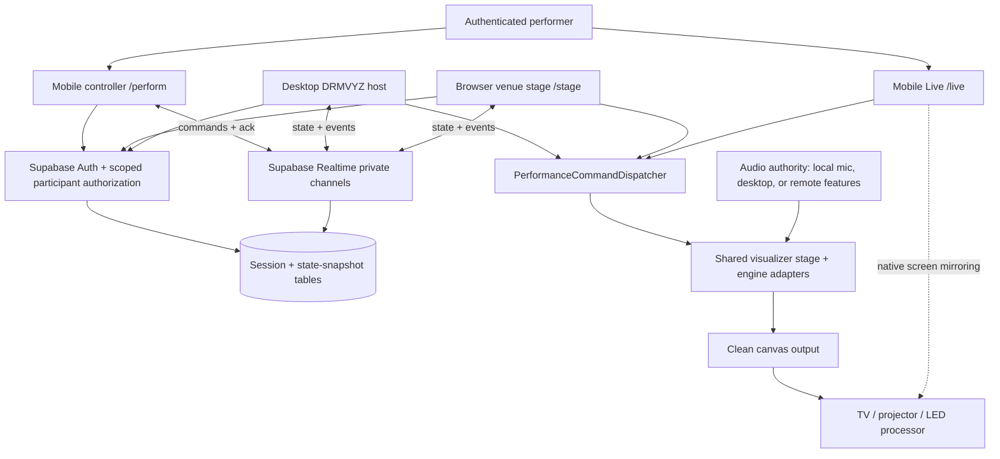
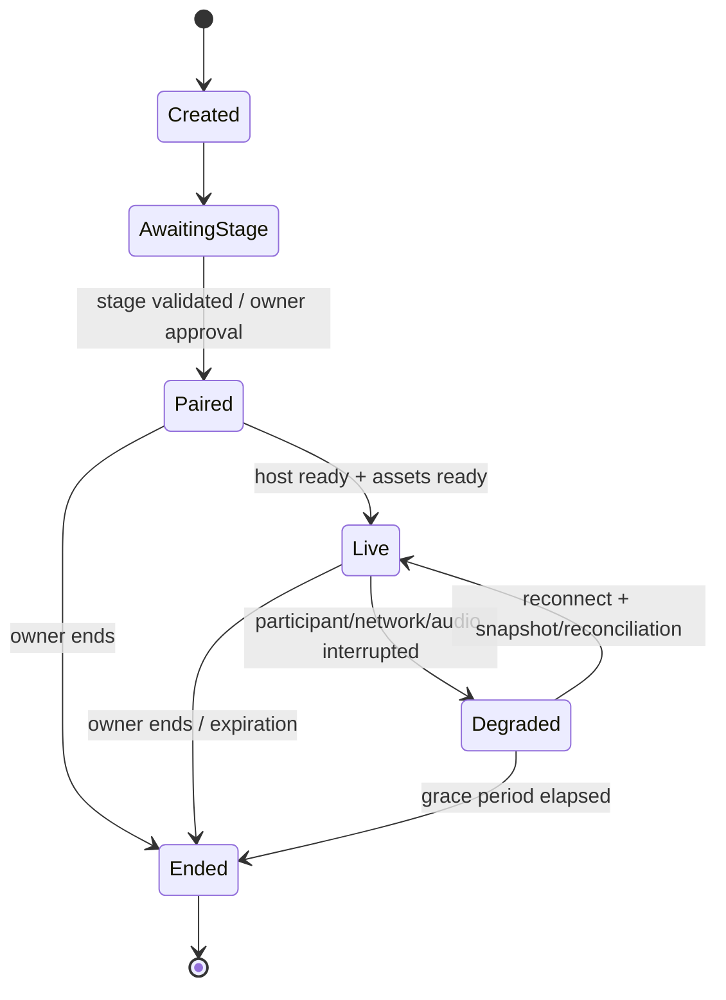

# DRMVYZ Mobile Performance, Browser Stage & Remote Control
## Architecture, Capabilities, Product Design, and Future Implementation Blueprint

**Document type:** Technical architecture and product requirements reference  
**Prepared:** November 12, 2026  
**Project:** DRMVYZ  
**Current public deployment:** `https://drmvyz.vercel.app/`  
**Status:** Proposed design, **not yet implemented**  
**Reference repository:** User-provided `DRMVYZ-main(1).zip` source snapshot  
**Primary objective:** Enable a performer to launch audio-reactive visuals on a phone, display clean visuals on venue screens through a browser or native screen mirroring, and remotely control a DRMVYZ visualizer from a mobile device without opening the full desktop authoring interface.

> **How to use this document later:** Begin with Sections 1–6 for product intent and architecture. Use Sections 7–18 as implementation requirements, Sections 19–22 as release gates and phased delivery, and Section 23 as a new-developer handoff. Before coding, re-check every referenced source path against the then-current repository. This document represents the uploaded November 2026 snapshot and describes **proposals** where stated.

---

## 1. Executive decision

Build **one shared DRMVYZ visualizer runtime**, **one engine-aware performance command system**, and **three purpose-built performance experiences**:

1. **Mobile Live**: The phone runs a clean visualizer stage, analyzes its own live microphone, and uses the operating system's mirroring/casting capability to show the phone's visuals on a TV or projector. No laptop is required.
2. **Browser Stage**: A venue device opens a dedicated visualizer URL, joins a temporary performance room, and renders a clean, fullscreen stage. A separate phone changes presets and controls parameters.
3. **Remote Performance Controller**: DRMVYZ runs on a laptop/desktop as the authoritative visualizer; the user's phone becomes a specialized touch performance deck for switching engines/presets, firing pads, and adjusting permitted engine parameters. Existing desktop output/casting continues to work.

These are **modes of the same DRMVYZ product**, not three independent visualizer forks. Avoid building a second library of visual presets or duplicating Cinema 2.0/CANVAS/LaserDMX/PixGrid runtime logic for mobile.

**Recommended system boundary:**

- **Renderer/host** executes visual engine state changes and produces the pixels.
- **Controller** sends intent and receives acknowledged live state.
- **Performance session** authenticates participants, pairs devices, routes messages, and records a recoverable small snapshot.
- **Audio authority** produces validated audio features for the active rendering host, locally or from an explicitly selected remote device.

---

## 2. User outcomes and use cases

### 2.1 Required outcome A: phone-only visual performance

**Scenario:** A DJ walks into a venue with only a smartphone and uses DRMVYZ to create audio-reactive visuals.

Required behavior:

- Authenticate in the browser on the phone.
- Open `/live` without loading the full Media Manager / Lyric Manager / Show Manager UI.
- Select any **mobile-compatible** engine and supported preset; the product should aim for every selectable engine, with compatibility validated per engine and per device.
- Explicitly grant microphone access and select **Live Input**.
- Analyze live room/music audio and render the corresponding DRMVYZ visuals on the phone.
- Enter a distraction-free, fullscreen-ish stage mode suited to native iOS/Android screen mirroring and orientation changes.
- Recover from loss of microphone permission, phone calls, browser backgrounding, screen lock, and graphics-context loss, with visible status.
- Offer an easy return to compact preset selection without accidentally displaying management UI on the venue screen.

**Critical product limitation:** Typical phone screen mirroring mirrors what the phone displays. If the performer opens a control deck on that same phone, the control deck may also appear on the venue screen. For a permanently clean venue display, use a separate browser stage/device or a second controller. Do not promise independent clean external-display rendering from ordinary mobile browser APIs without device-specific proof.

### 2.2 Required outcome B: code-based venue visualizer

**Scenario:** The venue opens a DRMVYZ stage URL on a browser-equipped TV, laptop, mini-PC, or other display device.

Required behavior:

- The venue browser opens `/stage` and can display a pairing screen or automatically show a previously approved session.
- The authenticated performer creates a session from `/perform`, chooses a stage, and pairs it using an expiring room code and/or QR code.
- Once paired, the venue displays **only the visualizer output**. No authoring rails, manager windows, user profile, or private project lists.
- The active stage displays changes made from the phone, including preset switches, performance actions, and parameter updates.
- A reconnecting stage receives the authoritative state snapshot and resumes safely.
- The performer can revoke/remove an individual stage or terminate the whole performance room.

**Clarification:** The room code is a *pairing credential/locator*, not a replacement for the user's account authentication. A public venue display must not inherit the performer's Supabase login session or general cloud-library privileges.

### 2.3 Required outcome C: phone as live desktop controller

**Scenario:** DRMVYZ is already rendering on a laptop; the performer is behind CDJs and doesn't want to return to the laptop.

Required behavior:

- Sign into DRMVYZ on the phone and open `/perform`.
- Find/approve the active desktop-hosted performance session.
- See the active engine, preset/scene, audio-source status, connected outputs, and connection health.
- Select an engine/preset or a favorite, navigate next/previous, and fire the same configured performance pads that exist on desktop.
- Edit only parameters exposed as safe, real-time performance controls.
- See acknowledged state, toggle/pressed state, and meaningful errors/disabled reasons.
- Continue using existing desktop output paths without replacing them.
- Keep the desktop responsible for rendering and, initially, its own audio source; remote phone-mic-to-desktop audio analysis can be added separately.

### 2.4 Explicitly out of scope for the first release

- Reproducing the full desktop authoring application on mobile.
- Editing Media Manager assets, Lyric Manager metadata, show timelines, shader source, or complex PixGrid/laser rig authoring from the performance deck.
- Guaranteeing identical performance from every desktop preset on all phone GPUs before compatibility testing.
- A cloud GPU streaming service.
- Physical DMX/laser output control from an untrusted web stage.
- Automatic remote performance for multiple DJs with conflicting control ownership.
- A standalone iOS/Android native app; start with an HTTPS browser experience, evaluate installability/PWA later.

---

## 3. Current repository architecture: confirmed integration points

The following is based on inspection of the uploaded source snapshot. **Existing** means the code path exists; it does **not** certify that mobile support, cross-device behavior, or production readiness has been tested.

| Area | Current source path | Observed architecture | Mobile-performance implication |
|---|---|---|---|
| Root app/auth | `src/App.tsx` | Supabase auth gate followed by audio provider and lazy-loaded `VyzualzView`; authenticated startup initializes additional app services | Create route-specific lightweight performance shells; do not mount all full-app services for a stage |
| Main VJ shell | `src/components/vyzualz/react/ReactView.tsx` | Owns stage composition, engine branches, rails, controls, active output canvas, recording/output composition | Extract a reusable clean stage while retaining React View as desktop owner |
| Engine registry | `src/components/vyzualz/react/reactEngineCatalog.ts` | Selectable React engine identities and labels; legacy compatibility identities are separately tracked | Use registry/capabilities, not a hardcoded list or old marketing count |
| React store/presets | `src/stores/reactStore.ts` | Zustand state and engine-aware preset selection/patches | Introduce a command dispatcher over existing actions, not arbitrary remote store writes |
| Cinema 2.0 | `src/components/vyzualz/react/Cinema2Stage.tsx`; `reactStore.ts` `activateCinema2Workspace()` | Dedicated stage and workspace document activation | Dedicated Cinema 2.0 adapter and serializer |
| CANVAS | `src/components/vyzualz/react/canvas/` plus store CANVAS selections | CANVAS-specific media/effects/recipes and persistence | CANVAS adapter must preserve media, recipe, and capture ownership |
| PixGrid | `src/components/vyzualz/react/pixGrid/` | Independent authored/deck workflows and rendering | Stage uses compiled/published artifacts, not full editor/compilation by default |
| Performance pads | `src/components/vyzualz/react/ReactPerformancePads.tsx` | Twenty pads; contextual actions or preset destinations | Reuse actual assignments and behavior metadata in touch UI |
| Action catalog | `src/components/vyzualz/react/ReactPerformanceActions.ts` | Action IDs and one-shot, toggle, momentary behavior/envelopes | Semantic command routing and toggle acknowledgment |
| Microphone | `src/hooks/useAudioEngine.ts` | `getUserMedia`, Web Audio, live-input analysis; microphone audio not sent through program audio output | Reuse locally; add a separate remote-audio-features transport adapter |
| Feature bus | `src/features/musicIntelligence/AudioFeatureBus.ts` | Canonical module-level frame publisher, publisher guard, frame metadata | Provide authenticated remote feature source without competing publishers |
| Music intelligence | `src/features/musicIntelligence/MusicIntelligenceEngine.ts` and `types.ts` | Layered frequency/rhythm/energy analysis, rich audio frame | Distinguish live input from loaded-track structural knowledge |
| Shared performance | `src/features/performanceCore/` | Engine-neutral performance context, engine-owned programs/behavior routing | Never add second global beat grid/section authority for mobile |
| Visual output | `src/components/vyzualz/react/output/OutputCastControl.tsx` | Uses active canvas, browser recording/cast pipelines and desktop bridge | Preserve existing canvas ownership and provide separate browser stage transport |
| Native casting | `src/native/outputBridge.ts`; `native/output/outputCastBridge.cjs` | Electron IPC plus local output/cast services and trusted receivers | Keep desktop provider boundary; do not assume it runs in phone browsers |
| Cloud media | `src/stores/mediaStore.ts`, media services, Supabase migrations | User-owned media and signed-storage access | Resolve portable media for authorized stage without sharing account access |
| Persistence | `src/stores/reactStore.ts` persistence layer | Large authored/project state stored in IndexedDB, plus cloud-backed authored data elsewhere | Logged-in second device cannot assume desktop project state is already available |
| Database | `supabase/migrations/` | Supabase schema and RLS evolution; uploaded snapshot includes migrations through `0046_*` | Add new migration numbers chosen from current repo, not hardcoded future numbers |

### 3.1 Canonical current engine list

At the inspected snapshot, `REACT_ENGINE_IDS` in `reactEngineCatalog.ts` contains **seven selectable identities**:

1. `cinema2` — Cinema 2.0
2. `oscilloscope` — Sound Drawing
3. `xyScope` — Sound Drawing XY
4. `canvas` — CANVAS
5. `laserDmx` — LaserDMX
6. `pixGrid` — PixGrid
7. `headliner` — HEADLINER

The registry also knows the nonselectable compatibility identities `shaderPads`, `cinematicPortal`, and `cinema`. Existing README/documentation may describe a historical six-engine layout or older marketing names. **The implementation must inspect the current selectable registry and test each engine's actual runtime**, rather than assuming older names or counts are authoritative.

### 3.2 Existing preset activation is not uniform

- For certain React presets: `selectReactEngine`, `selectReactPreset`, and `buildPresetPatch` / `buildPresetPatchForState` in `reactStore.ts` resolve related controls/settings.
- Engine switching may perform cleanup/reset. Example: Sound Drawing opens a preset-free state; CANVAS opens its clean playback state; PixGrid editor state can be hidden when leaving the engine.
- Cinema 2.0 uses `activateCinema2Workspace(request)` and its own workspace document.
- CANVAS actions target CANVAS recipe IDs and scene/media behavior.
- Performance-pad destinations can point to legacy-resolved Cinema 2.0 destinations or normal React presets and can carry transition timing.
- Contextual actions have target constraints and action-specific behaviors; triggering an action is **not** the same as selecting a preset.

**Rule:** The mobile client sends a *typed intent*, and the active host executes the existing safe action path. Do not synchronize raw Zustand writes to every device.

### 3.3 Existing audio source behavior

- `useAudioEngine.ts` requests microphone audio through `navigator.mediaDevices.getUserMedia()` with echo cancellation, noise suppression, and automatic gain control disabled.
- Live microphone analysis is active independently of normal file playback; live BPM/features are published through the shared analysis path.
- `AudioFeatureBus` publishes one canonical `MusicIntelligenceFrame` and includes a runtime authoritative-publisher guard.
- The Music Intelligence data frame includes layers that can exceed what a simplified remote audio packet carries. A six-band packet is **not equivalent** to a complete local analysis frame or raw stereo waveform.
- Live room audio does not automatically have reliable loaded-track structural annotations, lyrics, or precomputed phrase/section timing. Mobile effects must respect that distinction.

### 3.4 Existing output boundaries

- The visible stage publishes an output canvas used by recording/casting.
- Desktop output integrates Electron/native services for local displays and network receivers; these are not browser-compatible solely because the UI is React.
- LaserDMX physical Production Output is a separate safety-sensitive path, not interchangeable with visual canvas casting. Only an explicitly trusted host boundary may ever arm physical output.

---

## 4. Proposed system architecture



### 4.1 Roles

| Role | Responsibility | May do | Must not do |
|---|---|---|---|
| **Session owner** | Authenticated account owner | Create/end session; invite/revoke; choose host; authorize controllers | Hand account tokens to venue |
| **Authoritative host** | Desktop or designated browser stage | Execute commands, own current state revision, render pixels, publish acks | Accept unvalidated arbitrary store mutations |
| **Controller** | Phone/tablet performer interface | Read permitted state; request engine, pad, param changes | Read full library or edit authoring state without separate permission |
| **Renderer** | Venue stage/browser display | Render approved scene with narrowly scoped assets | Call private Media Manager APIs with owner credentials |
| **Audio source** | Local host mic/desktop audio or authorized remote phone | Publish authenticated, selected audio features | Publish to inactive session or compete with canonical source |
| **Viewer (optional)** | Monitor-only diagnostics/preview | Observe permitted state | Trigger controls |

One physical device can carry several roles, e.g. `/live` is host + renderer + local audio input, while a desktop performance can be host + renderer and the phone controller-only.

### 4.2 Authoritative-host rule

At any point, one elected renderer/host owns the authoritative revision of the current scene. A phone button press is **requested**, not optimistically assumed executed. The host validates it, applies it, then acknowledges with a new revision or a reason for refusal.

Browser stages that only mirror a desktop stream should not independently activate presets. For independently rendering multiple browser stages, define whether a single browser acts as the session state host and other stages render its authoritative commands or whether a dedicated session coordinator sequences events. Do **not** allow multiple hosts to write divergent state.

### 4.3 Independent renderer versus video stream

| Design | Network payload | Pixel renderer | Advantages | Limitations |
|---|---|---|---|---|
| **Independent browser stage** (default) | Preset/configuration, discrete events, audio features and asset URLs | Browser/venue GPU | No continuous upstream video, lower network load, works without desktop | Browser capability and asset portability matter; simulation may diverge unless synchronized |
| **Desktop video mirror** (later) | WebRTC encoded video frames | Desktop GPU | Same rendered visual result as desktop; venue device only decodes | Signaling, STUN/TURN, bandwidth, encoding latency, relay costs, network diagnostics |
| **Phone screen mirror** (first mobile use case) | OS-controlled screen mirroring | Phone GPU | Simple for quick venues | Control UI can appear on TV; OS/browser limitations; display may disconnect |

**Do not conflate a performance room with a video stream.** Room pairing/synchronization should work independently of which output method is selected.

---

## 5. Proposed routes and application shells

| Route | Purpose | Authentication | UI payload |
|---|---|---|---|
| `/perform` | Mobile performance deck and session manager | Required for owners/controllers | Only performance shell, selected engine metadata, session state |
| `/live` | Standalone audio-reactive phone renderer | Auth required by product decision; could later support limited demo | Clean stage plus compact setup/permissions overlay |
| `/stage` | Venue stage pairing / clean rendering | Scoped receiver identity and approved room membership; should not require owner account on TV | Pairing screen, fullscreen canvas, minimal emergency status |
| `/join` | Deep link/QR pairing | Auth as needed by role | Confirm session and controller/receiver role |
| `/app` or existing root | Full DRMVYZ authoring application | Existing Supabase auth | All current application managers/workspaces |

These are **proposed paths** under `drmvyz.vercel.app` and later the custom domain, not existing deployed features.

### Application-shell split

Create a minimal route bootstrap that decides which modules initialize. Today `App.tsx` authenticates, initializes app services, and mounts full `VyzualzView` under an audio provider after sign-in. Avoid starting unnecessary authoring/persistence/asset compiler services for `/perform` and `/stage`.

Recommended shape:

```text
ApplicationEntry
├── AuthenticationBoundary
├── FullApplicationShell        /app (existing managers, editors)
├── PerformanceControllerShell  /perform
├── MobileLiveShell             /live
├── BrowserStageShell           /stage
└── PairingShell                /join
```

Shared code should be loaded through lazy, role-appropriate chunks. A venue stage may load a selected engine and required assets, but not the full workspace editor. A controller may load parameter schemas and tiny thumbnails, but not the full 3D engine bundle.

### Navigation, responsive design, and screen behavior

- Touch targets approximately 44px or greater for frequent live actions; use deliberate layout testing.
- Make accidental navigation difficult during active performance; confirm destructive/session-ending actions.
- Add wake-lock support only where supported and granted; otherwise explain screen-lock risk.
- Support portrait controller, landscape fullscreen stage, orientation changes, safe-area insets, and tablet sizing.
- Keep performance status visible even when overlays are collapsed.
- Ensure the venue stage can go truly visually clean after pairing and never reveal profile/library details in an error state.

---

## 6. Session lifecycle and Jackbox-style pairing

### 6.1 Session lifecycle



### 6.2 Start a desktop-hosted session

1. Desktop user signs in and chooses **Start Performance Session**.
2. Backend creates session ID, expiry, owner, selected host, and a temporary pairing code.
3. Desktop subscribes to a private session channel and registers capabilities/ready state.
4. Phone signs in via `/perform`; it discovers the owner's active session or enters a code.
5. Host/owner approves the controller when required; backend issues restricted participation rights.
6. Controller receives current performance state, capability catalog, pad assignments, and ack channel.
7. The performer controls desktop visuals; desktop retains its current audio/casting providers.

### 6.3 Start a browser-venue session

1. User opens `/perform`, selects **Create Browser Stage**, and receives a temporary session code/QR.
2. Venue opens `/stage` and enters/accepts the code; the stage uses a scoped receiver identity.
3. Owner verifies/approves the receiver. Venue screen changes from pairing UI to loading/ready UI.
4. Host sends a session snapshot and signed references for only the assets needed by the selected scene.
5. Stage performs capability validation, loads assets, warms the engine, then displays a clean canvas.
6. Phone changes presets/pads/parameters. Renderer applies acknowledged changes in order.

### 6.4 Security requirements for pairing

- Room codes: 6–8 unambiguous random characters; store only a verifier/hash or apply appropriately scoped lookup; short expiry, rotation, one-time/limited-use semantics as applicable.
- Codes must be **rate-limited**, audited for invalid attempts, and not treated as permanent bearer access.
- Server validates every membership grant. Do not accept client-provided `owner_id`, `role`, `host_id`, or signed-URL scope at face value.
- Receiver identity should be restricted to the session, not a login clone of the owner.
- Owners can revoke individual devices, terminate room, and rotate codes.
- Private Realtime channels must be membership-authorized; RLS and channel authorization are complementary controls.
- Remove/expire stale participants and sessions; require new approval on new device identity if the user wants that policy.
- Never put account tokens, Supabase service-role keys, or long-lived asset credentials into stage URLs or QR codes.

---

## 7. Performance command architecture

### 7.1 New boundary: `PerformanceCommandDispatcher`

Build a typed API that sits **above** the existing Zustand actions and engine-specific runtime methods. Remote commands are interpreted on the **host**; the controller must never overwrite the host's store wholesale.

Proposed interfaces (illustrative, not current source):

```ts
type PerformanceCommand =
  | { type: 'engine.select'; engineId: string }
  | { type: 'preset.select'; engineId: string; presetId: string; transitionMs?: number }
  | { type: 'pad.trigger'; padId: string }
  | { type: 'action.trigger'; actionId: string; desiredToggleState?: boolean }
  | { type: 'parameter.set'; engineId: string; path: string; value: number | string | boolean }
  | { type: 'preset.next' | 'preset.previous'; engineId: string }
  | { type: 'output.blackout'; enabled: boolean }
  | { type: 'audio.select'; inputId: string };

interface PerformanceEnvelope {
  protocolVersion: 1;
  sessionId: string;
  commandId: string;         // UUID, idempotency/deduplication
  controllerId: string;
  issuedAtEpochMs: number;
  expectedRevision?: number; // conflict protection when applicable
  command: PerformanceCommand;
}

interface CommandAcknowledgment {
  commandId: string;
  sessionId: string;
  result: 'applied' | 'rejected' | 'expired' | 'unsupported';
  stateRevision: number;
  reasonCode?: string;
  appliedAtEpochMs?: number;
}
```

**Note:** A remote command's `path` must be looked up in a registered allowlist. Never use arbitrary string paths as an unrestricted way to edit store data. Define typed parameter IDs, range clamps, permissions, reset behavior, and engine-specific serialization.

### 7.2 Execution rules

- Validate authenticated, active membership/role on the server and validate command capability again on the host.
- Verify the target engine/preset/action still exists and is active/compatible.
- Check command protocol version, maximum message size, timestamp/TTL, sequence, and session status.
- Deduplicate by `commandId`; retrying a pad must not double-fire an impulse.
- Serialize stateful commands in order at the host; reject or reconcile stale revision preconditions.
- Apply engine-specific actions through existing invariant-preserving methods.
- Publish acknowledgments and a compact new snapshot/delta after accepted changes.
- For high-frequency controls, throttle/coalesce slider updates while retaining an exact final value on release.
- Classify actions as stateful vs ephemeral: late ephemeral hits should expire instead of being replayed after reconnect.

### 7.3 Explicit engine adapters

Proposed adapter pattern:

```ts
interface PerformanceEngineAdapter {
  engineId: string;
  getCapabilities(): EnginePerformanceCapabilities;
  getPublicState(): EnginePerformanceState;
  listPresets(): ReadonlyArray<PerformancePresetDescriptor>;
  listParameters(): ReadonlyArray<ParameterDescriptor>;
  preparePreset(id: string, context: StageContext): Promise<PrepareResult>;
  activatePreset(id: string, options: TransitionOptions): Promise<void>;
  triggerAction(actionId: string, options?: ActionOptions): Promise<void>;
  setParameter(parameterId: string, value: unknown): Promise<void>;
  captureSnapshot(): EngineSnapshot;
  restoreSnapshot(snapshot: EngineSnapshot): Promise<void>;
  teardown(): void;
}
```

Use engine adapters as **wrappers around current app logic**, not as new miniature rendering engines.

| Engine | Special handling to design and test |
|---|---|
| Cinema 2.0 (`cinema2`) | Workspace activation, preset-specific runtime, scene/layer context, 3D/media assets, GPU capabilities, warm-up before reveal |
| Sound Drawing (`oscilloscope`) | Preset-free initial state, waveform/glyph/typography dependencies, reset/trail state, available live microphone features |
| Sound Drawing XY (`xyScope`) | Stereo scope input/geometry, compatible fallback for mono phone mics, preset/scene controls |
| CANVAS (`canvas`) | Recipe selection, active source media, source clip restart, processed canvas capture parity, asset preflight |
| LaserDMX (`laserDmx`) | Virtual visual actions, momentary envelopes, blackout state, explicit physical output isolation and arming rules |
| PixGrid (`pixGrid`) | Prepared/compiled deck assets, scene state, preflight GPU/memory limits, avoid loading full editor by default |
| HEADLINER (`headliner`) | Inspect current stage and state contract; add explicit parameter/preset support and capability proof rather than guessing |

### 7.4 Contextual action and pad semantics

Current code exposes **20 pads** via `ReactPerformancePads.tsx` and contextual actions via `ReactPerformanceActions.ts`.

The action behavior contract distinguishes:

- **`oneShot`**: Apply a single persistent or atomic command, e.g. select CANVAS recipe, LaserDMX reveal.
- **`toggle`**: Change an ongoing on/off state, e.g. freeze/blackout; phone must display the host-acknowledged state and handle exclusivity groups.
- **`momentary`**: Trigger a bounded host-timed event/envelope; a phone tap should generate one event, not a press/release simulation that accidentally extends an effect.
- **Preset pads**: Can route to a preset or engine-specific destination, with `transitionTimeMs` semantics when applicable.

The controller should request the contextual pad layout *from the host*. Pads assigned to an incompatible engine should be disabled with a reason rather than silently firing another engine's action.

### 7.5 Parameter capability registry

Do not copy the enormous desktop Inspector to the phone. Each engine should publish a small list of live-safe controls:

```ts
interface ParameterDescriptor {
  id: string;
  label: string;
  type: 'float' | 'integer' | 'boolean' | 'enum' | 'color';
  min?: number;
  max?: number;
  step?: number;
  options?: Array<{ value: string; label: string }>;
  defaultValue?: number | boolean | string;
  updateMode: 'continuous' | 'onRelease' | 'discrete';
  permission: 'perform' | 'hostOnly';
  supportedEngines?: string[];
  isAvailable(context: PerformanceContext): boolean;
}
```

Suggested shared mobile control categories: **Intensity, Motion, Glow, Bass Response, Trail/Decay, Palette, Variation, Speed, Brightness, Blackout, and engine-specific Quick Controls**. A parameter only appears if the active engine actually supports it. Define whether each control is temporary live override or persisted preset edit; default mobile behavior should avoid silently overwriting the user's authored preset.

---

## 8. Performance state, snapshots, and synchronization

### 8.1 Minimum authoritative state

Store a **small, versioned, portable** runtime snapshot. Do not send all Zustand state or local IndexedDB project records to every participant.

```ts
interface PerformanceStateSnapshotV1 {
  schemaVersion: 1;
  sessionId: string;
  hostId: string;
  revision: number;
  updatedAt: string;
  engineId: string;
  presetId: string | null;
  engineSnapshot: unknown;  // validated, versioned by engine adapter
  activePadId: string | null;
  padAssignments: PerformancePadDescriptor[];
  toggles: Record<string, boolean>;
  liveControls: Record<string, unknown>;
  audioSource: { mode: 'local' | 'remoteFeatures' | 'desktop' | 'demo'; sourceDeviceId?: string };
  output: { blackout: boolean; targetIds: string[] };
  assets: Array<{ assetId: string; version: string; required: boolean }>;
}
```

Treat this as a **shape example**. The implementation should define strict validators per engine and reject unknown/unbounded data. Some preset/scene internals cannot be meaningfully serialized until each engine defines its own portable contract.

### 8.2 State sync design

- **Durable snapshot:** On creation, preset changes, key control commits, and occasional throttled checkpoints, persist session state in Supabase.
- **Realtime event channel:** Send low-latency commands, acks, state deltas, presence, and control/audio status.
- **Host revision:** Monotonically increasing revision assigned by the host or session coordinator; every change declares its base/new revision.
- **Join/reconnect:** Read latest authorized snapshot, fetch needed media, subscribe to realtime, reconcile revisions, then begin output.
- **Conflict policy:** Host authority wins; stale client commands can be rejected or rebased if harmless.
- **Recovery:** On connection loss, retain visual output in a stable state, show status on the controller, do not queue hazardous/expired momentary actions.
- **Optional failover:** Supporting a new host after a desktop failure is a separate complex feature. Require explicit host transfer in MVP.

### 8.3 Clock and deterministic visuals

Simply selecting the same preset on two independent browsers does **not** make them frame-identical. Engines may use random seeds, local frame clocks, GPU differences, or stateful simulations.

For coordinated multi-stage output, define:

- Session monotonic time origin / clock-offset estimate.
- Stable scene seed and event IDs.
- Scheduled execution timestamps where accuracy warrants it.
- Handling of lag, render-frame drops, sleep/resume, context loss, and late-joining receivers.
- Whether exact pixel parity is required or whether synchronized *scene intent* is sufficient.

For first release, require **state/scene parity**, not impossible cross-browser frame-perfect parity. Preserve the existing Shared Performance Core and Music Intelligence authority instead of creating separate device beat grids.

---

## 9. Audio design: local microphone and remote features

### 9.1 Audio modes

| Mode | Captures audio | Analyzes audio | Renders visuals | Initial release? |
|---|---|---|---|---|
| Phone-only Live | Phone microphone | Phone Web Audio / Music Intelligence | Same phone | **Yes** |
| Desktop-controlled | Desktop's current audio source | Desktop | Desktop | **Yes** |
| Venue stage with local microphone | Browser stage device mic, if granted | Stage browser | Stage browser | **Optional / hardware-dependent** |
| Phone mic → browser/desktop host | Phone microphone | Phone, sending remote features | Other device | **Later phase** |
| Remote raw audio over WebRTC | Phone microphone | Rendering host | Other device | **Optional advanced fallback** |

### 9.2 Local phone microphone

Reuse `useAudioEngine` and the canonical `AudioFeatureBus` where practical. On a user gesture:

1. Test media-device API availability under HTTPS.
2. Prompt permission and allow selection of a valid input where browsers expose it.
3. Initialize Web Audio/analysis after permission is granted.
4. Select Live Input while preventing audible feedback/program monitoring as appropriate.
5. Publish one authoritative Music Intelligence frame; ensure the stage doesn't mount a second analysis publisher.
6. Drive the engine's visuals at render-frame cadence.
7. Surface source-active, insufficient signal, permission denied, capture ended, and suspended states.

A native screen-mirroring connection is a device/OS responsibility. The web app may give steps, but should not promise to programmatically invoke every AirPlay/Chromecast receiver from an arbitrary mobile browser.

### 9.3 Remote features transport

For a phone controlling a separately rendering browser stage or desktop, introduce a selected **remote audio feature input**. This is a new transport boundary, not an entirely new Music Intelligence engine.

**Proposed packet** (illustrative):

```ts
interface RemoteAudioFeaturePacketV1 {
  v: 1;
  sessionId: string;
  sourceDeviceId: string;
  seq: number;
  capturedAtEpochMs: number;
  elapsedAudioSec: number;
  features: {
    sub: number; bass: number; lowMid: number; mid: number; high: number; air: number;
    rms: number; peak: number; transient: number;
    beatHit?: boolean; beatPhase?: number;
    bpm?: number | null; bpmConfidence?: number;
  };
  // Optional richer negotiated extension for waveform/FFT/stereo consumers
  spectralPayload?: unknown;
}
```

**Important distinction:** The packet above is **not** a `MusicIntelligenceFrame`. Create a validated adapter that reconstructs a safe, explicitly partial feature frame, resets source history on discontinuity, and advertises unavailable capabilities. Do not invent authoritative sections, lyric progress, or precise bar/downbeat knowledge from unreliable microphone BPM.

Proposed initial transport behavior:

- Publish approximately 10–20 updates/s, adaptive to observed network conditions; interpolate smoothly for visual frames.
- Send sequence numbers, source identity, audio capture timestamp, and TTL.
- Reject stale/out-of-order packets; avoid overbuffering (reactive effects become visibly late).
- Apply publisher ownership so a desktop live mic and remote phone never both claim canonical authority.
- Authorize a single selected audio source per performance room.
- On network loss, decay features smoothly toward safe idle and expose an audio-lost state.
- Keep raw microphone data on the source device unless an explicit, opt-in WebRTC transport is needed.

### 9.4 Raw waveform/stereo needs

Sound Drawing, XY Scope, and other waveform/FFT-dependent effects may require time-domain buffers, true stereo channels, phase data, or richer spectral detail. An energy-band feature packet is insufficient for full parity.

Before implementing remote audio for an engine, document which source features it requires and choose one:

1. **Features-only**: engine can behave correctly with compact features.
2. **Extended spectral transport**: send bounded/quantized waveform/FFT/stereo frames where appropriate.
3. **WebRTC microphone audio**: explicit user permission and consent, decoded/analyzed at the renderer with jitter buffering.
4. **Reduced-capability mode**: disable unavailable portions and tell the user why.

Do not degrade silently while advertising full parity.

### 9.5 Live-input limitations

- Live BPM confidence is not equal to a loaded-track downbeat/phrase map.
- Room noise, phone microphone placement, venue latency, bass-heavy rooms, automatic OS microphone processing, and Bluetooth peripherals can affect reactivity.
- Mobile browsers may suspend capture and `requestAnimationFrame` when backgrounded/locked.
- Mic capture should not feed amplified venue output unless the performer deliberately enables a well-tested monitoring path, because feedback is a real risk.

---

## 10. Visualizer stage extraction and rendering architecture

### 10.1 Extract the clean stage

Today `ReactView.tsx` couples the stage to authoring rails and page-level state. Introduce a `VisualizerStage` component that can be composed inside desktop React View, browser stage, and Mobile Live.

**Proposed component contract:**

```ts
interface VisualizerStageProps {
  mode: 'desktop' | 'browserStage' | 'mobileLive';
  engineId: string;
  sessionContext?: PerformanceSessionContext;
  onOutputCanvasChanged?: (canvas: HTMLCanvasElement | null) => void;
  onCapabilityChanged?: (capabilities: StageCapabilities) => void;
  onRuntimeError?: (error: StageRuntimeError) => void;
  qualityPolicy?: StageQualityPolicy;
}
```

**Avoid:** lifting only the bare `<canvas>` tag while leaving hidden dependencies on desktop panels, browser `localStorage` authoring data, or `ReactView`-specific effects. Extract runtime ownership and dependencies with tests.

### 10.2 Stable canvas ownership

- Exactly one current **program-output canvas** is authoritative for a stage.
- The output target updates explicitly when switching engines; old canvases are detached.
- Preview/editor/thumbnail canvases may never silently replace the program output.
- A fallback screen must not accidentally broadcast private data or editor elements.
- During engine warm-up, hold the previous valid visual or render a deliberate branded transition/blackout; never flash editors or broken resources.
- When rendering fails, keep a safe visual fallback and expose failure to controller.
- Preserve existing recording/output ownership rules and engine-specific processed-output parity.

### 10.3 Engine capability negotiation

Each stage should report capabilities to the host/controller:

```ts
interface StageCapabilities {
  renderBackends: Array<'webgl2' | 'canvas2d' | 'webgpu'>;
  maxTextureSize?: number;
  deviceMemoryGb?: number;
  cpuConcurrency?: number;
  preferredFps: 30 | 60;
  selectedQualityTier: 'low' | 'balanced' | 'high';
  supportedEngineIds: string[];
  unavailableReasons: Record<string, string>;
  microphone: 'available' | 'permissionRequired' | 'unavailable';
  fullscreen: boolean;
  wakeLock: boolean;
}
```

Capabilities must be *measured/feature-tested*. Do not equate User-Agent with reliable support. WebGPU is listed only as a future optional backend; do not imply current engines require or implement it.

### 10.4 Rendering quality and thermal safety

Proposed initial *performance budgets* to validate, not guarantees:

- Phone: start 30 FPS, balanced or low GPU density, auto-adjust render resolution and effect density, optionally 60 FPS on validated devices.
- Venue desktop/mini-PC: target 60 FPS where capable.
- Prefer 16:9 clean output for televisions, with cover/contain/letterbox modes and explicit overscan/aspect controls.
- Monitor dropped frames, long frames, context loss, texture allocations, and asset load times.
- Throttle/skip nonessential expensive computations rather than letting the phone thermally throttle without warning.
- Support low-power mode and FPS limiter on phone.
- Test extended 60–120 minute sessions on target hardware; product launch requires evidence, not only a few seconds of a working render.

---

## 11. Media, presets, library portability, and offline dependencies

### 11.1 Why cross-device media is a separate project concern

Some authored/project state exists in the desktop's IndexedDB persistence, while other data and media live in Supabase. A login on another device does not magically recreate every local authored canvas/media state. A stage must be able to fetch a **portable, versioned performance bundle** containing only the active scene's requirements.

### 11.2 Proposed portable performance bundle

```ts
interface PortablePerformanceBundleV1 {
  schemaVersion: 1;
  engineId: string;
  presetId: string | null;
  engineDocument: unknown;         // adapter-specific validated snapshot
  assetManifest: Array<{
    id: string;
    kind: 'image' | 'video' | 'svg' | 'font' | 'model' | 'other';
    checksum?: string;
    required: boolean;
    byteSize?: number;
  }>;
  brandOverrides?: unknown;        // only relevant, allowed authored visuals
  compatibility: {
    minRuntimeVersion: string;
    requiredCapabilities: string[];
  };
}
```

Asset resolution rules:

- Keep assets in user-owned cloud storage, not device-local path references.
- Publish asset IDs and version/checksum in snapshot; grant receiver only time-limited access to approved assets.
- Resolve through a backend-controlled asset capability flow; do not expose arbitrary private media bucket reads to anonymous receiver.
- Preflight missing assets, codec support, CORS, texture size, and memory before switching scenes.
- Preload likely next/previous presets within clear memory limits.
- Support recovery when a signed URL expires during a long performance.
- Protect SVG/font/model payloads and avoid treating untrusted content as executable script.

### 11.3 Preset switching and continuity

- **Stage prepare:** validate preset, fetch required assets, initialize engine, report ready.
- **Host commit:** execute switch at a well-defined state revision; preserve relevant transition duration.
- **Acknowledge:** controller shows actual active state only after host confirms success.
- **Fallback:** if media or GPU requirements fail, retain previous viable scene or execute deliberate safe blackout.
- **Mid-performance edits:** mobile controls are overrides unless explicitly saved from a separate authoring workflow.

---

## 12. Existing casting integration versus new browser casting

### 12.1 Retain existing desktop casting

Electron desktop output already has native provider boundaries and network receiver behavior. This project should integrate with it at the **active canvas/session state level** instead of rewriting supported AirPlay/Miracast/local receiver flows.

Existing reference paths:

- `src/components/vyzualz/react/output/OutputCastControl.tsx`
- `src/native/outputBridge.ts`
- `native/output/outputCastBridge.cjs`
- `src/components/vyzualz/react/ReactView.tsx`
- `docs/react-recording-and-output.md`

### 12.2 Phone-native screen mirror

The phone produces pixels and the operating system mirrors its display. The product may provide platform-specific guidance, active-orientation indicator, and status, but ordinary browser code cannot guarantee full control of native system casting on arbitrary devices.

Supported path must be validated against:

- iOS Safari with AirPlay-capable TV / Apple TV when available.
- Android Chrome/device-specific Screen Cast / Smart View / Google Cast mirroring.
- Wired adapters or venue HDMI capture as robust fallback.

**Avoid claiming** that every TV, codec, browser, network, or operating system allows native casting or keeps screen mirroring active when switching tabs/apps.

### 12.3 Browser stage as preferred clean-output option

When the venue can open a web page, `/stage` avoids mirroring phone controls. The stage renders from the shared engine runtime and can use the phone only as a controller/audio input. This is the recommended professional venue experience.

### 12.4 Future desktop-to-browser video relay

If exact desktop imagery is needed on a low-powered stage receiver:

- Reuse the canonical program-output canvas and capture pipeline.
- Add internet-safe signaling and WebRTC peer connection management.
- Use STUN/TURN infrastructure as needed for real-world NAT/firewall traversal.
- Protect stream session with time-limited tokens and explicit stage approval.
- Establish resolution/framerate/bitrate adaptation, connection quality, and fallback screen.
- Keep audio and video policies separate; avoid accidental raw microphone distribution.
- Budget TURN egress and investigate provider costs before turning on by default.

Do not assume the existing LAN-oriented receiver protocol already covers arbitrary remote networks.

---

## 13. Frontend UX design: dedicated performance interface

### 13.1 Design principles

- **Play-first** rather than edit-first.
- Fast recognition of active engine/preset and connection.
- Large controls for hands-on performance under dim lighting.
- No data grids, metadata editing, project management, or complicated settings in the active deck.
- Clear host acknowledgments; distinguish pending, applied, rejected, disconnected.
- Safe/sensible behavior under accidental touches and network jitter.
- Maintain DRMVYZ visual language and shared typography where appropriate, without forcing desktop rail density onto a phone.

### 13.2 Mobile controller information hierarchy

Top header:

- DRMVYZ / PERFORM.
- Session name/code (mask or copy only when useful).
- Live connection, host/audio/render status, stage count.
- Quick blackout as an intentional, guarded action if supported by host.

Main tabs (suggested):

| Tab | UI | Functions |
|---|---|---|
| **Presets** | Engine picker, current preset, favorites, search, previous/next | Stage-compatible preset selection and preloading |
| **Pads** | Contextual 4x5 or configurable compact 4x3 grid | Existing 20 pads, trigger/toggle state, color and labels |
| **Controls** | 4–8 fast-touch sliders/toggles; optional advanced page | Whitelisted live controls appropriate to active engine |
| **Output** | Host, stage connection, audio source, stage status, quality, fullscreen instructions | Session and output management; no hidden authoring features |

The performer should be able to **pin one tab** as the default live view and use favorite/quick actions without deep navigation.

### 13.3 Preset UI behavior

- Display actual host-provided list filtered by available engines/capabilities and user access.
- Show preset name, engine, optional thumbnail, compatibility reason, and preloaded/ready state.
- Tap preset → pending indicator → host acknowledgement → active marker.
- Keep previous scene visible if switching fails.
- Provide favorite presets and a recently used row; user-specific preferences can be saved separately from authored presets.

### 13.4 Performance-pad UI behavior

- Use authoritative pad IDs/assignments and `ReactPerformanceActions` metadata.
- One-shot and momentary actions respond to tap with transient confirmation.
- Toggle actions show actual host state, not just local button-press styling.
- Exclusive toggle groups reflect host's resolved winner.
- Disabled pads display why: unsupported engine, unavailable fixture/media, missing host rights, physical output not armed.
- Support haptic feedback only when available and not distracting.
- Always make accidental pad double-fire protections explicit at transport level.

### 13.5 Stage UI behavior

- Pairing mode: brand, short code/QR, device readiness test, help URL.
- Loading mode: asset/preflight state, not sensitive filenames.
- Live mode: **pure stage visuals**, optional small status overlay that times out and is remotely dismissible.
- Offline mode: maintain last safe frame or intentional logo/blackout; do not render management UI.
- Diagnostics mode: FPS, renderer backend, memory pressure, packet age, mic/capability status, with authorized opt-in display only.

### 13.6 Session management UX

- Create session, join active session, pair device, approve/reject, disconnect device, end session.
- QR pairing for convenience and manual code for fallback.
- Show **which device is the host** and whether the phone is controlling locally or remotely.
- Explain when phone controls will be mirrored to venue screen.
- Remember only non-sensitive display preferences and user-selected controller layout between sessions.

---

## 14. Supabase data and authorization design

**Use the existing Supabase project.** Proposed schema below is a conceptual specification. Do not paste it into production as-is; first compare against the current schema, ownership model, and migration patterns.

### 14.1 Proposed database entities

#### `performance_sessions`

Fields:

- `id uuid primary key`
- `owner_user_id uuid not null`
- `status` (`created`, `awaiting_stage`, `paired`, `live`, `degraded`, `ended`)
- `host_participant_id uuid nullable`
- `room_code_verifier` (hashed code / otherwise protected lookup)
- `room_code_expires_at timestamptz`
- `expires_at timestamptz`
- `created_at`, `updated_at`, `ended_at`
- Optional session display name, mode, protocol version

#### `performance_participants`

Fields:

- `id uuid primary key`
- `session_id uuid references performance_sessions(id)`
- `auth_user_id uuid nullable` (receiver may use a scoped auth identity)
- `device_label text` (sanitized)
- `role` (`owner`, `host`, `controller`, `renderer`, `viewer`, `audio_source` as suitable)
- `status` (`pending`, `approved`, `revoked`, `disconnected`)
- `capabilities jsonb` (validated, bounded)
- `joined_at`, `last_seen_at`, `revoked_at`

#### `performance_state_snapshots`

Fields:

- `session_id uuid`
- `revision bigint`
- `schema_version integer`
- `snapshot jsonb` (validated and size-limited)
- `created_at`

Index latest snapshot by session/revision. Retention should be limited: active + short recovery window, with pruning.

#### `performance_device_profiles` (optional)

- Account-owned saved preferred layout, pad bank arrangement, quality preference, favorite engines, and last connected device label.

#### `performance_command_audit` (optional limited retention)

- Metadata for critical transitions/authorization diagnostics: command ID, action type, source participant, host, result, timestamps, and reason code. **Do not** log raw microphone frames or full private media payloads.

### 14.2 Realtime channels

Suggested conceptual topics (exact syntax depends on Supabase client/server implementation):

```text
private:performance:<session-id>:control
private:performance:<session-id>:state
private:performance:<session-id>:presence
private:performance:<session-id>:audio
```

Messages may include:

- `command.request`
- `command.ack`
- `state.snapshot`
- `state.delta`
- `participant.joined` / `.left`
- `host.heartbeat`
- `stage.capability`
- `audio.features`
- `session.ended`

Authorization requirements:

- RLS prevents reading or writing sessions/participants not owned or approved.
- Realtime channel authorization enforces the same membership and role restrictions.
- A receiver cannot simply subscribe to a private channel by guessing a UUID or code.
- Rate limits and message-size caps apply; remote audio especially needs backpressure handling.
- Sensitive operations (membership grant, code redemption, role changes, asset grants) go through validated RPC/Edge Function/server endpoints rather than trusting direct client writes.
- Revoke participants immediately; do not rely solely on code expiry after channel admission.

### 14.3 Backend composition

Use:

- **Vercel**: static/client bundles and narrow server endpoints if needed.
- **Supabase Auth**: user authentication.
- **Supabase Database/RLS**: sessions, participants, snapshots, device preferences.
- **Supabase Realtime**: control and state transport (with feasibility benchmarking for remote audio throughput).
- **Supabase Storage / signed URLs**: narrowly scoped asset delivery.
- **Supabase Edge Functions or other trusted backend**: code redemption, privileged token issuance, asset grants, rate-limit enforcement where needed.

Avoid adding a permanent custom websocket server for MVP unless measured requirements justify it. Do not stream raw video through Supabase Realtime.

---

## 15. Security, privacy, and safety requirements

### 15.1 Core threat model

Threats include unauthorized room joining, code brute forcing, stale stolen room links, malicious parameter payloads, replayed pad events, private media exposure, unauthorized physical output, cross-account state leakage, leaked signed URLs, and resource-exhaustion attacks against a stage.

Required controls:

1. Owner-only session creation/termination and device revocation.
2. Short-lived room code with rate limits and bounded attempts.
3. Explicit role/membership model and authorization at every backend action and subscribed channel.
4. Strict runtime type validation, engine allowlists, parameter clamps, payload size limits, and content restrictions.
5. Deduplication/replay and timestamp protection on commands.
6. Scoped, expiring asset grants; no service-role secrets or owner JWTs in receiver.
7. Per-session active host/audio publisher selection, with no competing authorities.
8. Private stage fallback that never displays account data when sessions fail.
9. No indefinite raw microphone recording/storage; clear disclosure if opting into remote audio transmission.
10. Complete separation of virtual laser/lighting visuals and armed physical output; host-side interlocks must remain authoritative.

### 15.2 Physical laser/DMX boundary

For MVP, expose only **virtual visual behavior** from remote stages/controllers. If future physical output controls are added:

- Only a trusted, local host can arm hardware transmission.
- Arming requires an explicit local action and a verified active device/output configuration.
- Enforce emergency stop/blackout and safe defaults on disconnection.
- Every remote action passes through safety clamps and allowed fixture groups.
- Never give a public room code or browser stage direct permission to transmit Art-Net/sACN or arbitrary DMX data.

### 15.3 Account and session logout

- Logging out of a controller removes its authorization, even if the stage remains active under the owner's separate approved receiver identity.
- Logging out of the desktop host should end/transfer session under a defined policy; do not leave orphaned remote control authority.
- Ending a performance revokes participant grants and asset capabilities and invalidates future commands.

---

## 16. Proposed code layout and ownership

```text
src/
  app/
    routes/
      FullAppRoute.tsx
      PerformRoute.tsx
      MobileLiveRoute.tsx
      StageRoute.tsx
      JoinRoute.tsx
  features/
    performanceSession/
      domain/
        sessionTypes.ts
        commandTypes.ts
        stateSchema.ts
        capabilityTypes.ts
      host/
        PerformanceCommandDispatcher.ts
        PerformanceHostRuntime.ts
        PerformanceStatePublisher.ts
      engines/
        PerformanceEngineAdapter.ts
        Cinema2Adapter.ts
        SoundDrawingAdapter.ts
        SoundDrawingXyAdapter.ts
        CanvasAdapter.ts
        LaserDmxAdapter.ts
        PixGridAdapter.ts
        HeadlinerAdapter.ts
      realtime/
        PerformanceSessionService.ts
        PerformanceRealtimeTransport.ts
        PerformancePresence.ts
        PerformanceReconciliation.ts
      audio/
        PerformanceAudioInput.ts
        LocalMicrophoneInput.ts
        RemoteFeatureSender.ts
        RemoteFeatureReceiver.ts
      media/
        PerformanceAssetManifest.ts
        PerformanceAssetResolver.ts
        PerformanceScenePreflight.ts
      ui/
        MobilePerformanceApp.tsx
        MobilePresetBrowser.tsx
        MobilePerformancePads.tsx
        MobileQuickControls.tsx
        PairingScreen.tsx
        ConnectionStatus.tsx
  components/vyzualz/react/
    stage/
      VisualizerStage.tsx
      StageOutputCanvas.tsx
      StageCapabilityCheck.ts
      StageQualityManager.ts
supabase/migrations/
  <next>_performance_sessions.sql
  <next>_performance_participants.sql
  <next>_performance_snapshots.sql
```

**Do not treat these as mandatory final filenames.** Use existing repository naming and module boundaries. The important requirement is separation of domain types, host execution, engine adapters, audio transport, realtime session transport, stage rendering, and touch UI.

### Integration priorities

1. The **host dispatcher** invokes the existing `reactStore` actions and other real engine APIs.
2. The **stage** reuses visual rendering rather than importing the full desktop authoring component tree.
3. The **controller** consumes capability metadata and snapshots but does not need a WebGL renderer.
4. The **audio adapter** feeds Music Intelligence through one authoritative publisher and respects Shared Performance Core.
5. The **cloud layer** owns identity/membership; the rendering host owns actual live scene execution.

### Engineering repository rules

Before editing code, read:

- `AGENTS.md`
- `AI_IMPLEMENTATION_CONTRACT.md`
- `docs/documentation-index.md`
- `docs/react-view-architecture.md`
- `docs/shared-performance-core.md`
- `docs/music-intelligence.md`
- `docs/react-recording-and-output.md`

Follow existing repository change/testing standards. Avoid large refactors unrelated to extracting the stage/runtime boundary.

---

## 17. Protocol reliability and failure behavior

### 17.1 Connection states

`idle → connecting → authorizing → syncing → ready → degraded/reconnecting → ended`.

The phone must not show a green **Live** state merely because the WebSocket connection exists. Require recent host heartbeat **and** successful command capability/state sync.

### 17.2 Command reliability patterns

| Operation | Semantics | Retry strategy |
|---|---|---|
| Preset selection | Stateful and revisioned | Safe to retry with same command ID; host deduplicates |
| Param slider | Latest-value-wins in burst | Throttle intermediate values, commit final exact value |
| Toggle | Explicit desired state | Send `desiredToggleState` rather than blind invert where possible |
| Momentary pad | Ephemeral event | Short TTL, deduplicate, do not replay after reconnect |
| Blackout | Safety-critical state request | Host-confirmed and persists in snapshot; explicit recovery policy |
| Session end | Revocation | Privileged backend action; send terminal state |

### 17.3 Failure/fallback behavior

| Failure | Controller behavior | Stage/host behavior |
|---|---|---|
| Controller disconnects | Show reconnect notice | Keep rendering current safe scene |
| Host disconnects | Mark commands unavailable; no false success | Stage holds last valid safe output or falls back to safe screen |
| Mic permission denied | Show setup/error guidance | Demo/local fallback only on explicit user choice |
| Remote audio packet loss | Audio status degraded | Smooth decay toward safe idle; no fabricated beats |
| Preset asset missing | Reject with reason | Preserve previous valid scene |
| WebGL context lost | Show renderer status | Attempt bounded recovery; use safe fallback |
| Pairing code expires | Ask for new code | Do not enroll new participant |
| Stage revoked | Show removed/disconnected | Clear authorization and stop accessing protected assets |
| Host changes engine | Update engine/pad/param UI | Publish new capabilities and state revision |

### 17.4 Recovery and observational data

Collect *opt-in technical telemetry* with short retention and no raw media: connection setup duration, command round-trip percentile, rejected command reason, stage FPS/dropped frames, asset preflight failures, and audio packet age. Make diagnostics easy to export for bug reports, without exposing private project content.

---

## 18. Feature/capability matrix and prioritization

Legend: **MVP** = required before general release, **P2** = later, **Investigate** = needs engine/device proof.

| Capability | Mobile Live | Browser Stage | Phone controls desktop |
|---|---|---|---|
| Sign in to own account | MVP | Receiver uses scoped identity | MVP |
| Clean fullscreen visuals | MVP | MVP | Desktop already provides clean output paths |
| Engine selection | MVP where compatible | MVP where compatible | MVP |
| Preset selection | MVP where compatible | MVP where compatible | MVP |
| Existing performance pads | P2 if same phone mirrors UI | MVP with separate controller | MVP |
| Allowed quick parameters | MVP overlay (mirrors on TV) | MVP via separate controller | MVP |
| Local mic reactivity | MVP | P2 based on hardware | Existing desktop audio source remains MVP |
| Phone-mic remote feature feed | Not needed | P2 | P2 |
| Code/QR pairing | Optional when standalone | MVP | MVP |
| Authorized stage asset delivery | If cloud-owned assets used | MVP | Existing desktop path initially |
| Multiple stage outputs | P2 | P2 | Existing desktop output providers may cover local use cases |
| Video streaming from desktop | Not applicable | P2 advanced mode | P2 advanced mode |
| Native OS screen mirroring | External OS feature | Not needed | Existing desktop output remains separate |
| Offline mode | Investigate per asset/session design | Out of scope MVP | Desktop runtime only |
| Physical lighting/laser arming | Not from mobile | Never from generic stage | Trusted local host only; separate future work |

**Definition of “supports any engine”:** Product aim is every current selectable engine, but release eligibility is established by an explicit per-engine/per-device compatibility test. Unsupported engines are visible as disabled with explanations until verified. Do not ship an untested “all engines supported” claim.

---

## 19. Phased delivery roadmap

### Phase 0 — Repository and capability audit

**Goal:** Prove actual current state before moving code.

Work:

- Revalidate current `reactEngineCatalog.ts`, `ReactView` rendering branches, action IDs, audio path, and output-canvas ownership against latest main branch.
- Create a capability map for each engine: stage dependencies, WebGL2 needs, media requirements, audio features, portable state, and minimum browser targets.
- Inventory what is cloud-resolved vs locally persisted in IndexedDB.
- Confirm how auth and Vercel routing are configured today.
- Establish benchmark devices and a mobile matrix.

Deliverables: architecture inventory, engine/feature support matrix, baseline desktop regression suite, written ADRs (architecture decisions).

Exit gate: stage extraction plan approved with exact owner boundaries and no unverified assumptions.

### Phase 1 — Shared clean stage

**Goal:** One visual renderer used by desktop and stage-specific shells.

Work:

- Extract `VisualizerStage` from `ReactView` safely.
- Maintain current desktop output/recording and engine switching.
- Add minimal browser-stage test route with static local presets and no remote session yet.
- Add capability checks and safe fallback rendering.
- Add per-engine stage mount/switch/unmount tests.

Exit gate: desktop behavior unchanged; browser clean stage renders representative presets without loading full managers.

### Phase 2 — Standalone Mobile Live

**Goal:** Phone-only mic-reactive visuals.

Work:

- Add `/live` shell and login flow.
- Integrate microphone permissions and canonical local audio feature bus.
- Add engine/preset selector, minimal stage controls, portrait/landscape support, and quality tiers.
- Validate actual screen mirroring on iPhone and Android devices.
- Record support limitations per engine; prioritize high-confidence engines first.

Exit gate: at least the initial supported set runs a sustained live session on tested phones, with controlled permission/recovery behavior and clean stage display.

### Phase 3 — Secure sessions and browser-stage pairing

**Goal:** Jackbox-style room creation/join and remote state sync.

Work:

- Add session, participant, and snapshot migrations with RLS.
- Implement scoped role creation/code redemption/approval through trusted backend.
- Add Supabase private realtime control, presence, acknowledgments, and revocation.
- Build `/stage` pairing UI, QR support, state hydration, and fullscreen mode.
- Test connection recovery and stage isolation across accounts.

Exit gate: a signed-in phone pairs and controls a separate browser stage securely without any authoring UI.

### Phase 4 — Desktop-hosted mobile controller

**Goal:** Full performance control without returning to laptop.

Work:

- Implement dispatcher/engine adapters and host service.
- Reuse current 20-pad assignments, action behaviors, transition timing, and toggle state.
- Add mobile presets, pads, quick parameters, output/session status UI.
- Add revision-based snapshots, command deduplication, and acknowledgments.
- Integrate desktop as authoritative host without altering native casting providers.

Exit gate: every exposed mobile action has a matching validated desktop action with observable correct results; no silent failure or regression in desktop use.

### Phase 5 — Portable scenes and remote microphone

**Goal:** Rich browser-stage content and phone-mic-controlled remote stage.

Work:

- Implement portable engine snapshots and scoped asset manifest/URLs.
- Preload/validate media and scene dependencies.
- Build remote feature sender/receiver with explicit source selection.
- Add extended FFT/waveform/stereo transport or labeled reduced support where required.
- Confirm transitions, timing reset behavior, and reconnect outcomes.

Exit gate: cloud scenes restore correctly on another device, audio source selection is authoritative, and degraded network conditions fail visibly and safely.

### Phase 6 — Hardening and public release

**Goal:** Reliable performance in a real venue.

Work:

- Test iOS/Android browsers, venue TVs/mini-PC browsers, macOS/Windows desktop, WebGL context loss, background/lock/permission interrupts, LAN/Internet latency, asset reload, signed-URL expiry, and security abuse cases.
- Run extended set-length stress tests.
- Tune GPU quality, bundle sizes, asset memory, command latency, and remote feature jitter.
- Add metrics/diagnostics, help text, pairing support, and staged feature flags.

Exit gate: compatibility and reliability targets are met on defined supported hardware; no high-severity auth/security/output regressions.

### Optional Phase 7 — Advanced broadcast capabilities

- WebRTC desktop-pixel streaming to remote browser stage.
- Shared multi-stage synchronization/host transfer.
- Guest VJ control roles and time-limited collaborator permissions.
- Saved stage/controller profiles and preset banks.
- Advanced external display workflows after hardware feasibility proof.

---

## 20. Validation plan and acceptance tests

### 20.1 Functional acceptance

- [ ] `/perform` opens without loading full manager/editor UI.
- [ ] `/live` opens clean stage and requests mic only on explicit user action.
- [ ] Phone microphone features drive a supported engine/preset in live mode.
- [ ] Local microphone capture does not leak into output audio unexpectedly.
- [ ] Room pairing requires authorized session membership and expires appropriately.
- [ ] Browser `/stage` renders only approved visual output and never exposes owner managers.
- [ ] Controller can select every *compatible* current engine and corresponding preset.
- [ ] Controller triggers all supported contextual pads with correct host semantics.
- [ ] Toggle state remains accurate across multiple controllers/reconnections.
- [ ] Preset transitions preserve existing engine-specific activation and reset behavior.
- [ ] Parameter changes are allowlisted, clamped, acknowledged, and non-destructive to authored presets.
- [ ] Desktop casting and recording work as before stage extraction.
- [ ] Host/receiver can lose network and recover to a correct, safe state.
- [ ] Unsupported engine/device combinations give clear reasons rather than crashes.
- [ ] No remote room code or receiver can arm physical outputs.

### 20.2 Engine tests

For each of `cinema2`, `oscilloscope`, `xyScope`, `canvas`, `laserDmx`, `pixGrid`, `headliner`:

1. Load a representative first-party preset and a user-authored preset where applicable.
2. Switch into and out of the engine; check reset/cleanup and output-canvas ownership.
3. Test available audio features under local file, live mic, and remote-feature modes as supported.
4. Test one shot, toggle, momentary, and preset transition where applicable.
5. Test asset preload, error fallback, and reload of saved snapshot.
6. Test unsupported capability handling and runtime teardown/recovery.
7. Verify recording/casting captures the visible processed result, not a stale/dry/editor canvas.

### 20.3 Cross-browser/device matrix

Suggested baseline (actual supported versions to be established during implementation):

- iPhone Safari, recent and older supported hardware.
- Android Chrome on at least one current/high-end and one mid-range device.
- macOS Chrome/Safari desktop browser stage.
- Windows Chrome/Edge venue browser stage.
- Low-powered mini-PC/Android TV browser where practical.
- Existing macOS and Windows Electron desktops.

Test portrait, landscape, permission acceptance/denial, background/foreground, lock/unlock, thermal load, screen-mirror disconnect/reconnect, and long-running sessions.

### 20.4 Network and security tests

- Attempt to join with invalid, expired, reused, and rate-limited codes.
- Attempt to subscribe to another owner's room channel.
- Revoke controller while it is connected; verify immediate command rejection.
- Replay duplicate pad command; verify one execution.
- Send stale/out-of-order slider state, invalid engine ID, unknown path, huge payload, malformed schema; verify host safe rejection.
- Disconnect at precisely preset preparation/commit; verify no corruption and clear active state.
- Kill/suspend audio input and restart; verify canonical publisher reset and no stale beat events.
- Attempt receiver asset read without authorization; verify denied.
- Verify no service role key, owner auth JWT, or private media URL is exposed in room QR/code URLs.

### 20.5 Proposed measurable service targets

These are **design targets requiring measurement**, not assurances:

| Metric | Initial target |
|---|---|
| Typical responsive pad/command acknowledgment | p50 below ~150 ms on good local/regional networks; track p95 separately |
| Reconnection recovery | Automatically resync snapshots after temporary interruption, no duplicate impulses |
| Mobile stage frame rate | 30 FPS default on validated devices with adaptive quality |
| Desktop/venue stage | 60 FPS where hardware supports it |
| Scene switch | No unintended manager flash, stale canvas, or unhandled crash |
| Extended live set | 60–120 minutes on representative supported hardware without progressive leak |
| Authorization | Zero unauthorized participant/control/asset accesses in adversarial tests |

Tune actual SLOs after a prototype and real-world measurement. Avoid promising ultra-low-latency performance over uncontrolled venue Wi-Fi.

---

## 21. Risks, trade-offs, and mitigations

| Risk | Why it matters | Mitigation |
|---|---|---|
| Monolithic React View coupling | Stage extraction can break hidden editor/runtime dependencies | Incremental extraction with desktop regression tests |
| Seven engines with disparate state paths | Simple preset-ID write is insufficient | Per-engine adapter and validated capability metadata |
| Browser graphics variance | Large Canvas/PixGrid/Cinema scenes may exceed phone GPU limits | Device capability negotiation, preflight, adaptive quality |
| Private/local project data | Second device cannot read desktop IndexedDB | Portable scene bundle plus asset manifest and grants |
| Mobile browser lifecycle | Background/lock can suspend audio and rendering | Active-stage guidance, wake lock when available, explicit recovery |
| Mirroring control screen | User sees mobile UI on TV | Separate browser stage + controller device |
| Live audio structural uncertainty | BPM does not imply reliable phrases/downbeats/sections | Respect shared authority/confidence; no fake loaded-track context |
| Network jitter | Pads/sliders feel delayed and remote feature response drifts | Ack, TTL, throttling, local interpolation, diagnostics |
| Room-code abuse | Unauthorized audience control or data access | Short-lived codes, RLS, rate limit, owner approval |
| Multiple hosts | Conflicting presets/state | Single host authority and revision model |
| WebRTC streaming expense | TURN/relay bandwidth and operational complexity | Independent renderer first; streaming optional later |
| Stage media/codec incompatibility | Scene can be visually incomplete | Asset preflight and preserved previous scene |
| Physical laser/lighting safety | Remote browser actions must not affect hardware unsafely | Virtual-only MVP, trusted local arming and interlocks |

---

## 22. Architecture decisions to preserve for later

### Decisions recommended now

- **D-01**: Three performance modes within one application.
- **D-02**: One shared renderer/runtime; extract a clean stage from desktop shell.
- **D-03**: Engine-specific command adapters invoke existing state/action contracts.
- **D-04**: Active host is authoritative; controller sends intent and receives acknowledgment.
- **D-05**: Supabase Auth + scoped private Realtime + database snapshots for MVP.
- **D-06**: Portable subset of performance state, not whole Zustand/IndexedDB mirroring.
- **D-07**: Independent browser stage is default; remote desktop pixel streaming is later.
- **D-08**: Mic input is separate from rendering; one canonical audio publisher per session.
- **D-09**: Physical output remains behind trusted local host safety boundaries.
- **D-10**: Engine/device compatibility is declared and tested, not assumed.

### Decisions requiring validation during Phase 0/1

- Exact router/client shell structure and Vercel rewrite rules.
- Whether the first mobile release supports all seven selectable engines, or a clearly disclosed validated subset.
- Whether `/stage` initial pairing is authenticated anonymous identity or scoped custom receiver token, and how token mint/revocation works in the chosen backend.
- Whether performance session host is always desktop-or-stage, and whether owner may temporarily swap hosts without session recreation.
- Minimum supported iPhone/Android hardware and OS/browser versions.
- Stage frame-rate/quality defaults by engine.
- Remote audio transport choice after data/latency testing: Supabase Broadcast vs dedicated data channel vs WebRTC audio.
- How user-authored Cinema 2.0, PixGrid, HEADLINER and CANVAS data is packaged and permissioned.
- Whether multiple browser stage devices initially show state-synchronized visuals or must be frame-coherent.
- How the existing domain and future custom domain handle deep links, session redirects, and auth callbacks.
- Whether a one-device Phone Live user needs a partially overlayed controller and how to avoid broadcasting it during screen mirroring.

### Decisions intentionally deferred

- Native mobile app, Cloud GPU, remote multi-VJ collaboration, cross-region video relays, full network clock/frame-lock, and physical output control from mobile.

---

## 23. Future implementation kickoff instructions

When development resumes, hand the implementation assistant **this document, the latest DRMVYZ repository, and the repository's existing implementation contract**. Do not ask it to build the whole feature in one unreviewed change.

Suggested kickoff task:

> Analyze the **current** DRMVYZ repository against `DRMVYZ_Mobile_Performance_Architecture_Design.md`. Reconfirm engine registry, preset activation and performance pad behavior, audio authority, visual output canvas ownership, Supabase/auth architecture, and cloud/IndexedDB persistence. Produce a Phase 0 compatibility matrix and a precise Phase 1 file-by-file change plan. Do not implement session/pairing or remote audio until stage extraction is validated. Preserve existing desktop user flows and `AI_IMPLEMENTATION_CONTRACT.md`. Identify discrepancies between the blueprint and the current code before proceeding.

### Expected deliverables by major milestone

- **Phase 0:** Current-state architecture, support matrix, open technical decisions.
- **Phase 1:** Extracted stage and desktop regression evidence.
- **Phase 2:** Phone-only live mic visuals and mobile/browser test evidence.
- **Phase 3:** Session migrations/RLS, pairing, receiver state hydration, authorization tests.
- **Phase 4:** Mobile performance deck, adapters, command protocol, desktop integration, pad/parameter tests.
- **Phase 5:** Portable scenes/media and remote audio capability coverage.
- **Phase 6:** Stress testing, security review, support docs, and rollout plan.

### Code review non-negotiables

- Do not fork engine implementations per device.
- Do not directly mutate the remote host store from a mobile controller.
- Do not bypass existing Cinema 2.0 workspace activation or performance-pad action behaviors.
- Do not create another competing beat/section analysis authority.
- Do not mix preview canvas with program-output canvas.
- Do not grant venue receivers owner-level access to Supabase data.
- Do not expose unsupported engine/audio features as though they work.
- Do not alter the safety/arming model for physical LaserDMX output.
- Do not claim completion without actual end-to-end browser/desktop/hardware tests.

---

## 24. Quick reference: first implementation slice

**First concrete engineering objective:** Extract an independently mountable, clean `VisualizerStage` and build a test route that can render the same active preset as desktop React View while preserving existing output-canvas behavior.

**Why first:** Everything else relies on that boundary. Once the stage can render without authoring rails, mobile Live becomes a microphone/runtime integration problem, and browser Stage becomes a session/auth/sync integration problem. Without it, every later phase inherits unstable full-desktop dependencies.

**End-state product statement:**

> A performer opens DRMVYZ on their phone, connects to any authorized venue stage or their own desktop host, and operates their visuals from a purpose-built performance deck. A phone can also run the visualizer directly using its microphone, with the operating system handling display mirroring. DRMVYZ's original engines, presets, audio authority, and output safety rules remain the single source of truth.

---

### Appendix A. Source files to re-audit before implementing

```text
AGENTS.md
AI_IMPLEMENTATION_CONTRACT.md
README.md
docs/documentation-index.md
docs/react-view-architecture.md
docs/react-recording-and-output.md
docs/music-intelligence.md
docs/shared-performance-core.md
src/App.tsx
src/components/vyzualz/react/ReactView.tsx
src/components/vyzualz/react/reactEngineCatalog.ts
src/components/vyzualz/react/reactWorkspaceComposition.ts
src/components/vyzualz/react/ReactPerformancePads.tsx
src/components/vyzualz/react/ReactPerformanceActions.ts
src/components/vyzualz/react/Cinema2Stage.tsx
src/components/vyzualz/react/output/OutputCastControl.tsx
src/stores/reactStore.ts
src/stores/mediaStore.ts
src/hooks/useAudioEngine.ts
src/features/musicIntelligence/AudioFeatureBus.ts
src/features/musicIntelligence/MusicIntelligenceEngine.ts
src/features/musicIntelligence/types.ts
src/features/performanceCore/
src/native/outputBridge.ts
native/output/outputCastBridge.cjs
supabase/migrations/
```

### Appendix B. Terminology

- **Stage:** Clean visual rendering surface (not an authoring workspace).
- **Host:** Single authority that executes live commands for a session.
- **Controller:** Device that submits performer intent (pad, preset, parameter).
- **Receiver/renderer:** Device that displays approved visual pixels/state.
- **Session:** Authenticated, time-bounded relationship among owner, devices, host, and scene.
- **Room code:** Temporary pairing secret, not general account access.
- **Performance snapshot:** Portable validated runtime state for reconnect/join.
- **Audio feature transport:** Numeric/spectral analysis messages, not necessarily raw audio.
- **Program-output canvas:** Authoritative visible frame source for recording/casting.
- **Engine adapter:** Thin engine-specific command/capability/snapshot bridge, not a replacement engine.

**Document concludes. No application code or database schema has been changed as part of this specification.**
