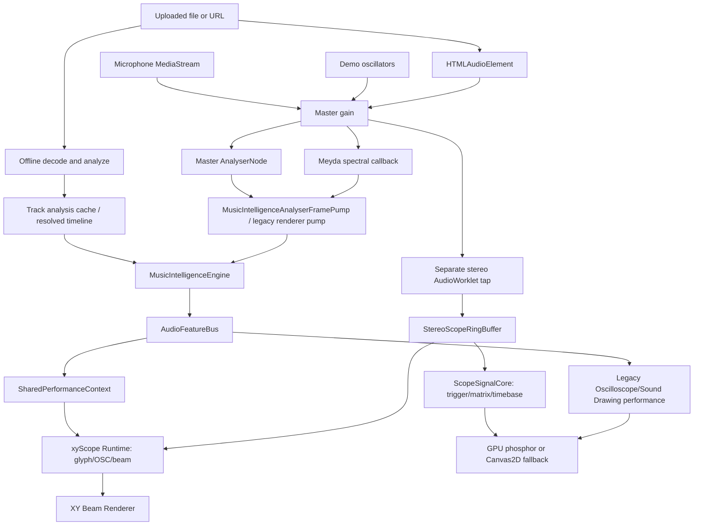
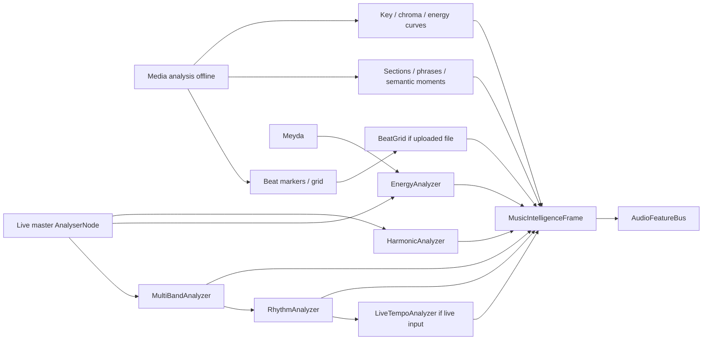

# DRMVYZ AUDIO INTELLIGENCE: COMPLETE CODE AUDIT

# Evidence protocol and source boundary

**Audit date:** 2026-11-16. **Primary code evidence:** uploaded `DRMVYZ-main (3)(1).zip`; root paths in citations are relative to `DRMVYZ-main/`. **Guide:** `Sound_Drawing_Complete_Recreation_Guide(1).md` (1,499 lines). **Visual references:** the eight submitted screenshot/storyboard JPEG files covering Sound Drawings 1, 2, 4 and 6. **Unavailable in this turn:** the four original `.mov` recordings, a separate instructional-package ZIP, actual audio tracks, a running packaged Electron app and installed `node_modules`. No tests, build, benchmark, media-output comparison or live UI operation was executed. Static inspection verifies code paths and conditions, **not** runtime correctness on a particular device.

Statuses: **EXISTS** = code plus inspected connection to a consumer; **REUSABLE** = existing suitable module; **PARTIAL** = partial implementation or missing integration, without asserting failure; **BROKEN** = demonstrable code defect with explicit reproduction hypothesis; **DUPLICATED** = overlapping implementations; **MISSING** = no implementation found after targeted source search, subject to runtime validation; **UNKNOWN** = cannot establish conclusively; **NEW COMPONENT** = proposed engineering work. A UI field or label alone does not prove functional behavior.

The guide distinguishes **literal stereo XY** (left and right PCM at the same sample index) from **author-created vectors modulated by arbitrary tracks**. They must not be conflated. Guide video attributions [V1–V4] are *visual observations/reconstruction*, and [ENGINEERING] denotes interpretation or proposed design rather than verified spoken narration. The supplied screenshots support scene shapes (circle, cubes, wireframes, glowing contours, Ableton/osci-render) but **cannot establish inter-frame timing or exact DSP parameter values**.

# Executive findings

1. **DRMVYZ already contains two distinct Sound Drawing families.** The classic `oscilloscope` engine includes a professional scope signal path, independent authored artwork and performance shows; the standalone `xyScope` engine includes text, Text V2, SVG, oscillator/OSC1/OSC2/INIT/OCTA runtimes, shared-context reactivity and a specialized beam. A new engine should not begin as a greenfield rewrite.
2. **True sample-paired stereo is present**, captured by `StereoScopeAudioTap` with the `stereo-scope-processor` worklet, not by `AudioFeatureBus.raw`. `ScopeSignalCore` handles true XY channel relationships, triggering and timebase; code also explicitly labels mono-delay XY and band-split XY as *creative*, not stereo measurements.
3. **Music Intelligence is substantial**: band envelopes, events, live tempo, file beat grids, offline sections, harmony, semantics, cached analysis and per-frame shared bus. What is not established is a single fully unified feature contract for every Sound Drawing route or consistent confidence-sensitive modulation under all source modes.
4. **Geometry and phosphor rendering are already implemented.** Text font paths, SVG sampling, path caches, CRT/phosphor GPU and fallback Canvas exist. Their different modes have different budgets and controls. The highest-value work is convergence, provenance, recoverability, test fixtures and authoring rather than duplicate shaders.
5. **Authentic shape-to-stereo-PCM synthesis/export has not been located** in the inspected Sound Drawing/audio runtime files or repo-wide targeted search. A separately bounded synthesizer is appropriate, but not necessary for the arbitrary-track performance MVP.
6. **A concrete determinism issue exists:** `XyScopeRuntime` uses `Math.random()` to change the active text on a fixed ~4-second hold in its general rendering path (`XyScopeRuntime.ts:58-59, 250-257`), while Text V2 separately supports seeded choices. Reproducible export and phrase-aware behavior require reconciling this old path. This is not a claim that every XY source has this defect.
7. **Another operational distinction:** live mic analysis intentionally publishes neutral sections and phrases (`MusicIntelligenceEngine.ts:676-780`). A future choreography engine must never treat estimated tempo alone as confirmed section structure.

**Recommendation:** preserve both engines for backward compatibility. Extract a shared, versioned `SoundDrawingCore` for path identity, normalized features, musical event IDs, deformation constraints and optional beam adapters; gradually connect both presentations through adapters, with explicit capability fallbacks. Performance mode should default to **Hybrid Audio-Reactive Vector Drawing**, with honest literal PCM scope mode and a later dedicated XY audio synthesizer.
## Audited repository

- ZIP: 4,786 entries; 3,344 source/text/config files extracted selectively (binary model assets not inspected).
- TypeScript/TSX under src: 2,455 files; Music Intelligence main module files: 29.
- Framework evidence: `package.json` includes Electron, React/Vite, Zustand, Three.js, Meyda, svg-path-properties and web-audio-beat-detector. The uploaded project has **no installed node_modules** in this environment.
- There are additional domain-specific analyzers in Cinema2, PixGrid and XY OSC1. This is a static, targeted architecture audit, not a proved exhaustive dynamic call graph of all 2,455 TS/TSX files.

## Principal source map

| Module | Code evidence | Actual role | Assessment |
| --- | --- | --- | --- |
| Music Intelligence frame and bus | `src/features/musicIntelligence/types.ts:233-280` | canonical features, capability and raw mono-analyser arrays | EXISTS / REUSABLE |
| Feature publication/authority | `src/features/musicIntelligence/AudioFeatureBus.ts:57-120` | singleton push/pull bus, guard on complete frames | EXISTS / REUSABLE |
| Main analyzer | `src/features/musicIntelligence/MusicIntelligenceEngine.ts:644-907` | band, rhythm, energy, harmony, timing, semantics assemblage | EXISTS / REUSABLE |
| Per-frame analyser pump | `src/features/musicIntelligence/MusicIntelligenceAnalyserFramePump.ts:126-208` | reusable buffers and frame duplication checks | EXISTS / REUSABLE |
| Web Audio graph and Meyda | `src/hooks/useAudioEngine.ts:545-698` | file/live graph, analysers, tap, spectrum | EXISTS / REUSABLE |
| Live input publisher | `src/hooks/useAudioEngine.ts:1668-1694` | single authoritative live stream publisher | EXISTS / REUSABLE |
| Stereo worklet | `public/worklets/stereo-scope-processor.js:31-135` | sample-paired stereo capture | EXISTS / REUSABLE |
| Scope tap | `src/audio/scope/StereoScopeAudioTap.ts:64-185` | stereo ring and capture status | EXISTS / REUSABLE |
| Scope matrix contract | `src/audio/scope/scopeTypes.ts:15-103` | measurement vs creative modes | EXISTS / REUSABLE |
| Scope geometry core | `src/audio/scope/ScopeSignalCore.ts:79-263` | conditioning, trigger, timebase, display trace | EXISTS / REUSABLE |
| Classic renderer | `src/components/vyzualz/react/renderers/SoundDrawingRenderer.ts:1694-1743` | professional sample trace and beam geometry | EXISTS / REUSABLE |
| Phosphor GPU | `src/components/vyzualz/react/renderers/soundDrawing/ScopePhosphorRuntime.ts:37-50` | WebGL2 emission/persistence/bloom/CRT | EXISTS / REUSABLE |
| XY UI | `src/components/vyzualz/react/xyScope/XyScopeWorkspace.tsx:120-199` | source cards, uploaded SVG input | EXISTS / REUSABLE |
| XY surface | `src/components/vyzualz/react/xyScope/XyScopeSurface.tsx:79-163` | bus, stereo tap, shared choreography context | EXISTS / REUSABLE |
| XY runtime | `src/components/vyzualz/react/xyScope/XyScopeRuntime.ts:170-375` | multi-mode runtime, beam and choreography | EXISTS / REUSABLE |
| XY SVG compiler | `src/components/vyzualz/react/xyScope/XyScopeSvg.ts:7-58` | shared SVG compile and independent strokes | EXISTS / REUSABLE |
| XY typography | `src/components/vyzualz/react/xyScope/XyScopeGeometry.ts:81-256` | font outlines and contour resampling | EXISTS / REUSABLE |
| Text V2 choreography | `src/components/vyzualz/react/xyScope/XyScopeTextV2Performance.ts:94-191` | evidence-based states and cue selection | EXISTS / REUSABLE |
| Sound Drawing show runtime | `src/components/vyzualz/react/soundDrawing/SoundDrawingPerformanceEngine.ts:54-89` | layers, mappings and show state | REUSABLE |
| Preset persistence | `src/stores/reactStore.ts:6164-6401` | XY settings and sound-drawing show state serialization | EXISTS / REUSABLE |
| Offline analyzer | `src/features/musicIntelligence/offlineTrackAnalyzer.ts:454-590` | whole-file FFT and structural analysis, cooperative yields | EXISTS / REUSABLE |

## Music Intelligence implementation inventory (main module directory)

| Path | LOC | Exported identifiers (first 8) | Scope |
| --- | --- | --- | --- |
| `src/features/musicIntelligence/AudioFeatureBus.ts` | 120 | AudioFeatureBusPublicationKind, AudioFeatureBusPublicationMeta, AudioFeatureBus | Production source file; inspect called dependencies and tests before modifying |
| `src/features/musicIntelligence/MusicIntelligenceAnalyserFramePump.ts` | 236 | MusicIntelligenceAnalyserAnalysisMode, MusicIntelligenceAnalyserFramePumpInput, MusicIntelligenceAnalyserFramePumpDiagnostics, MusicIntelligenceAnalyserFramePumpOptions, shapeLiveInputAnalysisBuffers, MusicIntelligenceAnalyserFramePump | Production source file; inspect called dependencies and tests before modifying |
| `src/features/musicIntelligence/MusicIntelligenceEngine.ts` | 944 | MusicIntelligenceEngineOptions, AnalyserInputFrame, MusicIntelligenceRealtimeAnalysisMode, AudioFrameInput, MusicIntelligenceEngine, musicIntelligenceEngine | Production source file; inspect called dependencies and tests before modifying |
| `src/features/musicIntelligence/analysisCompatibility.ts` | 53 | DEFAULT_TRACK_ANALYSIS_SOURCES, resolveTrackAnalysisSources, resolveTrackAnalysisProvenance, withTrackAnalysisCompatibilityDefaults | Production source file; inspect called dependencies and tests before modifying |
| `src/features/musicIntelligence/analysisTuning.ts` | 83 | ANALYSIS_TUNING, LoadedAudioAnalysisTuning | Production source file; inspect called dependencies and tests before modifying |
| `src/features/musicIntelligence/analysisValidation.ts` | 60 | isUsableTrackAnalysis | Production source file; inspect called dependencies and tests before modifying |
| `src/features/musicIntelligence/analysisVersion.ts` | 12 | CURRENT_ANALYSIS_VERSION, isCurrentAnalysisVersion | Production source file; inspect called dependencies and tests before modifying |
| `src/features/musicIntelligence/bandAnalysis.ts` | 183 | BandConfig, DEFAULT_BAND_CONFIGS, ExtendedBandStats, BandAnalysisResult, getBandAvg, MultiBandAnalyzer | Production source file; inspect called dependencies and tests before modifying |
| `src/features/musicIntelligence/beatGrid.ts` | 203 | BeatGridState, BeatGrid | Production source file; inspect called dependencies and tests before modifying |
| `src/features/musicIntelligence/bpmReanalysis.ts` | 281 | applyResnap, applyReanalyze | Production source file; inspect called dependencies and tests before modifying |
| `src/features/musicIntelligence/browserGoldenFixture.ts` | 249 | BROWSER_AUDIO_GOLDEN_SCHEMA_VERSION, BrowserAudioGoldenSource, BrowserAudioGoldenDecodedAudio, BrowserAudioGoldenFixture, BrowserSerializableRgbWaveformAnalysis, BrowserAudioGoldenRunResult, BrowserAudioGoldenOptions, canonicalStringifyBrowserAudioGolden | Production source file; inspect called dependencies and tests before modifying |
| `src/features/musicIntelligence/constants.ts` | 171 | DEFAULT_MI_FRAME | Production source file; inspect called dependencies and tests before modifying |
| `src/features/musicIntelligence/contextualSectionAnalysis.ts` | 1244 | CONTEXTUAL_SECTION_CLASSIFIER_VERSION, ContextualSectionClassificationInput, ContextualSectionClassificationResult, classifyContextualSections | Production source file; inspect called dependencies and tests before modifying |
| `src/features/musicIntelligence/energyAnalysis.ts` | 186 | MeydaFeatureSnapshot, EnergyAnalysisResult, EnergyAnalyzer | Production source file; inspect called dependencies and tests before modifying |
| `src/features/musicIntelligence/featureSmoothing.ts` | 194 | EMAFilter, AttackReleaseFilter, PeakFollower, RunningMax, FeatureRingBuffer, CurveType, CurveParams, applyCurve | Production source file; inspect called dependencies and tests before modifying |
| `src/features/musicIntelligence/harmonicAnalysis.ts` | 307 | HarmonicAnalysisResult, HarmonicAnalyzer | Production source file; inspect called dependencies and tests before modifying |
| `src/features/musicIntelligence/index.ts` | 152 | (internal helpers) | Production source file; inspect called dependencies and tests before modifying |
| `src/features/musicIntelligence/liveTempoAnalysis.ts` | 347 | LIVE_TEMPO_TUNING, LiveTempoInput, LiveTempoState, LiveTempoDiagnostics, LiveTempoAnalyzer | Production source file; inspect called dependencies and tests before modifying |
| `src/features/musicIntelligence/musicalGridAnalysis.ts` | 652 | ChromaFrame, MusicalFeatureCurves, DownbeatResolution, MusicalGridResolution, ResolveMusicalGridInput, sampleCurveAt, buildBeatMarkers, resolveDownbeatPhase | Production source file; inspect called dependencies and tests before modifying |
| `src/features/musicIntelligence/musicalHierarchyAnalysis.ts` | 487 | MusicalHierarchyInput, MusicalHierarchyResult, buildBoundaryAlternatives, attachSectionAnalysisMetadata, generateMusicalHierarchy | Production source file; inspect called dependencies and tests before modifying |
| `src/features/musicIntelligence/offlineTrackAnalyzer.ts` | 1016 | TrackAnalysisSeed, TrackAnalysisOptions, fftMagnitudes, buildBeatMarkers, AudioBufferMusicalKeyDetection, detectAudioBufferMusicalKey, analyzeTrackBuffer | Production source file; inspect called dependencies and tests before modifying |
| `src/features/musicIntelligence/rekordboxSectionAnalysis.ts` | 615 | ValidatedRekordboxPhraseRegion, RekordboxPhraseValidationResult, RekordboxSectionBuildResult, validateRekordboxPssi, buildRekordboxAuthoritativeSections | Production source file; inspect called dependencies and tests before modifying |
| `src/features/musicIntelligence/rhythmAnalysis.ts` | 197 | RhythmAnalysisResult, RhythmAnalyzer | Production source file; inspect called dependencies and tests before modifying |
| `src/features/musicIntelligence/sectionAnalysis.ts` | 993 | SectionDetectionOptions, StructuralSegmentationResult, analyzeStructuralRegions, detectSections | Production source file; inspect called dependencies and tests before modifying |
| `src/features/musicIntelligence/selectors.ts` | 314 | selectBands, selectRhythm, selectEnergy, selectCurrentSection, miFrameToAudioBandValues, getModulationSourceValue, getTriggerSourceValue, isMusicIntelligenceConditionSource | Production source file; inspect called dependencies and tests before modifying |
| `src/features/musicIntelligence/semanticAnalysis.ts` | 523 | SemanticAnalyzer, detectSemanticMoments, suggestVisualAutomation | Production source file; inspect called dependencies and tests before modifying |
| `src/features/musicIntelligence/stemAnalysis.ts` | 170 | StemCurveInterpolator, StemAnalysisBackend, nullStemBackend, setStemAnalysisBackend, getStemAnalysisBackend, emptyStems | Production source file; inspect called dependencies and tests before modifying |
| `src/features/musicIntelligence/trackAnalysisStorage.ts` | 248 | AnalysisGridPatch, boundTrackAnalysisForStorage, migrateTrackAnalysisStorageState, useTrackAnalysisStore | Production source file; inspect called dependencies and tests before modifying |
| `src/features/musicIntelligence/types.ts` | 854 | MIBands, MIRhythm, MIEnergy, SectionSource, MISection, MelodyContourLabel, MIHarmonic, MIStems | Production source file; inspect called dependencies and tests before modifying |

## Feature-by-feature inventory

| Capability | Status | Algorithm / implementation | Evidence | Caveat or enhancement |
| --- | --- | --- | --- | --- |
| Six bands, smoothed + normalized | EXISTS | MultiBandAnalyzer; 20-60/60-250/250-1000/1k-4k/4k-10k/10k-20k Hz, attack/release, adaptive floor | `src/features/musicIntelligence/bandAnalysis.ts:21-164` | Not literal stereo; smoothing uses per-update alphas, inspect frame-rate sensitivity |
| RMS, running energy, crest factor, percentile | EXISTS | EnergyAnalyzer uses 8-bit time buffer and grouped band outputs | `src/features/musicIntelligence/energyAnalysis.ts:68-179` | Raw energy is not calibrated LUFS; reference against mastered tracks |
| Spectral flux / onset | EXISTS | RhythmAnalyzer tracks positive spectral change with adaptive threshold | `src/features/musicIntelligence/rhythmAnalysis.ts:12-45` | Frame-dependent detector; validate across frame rates |
| Kick / snare / hat events | EXISTS | Band-weighted attack detectors and refractory timing | `src/features/musicIntelligence/rhythmAnalysis.ts:134-191` | Heuristics, not proven stem-isolated event classifiers |
| Spectral centroid/spread/rolloff/flatness | EXISTS | Meyda callback with bufferSize=512 feeds MI getter | `src/hooks/useAudioEngine.ts:669-695` | Meyda callback features conditioned/normalized by energy analyzer |
| Key/mode/chord/pitch | PARTIAL | HarmonicAnalyzer FFT/chroma and clarity-gated pitch guess | `src/features/musicIntelligence/harmonicAnalysis.ts:166-305` | Unknown confidence on dense tracks; not sample-accurate path frequency |
| Beat/BPM/downbeat/bar/phrase | EXISTS | BeatGrid with effective offline BPM and marker grid | `src/features/musicIntelligence/beatGrid.ts:49-200` | Audio-file authority differs from live-input beat estimates |
| Live tempo | PARTIAL | LiveTempoAnalyzer onset interval clustering and confidence | `src/features/musicIntelligence/liveTempoAnalysis.ts:7-287` | Explicitly does not claim bars/sections for live microphone |
| Track sections and semantic moments | EXISTS | Offline self-similarity and section/semantic analysis | `src/features/musicIntelligence/sectionAnalysis.ts:22-402` | Depends on available analysis, confidence and imported overrides |
| Rekordbox authoritative integration | EXISTS | Seeded grids/phrases/sections survive analysis | `src/features/musicIntelligence/offlineTrackAnalyzer.ts:40-93` | Provenance and import integrity must be respected |
| Stored stem curves | PARTIAL | StemCurveInterpolator samples separately prepared curves when available | `src/features/musicIntelligence/MusicIntelligenceEngine.ts:790-799` | No guarantee every track has separated-stem data |
| Lyrics/word cues | EXISTS | MI lyric state plus LyricPlaybackBus bridge | `src/features/musicIntelligence/MusicIntelligenceEngine.ts:795-800` | Lyrics absent on many tracks, must not gate basic geometry |
| Raw time-domain data on shared bus | EXISTS | MIFrame.raw.timeDomainData is Uint8Array from a mono/master AnalyserNode | `src/features/musicIntelligence/types.ts:270-273` | Not independently synchronized L/R PCM |
| Synchronized stereo PCM capture | EXISTS | Two channels copied from same AudioWorklet render quantum; ring frame ids | `public/worklets/stereo-scope-processor.js:109-132` | Timing coupling needs end-to-end latency test |
| Detailed per-band spectral feature propagation to XY | PARTIAL | XY surface derives context; OSC1 performs additional local FFT | `src/components/vyzualz/react/xyScope/XyScopeOsc1Analysis.ts:9-66` | Potential duplicate analysis and semantic/latency mismatch |
| Stereo correlation measurement | EXISTS | Scope trace computes correlation from synchronized frame | `src/audio/scope/ScopeSignalCore.ts:249-262` | Not a public MIFrame stereo field |
| One shared canonical feature publisher for live mic | EXISTS | Live-input publisher guard and pump owned by audio engine | `src/hooks/useAudioEngine.ts:1668-1694` | Legacy/file renderers still have separate publishing paths |

## Audio input, ownership and lifecycle

- `useAudioEngine.ts:552-667` owns the AudioContext graph. Main master analyser; left/right analysers behind `ChannelSplitter`; independent stereo `AudioWorklet` tap; a 60-second mono capture ring; selectable monitoring chain; reference A/B program path. The stereo scope tap sits on `masterGain`, **before** output monitoring/mute, so the displayed waveform may not reflect monitor processing. A diagnostic should label capture position.
- `useAudioEngine.ts:809-890`: file source uses `createMediaElementSource`; microphone uses `getUserMedia` and `createMediaStreamSource`. `useAudioEngine.ts:1656-1666` derives file transport time from media element, live time from AudioContext epoch. `useAudioEngine.ts:1650-1653` resets stereo capture on seek.
- `AudioFeatureBus.ts:57-120` exposes zero-alloc `getFrame()`, subscriptions, `setFrame`, `updatePartial`, reset, publisher metadata and authoritative full-frame guard. `updatePartial` does not enforce `canPublishFrame`, by design or oversight, so define and test ownership for metadata updates while a live publisher is active. Do **not** designate it BROKEN without reproduction.
- `MusicIntelligenceAnalyserFramePump.ts:126-208` reuses Uint8Array buffers and skips recently published external matching frames, reducing redundant work. Yet `ReactPlaceholderCanvas.tsx:509-584` has a separate analyser publication path. Audit all emitters before consolidating clocks.
- `StereoScopeAudioTap.ts:64-185` retains stereo frame indices, channel count, dropped frames, discontinuities and reasons for unavailability. Worklet uses 1024-frame blocks and transferable recycled buffers (`public/worklets/stereo-scope-processor.js:31-132`). At 48 kHz, a full block represents ~21.3 ms; this is capture packetization, not established end-to-end latency.
- The source switch code clears/retains current source state; verify on actual target platform that every file/stream transition resets source provenance and timebase before the next draw. Static tests cannot establish hardware start-up behavior.

## Actual data-flow diagrams

*Graph is code-derived but schematic. It does not imply the separate XY beam and legacy GPU phosphor share a concrete renderer implementation.*
## Feature extraction dependency sketch

### Timing semantics, confidence and transport

`MusicIntelligenceFrame.timeSec` is media/source time, **not** automatically presentation time. `frameId` denotes a publication. `StereoScopeFrame.startFrame` is capture-sample index. `XyScopeSurface.tsx:108-152` reconstructs shared performance context on new frame IDs and transport discontinuity, and asks the stereo ring for a recent fixed-size window. `XyScopeRuntime.ts:289-301` uses beat position only when engine-level `bpmSync` is set, otherwise free-runs. This is **one instance** of BPM Sync semantics; it is not proof that all engine-level switches behave the same. Prove callback wiring separately for legacy mode and Audio Dock toggles before changing UI semantics.

The offline analyzer is not a Web Worker: `offlineTrackAnalyzer.ts:408-409` explicitly uses cooperative `setTimeout(...,0)` yields and `analyzeTrackBuffer()` is called from the current JS execution environment. Heavy uploads may still contend with rendering or input until worker offload is profiled. No worker claim is made for unrelated lyric/media paths, which do have workers.

### Publisher and subscriber architectural risks

1. **DUPLICATED:** sources can derive music snapshots in different animation loops. Overlap is partly guarded by publisher identities and timestamps; an exact conflict requires integration tests. Risk: subtle per-frame event skips, double advancement or different sample windows.
2. **DUPLICATED:** `XyScopeOsc1Analysis.ts:9-66` computes its own 2048-sample Blackman-windowed FFT while canonical MI already has analyzed bands. Retain local analysis only where raw stereo-detail is truly required; otherwise share normalized features.
3. **PARTIAL:** canonical `MusicIntelligenceFrame.raw` exposes a master analyser's single Uint8 frequency/time buffers, not an explicit source-aligned float stereo PCM window. This is fine for generic reactivity but inadequate as the interface for literal XY.
4. **PARTIAL:** classic GPU phosphor and XY beam implementations are separate presentation backends. Preserve their look and optimize through a common trace representation rather than forcing one shader to replace the other.
5. **UNKNOWN:** no end-to-end measured latency, runtime memory profile, underrun rate or dropped-frame trace supplied. Do not present static code comments as benchmark results.

## Capture, feature and confidence contracts

The existing frame already contains `bands`, `rhythm`, `energy`, `harmonic`, `stems`, `lyrics`, `semantics`, `section`, `resolvedSections`, `raw` and optional `capabilities` (`types.ts:233-280`). Standardize all feature consumers on its existing **units and source confidence** before adding visual mappings. Keep three orthogonal clocks:

- **Transport clock**: canonical timeSec and discontinuity identity, owned by current audio transport or live source.
- **Feature clock**: frameId/publishedAtMs; event identity and confidence, not independently advancing MIDI/beat counters inside individual renderers.
- **Draw/sample clock**: audio sample-frame index for literal XY; requestAnimationFrame delta for render/persistence, derived from the transport where possible for deterministic export.

Use a typed read-only adapter; never mutate `AudioFeatureBus.getFrame()` objects. Implement `validUntilSec`, `sourceIdentity`, `captureTimestamp`, and `confidence` in the **adapter**, not by casually changing all legacy `MusicIntelligenceFrame` consumers. Deny/neutralize unavailable features explicitly (`liveSections=false`), and show operator-facing provenance.

## Source-specific functions and integration observations

### File source and offline analytics

`useAudioEngine.ts:1394-1415` decodes file buffers for analysis, and `offlineTrackAnalyzer.ts:454-1016` extracts spectral, beat, bar, harmonic, structural and semantic signals with optional imported Rekordbox timing. `trackAnalysisStorage.ts:160-248` persists bounded analysis through Zustand. The authoritative timeline resolver `features/trackIntelligence/authoritativeTimeline.ts:140-250` combines track and manual edits; consumers must use it rather than inventing a parallel `sectionAtTime` query. Analyzer version, reanalysis and cache invalidation remain part of the stored track contract.

### Real-time live input

`useAudioEngine.ts:870-890` acquires the microphone; `useAudioEngine.ts:1032-1034` establishes authoritative publisher ownership; `MusicIntelligenceEngine.ts:676-780` publishes bands, beat estimates and onsets but makes `sections=false` and does not claim phrases/structural semantics. This is **intentional correctness**, not a missing genre-specific classifier. For live microphones, use onset- and beat-confidence-driven choreography and do not synthesize imaginary drops.

### Classic Sound Drawing

`ReactTypes.ts:42` includes distinct `'oscilloscope'` and `'xyScope'` engine IDs. In `SoundDrawingRenderer.ts:1694-1743`, the professional mode reads synchronized captures through `toStereoScopeFrame`, calls `ScopeSignalCore`, turns traces into beam geometry and, when supported, enters `ScopePhosphorRuntime` (`SoundDrawingRenderer.ts:3883-3909`). It falls back to waveform drawing on unavailable stereo capture. Source type handlers at `SoundDrawingRenderer.ts:577-675` include builtin shapes, text/OpenType, SVG and SVG visual art, with runtime caches. One potentially confusing behavior is the code's **circle fallback** if a selected SVG glyph cache entry is unavailable (`SoundDrawingRenderer.ts:637-668`), while the standalone XY SVG compiler refuses invalid input rather than silently substituting art. Harmonize user-facing failure reporting, without breaking old presets.

### Standalone XY Scope

`XyScopeWorkspace.tsx:120-176` offers TEXT, TEXT V2, SVG and OSCILLATOR cards; OSC1/OSC2/INIT/OCTA also exist as source/settings variants (`XyScopeSettings.ts:35-43`, `XyScopeRuntime.ts:88-127`). SVG passes through `compileSvgToGlyphResult` with a 2048-point budget and independently grouped subpaths (`XyScopeSvg.ts:8-58`). Font outlines/contours are built from OpenType (`XyScopeGeometry.ts:81-256`). Text V2 has event-seeded plans and readable/formation/reform phases (`XyScopeTextV2Performance.ts:94-191`, `XyScopeTextV2Trajectory.ts:4-16`). These are substantive functional starting points, not UI-only stubs.

### Sound Drawing performance shows

`SoundDrawingPerformanceEngine.ts:54-89, 605-868` defines layered performance settings and typed modulation targets; `SoundDrawingProfessionalScopeLayer.ts:22-86` creates authored scope layer overrides without overwriting manual state. The P0 task is to reconcile the shared mapping/feature provenance with XY modes and the legacy performance show instead of adding a third unrelated control plane.

## Candidate verified concerns and test plans

| Finding | Classification | Evidence | Why it matters | Focused verification |
|---|---|---|---|---|
| Fixed hold + unseeded text choice in legacy XY path | **BROKEN for deterministic-replay requirement** | `XyScopeRuntime.ts:58-59,250-257` | Two renders can choose different next words for identical input | Replay same serialized preset and audio event stream; compare text-change logs byte-for-byte |
| Live mic has no structural section evidence | **EXISTS / intentional limitation** | `MusicIntelligenceEngine.ts:676-780` | Do not generate false phrase-level transitions | Feed live onsets without offline markers; section/phrase not claimed |
| Shared bus partial publication bypasses full-frame authority guard | **PARTIAL / risk** | `AudioFeatureBus.ts:89-102` | Metadata updates could violate ownership if misused | Interleave live publisher and foreign partial updates; assert immutable source/timestamp invariants |
| Full SDL feature version across both engine IDs | **PARTIAL / unification needed** | `ReactTypes.ts:42`; `XyScopeSurface.tsx:129-152` | Settings/meaning differ by source | Snapshots for same beat/transient + both engine IDs; compare event IDs/confidence |
| Legacy SVG cache miss substitutes circle | **EXISTS / UX risk** | `SoundDrawingRenderer.ts:637-668` | Wrong art silently appears | Load intentionally stale or not-yet-ready SVG and assert warning/status |
| Offline analyzer may block despite cooperative yield | **UNKNOWN / perf risk** | `offlineTrackAnalyzer.ts:408-409` | Main thread can still do chunks of CPU work | Measure 10+ min track analysis while preview renders 60 fps |
| Separate literal XY and authored geometry paths | **EXISTS / deliberate distinction** | `scopeTypes.ts:23-70`; `XyScopeRuntime.ts:349-375` | Avoid mislabeling reactive art as literal audio | Run stereo out-of-phase fixture; compare actual scope mode with authored word mode |

## Source-specific regression test inventory

Run after dependency installation (not executed in this audit): `src/audio/scope/__tests__/stereoScopeAudioTap.test.ts`, `stereoScopeRingBuffer.test.ts`, `scopeSignalCore.test.ts`, `scopeChannelMatrix.test.ts`, `scopeTrigger.test.ts`, `src/hooks/useAudioEngine.liveInput.test.tsx`, `src/stores/soundDrawingScopeMigration.test.ts`, `src/stores/xyScopePersistence.test.ts`, `src/components/vyzualz/react/xyScope/*.test.ts` and the browser audio golden fixture (`scripts/browser-audio-intelligence-golden.mjs`). Capture terminal output, OS/GPU, sample rate, test duration and any skip reason. Static code review alone does not prove tests currently pass.
