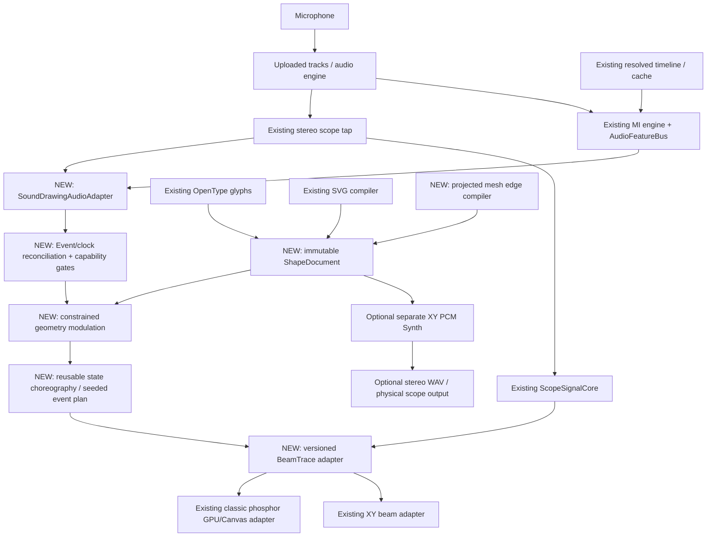
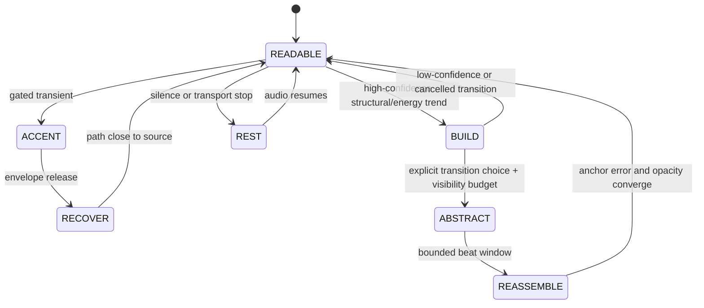

# DRMVYZ SOUND DRAWING: TECHNICAL ENGINE ARCHITECTURE

# Evidence protocol and source boundary

**Audit date:** 2026-11-16. **Primary code evidence:** uploaded `DRMVYZ-main (3)(1).zip`; root paths in citations are relative to `DRMVYZ-main/`. **Guide:** `Sound_Drawing_Complete_Recreation_Guide(1).md` (1,499 lines). **Visual references:** the eight submitted screenshot/storyboard JPEG files covering Sound Drawings 1, 2, 4 and 6. **Unavailable in this turn:** the four original `.mov` recordings, a separate instructional-package ZIP, actual audio tracks, a running packaged Electron app and installed `node_modules`. No tests, build, benchmark, media-output comparison or live UI operation was executed. Static inspection verifies code paths and conditions, **not** runtime correctness on a particular device.

Statuses: **EXISTS** = code plus inspected connection to a consumer; **REUSABLE** = existing suitable module; **PARTIAL** = partial implementation or missing integration, without asserting failure; **BROKEN** = demonstrable code defect with explicit reproduction hypothesis; **DUPLICATED** = overlapping implementations; **MISSING** = no implementation found after targeted source search, subject to runtime validation; **UNKNOWN** = cannot establish conclusively; **NEW COMPONENT** = proposed engineering work. A UI field or label alone does not prove functional behavior.

The guide distinguishes **literal stereo XY** (left and right PCM at the same sample index) from **author-created vectors modulated by arbitrary tracks**. They must not be conflated. Guide video attributions [V1–V4] are *visual observations/reconstruction*, and [ENGINEERING] denotes interpretation or proposed design rather than verified spoken narration. The supplied screenshots support scene shapes (circle, cubes, wireframes, glowing contours, Ableton/osci-render) but **cannot establish inter-frame timing or exact DSP parameter values**.

# Design decision

**Primary performance experience: hybrid authored vector + genuine scope beam behavior.** Use existing `AudioFeatureBus`, `SharedPerformanceContext`, source vector paths and renderers. Reserve literal PCM viewing and independent shape-to-PCM synthesis as clearly labeled separate modes. Avoid altering source PCM as the only way to make text readable. The source contour is a persistent invariant; modulation produces a temporary deformation field with a mathematically constrained return path.

## Mode definitions and honest user-facing semantics

| Mode | Geometry authority | Audio authority | Sound emitted by the renderer? | Invariant | Suggested surface |
|---|---|---|---|---|---|
| A: Measured XY | sample-paired stereo PCM L[n],R[n] | worklet tap/audio clock | no new sound, existing track is monitored | raw waveform fidelity, not legibility | existing Professional Scope controls |
| B: Authored Vector | immutable font/SVG/mesh paths | feature bus and event clock | no | readable source path is recoverable | existing TEXT/TEXT V2/SVG |
| C: Hybrid Sound Drawing (default) | immutable paths + optional physically derived scan texture | feature bus + stereo metrics | no (unless user selects explicit synthesis) | identity, topology and timing | existing XY engine + legacy show adapter |
| D: XY Synth (later optional feature) | authored path P(u) serialized to stereo PCM | generated sample clock, MIDI/automation | **yes** stereo PCM | matching rendered and exported samples | dedicated explicit synthesizer UI |

## Proposed integration graph



**Integration principle:** adapters operate alongside existing engine IDs and their persisted settings. No mass renames, no wholesale React view replacement, no new `AudioContext`, and no duplicate FFT for features already available on the bus. Treat user selections and existing preset migrations as inputs.

## Engineering module boundaries (proposed; files do not exist yet)

| Proposed file | Purpose | Existing entry point / reuse | Thread / update interval | Failure behavior |
|---|---|---|---|---|
| `src/components/vyzualz/react/soundDrawing/core/SoundDrawingAudioAdapter.ts` | read-only authoritative feature adapter, timestamps, capabilities, stereo metrics | `AudioFeatureBus`, `StereoScopeAudioTap`, `SharedPerformanceContext` | main rAF; snapshot on new MI frame | quiet/neutral feature with explicit unavailable flags |
| `.../core/SoundDrawingClock.ts` | derive event IDs, audio time, seek/loop revision and phase | `XyScopeTransport`, BeatGrid | event-driven + rAF | free-run only if user allows; never invent sections |
| `.../core/ShapeDocument.ts` | source path identities, semantic groups and constraints | XyScopeGeometry, oscillatorPoint caches, SVG compiler | preprocess + immutable | return validation errors, never silent art replacement |
| `.../core/PathCompiler.ts` | async flattening and segment/arc-length budgets | SVG/OpenType, Three.js | worker if available | progressively reduced resolution |
| `.../core/ConstrainedDeformer.ts` | per-letter/segment audio warp plus backtracking constraint projection | OSC1/OSC2/TextV2 | rAF or worker precomputed targets | degrade to source path if invalid |
| `.../core/SoundDrawingModMatrix.ts` | feature-to-control mappings, attack/release, confidence and bounds | existing ScopeMusicMapping and SoundDrawingPerformanceEngine targets | MI frame + rAF envelope | disable only affected mapping |
| `.../core/ChoreographyDirector.ts` | state, cue selection, recency-aware seeded variations | TextV2Performance, shared performance event IDs | beat/phrase events, interpolate rAF | hold readable when confidence absent |
| `.../core/BeamTrace.ts` | typed beam segments, pen-up flags, dwell/exposure and IDs | ScopeSignalCore output, geometry point buffers | rAF render | Canvas fallback |
| `.../core/QualityMonitor.ts` | CPU/GPU/drops counters and tier shifts | ScopePhosphorQualityController, tap status | 1Hz telemetry | lower point budget/bloom before losing outlines |
| `src/audio/scope/ShapeToXyAudioSynth.ts` | optional path oscillator and stereo PCM synthesis | SoundDrawing path compiler; **separate from track playback** | AudioWorklet sample rate | mute safe, prevent NaN, limit amplitude |

## Data contracts (TypeScript, proposed API)

```ts
export type SoundDrawingMode = 'measuredStereoXY' | 'authoredVector' | 'hybrid' | 'xySynth';
export type EventKind = 'beat' | 'kick' | 'snare' | 'hat' | 'phrase' | 'section' | 'manual';
export interface SoundDrawingClock {
  readonly sourceId: string;
  readonly audioTimeSec: number;
  readonly presentationTimeSec: number;
  readonly sampleFrame: number | null;
  readonly frameId: number;
  readonly discontinuityId: string;
  readonly bpm: number | null;
  readonly beatIndex: number | null;
  readonly beatPhase: number | null;
  readonly barIndex: number | null;
  readonly phraseIndex: number | null;
  readonly sectionId: string | null;
}
export interface FeatureReading {
  readonly value: number; // normalized 0..1 unless otherwise declared
  readonly confidence: number;
  readonly source: 'live-fft' | 'offline' | 'imported' | 'stereo-tap' | 'unavailable';
  readonly updatedAtSec: number;
  readonly available: boolean;
}
export interface SoundDrawingAudioContext {
  readonly clock: SoundDrawingClock;
  readonly features: Readonly<Record<string, FeatureReading>>;
  readonly events: readonly {kind: EventKind; id: string; strength: number; confidence: number; atSec: number}[];
  readonly capture: {channelCount: 1 | 2 | null; sampleRate: number | null; stereoAvailable: boolean; droppedFrames: number};
}
export interface VectorContour {
  readonly id: string; readonly groupId: string; readonly closed: boolean;
  readonly pointsXY: Float32Array; // interleaved normalized x,y
  readonly anchorIndices: Uint32Array; readonly drawOrder: number;
  readonly semanticRole?: 'letter' | 'stroke' | 'outer' | 'counter' | 'decorative';
}
export interface ShapeDocument {
  readonly schemaVersion: 1; readonly sourceHash: string; readonly sourceKind: 'text' | 'svg' | 'primitive' | 'mesh';
  readonly contours: readonly VectorContour[];
  readonly groups: readonly {id: string; label: string; contourIds: readonly string[]}[];
  readonly originalBounds: readonly [number,number,number,number];
  readonly geometryVersion: string; readonly licenseNotice?: string;
}
export interface ModulationRule {
  readonly id: string; readonly sourceFeature: string; readonly target: string;
  readonly min: number; readonly max: number; readonly attackMs: number; readonly releaseMs: number;
  readonly curve: 'linear' | 'smoothstep' | 'power';
  readonly minimumConfidence: number; readonly missing: 'neutral' | 'hold' | 'disable';
  readonly scope: 'beam' | 'stroke' | 'glyph' | 'shape' | 'transition';
}
export interface BeamTrace {
  readonly xy: Float32Array; readonly segmentFlags: Uint8Array;
  readonly dwell: Float32Array; readonly pointCount: number;
  readonly source: 'measured' | 'authored' | 'synthetic';
  readonly clipId: string; readonly geometryVersion: string;
}
export interface SoundDrawingPresetV1 {
  readonly schemaVersion: 1; readonly engineId: 'oscilloscope' | 'xyScope';
  readonly mode: SoundDrawingMode; readonly shapeRef: string;
  readonly mapping: readonly ModulationRule[];
  readonly readabilityFloor: number; readonly seed: number;
  readonly scan: {density: number; jumpPolicy: 'blank' | 'dim' | 'visible'};
  readonly choreography: {minReadableFraction: number; allowedStates: readonly string[]};
  readonly legacySettings?: unknown; // preserved versioned adapter payload
}
```

Do **not** pass 60Hz-mutating `Float32Array` shapes into Zustand state. Store stable source/preset metadata and keep typed point buffers in reusable runtime storage. Read only from the shared bus and emit fixed-format typed geometry into whichever renderer owns the canvas.

## Mathematical model

### Source invariance and bounded deformation

Let `P_i` be the immutable original coordinate of vertex `i` in contour `c`. Let per-contour transform `T_c` and local modulation `d_i(t)` be driven by typed features. For each point:

\[
Q_i(t) = P_i + a_c(t) \, [T_c(P_i,t)-P_i] + w_i(t)d_i(t), \quad 0\le a_c,w_i\le 1.
\]

Smooth each target parameter with `s(t+dt) = s(t) + (target-s(t))(1-exp(-dt/tau))`; use shorter attack and longer release. Bound anchors by `||Q_a-P_a|| <= maxDelta_a * localGlyphHeight`, and treat glyph order, hole/counter areas and original neighborhood adjacency as constraints. For semantically readable states, enforce minimum stroke gap and intersection budgets; if violation occurs, backtrack the deformation weight by bisection until the nearest feasible state is found. This guarantees a reversible return **mathematically for the stored source**, but does not guarantee perceptual OCR recognition without human review.

**Suggested starting limits, not validated measurements:** 0.04–0.10 glyph-height normal local displacement, 3–12° local rotation, minimum readable fraction 0.65 over an 8-bar window, max 0.15 interglyph gap compression. The actual thresholds must be tuned using labeled screenshot comparisons across fonts, word lengths and varied tracks.

### Continuous path topology

Represent contours as ordered IDs, not only screen positions. `penUp` transitions must not draw connecting lines. Use arc-length resampling for sufficiently smooth traversal: `s_k = k*L/N`, lookup contour position at distance `s_k`. Maintain `closed` status and avoid contour index reordering between frames. Where the number of points changes, perform an explicit one-time correspondence mapping during preprocessing; don't pair arbitrary index `i` with another shape's unrelated point `i`.

### Geometric dwell and phosphor

For a beam sample with local velocity `v`, approximate dwell `d = clamp(k/(epsilon+|v|), dMin, dMax)` and deposit into phosphor field with an HDR-capable blend. Persistence `P(t+dt)=exp(-dt/tau)*P(t)+G(t)`; the deposition `G` must be normalized to sample density and render cadence to avoid brighter results simply because the frame rate is higher. Preserve the existing `ScopePhosphorRuntime` implementation and validate its dt behavior before changing shaders.

### Stereo measurement vs generated XY

For true XY scope: `X[n] = gainL * L[n]`, `Y[n] = gainR * R[n]`, with L/R paired at index `n` from the **same** worklet block. For authored sound generation: `u_n=fract(u_0+f_draw*n/Fs)` and output `(L[n], R[n])=(gx*P_x(u_n),gy*P_y(u_n))`. Do not feed real DJ track PCM to the authored contour and call it literal measurement. Audio output synthesis requires anti-alias limits, nonzero retrace slews and safety output gain, and must be opt-in.

## Adaptive, genre-independent normalization and musical mapping

Use two independently tracked signals: source-relative *continuous* activity and discrete *confidence-weighted* hits. Relative normalization for feature `x` should use rolling or offline quantiles `z=clip((x-P10)/max(P90-P10,eps),0,1)`. Freeze calibration on silence, apply bounded warmup, smooth baseline changes on track switch, and expose raw and normalized features in diagnostics. Per-band quantiles avoid sub-heavy masters saturating every visual channel. Do not directly map genre names to distortion strength.

| Audio driver | Existing source | Normalize/filter | Visual mapping | Guardrail |
| --- | --- | --- | --- | --- |
| Kick hit | rhythm.kickHit/Strength | event after dedupe | beam width impulse; slight local outline expansion | <140ms release, do not move anchors |
| Snare hit | rhythm.snareHit/Strength | event after dedupe | luminance accent and 1-2 local stroke echoes | max repeat count / gap |
| Hat/high transient | rhythm.hatHit; bands.high | short envelope | fine beam grain or scan twinkle | no global word shake |
| Sub-bass | bands.normalizedSub | rolling percentile | bounded radial thickness or interior swell | shape boundary lock |
| Bass | bands.normalizedBass | rolling percentile | per-glyph X/Y local scale 0-8% | no counter collapse |
| Low mid | bands.normalizedLowMid | attack/release | asymmetric shear and stroke extension | anchor and interletter clamp |
| Mid | bands.normalizedMid | slow 60-160ms envelope | gentle differential rotation per glyph | no whole-word vertical jitter |
| Air | bands.normalizedAir | 30-100ms smoothing | beam texture and sparse sparkle | flash policy |
| Spectral flux | energy.spectralFlux | event + envelope | scan perturbation or controlled transition cue | confidence threshold and refractory |
| Centroid | energy.spectralCentroid | normalized bounded | scan density/timbre-like texture | never drive source position alone |
| Harmonic confidence | harmonic.keyConfidence/chordConfidence | gated slow value | ordered Lissajous micro-ornament option | when low confidence leave neutral |
| Stereo correlation | ScopeTrace.correlation (adapter) | if stereo only | independent horizontal/vertical extent | mono clearly labeled |
| Beat phase | rhythm.beatPhase | validated grid or live tempo | ease sync and time quantization | do not gate basic render |
| Downbeat | rhythm.downbeatHit | offline grid with confidence | transition start/phrase accent | live fallback to onset |
| Phrase | phraseMarkers/context.phraseIndex | validated/seeded event | select new choreography grammar | no fabricated phrase for mic |
| Build/drop | resolvedSections + energy | section with provenance/confidence | controlled growth / restore / hold | dense music remains legible |
| Silence | bands.volume / energy.rms | noise gate + hold | settle to source, dim rather than disappear | do not amplify noise |

## Choreography event/lifecycle



A director consumes normalized immutable cues with IDs `sourceId:analysisRevision:boundaryKind:boundaryIndex`. Only event boundaries select a new scene recipe. Avoid per-frame RNG: use `seed = hash(presetSeed, sourceId, sectionId, phraseOrEventId)`. A recency filter penalizes the last N styles and weighted choice is based on actual feature evidence, not a rigid 4/8/16 loop. Continuous geometry interpolation remains deterministic against presentation timestamp. A transition can enter temporary abstraction only with a bounded return event and declared maximum unreadable interval. Seeking replaces the active state with a deterministic reconstruction from known time and event history; no stale trail from previous source.

## Three-process allocation and run-loop pseudocode

- **Electron main:** app lifecycle, persistence, filesystem import/export, security policy; no per-sample audio DSP and no shader loops.
- **AudioWorklet:** existing stereo tap unchanged; optional separate shape-to-PCM oscillator. Allocate no dynamic objects per quantum; transport typed blocks or ring metadata.
- **Worker (optional):** import SVG/mesh, font outline flattening, offline quantile precompute, correspondence maps and expensive offline analysis. Actual workerization must be benchmarked before rewriting analyzer.
- **Main renderer thread:** React settings, frame adapter, musical event director, preallocated deformation buffers and backend dispatch; don't publish high-rate buffers through React state.
- **GPU:** beam deposition, velocity/dwell approximation where practical, phosphor ping-pong, bloom and tonemap. Canvas fallback preserves core path and cue semantics.

```ts
// Pseudocode, not a drop-in replacement for existing runtime.
function renderSoundDrawingFrame(presentationTimeSec: number) {
  const music = soundDrawingAudioAdapter.read(presentationTimeSec); // bus + optional stereo tap
  if (music.clock.discontinuityId !== lastDiscontinuity) resetAllRuntimes('seek-or-track');
  const eventList = clock.consumeNewEvents(music); // deduped; confidence gates
  director.onEvents(eventList, {seed: preset.seed, capabilities: music.features});
  const controls = modMatrix.resolve(music.features, presentationTimeSec);
  const intent = director.sample(presentationTimeSec, controls);
  const deformed = constrainedDeformer.renderInto(shapeDocument, intent, pooledBuffers);
  const valid = readabilityGuard.constrainOrRevert(shapeDocument, deformed, intent);
  const trace = beamAdapter.encode(deformed, valid, pooledTrace);
  existingRenderer.draw(trace, music, presentationTimeSec);
}
```

## UI and preset ownership plan

Retain existing `ReactEnginePanel` and `XyScopeEnginePanel`; share reusable control definitions, not whole panels. Group controls as **Source** (text/SVG/shape, font, content), **Geometry** (per-letter behavior, depth, readability, topology), **Motion** (mapped bands, envelope, transition, event triggers), **Scope/Beam** (literal/creative measurement, timebase, gain, persistence, phosphor, glow), **Master** (Auto Performance, Sync BPM, intensity and safety), **Diagnostics** (confidence, live stereo status, frame rate, dropped samples, last event). Expose *source provenance* and whether a control edits the baseline, a modulation target or runtime-only live effective value.

| Control | Type/range | Starting value | Algorithmic effect | Owner |
| --- | --- | --- | --- | --- |
| Mode | select | hybrid | authoritative geometric mode | engine |
| Text/SVG source | asset/text | DRMVYZ or user upload | immutable source path | preset |
| Readability floor | float 0..1 | 0.72 proposed | constraint backtracking | preset |
| Min readable fraction | float 0..1 | 0.65 proposed | state dwell budget | preset |
| Per-glyph rotation | degrees 0..18 | 6 proposed | local matrix transform | preset |
| Max displacement | float 0..0.2 glyph height | 0.08 proposed | anchor clamp | preset |
| Stroke breakup | float 0..1 | 0.0 default | bounded segment gap | preset |
| Attack | ms 5..500 | 45 proposed | envelope attack | mapping |
| Release | ms 40..1500 | 240 proposed | return envelope | mapping |
| Band influence | six floats 0..1 | curated weights | feature routing | mapping |
| Phase/Harmonic texture | float 0..1 | 0.15 | local pattern/texture | preset |
| Duplicator count | integer 1..8 | 1 | stroke repeated copies | preset |
| Phosphor persistence | seconds 0.02..2 | existing default | phosphor tau | shared scope |
| Beam width | px 0.5..6 | existing default | geometry deposition | shared scope |
| Auto Performance | bool | false where previous config says off | effective target interpolation | master |
| Sync BPM | bool | off or existing persisted | schedule only supported events | master |
| Flash reduction | bool | enabled as safe default proposed | guard output modulation | master |

## Open-source dependency decision (confirmed at review date where linked)

| Candidate | License / status | Use in DRMVYZ | Integration choice |
|---|---|---|---|
| Meyda | MIT; already installed (`package.json`) | spectral features | **REUSE**. Avoid adding competing FFT library without evidence |
| Three.js | MIT; already installed (`package.json`) | 3D project-to-vector mesh edges | **REUSE**, build tiny edge-to-contour adapter |
| svg-path-properties | ISC; already installed at `^2.0.2`; npm lists active later releases | path length/point sampling | **REUSE**, do not replace currently supported SVG compiler blindly |
| Web Audio / AudioWorklet | Browser platform APIs | sample-paired capture and optional synthesis | **REUSE** existing scope worklet |
| osci-render | GPLv3 and premium/free distributions | architectural reference, validation comparison, standalone authoring | **DO NOT COPY/LINK into closed-source build** absent license review |
| woscope | MIT, older proof-of-concept | reference for phosphor/XY look | study visual principles; existing phosphor implementation is preferable |
| `sosci` / OsciStudio | licensing restrictions and paid editions vary | external comparison | validation tools, not planned embedded runtime |
| Paper.js | confirm current package/repo license before adopting | complex offscreen path operations | only if existing OpenType/SVG compiler cannot cover requirement |
| FFmpeg | depends on binary build/license | media fixture/export | optional separate export path, review distribution obligations |

**External references verified:** https://github.com/jameshball/osci-render ; https://github.com/m1el/woscope ; https://github.com/meyda/meyda ; https://www.npmjs.com/package/svg-path-properties . Package release information can change, so pin the exact version before shipping; this is not a legal opinion.

## Performance and safety targets (proposed, NOT measured)

| Metric | Initial target | Instrumentation |
|---|---|---|
| Presentation | 60 fps on development GPU at 1080p; 30 fps fallback for weak hardware | rAF interval P50/P95, GPU timer query if available |
| Input-to-visual onsets | P95 <= 65 ms for live input, excluding connected display latency | audio inject pulse with sample index + photodiode/capture telemetry |
| Stereo capture | zero avoidable channel mispairing; <= 0.1% dropped frames in nominal load | `StereoScopeTap.getStatus()` counters |
| Main-thread budget | P95 <= 4 ms for deformer/pack beyond existing renderer | performance.mark around each subsystem |
| Geometry | 2k baseline, 4k high-quality, dynamic 512-1k low tier | per-contour count and compiler cache hit rates |
| Peak memory | no unbounded growth over 30-minute soak | heap snapshots, cache cap counters |
| Recovery | initial target <= 500ms after short transient and exact canonical path after reassembly | normalized landmark distance and contour hashing |
| Readable default | >= 65% of defined 8-bar view; 0.72 proposed readability score | vector metrics plus blinded human legibility checks |

Do not silently drop source geometry to improve FPS; first reduce glow passes/texture resolution, then point density while preserving semantic anchors and transition decisions. Scenes should expose a reduced-flash/reduced-motion path.
