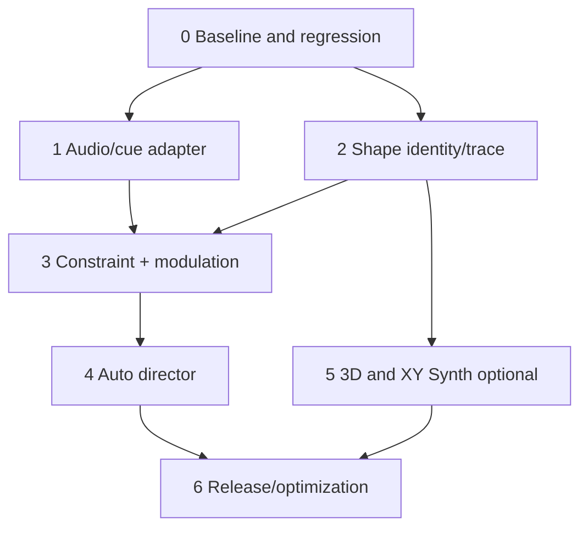

# DRMVYZ SOUND DRAWING: PHASED IMPLEMENTATION ROADMAP

# Evidence protocol and source boundary

**Audit date:** 2026-11-16. **Primary code evidence:** uploaded `DRMVYZ-main (3)(1).zip`; root paths in citations are relative to `DRMVYZ-main/`. **Guide:** `Sound_Drawing_Complete_Recreation_Guide(1).md` (1,499 lines). **Visual references:** the eight submitted screenshot/storyboard JPEG files covering Sound Drawings 1, 2, 4 and 6. **Unavailable in this turn:** the four original `.mov` recordings, a separate instructional-package ZIP, actual audio tracks, a running packaged Electron app and installed `node_modules`. No tests, build, benchmark, media-output comparison or live UI operation was executed. Static inspection verifies code paths and conditions, **not** runtime correctness on a particular device.

Statuses: **EXISTS** = code plus inspected connection to a consumer; **REUSABLE** = existing suitable module; **PARTIAL** = partial implementation or missing integration, without asserting failure; **BROKEN** = demonstrable code defect with explicit reproduction hypothesis; **DUPLICATED** = overlapping implementations; **MISSING** = no implementation found after targeted source search, subject to runtime validation; **UNKNOWN** = cannot establish conclusively; **NEW COMPONENT** = proposed engineering work. A UI field or label alone does not prove functional behavior.

The guide distinguishes **literal stereo XY** (left and right PCM at the same sample index) from **author-created vectors modulated by arbitrary tracks**. They must not be conflated. Guide video attributions [V1–V4] are *visual observations/reconstruction*, and [ENGINEERING] denotes interpretation or proposed design rather than verified spoken narration. The supplied screenshots support scene shapes (circle, cubes, wireframes, glowing contours, Ableton/osci-render) but **cannot establish inter-frame timing or exact DSP parameter values**.

## Decision and MVP scope

**MVP:** 1) pick a word or SVG; 2) keep it continuously legible while uploaded music or live mic modulates distinct beam/stroke features; 3) observe kick/snare/beat when reliable; 4) recover exact source contour on release; 5) preserve presets and engine selection; 6) show stereo/feature capability diagnostics. The MVP **does not** require physical oscilloscope output, automatic YouTube frame reconstruction, full 3D object authoring or actual stereo XY-audio synthesis.

**Operating strategy:** keep both existing engine IDs working; integrate using parallel adapters behind a feature flag. Ship P0+P1 first. Maintain classic renderer as a fallback while convergence proceeds. Progress checkpoints are based on tests and observable visuals, not elapsed time estimates.

## Dependency graph

## Phase 0: Freeze evidence, establish tests and compatibility

**Objective:** Baseline runtime reality before modifying two existing engines.

**Existing modules to modify:** `src/components/vyzualz/react/xyScope/XyScopeSurface.tsx`; `src/components/vyzualz/react/ReactPlaceholderCanvas.tsx`; `src/stores/reactStore.ts`.

**New proposed modules:** `src/components/vyzualz/react/soundDrawing/core/__tests__/SourceParity.test.ts`; `scripts/sound-drawing-golden.mjs`. Paths beginning `.../core/` abbreviate `src/components/vyzualz/react/soundDrawing/core/`.

**Reusable implementation:** src/audio/scope/__tests__; src/test/browserAudioIntelligenceGolden.entry.ts; src/stores/soundDrawingScopeMigration.test.ts.

**Algorithm/data contracts:** Capture frame IDs, times, session identity, controls, RGB screenshots; add test utilities without modifying behavioral assumptions..

**Ordered tasks**

1. Install locked dependencies and execute existing targeted tests.
2. Record supported engine/source IDs and exact settings schema versions.
3. Run same test PCM/file/live fixtures through both engine presentation routes.
4. Record baseline frame pacing and capture/draw latency.
5. Document accepted differences and current migration behavior.

**Verification tests / quality gates**

- Run `npm run typecheck` and focused Vitest after dependencies are installed.
- Native browser test: playback seek, pause, source switch and mic permission denial.
- Golden snapshots for point, Lissajous, text, SVG, complex wireframe.
- No regression in 2 existing engine IDs.

**Expected observable result:** A buildable baseline with side-by-side capture logs and zero unexplained preset data loss.

**Definition of done:** Reproducible smoke suite and known-issue log checked into repo.

**Risk and rollback:** Browser GPU and audio hardware variation; cannot be dismissed by unit-only success.

## Phase 1: Unify feature and timing contracts

**Objective:** One read-only feature/context adapter, preserving current MI engine.

**Existing modules to modify:** `src/features/musicIntelligence/AudioFeatureBus.ts`; `src/components/vyzualz/react/xyScope/XyScopeSurface.tsx`; `src/components/vyzualz/react/ReactPlaceholderCanvas.tsx`; `src/components/vyzualz/react/xyScope/XyScopeTransport.ts`.

**New proposed modules:** `src/components/vyzualz/react/soundDrawing/core/SoundDrawingAudioAdapter.ts`; `src/components/vyzualz/react/soundDrawing/core/SoundDrawingClock.ts`; `.../core/__tests__/AudioAdapter.test.ts`. Paths beginning `.../core/` abbreviate `src/components/vyzualz/react/soundDrawing/core/`.

**Reusable implementation:** MusicIntelligenceFrame; MusicIntelligenceAnalyserFramePump; StereoScopeAudioTap; authoritativeTimeline.ts; SharedPerformanceContext.

**Algorithm/data contracts:** Resolve immutable source identity, capture provenance, beat/phrase confidence and explicit missing feature fallbacks, dedupe event by source/analysis revision/boundary..

**Ordered tasks**

1. Define canonical `SoundDrawingAudioContext` with immutable event IDs.
2. Read MI snapshot once per draw iteration without mutating it.
3. Join optional stereo tap status and true PCM only to measured scope consumer.
4. Make transport discontinuity reset once per source event.
5. Keep section unavailable for live mic unless externally provided authority.
6. Audit all frame publishers and partial-update semantics.

**Verification tests / quality gates**

- Two renderers consume identical typed musical context from same test frame.
- Live microphone cannot produce sections/phrases from tempo estimate.
- Seek/loop does not duplicate beatHit or carry old track contour state.
- No second AudioContext or independent feature bus.

**Expected observable result:** Feature mapping behaves consistently under file/live/mono/stereo and source switches.

**Definition of done:** Provenance and event IDs stable under repeated test playback, no legacy regressions.

**Risk and rollback:** Risk of cross-engine publisher authority changes; stage behind adapter feature flag.

## Phase 2: Canonical geometry and trace interfaces

**Objective:** Make all authored shapes uniquely identifiable and restorable.

**Existing modules to modify:** `src/components/vyzualz/react/xyScope/XyScopeGeometry.ts`; `src/components/vyzualz/react/xyScope/XyScopeSvg.ts`; `src/components/vyzualz/react/renderers/SoundDrawingRenderer.ts`; `src/components/vyzualz/react/renderers/svgGlyphUtils.ts`.

**New proposed modules:** `.../core/ShapeDocument.ts`; `.../core/PathCompiler.ts`; `.../core/BeamTrace.ts`; `.../core/__tests__/PathTopology.test.ts`. Paths beginning `.../core/` abbreviate `src/components/vyzualz/react/soundDrawing/core/`.

**Reusable implementation:** Existing OpenType font loaders, `compileSvgToGlyphResult`, built-in shape points and `ScopeSignalCore` output.

**Algorithm/data contracts:** Preprocess normalized immutable source contours, preserve pathId/glyphId/semantic role, record pen-up, resample by arc length with stable matching; convert to backend-specific BeamTrace..

**Ordered tasks**

1. Create `ShapeDocument` with source hash and contour IDs.
2. Adapt text/OpenType, SVG and built-in shape points without changing original APIs.
3. Preserve open/closed contour flags and jump policy.
4. Implement progressive point resolution and cache identity.
5. Implement a renderer adapter for Canvas/GPU paths.
6. Explicitly surface invalid SVG or not-yet-ready source instead of showing the wrong artwork.

**Verification tests / quality gates**

- Canonical shape hashed before/after transient is identical.
- A and O counters do not spontaneously fill.
- Disconnected SVG paths never draw unintended bridge lines.
- Legacy visual golden comparison passes or documented offset accepted.

**Expected observable result:** Same word/logo renders on both engine paths with stable stroke IDs and no unexpected connections.

**Definition of done:** Shape compiler receives upload, emits validated deterministic contours and round-trips preset.

**Risk and rollback:** Topology changes can distort art; keep old renderer output selectable until validated.

## Phase 3: Safe modulation and identity-preserving choreography

**Objective:** Per-stroke, per-letter musical reaction without destructive deformation.

**Existing modules to modify:** `src/components/vyzualz/react/xyScope/XyScopeTextV2Performance.ts`; `src/components/vyzualz/react/xyScope/XyScopeChoreography.ts`; `src/components/vyzualz/react/xyScope/XyScopeRuntime.ts`; `src/audio/scope/scopeMusicMapping.ts`.

**New proposed modules:** `.../core/ConstrainedDeformer.ts`; `.../core/SoundDrawingModMatrix.ts`; `.../core/ReadabilityGuard.ts`; `.../core/__tests__/ReadabilityRecovery.test.ts`. Paths beginning `.../core/` abbreviate `src/components/vyzualz/react/soundDrawing/core/`.

**Reusable implementation:** Existing OSC1/OSC2 settings, Text V2 trajectories, ScopeMusicMapping, MI band normalizers.

**Algorithm/data contracts:** Feature-specific attack/release, rolling quantiles, confidence gate; constrained per-glyph affine+local warps, geometric backtracking and guaranteed source lerp..

**Ordered tasks**

1. Create typed mapping rules with explicit missing-feature behavior.
2. Build source-relative quantile calibration and silence freeze.
3. Add per-glyph anchor selection, normalized displacement limits.
4. Apply collision/counter-size/interletter gap constraints.
5. Enforce a readable fraction over a musical window.
6. Wire release and reassembly on stop, seek, low confidence.
7. Remove general unseeded active-text selection in favor of deterministic event policy.

**Verification tests / quality gates**

- One preset across house/dubstep/ambient fixture yields distinct motion but same readable word.
- At strongest trigger, canonical anchor bounds hold.
- After a release, per-vertex max error falls below tolerance.
- Fixed source/seed yields exact same per-event choreography decisions.

**Expected observable result:** Legible font/SVG draws with bounded local variation and a smooth return under heavy audio.

**Definition of done:** All transformation states reversible; no source topology is overwritten.

**Risk and rollback:** Perceptual readability cannot be established by numerical metric alone; schedule human review.

## Phase 4: Auto Performance unification

**Objective:** Event-driven transition director across engine sources.

**Existing modules to modify:** `src/components/vyzualz/react/soundDrawing/SoundDrawingPerformanceEngine.ts`; `src/components/vyzualz/react/xyScope/XyScopeTextV2Performance.ts`; `src/components/vyzualz/react/xyScope/XyScopeRuntime.ts`; `src/components/vyzualz/react/ReactEnginePanel.tsx`.

**New proposed modules:** `.../core/ChoreographyDirector.ts`; `.../core/__tests__/AutoPerformanceLifecycle.test.ts`. Paths beginning `.../core/` abbreviate `src/components/vyzualz/react/soundDrawing/core/`.

**Reusable implementation:** Existing seeded Text V2 decisions, layer show director, shared timeline/section events, engine manual settings.

**Algorithm/data contracts:** Finite-state machine READABLE / ACCENT / BUILD / ABSTRACT / REASSEMBLE / REST with confidence gates and seeded recency weighted choices..

**Ordered tasks**

1. Define one director event schema with source revision.
2. Keep manual controls immutable and disable mapping when Auto off.
3. Provide local accent envelopes distinct from phrase-scale scene changes.
4. Add explicit min readable dwell and max abstraction duration.
5. Align start of section transitions to confident musical boundaries.
6. Expose last event, state and effective control values in inspector.

**Verification tests / quality gates**

- Toggling Auto off restores manual values without silent long-lived modulation.
- No scene remains abstracted after track switch or pause.
- No 4-second default text shuffle unless explicitly requested.
- Low-confidence live input remains in event-based mode.

**Expected observable result:** Professional choreography with visible, explainable transitions and bounded abstraction.

**Definition of done:** Scene selection deterministic; original glyph rebuilt on every recovery.

**Risk and rollback:** Compatibility with existing show authoring and preset locks; preserve old behavior via migration and toggle.

## Phase 5: Beam fidelity, 3D and authentic synthesis

**Objective:** Extend without confusing literal measurement with authored art.

**Existing modules to modify:** `src/components/vyzualz/react/renderers/soundDrawing/ScopePhosphorRuntime.ts`; `src/components/vyzualz/react/xyScope/XyScopeBeam.ts`; `src/components/vyzualz/react/xyScope/XyScopeSvg.ts`; `src/audio/scope/ScopeSignalCore.ts`.

**New proposed modules:** `.../core/ProjectedMeshPaths.ts`; `src/audio/scope/ShapeToXyAudioSynth.ts`; `public/worklets/shape-to-xy-processor.js`; `.../core/__tests__/XyAudioFixtures.test.ts`. Paths beginning `.../core/` abbreviate `src/components/vyzualz/react/soundDrawing/core/`.

**Reusable implementation:** Three.js already installed, beam target/persistence pipeline, existing scope capture and ring buffer.

**Algorithm/data contracts:** Project mesh edges with clipping/occlusion policy, stroke ordering; optional path phase accumulator samples authored normalized P(u) at Fs and exports paired L/R PCM..

**Ordered tasks**

1. Benchmark and integrate shared beam trace adapter.
2. Add edge graph mesh-to-2D projection as editable source.
3. Implement optional controlled duplicator/echo layer.
4. Prototype XY synth with circle/triangle first and safe gain.
5. Band-limit path jumps for audible generated output.
6. Export stereo WAV and inspect independently on XY viewer.
7. Label physical fidelity vs simulated beam distinctly.

**Verification tests / quality gates**

- Circle 120 Hz phase offset yields circular L/R scope plot.
- Exported stereo PCM resynth matches float reference samples within quantization tolerance.
- Rotating cube remains recognizable at 30/60 fps and boundary crossings.
- Beam persistence visually agrees with legacy golden fixtures.

**Expected observable result:** Optional advanced mode generates PCM images; existing music-reactive vector remains unaffected.

**Definition of done:** XY synthesis isolated; no unreviewed GPL dependency; no unexpected audio output.

**Risk and rollback:** Audio safety, sampling alias, anti-alias filters, licensing, numerical load.

## Phase 6: Release, migration, optimization and acceptance

**Objective:** Ship a stable integrated feature using measured performance.

**Existing modules to modify:** `src/stores/reactStore.ts`; `src/components/vyzualz/react/ReactView.tsx`; `src/components/vyzualz/react/ReactEnginePanel.tsx`; `existing unit/e2e test scripts`.

**New proposed modules:** `src/components/vyzualz/react/soundDrawing/core/QualityMonitor.ts`; `.../core/__tests__/PresetRoundTrip.test.ts`; `scripts/sound-drawing-soak.mjs`. Paths beginning `.../core/` abbreviate `src/components/vyzualz/react/soundDrawing/core/`.

**Reusable implementation:** Existing preset/migration tests, scope phosphor quality controller, browser golden suite.

**Algorithm/data contracts:** Versioned settings migration, source-relative quality degradation, deterministic export context, device capability and latency report..

**Ordered tasks**

1. Complete preset import/export and exact versions of shape topology/mappings.
2. Snapshot legacy and new source mode visual parity.
3. Instrument frame CPU/GPU and stereo drop counters.
4. Test reduced-motion/flash settings and browser permission failure.
5. Run 30min soak, repeated seeking/source switching/mic toggles.
6. Record known device/driver limitations and recovery options.
7. Publish release criteria/rollback plan.

**Verification tests / quality gates**

- At least four genre fixtures and no-audio/mono/stereo signal fixtures pass.
- No high-severity feature/preset regression.
- P95 renderer/frame pacing and latency targets reported with environment.
- 30-min live set produces no unbounded memory trend.
- All no-audio fallback states honest and legible.

**Expected observable result:** A release candidate with reproducible fixtures, metrics and documented limitations.

**Definition of done:** All P0/P1 acceptance criteria pass or are explicitly waived with reason and owner.

**Risk and rollback:** Performance regressions; data migrations require rollback copies and test on older state.

## Checkpoint acceptance matrix

| Checkpoint | Blocking acceptance | Evidence to save |
|---|---|---|
| After P0 | Existing tests and screenshot baseline recorded, not necessarily all passing | test JSON, screenshot hashes, source version and GPU/OS |
| After P1 | Mono/stereo provenance and source identity stable, live mic shows no invented phrase | traces of `sourceId`, `frameId`, eventIds and capability flags |
| After P2 | SVG/text path identity and pen-up correctness; seek resets | per-contour original hashes, output screenshot, reset log |
| After P3 (MVP) | Word remains recognizable under heavy passages, restores exactly | per-event geometry metrics plus blind readable/illegible votes |
| After P4 | Auto off restores manual; section transitions only on supported evidence | state/cue timeline and persisted seed |
| After P5 | Literal PCM fixture mathematically aligns with output; no fallback regression | stereo WAV, independent XY scatter, alias spectrum |
| After P6 | 30-min soak and multi-genre acceptance with documented targets | FPS percentiles, heap time series, dropped blocks, preset diff |

## Recommended rollout and migration

Keep `oscilloscope` and `xyScope` IDs, and existing state objects in `reactStore.ts`. Add optional `soundDrawingCoreVersion` and per-preset adapter settings. On loading old state, use current rendering behavior by default until the operator explicitly enables the upgraded core. Preserve any unknown future keys in serialized preset payloads; test read/write against at least three previous fixture versions. On failure, revert to original renderer, not empty screen. A clean fallback must never claim raw stereo when the capture ring reports only mono/unavailable.

## Integration blockers and what would change the plan

1. If the running application shows a failing stereo AudioWorklet under packaged Electron even though the code exists, move tap bootstrap and device diagnostics into P0 before other work.
2. If benchmark shows `offlineTrackAnalyzer` causing visible frame stalls, workerization may move from P2 to P0/P1, but only after profiling.
3. If the canonical ShapeDocument cannot round-trip current SVG/glyph contours without visual drift, migrate one source mode at a time; don't introduce a global geometry replacement.
4. If user-supplied source assets carry restrictive fonts/logos, preserve their license info and avoid bundling them into distributable sample packs without permission.
5. If the external library licenses or package versions change, repin before distribution. Confirm source code obligations with counsel for any GPL dependencies.
