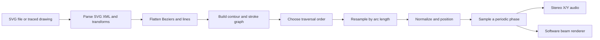
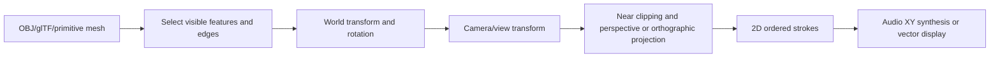
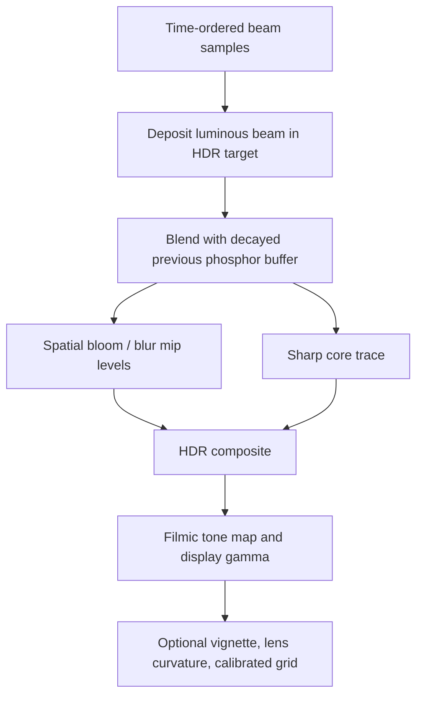
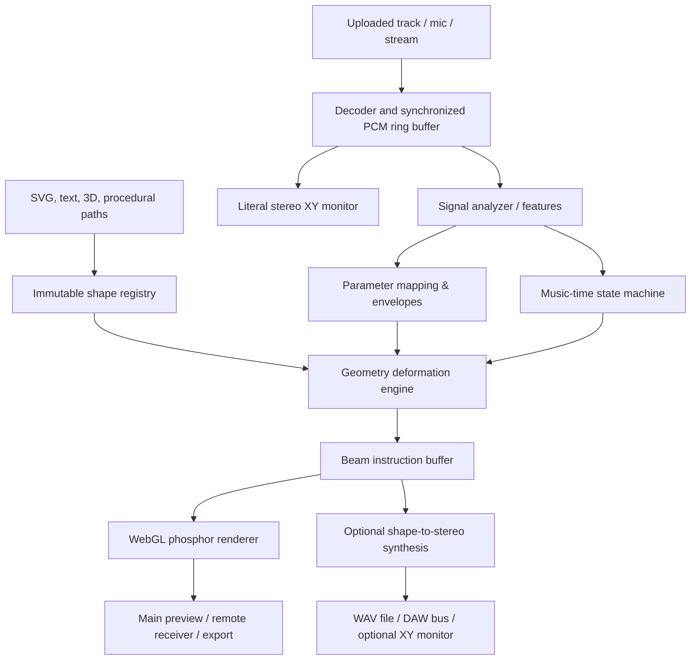
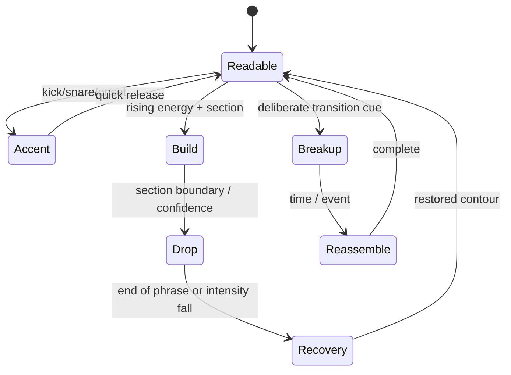

# SOUND DRAWING: THE COMPLETE ENGINEERING & RECREATION GUIDE

**A source-grounded instructional handbook for oscilloscope music, XY/vector synthesis, high-fidelity audio, 3D sound drawings, sound-reactive graphics, and practical software implementation**  
**Prepared:** 2026-11-16  
**Source material:** Four uploaded `.mov` recordings, approximately **38 minutes 15 seconds** in aggregate (see source inventory).  
**Audience:** Complete beginners through DSP, graphics, creative-coding, and music-application developers.  
**Primary intended outcome:** Understand the demonstrations, reproduce them with accessible tools, and build a reusable real-time Sound Drawing engine.

> **IMPORTANT EVIDENCE & COMPLETENESS NOTE.** I inspected the four supplied video files, checked their technical metadata, and reviewed representative image frames throughout each recording, with additional closer inspection of demonstration and equation scenes. I also checked the apparent original pages and current technical documentation for two matching YouTube tutorials. **A speech-to-text engine/audio transcription of the uploaded recordings was not available in this environment.** Therefore, this is **not** a verbatim transcript and cannot honestly be represented as a complete extraction of every spoken sentence. Specific spoken claims or exact parameter values not legible on screen are **not** attributed to the videos. This document is instead a detailed reconstruction of what is demonstrably visible and published in matching chapter descriptions, augmented by explicitly marked engineering derivations, tested principles, code recipes, references, and implementation exercises. Screen positions/times are approximate. The final recording provided ends around 18:21, earlier than the apparent full public video's published outro chapter. This handbook does not claim to have viewed any footage not included in the upload.

## How to read the evidence labels

- **[V1]** `Sound Drawing(1).mov`: on-screen concepts and demonstrated programming; duration **07:24.63**, 640×360 at 60 fps, AAC audio.
- **[V2]** `Sound Drawing 2.mov`: physical oscilloscope and 2D/3D drawing demonstration; duration **02:40.62**, 2012×1134 at 60 fps, AAC audio.
- **[V3]** `Sound Drawing 4(1).mov`: beginner tools and Ableton/osci-render walkthrough; duration **09:48.99**, 640×360 at 60 fps, AAC audio. Public matching tutorial: [How To Make Music That Draws Shapes](https://www.youtube.com/watch?v=vnhZbjTYrM8).
- **[V4]** `Sound Drawing 6.mov`: in-depth conceptual overview; duration **18:20.98**, 640×360 at 60 fps, AAC audio. Public matching tutorial: [This Music Draws Pictures When You Play It](https://www.youtube.com/watch?v=aACHxWfsWjU).
- **[EXT]** An independently verified reference from official documentation, GitHub, or published educational material.
- **[ENGINEERING]** Recommended implementation strategy, demonstration code, or inference developed for this handbook, **not** something asserted to have been said in a recording.

---

# PART I — WHAT THE VIDEOS ACTUALLY COVER

## 1. Source-by-source observational atlas

### 1.1 [V1] Digital sampling, fidelity, Max-style signal programming and drawing

| Approx. source time | Evident subject or action | Why it matters for recreation |
|---|---|---|
| 00:00–00:20 | “Digital Audio Basics” and “High Fidelity” opening, with a green signal-distorted text presentation | The eventual oscilloscope image depends on digital signal accuracy, not merely artwork resolution. |
| 00:20–01:00 | Sine curve, then discrete samples; an illustration notes a low sample count is a poor approximation of the sampled curve | Sampling creates a sequence of numerical amplitude values; reconstruction and band-limiting matter. |
| ~01:00–02:00 | Code/editor alongside waveform plot and an excerpt labeled **“The sampling theorem”**; text and formula relating sampled spectrum to copies of the original | Learn Nyquist/Shannon, sample clocks, Fourier transforms, and aliasing. |
| ~02:04–02:22 | Slide references **88.2 kHz**; then material compares **192 kHz** sampling | Compare per-cycle spatial sample budget, not just perceived audio sound quality. |
| ~02:25–03:06 | Square waveform, followed by a visibly rippled/rounded reconstruction | Sharp discontinuities need high harmonics, which cannot be preserved indefinitely with finite bandwidth; ringing is relevant. |
| ~03:06–03:50 | Text explicitly computes **Nyquist frequency = 192 kHz / 2 = 96 kHz** | 192 kHz playback cannot faithfully represent frequency components above 96 kHz (and practical filters require transition bands). |
| ~03:55–04:20 | A glowing green recursively structured triangular/fractal image on a physical-looking oscilloscope; editing and patch-like interfaces follow | Shapes can be encoded as continuously traversed XY signal paths, including procedural/fractal paths. |
| ~04:20–05:20 | Node/patch environment and code editor, with shape-related files and parameters | Recreate with a coordinate generator, frame/phase signal generator, and signal-routing patch or typed code. |
| ~05:20–06:50 | Audio device configuration; a point, a horizontal stroke, and signal-routing modules appear | Solve audio I/O, channel routing, device sample rate, and incremental geometric validation before complex scenes. |
| ~06:50–07:24 | Patch/code and an angular triangle shape being traced on screen | Demonstrates a practical progression from a single point or line to a closed figure. |

**Interpretive boundary:** The screen plainly demonstrates the sampling-theorem concept, different sampling rates, programming/patching, and increasing geometric complexity. The small code text and precise signal operators are not readable enough to reconstruct line-for-line from the available frames. The implementations in Parts III–V teach equivalent principles, not a claimed transcription of the source code.

### 1.2 [V2] A performer, real scope display, and geometric vector-animation showcase

| Approx. source time | Evident subject or action | Engineering interpretation |
|---|---|---|
| 00:00–00:20 | Presenter with microphone, audio/controller setup, and green cathode-ray-looking screen | External audio routing and the physical display must be calibrated. |
| 00:20–00:50 | Small green point and a circle/ellipse on the display | A constant XY signal produces a point; quadrature sinusoids produce a circle. |
| 00:50–01:15 | Explanation with displayed shape changing; scope knobs and camera angle shown | Amplitude, offsets, display gain and/or audio synthesis parameters alter a trace. |
| ~01:15–01:45 | Isolated straight segments and open/closed rectangular traces against black | A draw path is a time-ordered signal, not a bitmap. |
| ~01:45–02:00 | Connected rectilinear, branching or maze-like figure | Paths are made of ordered line segments; drawing order and repositioning are observable. |
| ~02:00–02:30 | Multiple floating cube-like wireframes, a tunnel or 3D group, and rotating/repositioned objects | Build 3D geometry, project edges to 2D, then serialize edge segments into XY samples. |
| ~02:30–02:40 | Atmospheric shots of a performer/laser effects and a cube graphic | A software-scope renderer, actual physical scope and stage projection are different output backends. |

The exact program used in [V2] is not established solely by the provided frames. It should not be identified without further source verification. The shape vocabulary and achievable results **are** demonstrable.

### 1.3 [V3] Beginner creation workflow and application choices

The matching public tutorial supplies the following chapter labels; they also align with the uploaded recording's visible structure.

| Chapter | Video time | Instructional subject | Recreation task |
|---|---|---|---|
| Intro | 00:00 | Short glowing-figure example, presenter introduction | Define the difference between conventional waveform plotting and XY sound drawing. |
| DAW | 01:05 | Digital Audio Workstation, including arranging notes/automation | Prepare a DAW project and route MIDI/audio. |
| `osci-render` | 01:26 | Shape-to-audio synthesis tool | Load a shape source and turn it into stereo XY signal. |
| OsciStudio | 02:28 | Dedicated oscilloscope music composition environment | Compare timeline, SVG/OBJ and animation authoring approaches. |
| DIY | 03:05 | Building/programming your own shape generator | Learn primitives, DSP and coordinate serialization. |
| Free oscilloscopes | 03:24 | Software viewing alternatives | Make visualization possible without analog hardware. |
| `sosci` | 04:05 | High-quality software oscilloscope | Inspect incoming signal rather than synthesize a shape. |
| `osci-render` versus `sosci` | 04:54 | Tool-selection comparison | Distinguish synthesis from signal visualization. |
| Demonstration | 05:24 | DAW with separate effect/instrument regions and a software scope | Build a start-to-finish interactive production session. |
| Outro | 08:42 | Recap | Create/export a reusable session. |

**Closer demonstration observations:** ~05:47 shows a sound source/DAW next to a glowing point; ~06:05 shows an `osci-render` interface drawing a bright square and multiple selectable visual/audio controls; ~06:31–07:05 shows a drawn loudspeaker/sound icon, moving from outline through a dotted/stroked form; ~07:17–08:27 shows Ableton arrangement/MIDI lanes, a recognizable glowing loudspeaker figure, parameter/control adjustment and increasingly distorted/duplicated paths. [V3]

**Important distinction:** The tutorial's `osci-render` is a **synthesizer that makes an audio signal trace art**; `sosci` is a **scope-style visualization of a signal**. They can be used together, but are not interchangeable. [V3, EXT]

### 1.4 [V4] Detailed oscilloscope music theory and sound/visual compromises

The matching public chapter list is especially helpful for navigating the uploaded recording. Source file playback stops at ~18:21, so the full video's later public outro is outside this clip.

| Published chapter boundary | Topic | On-screen evidence / principal engineering ideas |
|---|---|---|
| 00:00 | Intro | Glowing abstract wireframe displays; flashing-visuals warning appears early. |
| 01:32 | How it works | Hearts, simple wave traces, sound-produced figures, and XY axis principle. |
| 03:07 | Higher dimensions | Wireframe polyhedra; 3D projection versus 2D display is illustrated near 04:05. |
| 04:20 | Why it is hard | Shape detail, tone quality, brightness, complexity and sample/path-budget tradeoffs. |
| 06:24 | Harmony via duplication | Multiple copies of figures and musical/visual layering; integer ratios illustrated, including **3:1** around ~07:39. |
| 09:05 | Frequency/phase modulation | How evolving oscillator phase/frequency causes visible geometric transformations. |
| 11:07 | Audio effects | Examples include phaser/reverb labels in graphics; an audio effect also changes the drawn XY signal. |
| 12:57 | Visual effects | Transformations of line images, including geometric warps and projections, are shown. |
| 15:10 | Lissajous patterns | Parametric sine relationships, integer frequency ratios, their figures, and later 3D-style example equations. |
| 17:11 | Tuning systems | Comparing exact rational frequency relations against equal-tempered musical tuning; Lissajous patterns evolve if ratios do not close. |
| 18:55 | Public-video outro | **Not present** in the 18:21 uploaded recording. |

Specific observed moments: a waveform/shape drawing section at ~02:00; heart and 3D projections at ~03:03–04:08; a block-like vector-to-wave diagram at ~07:12; a **3:1** ratio picture at ~07:39; a table titled “Frequency Ratios in 12-Tone Equal Temperament (12-TET)” at ~08:04; “Duplicator” label at ~08:33; bright streaks and effect artifacts in ~11:30–12:50; a transform written in polar-coordinate notation around ~13:35; “Lissajous Patterns” title around ~15:45; 3D parametric sine example around ~16:19; changing curves and musical-notation graphic around ~17:50. [V4]

### 1.5 Concepts shared by all four

1. **Sound can be a coordinate stream.** In XY mode, sample-paired stereo channels can dictate the position of a beam.
2. **The picture is drawn over time.** Smooth appearance relies on fast, repeated, correctly ordered traversal and display persistence.
3. **Frequency, geometry, and timbre are coupled** when the *same stereo waveform* is used for both sound and image.
4. **Sampling rate and bandwidth impose limits.** High-detail corners, discontinuous jumps, and fast movement create high-frequency content and aliasing risk.
5. **Path order matters.** Even if a picture's edges look right on paper, connection lines and path discontinuities can change the display.
6. **3D shapes need 2D projection** before encoding into two audio channels.
7. **Audio-domain processing changes picture geometry** because it modifies the actual X/Y samples.
8. **DAW integration and automation** make the shapes musical rather than merely static illustrations.
9. **A convincing physical scope appearance involves light accumulation and decay**, not ordinary opaque computer line drawing.
10. **Musically useful composition is a compromise:** the most beautiful image is not always the most pleasant resulting sound.

---

# PART II — FIRST PRINCIPLES, TAUGHT FROM ZERO

## 2. The three different things people call “sound drawing”

**A. Time-domain oscilloscope:** x-axis = time; y-axis = amplitude. A kick appears as a transient over a short time window. Two independent channels can be plotted in separate lanes. This is useful for diagnosing music, but does not generally produce heart/triangle/cube images.

**B. Genuine XY oscilloscope music:** x-axis = instantaneous LEFT audio-channel amplitude; y-axis = instantaneous RIGHT audio-channel amplitude, paired at the **same sample index**. The signal itself is composed to trace the wanted outline; playing it can be audible. The visual is not independent of the sound.

**C. Sound-reactive vector/oscilloscope-inspired animation:** a renderer draws a stored, procedural or generated path; separate music controls its motion, distortion, brightness and transitions. **This is the correct architecture if arbitrary DJ tracks must preserve a chosen recognizable figure.** It may imitate a scope convincingly, but the rendered line is **not necessarily** the literal XY waveform of that DJ track. [ENGINEERING]

> **Core truth:** You cannot guarantee an arbitrary stereo song will naturally trace a particular readable icon. Its left and right sample streams contain whatever the recording contains. If a music-reactive engine holds a word, logo or recognizable shape under dubstep, house or ambient audio, it is deliberately preserving independent vector geometry while mapping extracted audio features to deformation. This is a feature, not a mathematical shortcut.

## 3. What a digital audio sample actually is

A microphone or sound generator produces a continuous-time waveform `s(t)`; digital conversion measures it at times `t_n = n / F_s`.

\[
s[n] = s(n/F_s), \quad n = 0,1,2,\ldots
\]

Here `F_s` is the **sample rate**, for example 44,100, 48,000, 88,200, 96,000 or 192,000 samples/second, *per channel*. A stereo 192 kHz stream has 192,000 paired (left,right) sample positions per second. [V1, ENGINEERING]

For a sine wave,

\[
s[n] = A\sin\big(2\pi f\,n/F_s + \phi\big).
\]

- `A` sets amplitude, and in genuine XY synthesis also affects image size.
- `f` is cycles per second (Hz), which affects audible pitch and repetition speed.
- `\phi` is phase, which influences shape and orientation relative to the other channel.
- Samples themselves are numbers, not pixel positions until the renderer maps them into screen coordinates.

A 48 kHz stereo signal contains 480 paired samples for each repeated 100 Hz path, 240 for 200 Hz, and only 48 for 1 kHz. At 192 kHz, these budgets become 1,920, 960 and 192 samples respectively. More samples per path can improve representable traversal detail, but doubling the sample rate **does not** automatically improve analog sound quality or eliminate geometric issues. It also increases CPU, I/O and memory costs.

## 4. Sampling theorem, Fourier spectrum and aliasing

**Simplified sampling theorem:** A strictly band-limited signal with no energy at or above `F_s/2` can, ideally, be reconstructed from sufficiently precise uniformly spaced samples. The Nyquist frequency is `F_N = F_s / 2`. [V1]

| Sample rate | Nyquist frequency | Paired samples available per 120 Hz XY revolution |
|---|---:|---:|
| 44,100 Hz | 22,050 Hz | 367.5 average |
| 48,000 Hz | 24,000 Hz | 400 |
| 88,200 Hz | 44,100 Hz | 735 |
| 96,000 Hz | 48,000 Hz | 800 |
| 192,000 Hz | 96,000 Hz | 1,600 |

Non-integer samples-per-cycle are normal. In production, use a **fractional phase accumulator** rather than trying to force an arbitrary note into an integer number of samples.

If a source contains frequency `f` above `F_N`, components fold back into the representable range. A practical expression for a simple sinusoidal alias is to find an equivalent frequency by wrapping `f` into `[-F_s/2, F_s/2]`, then take its magnitude. **Example:** a 30 kHz tone sampled at 48 kHz aliases to 18 kHz. In shape playback, corners and sudden repositioning are particularly rich in high frequencies and can turn into spirals, artifacts, smears or misleading edges.

A periodic shape/path has a Fourier-series representation:

\[
x(t)=a_0+\sum_{k=1}^{\infty}\left[a_k\cos(2\pi k f_0t)+b_k\sin(2\pi k f_0t)\right].
\]

The same is true independently for `y(t)`. Very sharp turns may require many high-order harmonics. A square-like signal, for example, has theoretically infinite odd harmonics; a finite-bandwidth device smooths its corners and can show ringing. The **Gibbs phenomenon** is associated with truncated Fourier representations near discontinuities, and is one reason the square-to-rounded/rippled imagery in [V1] matters. [V1, ENGINEERING]

Practical steps:

1. Start with smooth curves (circle, ellipse, rounded rectangle).
2. Limit instantaneous jumps, especially from one disconnected stroke to another.
3. Use smooth ramps and/or band-limited synthesis instead of ideal hard discontinuities when audible output matters.
4. Oversample processing internally if needed; apply an anti-aliasing low-pass filter before decimation.
5. Set explicit maximum drawing speed and per-frame point budgets.
6. Measure actual output using the waveform and XY view after every processing step.

## 5. How a stereo pair becomes an XY picture

Take paired signal samples `L[n], R[n]` and map to a viewport width `W`, height `H`:

\[
X_n = \frac{W}{2} + g_x L[n]\frac{W}{2},\qquad
Y_n = \frac{H}{2} - g_y R[n]\frac{H}{2}.
\]

The minus sign on Y compensates for typical computer screen coordinates increasing downward. In an actual XY scope, cable assignment, channel inversion, DC/AC coupling and gain determine the orientation. There is **no universal left/right wiring convention** across all software and devices, so verify with a horizontal/vertical test line before using real hardware.

The render operation is conceptually `moveTo(X[0],Y[0]); lineTo(X[1],Y[1]); ...`. When points are paired, and the drawing is repeated frequently, the phosphor display or software trail makes a continuous visible figure.

## 6. Your first five signal-generated figures

Use `\omega = 2\pi f` and time `t`.

| Figure | X/left | Y/right | Learning objective |
|---|---|---|---|
| Dot | `0` | `0` | DC-centered spot, gain and output calibration. |
| Horizontal stroke | `0.75 sin(ωt)` | `0` | X control. |
| Vertical stroke | `0` | `0.75 sin(ωt)` | Y control. |
| Diagonal line | `0.75 sin(ωt)` | `0.75 sin(ωt)` | In-phase channels make a diagonal. |
| Circle | `0.75 cos(ωt)` | `0.75 sin(ωt)` | A 90° phase difference produces a circle. |
| Ellipse | `0.9 cos(ωt)` | `0.45 sin(ωt)` | Different gains scale the axes. |
| Lissajous | `A sin(2πaf t + φ)` | `B sin(2πbf t)` | Frequency ratios draw lobed closed or drifting curves. |

**Exercise 1:** Output a 120 Hz circle, then change `f` to 240 Hz with the amplitudes untouched. The shape should remain a circle but traverse twice as fast and sound an octave higher (for a simple single-cycle circle). **Exercise 2:** Rotate the circle by changing relative phase or applying a 2×2 rotation matrix to X and Y. **Exercise 3:** Replace both equal-frequency oscillators with 3:2, 4:3 and 7:6 frequency ratios and compare closure and number of lobes.

## 7. Understanding Lissajous figures and tuning

\[
x(t)=A\sin(2\pi f_x t+\phi_x),\quad
y(t)=B\sin(2\pi f_y t+\phi_y).
\]

When `f_x/f_y = p/q` for relatively prime positive integers `p` and `q`, write `f_x = p f_b` and `f_y = q f_b`. The combined pattern has a repetition period `T = 1/f_b = p/f_x = q/f_y` (although special symmetries can make a visually identical pattern appear earlier). For exact commensurable frequencies, `f_b` is their common base frequency. Approximate decimal frequency ratios can produce slow phase drift instead of a strictly closed trace. If `f_x = 300 Hz` and `f_y=200 Hz`, then `f_b=100 Hz` and the combined pattern repeats every 10 ms. Other phase choices can change intersections and orientations.

12-tone equal temperament uses a semitone ratio of `2^(1/12)`; a note `n` semitones above a reference is `f_n = f_0 · 2^(n/12)`. That irrational equal-tempered ratio is generally not identical to a simple exact fraction such as `3/2`. Consequently, a complex two-oscillator figure may evolve slowly instead of closing perfectly. This is the important connection between the 12-TET frequency table, `3:1` example, and tuning/Lissajous scenes in [V4].

**Experiment:** Set `f_x = 300`, `f_y = 200`; then set `f_x = 200 * 2^(7/12)` (a tempered fifth). Over a longer viewing interval the latter pattern moves relative to a perfectly repeating 3:2 relationship. Keep the capture window and phosphor persistence identical when comparing.

## 8. Basic mathematical geometry that becomes sound

Represent the desired shape as an ordered *continuous path* `P(u) = (x(u), y(u))` for normalized phase `u ∈ [0,1)`. At sample index `n` use `u_n = fract(f_0 n / F_s + u_0)` and output `L[n] = gain · x(u_n)`, `R[n] = gain · y(u_n)`. This is the bridge between picture geometry and playable audio. [ENGINEERING]

**Triangle:** Define `P` as 3 vertices followed by the start vertex and interpolate along edges. **Rectangle:** Define 4 edges with appropriate traversal lengths. **Heart:** Use a parametric curve, or import/resample an SVG path. **Letters and logos:** Convert outlines to ordered contours, assign explicit pen-up/pen-down behavior, and organize the travel routes. **Fractals:** Recursively subdivide or grow paths, but cap recursion and high-frequency cost.

Parametric heart example (normalize its coordinates before sound generation):

\[
x(u)=16\sin^3(2\pi u),\quad
y(u)=13\cos(2\pi u)-5\cos(4\pi u)-2\cos(6\pi u)-\cos(8\pi u).
\]

The heart equation is an **example engineering formula**, not an extracted equation claimed from the footage.

---

# PART III — RECREATE THE CORE FUNCTIONALITY WITH FREE SOFTWARE

## 9. The minimum working setup

### Path A: quickest end-user route (DAW + existing generator)

1. Obtain the available **free** version of `osci-render` from https://osci-render.com/. The project's source repository is https://github.com/jameshball/osci-render; its core source is GPLv3. Feature availability varies by free/premium edition and software release; do not assume all current paid features are free.
2. Install it as a standalone app or the supported DAW plugin format, following the specific release instructions (VST3/AU support is documented by the project).
3. Open a DAW such as Ableton Live (commercial) or a suitable free DAW, and load the generator. Create a session at 48 kHz to begin.
4. Start with the generator's circle/default shape or import a **simple closed SVG**.
5. Play a sustained low/mid MIDI note if the device uses note-triggered voices. Locate and configure audio and MIDI input/output in its current interface.
6. Open the built-in viewer or a compatible XY visualizer; observe the shape.
7. Record/export a **stereo** file and retain its channel order. Test it in an independent XY scope viewer.
8. Only then add automations and effects: scale, rotation, waveform distortion, duplicates, attack/release, MIDI note selection.
9. Check both *sound* and *picture* after each effect. Save the DAW session/preset and a lossless exported test.

**Troubleshooting:** A point often means one or both channels have nearly no AC variation; a line rather than circle can mean channels are identical/in phase or one channel is missing; a diagonal line can mean a stereo output was collapsed to mono; a drifting image can arise from differing frequencies/phase; extra diagonal lines may be pen moves that were sent through the audio without blanking.

### Path B: beginner-friendly hardware-free viewer

Use a software viewer such as [osci-render's included viewer](https://osci-render.com/), the free viewing tools linked in the original tutorials, or a [woscope-style XY viewer](https://github.com/m1el/woscope). The official `sosci` product focuses on high-quality visualization; its current licensing/price should be checked, rather than assuming it is a free open-source component. [V3, EXT]

### Path C: open-source developer setup

Use `Node.js`/TypeScript + `Web Audio API` for signal input, `SVG` geometry with path sampling for shapes, `Canvas`/`WebGL` for rendering, and `FFmpeg` for export. For 3D, use a mature geometry library such as `three.js`, but convert its projected 2D *edges* to vector strokes before feeding a scope pipeline. [ENGINEERING]

## 10. The free component and library catalog

| Tool / library | What it contributes | Free / licensing caution | Resource |
|---|---|---|---|
| **osci-render** | Full audiovisual shape-to-audio synthesis, SVG/OBJ/text, Lua, DAW/MIDI, viewer | Free edition exists; GPLv3 source; premium features separate; review obligations before distributing derivatives | https://github.com/jameshball/osci-render |
| **XYscope for Processing** | Draw points/lines/shapes; convert geometry to audio channels for vector displays | Open project; verify repository's specific licensing before embedding | https://github.com/ffd8/xyscope |
| **OSCDraw** | Very small HTML/JS vector drawing-to-stereo sound reference | Open repository; inspect declared license before reuse | https://github.com/adlerweb/OSCDraw |
| **woscope** | WebGL simulated XY phosphor scope | Open GitHub source; verify version/license | https://github.com/m1el/woscope |
| **Phosphor / oscilloscope_playground** | Multi-pass beam, phosphor decay, bloom, CRT simulation | Open repository; verify license | https://github.com/hubertlim/oscilloscope_playground |
| **Web Audio API** | Native microphone/file/stream routing, PCM and FFT | Built into modern browsers; no third-party dependency | https://developer.mozilla.org/en-US/docs/Web/API/Web_Audio_API |
| **AudioWorklet** | Low-latency sample-by-sample DSP and synchronous stereo handling | Browser API; real-time scheduling discipline required | https://developer.mozilla.org/en-US/docs/Web/API/AudioWorkletProcessor |
| **Meyda** | Audio feature extraction: RMS, centroid, loudness, spectral metrics and more | MIT license | https://github.com/meyda/meyda |
| **three.js** | Wireframe 3D meshes, transforms, projection, cameras | MIT license (check current repository) | https://threejs.org/ |
| **Paper.js** | Vector path modeling, segment splitting, curvature and geometry editing | Open source (check actual package license) | https://paperjs.org/ |
| **svg-path-properties** | Get path length and sample points along SVG geometry | Check current version and license | https://github.com/rveciana/svg-path-properties |
| **opentype.js** | Convert fonts to outlines for traceable text | Open source; respect font licenses separately | https://github.com/opentypejs/opentype.js |
| **Tone.js** | Musical synthesis, transport/metronomic timing, signal/control routing | MIT license | https://tonejs.github.io/ |
| **FFmpeg** | Decode, process, resample and mux media; render XY analysis | Free software; build-dependent LGPL/GPL license | https://ffmpeg.org/ |
| **librosa** | Offline onset, pitch/chroma, tempo, spectral features, beat events | BSD-3-Clause license | https://librosa.org/ |
| **Max/MSP / Max for Live** | Visual signal patching and DAW/device integrations matching one recording's patch aesthetic | Commercial products; not zero-cost substitutes | https://cycling74.com/ |
| **Pure Data (Pd)** | Free patch-based alternative for audio/video signal experiments | Free/open-source; third-party externals have separate licenses | https://puredata.info/ |
| **OsciStudio** | Dedicated commercial music-to-XY shape environment, OBJ/SVG and timelines | Paid license, not a free library | https://www.oscilloscopemusic.com/software/oscistudio/ |
| **Oscillody** | Real-time audio-based oscilloscope visualizer and MP4 export reference | GPL-3.0-or-later; strong copyleft caution | https://github.com/Akosmo/Oscillody |

**Selection rule:** For a closed-source Electron application, prefer browser APIs and permissively licensed libraries unless a legal review approves GPL/copyleft integration. Linking to a GPL project's source as a *design reference* is different from copying code into a proprietary distributed application. [ENGINEERING]

## 11. Generate a real XY-audio figure, end to end, with Python

This complete example uses **Python 3 + NumPy only** and the Python standard library (`wave`). It writes a two-channel, 16-bit PCM WAV that should draw a triangle on an XY scope. Install NumPy with `python -m pip install numpy`. Save as `triangle_xy.py` and run `python triangle_xy.py`.

```python
from pathlib import Path
import wave
import numpy as np

FS = 48000
DURATION = 5.0
CYCLES_PER_SECOND = 120.0
GAIN = 0.50
OUTPUT = Path("triangle_xy_48k.wav")

# Unitless vertices already fit in approximately [-1,+1].
vertices = np.asarray([
    [-0.82, -0.70],
    [ 0.82, -0.70],
    [ 0.00,  0.85],
], dtype=np.float64)


def make_closed_path_lookup(vertices: np.ndarray, samples=4096):
    """Resample a closed polygon uniformly by Euclidean arc length."""
    closed = np.vstack([vertices, vertices[0]])
    edges = np.diff(closed, axis=0)
    lengths = np.linalg.norm(edges, axis=1)
    if np.any(lengths <= 1e-12):
        raise ValueError("Remove coincident adjacent vertices")
    cum = np.r_[0.0, np.cumsum(lengths)]
    perimeter = float(cum[-1])
    distance = np.arange(samples, dtype=np.float64) * perimeter / samples
    edge_index = np.searchsorted(cum, distance, side="right") - 1
    edge_index = np.clip(edge_index, 0, len(edges) - 1)
    amount = (distance - cum[edge_index]) / lengths[edge_index]
    lookup = closed[edge_index] + amount[:, None] * edges[edge_index]
    return lookup


lookup = make_closed_path_lookup(vertices)
frame_count = round(FS * DURATION)
sample_index = np.arange(frame_count, dtype=np.float64)
phase = np.mod(sample_index * CYCLES_PER_SECOND / FS, 1.0)
index = phase * len(lookup)
index0 = np.floor(index).astype(np.int64)
frac = index - index0
xy = ((1.0 - frac)[:, None] * lookup[index0] +
      frac[:, None] * lookup[(index0 + 1) % len(lookup)])

# X goes to left channel, Y goes to right channel.
stereo = np.clip(GAIN * xy, -0.999, +0.999)
pcm = np.round(stereo * 32767).astype("<i2")
with wave.open(str(OUTPUT), "wb") as wav:
    wav.setnchannels(2)
    wav.setsampwidth(2)
    wav.setframerate(FS)
    wav.writeframes(pcm.tobytes())

print(f"Saved {OUTPUT.resolve()} ({DURATION:.1f} s, {FS} Hz, stereo)")
```

**Verification:** Import the WAV into a stereo editor or an XY scope. It should trace a triangle, although exact appearance depends on software gain/blur. Check for harsh sound; reduce gain and frequency before listening through headphones. The path contains non-smooth corners, so this is a *basic geometry* test, not a perfectly band-limited mastering example. Do **not** connect a headphone/line output directly to arbitrary scope terminals without checking grounding and voltage requirements. [ENGINEERING]

To make a square, change the vertices to `[[-.7,-.7],[.7,-.7],[.7,.7],[-.7,.7]]`; to increase pitch, increase `CYCLES_PER_SECOND`; to alter size, change `GAIN`. To implement SVG outlines instead of hardcoded vertices, see Section 13.

## 12. Preview XY audio with FFmpeg without a specialized app

FFmpeg contains an `avectorscope` filter that provides an XY-like visualization of stereo audio. An example command:

```bash
ffmpeg -i triangle_xy_48k.wav \
  -filter_complex "[0:a]avectorscope=s=960x960:mode=lissajous_xy:draw=line:scale=lin:zoom=0.9,format=yuv420p[v]" \
  -map "[v]" -map 0:a -c:v libx264 -c:a aac -shortest triangle_preview.mp4
```

Inspect orientation in the rendered output. Depending on the tool and coordinate convention, you may need to invert or flip Y, invert or swap the audio channels, or use a horizontal/vertical test tone. `avectorscope` is a debugging/visualization tool; it is **not** equivalent to an analog beam model with calibrated phosphor persistence. [EXT, ENGINEERING]

## 13. Turn SVGs, typography, and images into continuous vector paths

### 13.1 Vector file pipeline



A robust importer does much more than read the `d` attribute of an SVG `<path>`. Support `M/L/H/V/C/S/Q/T/A/Z` commands, **relative and absolute commands**, nested group transforms, the `viewBox`, strokes, filled objects, and curves. An SVG's apparent **filled region** is not inherently a scope-compatible path. Decide whether to draw the fill boundary, hatch it, trace its skeleton/centerline, or convert it to multiple contours.

**Production-friendly approach:** Use a mature SVG parser and path-sampling package; flatten curves to polylines with error tolerance in the displayed/pixel domain. Apply all transforms *before* resampling. For each polyline, record whether it is closed, its total length, its winding direction, its semantic identity (letter A, eyebrow, cube edge), and its logical pen-lift boundaries. [ENGINEERING]

### 13.2 Cubic Bézier mathematics

A cubic segment with control points `P0, P1, P2, P3` is

\[
B(t)=(1-t)^3P_0+3(1-t)^2tP_1+3(1-t)t^2P_2+t^3P_3,
\qquad 0\le t\le1.
\]

Evaluating Bézier curves at equally spaced values of `t` does **not** guarantee equal physical spacing along the curve. Instead:

1. Subdivide the curve until chord-to-curve error is below a chosen tolerance.
2. Estimate cumulative arc length from the polyline segments.
3. Create a new set of points uniformly spaced by arc length `s`.
4. Preserve high-curvature landmarks, corners and intentional cusps so smoothing does not erase design identity.
5. For animated paths, maintain stable semantic correspondences as well as a fixed or bounded point budget.

Adaptive sampling avoids overusing precious samples on straight spans while starving sharp turns. For a GPU-only scope-like renderer you can use more points; for faithful **audible stereo XY** you are constrained by audio sample rate and redraw frequency.

### 13.3 The disconnected-strokes problem

Suppose you want to draw the letter **H**: left vertical stem, right vertical stem, and horizontal crossbar. A true scope generally receives a **single continuous stream of XY voltage**. Moving from the end of one stroke to the start of another creates a visible transition unless the beam can be blanked or its brightness reduced.

Options:

- **Single-line design:** Arrange the path into one continuous drawing where possible.
- **Stroke retracing:** Permit retraces over existing lines to reach the next stroke.
- **Connector minimization:** Find a stroke order that minimizes the distances traveled while not drawing the intended shape.
- **Physical beam blanking:** Use a suitably supported Z/intensity/blanking input and additional control signal (not always available), with careful hardware verification. Plain stereo audio alone usually does not provide an independent blanking channel.
- **Software-only blanking:** Put `penUp=true` in the path instruction stream and suppress those segments in the visual renderer. This is **not equivalent** to an unblanked two-channel hardware scope.
- **Dynamic beam focus/brightness:** Dim or reduce persistence on jumps; still test visual and audio behavior.

The correct data representation is therefore a set of **strokes and travel actions**, not simply an array of unordered edges.

```ts
type Vec2 = { x: number; y: number };
type StrokeSegment = {
  id: string;
  points: Vec2[];
  closed: boolean;
  weight: number;
  semanticGroup?: string;
};
type BeamInstruction =
  | { kind: 'trace'; strokeId: string; points: Vec2[] }
  | { kind: 'travel'; from: Vec2; to: Vec2; blank: boolean };
```

### 13.4 Text-to-scope pipeline

1. Choose a licensed font whose outlines can be extracted or drawn with its permitted usage rights.
2. Convert glyph shapes to contours; preserve holes such as the center of `A`, `B`, `O`, `P`, `R`.
3. Apply kerning and letter positioning **before** curve flattening.
4. Choose output style: outer outlines, both inner/outer outlines, single-line font, or centerline skeletonization.
5. Determine stroke order between glyphs and intra-glyph contours.
6. Resample the individual strokes; build a consistent source of truth for any future per-letter transform.
7. Keep each letter's original readable vector skeleton immutable. Apply non-destructive effects to separate animated working buffers.
8. For audio-to-drawing export, encode travel honestly; for purely digital visualization, use actual blanking instructions.

**Avoid:** treating characters as mere groups of moving particles. A cloud of points may be attractive but often loses the letter structure that makes an oscilloscope word effect special.

### 13.5 Raster images and silhouettes

An image (PNG/JPG) is not an XY path. To draw it, first derive contours, line art, or a skeleton; threshold/edge-detect it, find connected components, trace contours, simplify and order paths, and discard visually insignificant noise. For a photo, trace **selected contours** or a generative abstraction; attempting to encode every dark/light pixel into stereo audio will generally sound poor and lose focus. In a scope-style rasterized visual-only app, a user image can be converted into many independent strokes because electronic blanking can be simulated.

**Practical learner exercise:** Draw a simple SVG triangle, then an outline heart, then the word `BEAM`. For each, produce: (a) original SVG, (b) flattened contour preview, (c) beam-order travel preview, (d) XY audio or visualized path, and (e) quality-control notes.

## 14. Convert a 3D model into oscilloscope-style drawings

[V2] and [V4] visibly demonstrate cube-like and polyhedral 3D wireframes, projections and moving 3D geometry. The required transformation chain is:



### 14.1 Rotations

For a 3D point `p=(x,y,z)`, apply a 3×3 rotation matrix or normalized quaternion. An example Z-axis rotation is

\[
R_z(\theta)=\begin{bmatrix}
\cos\theta&-\sin\theta&0\\
\sin\theta&\cos\theta&0\\
0&0&1
\end{bmatrix}.
\]

The general model/view transform first takes a local mesh point into world coordinates and then into camera coordinates. Represent rotations with quaternions for animation when possible to avoid gimbal-lock artifacts.

### 14.2 Project to 2D

With camera-space point `(x_c,y_c,z_c)` and a positive-forward convention, pinhole perspective is approximately

\[
x_p=f\frac{x_c}{z_c},\qquad y_p=f\frac{y_c}{z_c},\qquad z_c>z_{near}.
\]

The sign of `z` changes with camera convention. Apply camera clipping **before** division. An orthographic camera instead maps `x_p = scale·x_c`, `y_p = scale·y_c`; it lacks depth foreshortening and is often easier for scope-style illustrations. Projection choice is a creative control, not a superficial rendering switch.

### 14.3 Edges and hidden lines

A rendered 3D mesh may have hundreds or thousands of triangular edges. You must decide which edges to trace:

- explicit artist-authored curves/edges;
- boundary/silhouette edges;
- sharp crease edges;
- all visible wireframe edges;
- deliberately simplified feature lines;
- hidden lines (optional, if useful to express a cube's topology).

For a full 3D line-art workflow, choose a deterministic rule for back-facing/occluded edges and re-evaluate as the camera moves. Do not feed every tessellation edge into the scope just because a model contains it. This quickly overwhelms the sample budget and turns a recognizable model into a bright mesh cloud.

### 14.4 Cube walkthrough

1. Create eight vertices at `±1` on each axis.
2. Create the twelve cube edges as vertex-index pairs.
3. Set the camera and an orthographic projection.
4. Rotate the cube around X and Y using time-based quaternions.
5. Recompute projected endpoints each visual frame.
6. Choose edge order; prevent accidental diagonals with travel/blanking handling.
7. If physically encoding stereo, resample the edge traversal according to an available per-cycle sample budget. If only rendering, preserve separate strokes with intentional blanking.
8. Animate at 30–60 display frames/second while audio synthesis continues at audio sample rate. **Do not drive audio sample generation only at 60 fps.**
9. Add a second/third cube only after verifying visibility and repeatability of a single cube.

### 14.5 3D coordinate signals and higher-dimensional demonstrations

You can also define `x(t), y(t), z(t)` as three harmonically related oscillators and project `(x,y,z)` into a 2D camera. For example:

\[
x(t)=\sin(4t+\pi/3),\quad y(t)=\sin(5t),\quad z(t)=\sin(4t).
\]

This is an **illustrative** 3D Lissajous-like construction; precise equations on the small source slides should not be assumed identical to this choice. The important distinction is that `z(t)` is used for 3D position/depth before projection, while an ordinary stereo scope still displays only two driven coordinates. A 3D object does not require a physical 3-axis monitor to achieve a projected 3D appearance. [V4, ENGINEERING]

## 15. Animation, choreography, envelopes and meaningful beat timing

### 15.1 Three independent clocks

An advanced engine needs at least three coherent timelines:

1. **Audio sample clock:** sample index `n` / `F_s`, authoritative for sound generation and capture.
2. **Music transport clock:** BPM, beats, bars, phrases, section transitions. One 4/4 bar lasts `240/BPM` seconds.
3. **Rendering clock:** frame presentation time, often 60 fps but not perfectly steady.

Don't increment animation state by an assumed frame interval. Compute positions from absolute transport/audio timestamps; allow motion blur or subframe sampling if camera/render times vary.

At 150 BPM, a quarter-note beat is `60/150 = 0.4 s`; an 8-bar 4/4 phrase is `8×4×0.4 = 12.8 s`. These values are **examples** for deterministic choreography.

### 15.2 Suggested animation parameter hierarchy

```text
Preset
├─ Shape source
│  ├─ builtin / SVG / text / 3D / procedural
│  ├─ immutable semantic groups
│  └─ vector path and stroke order
├─ Global motion
│  ├─ position, scale, rotation, orbit
│  ├─ projection / camera
│  ├─ path traversal speed / note frequency
│  └─ overall opacity / gain
├─ Local motion
│  ├─ per-vertex/edge displacement
│  ├─ per-glyph transforms
│  ├─ coordinate noise and harmonic FM
│  └─ distortion and recovery
├─ Beam simulation
│  ├─ brightness, beam radius, glow
│  ├─ dwell weighting, phosphor decay
│  └─ blanking, additive blend, color
├─ Audio features and mappings
│  ├─ onset, beat, downbeat, phrase, section
│  ├─ low/mid/high energy, RMS, spectral flux
│  ├─ custom bands, pitch/chroma, transient
│  └─ mapping curves / clamp / smoothing
└─ Automation
   ├─ lane values and envelopes
   ├─ LFOs / per-note modulation
   ├─ beat-quantized events
   ├─ random seeds and recovery
   └─ preset transitions
```

### 15.3 Envelopes

An ADSR envelope maps trigger time to attack, decay, sustain and release. For the initial attack, one simple function is `a(t) = clamp((t-t0)/T_attack, 0, 1)`; the decay stage can interpolate from peak to sustain. Smoothstep interpolation `s(u)=3u²−2u³` prevents instantaneous velocity changes at endpoint boundaries.

In a **visual-word mode**, apply attack primarily to glow/excursion/rotation and retain an independently controllable **legibility** floor. An attack event need not make the letter disappear. During release, use shortest-path rotation and shape morph back toward the original contour; don't teleport vertices.

## 16. Duplicators, harmony and frequency/phase modulation

[V4] explicitly organizes its explanation around harmony through duplication, frequency/phase modulation, then audio and visual effects. These are separate tools with distinct consequences.

### 16.1 Duplicator: one contour becomes many

Let base path `P(u)` and transformed copies `T_i(P(u))` exist. A software renderer can draw all copies in the same frame, optionally with different animation rates and opacity. A *true two-channel scope signal* cannot place multiple beam points simultaneously. To make copies appear together, **multiplex** them: allocate rapid time slots to traverse one path and then another. The aggregate visual relies on repeated redraw and phosphor persistence.

If the available sample rate is 96 kHz, nominal redraw repetition 120 Hz and there are four copies, the entire repetition has about `96,000/120=800` paired samples, leaving only ~200 per copy before travel and transition costs. This is a conceptual budget, not a guarantee of image quality.

For copy `i`, a 2D rotation/scale/translation is

\[
P_i(u)= s_i\begin{bmatrix}
\cos\theta_i&-\sin\theta_i\\
\sin\theta_i&\cos\theta_i
\end{bmatrix}P(u)+\begin{bmatrix}c_{xi}\\c_{yi}\end{bmatrix}.
\]

Duplicate parameters: count, angular spread, spacing, relative scale, channel gain, path offset, ghost opacity, traversal priority and optional note offsets. In a visual-only engine, preserve the original identity during copy expansion by setting a canonical primary copy and treating extras as subordinate echoes.

### 16.2 Amplitude modulation (AM) and radius/pulse effects

Multiply both coordinates by a modulator `m(t)=1 + d sin(2πf_m t)`:

\[
X(t)=m(t)\,x_0(t),\quad Y(t)=m(t)\,y_0(t).
\]

This creates a figure that expands and contracts. Unequal envelopes on X and Y produce squash/stretch. Audio AM also creates sidebands at carrier ± modulation frequency: an attractive visual pulse can become audible tremolo or unexpected tones if the XY audio is used as music.

### 16.3 Frequency modulation (FM)

A phase oscillator obeys `φ'[t] = 2π f_inst(t)`. For a sinusoidally varied instantaneous frequency,

\[
\phi(t)=2\pi f_c t+\beta\sin(2\pi f_m t),\qquad
f_{inst}(t)=f_c+\beta f_m\cos(2\pi f_m t).
\]

Here `β` is a dimensionless phase-deviation/modulation index. The corresponding figure `x=cos φ, y=sin φ` may change traversal speed but remains circular if both coordinates share the same phase; to produce visibly different shape geometry, modulate axes differently, rotate through another harmonic, or displace a subset of contour points. This distinction prevents the common error of expecting any FM control to warp a shape dramatically.

### 16.4 Phase modulation and Lissajous drift

Change phase on one axis independently, such as:

\[
x=\cos(2\pi f t),\quad y=\sin(2\pi f t+\beta\sin 2\pi f_m t).
\]

The figure evolves from a circle into ellipses/other deformations as its relative phase changes. For recognizable objects, phase-modulate **contour traversal** carefully: unequal traversal phase per axis can rip apart semantic correspondence. An alternative is to modulate geometric transform parameters while keeping the base path's shared `u` parameter stable.

### 16.5 Harmonic layering

To add a musical partial, sum a second component to both channels:

\[
X(t)=a_1x_1(t)+a_2x_2(t),\quad Y(t)=a_1y_1(t)+a_2y_2(t).
\]

This is **signal superposition**, not automatically the same as visually rendering two clean separate figures. Because the scope sees the **sum at each instant**, the image can become a transformed trajectory rather than two separate drawings. For clearly distinct copies, use carefully planned time multiplexing or render layers independently in a digital-only renderer. Evaluate perceptual tone/visual tradeoffs after each change.

### 16.6 Practical comparison experiment

Make a clean circle. Apply, in order, (1) constant phase offset, (2) independent-axis FM, (3) unequal X/Y gain, (4) geometric rotation, (5) two-copy multiplexing. Save five recordings and annotated scope screenshots. This teaches which operations truly change the continuous stereo path and which just change the light-rendering representation.

## 17. Audio effects versus visual effects

A pivotal lesson in [V4] is that the **same numeric channel data** can serve as sound and a graphic. A conventional effect can therefore modify both, with sometimes surprising consequences.

| Effect | On sound | On a true XY picture | In a geometric renderer |
|---|---|---|---|
| Gain/volume | Louder or quieter | Larger/smaller trace | Scale geometry or change brightness independently. |
| Stereo balance | Channel changes | X/Y stretch/flattening | Apply `scaleX` / `scaleY`. |
| Polarity invert | Inverts one channel | Mirror about an axis | Mirror transform. |
| Stereo swap | Left/right exchange | XY axes swap (reflection across diagonal) | Swap coordinates. |
| Delay | Echo | Offset copies and complex connecting motion in the summed trajectory | Explicit delayed duplicate trails. |
| Reverb | Reverberant decay | Dense overlapping ghosts/smear; edges can lose precision | Simulated traces with independently controlled afterglow. |
| Phaser/all-pass | Moving phase relationships | Continuously changing Lissajous shape | Phase-dependent warps as a controlled approximation. |
| Chorus | Delayed/modulated copies | Thickening, wavering and multi-traced shapes | Spatial duplicates and small animated offsets. |
| Distortion/bit crush | Harmonics and quantization | Sharp jumps, clipping, staircase and artifacts | Optional gated/stuttered path deformation and visual quantization. |
| Low-pass filter | Reduced brightness/harmonics | Softened corners and fine details | Geometric smoothing; **not** a literal same operation unless applied to XY samples. |
| Pitch shift | Changes pitch | Usually changes redraw rate and may also alter geometry depending on implementation | Change traversal clock independently if desired. |

A digital-only effect may visually imitate a phaser while not modifying the audio. If the product claims a signal-faithful scope, distinguish authentic DSP-generated trajectories from purely artistic effects. **Never confuse an afterglow post-process with an actual audio reverb.** [ENGINEERING]

### 17.1 Preserve geometry when a large effect is applied

Instead of mutating the source contour in place:

\[
P_{render}(u,t)=P_{base}(u)+w(t)D(P_{base}(u),u,t),
\]

where `P_base` is an immutable recognizable figure, `D` is effect displacement and `w(t)` is a bounded event envelope.

For a readable title/word, clamp deformation `||wD||` against local glyph height, stroke separation and word bounding box. An independent readability constraint can be checked before accepting each animated frame. Then blend back to `P_base` over a defined release interval. This is a **sound-reactive vector engine strategy**, not a guarantee that the corresponding stereo audio will produce an equally pleasant musical tone.

## 18. Phosphor, persistence, bloom and convincing analog behavior

An ordinary computer line drawn at 60 fps will often look too crisp and static. Actual analog-like displays involve a tiny moving bright spot, temporal persistence and optical blur. [V2, V4, EXT]

### 18.1 Beam intensity accumulation

Let `B_t(x,y)` be the intensity deposited by recent beam movement. Maintain a phosphor buffer `P_t`:

\[
P_t(x,y)=e^{-\Delta t/\tau}P_{t-\Delta t}(x,y)+kB_t(x,y).
\]

- `Δt`: actual elapsed render time, not assumed 1/60.
- `τ`: decay time constant. For example, 0.08–0.3 s is a reasonable artistic starting range; it is not a universal measurement for a particular vintage phosphor.
- `k`: source strength/gain. Avoid unbounded HDR accumulation/clipping.

Each audio sample or resampled beam segment contributes a narrow Gaussian profile, often deposited with **additive** blending. Slow motion increases local dwell time and can make corners brighter. A high-quality implementation calculates deposition as a function of segment length, time and beam speed, then runs separable bloom and final tone mapping in a later pass.

### 18.2 Recommended multi-pass GPU pipeline



Implementation notes:

1. Keep beam and phosphor buffers in linear-light floating-point precision if feasible. Tone map **after** accumulation, not on each source sample.
2. A gaussian-like core intensity may be `I(r)=I0 exp(-r²/(2σ²))`, with radius `σ` in framebuffer pixels.
3. Draw high-speed long segments with sufficient intermediate coverage so they don't appear dashed.
4. Integrate brightness by temporal dwell, not just vertex count. Otherwise slowly traversed vertices can be over-bright solely due to path point density.
5. Apply bloom on downsampled buffers; consider adaptive resolution.
6. Provide an accurate black/transparent background option for event visual pipelines.
7. Handle long gaps and resets: decay by elapsed time and clear on stream/preset discontinuities according to user preference.
8. Cap the *peak* brightness and remove flickering by interpolating motion and controlling envelopes. Photosensitive users should have reduced-flash controls.

**Two types of persistence:** visual phosphor persistence is a rendering post-process, while a real analog display also integrates optical energy through the motion of a beam. Simulated trail history can imitate appearance but need not represent a real scope's physical transfer function exactly.

### 18.3 Example GLSL-style shader pseudocode

```glsl
// Conceptual fragment logic. 'deposit' is already the beam-buffer value.
vec3 accumulated = texture(previousPhosphor, uv).rgb;
vec3 fresh = texture(currentBeamDeposit, uv).rgb;
float decay = exp(-dtSeconds / max(decaySeconds, 0.001));
vec3 linearPhosphor = accumulated * decay + fresh * exposure;
// Write linearPhosphor to an HDR floating point buffer.
// Perform bloom and tone mapping in separate passes.
```

**What NOT to do:** add successive CSS box shadows to a regular SVG path and assume it will look like a real scanned trace. It may look neon, but it won't reproduce intensity based on traversal, intersections and dwell.

---

# PART IV — BUILD THE REAL-TIME APP IN JAVASCRIPT / TYPESCRIPT

## 19. Recommended engine architecture



This graph deliberately distinguishes four outputs: raw source audio, analyzed features, independent geometric drawing, and optional synthesized XY audio. Do not silently reuse a geometry signal as the venue's music signal or assume the source track itself encodes the scene.

### 19.1 Clean module boundaries

```text
sound-drawing/
  audio/
    AudioSourceManager.ts
    StereoTapProcessor.js
    PCMClock.ts
    AnalysisScheduler.ts
    FeatureExtractor.ts
    BeatPhraseAdapter.ts
  geometry/
    PathTypes.ts
    SvgImporter.ts
    TextOutlineImporter.ts
    MeshEdgeExtractor.ts
    Projection.ts
    ArcLengthResampler.ts
    StrokeRouter.ts
    SemanticGroups.ts
  synthesis/
    PhaseAccumulator.ts
    XYAudioRenderer.ts
    OscillatorBank.ts
    AudioEffects.ts
  choreography/
    ParameterMapping.ts
    BoundedDeformation.ts
    TimeEnvelope.ts
    CueTimeline.ts
    PresetStateMachine.ts
  renderer/
    BeamInstructions.ts
    BeamDepositPass.ts
    PhosphorPass.ts
    BloomPass.ts
    CompositePass.ts
  tooling/
    WaveformXYInspector.ts
    PerformanceRecorder.ts
    PresetSerializer.ts
    TestFixtures.ts
```

Use typed, platform-neutral core modules to keep output portable across an Electron UI, an offline renderer and a venue receiver. Avoid embedding business rules directly inside React render functions.

## 20. Work with arbitrary uploaded music: two capture approaches

### 20.1 Easy visualization: Web Audio AnalyserNode

For independent left/right analysis, split stereo channels before creating two analyzers:

```ts
const ctx = new AudioContext();
const player = document.querySelector('audio')!;
const source = ctx.createMediaElementSource(player); // once per audio element
const split = ctx.createChannelSplitter(2);
const leftAnalyzer = ctx.createAnalyser();
const rightAnalyzer = ctx.createAnalyser();
leftAnalyzer.fftSize = 2048;
rightAnalyzer.fftSize = 2048;
source.connect(split);
split.connect(leftAnalyzer, 0, 0);
split.connect(rightAnalyzer, 1, 0);
source.connect(ctx.destination); // listen to source, do not create duplicate route

const l = new Float32Array(2048);
const r = new Float32Array(2048);
function renderScope() {
  leftAnalyzer.getFloatTimeDomainData(l);
  rightAnalyzer.getFloatTimeDomainData(r);
  // For a basic visual approximation, plot paired l[i],r[i].
  // Separate analyzers do not guarantee sample-exact synchronized snapshots.
  requestAnimationFrame(renderScope);
}
await ctx.resume(); // must be initiated after an appropriate user gesture
renderScope();
```

This is sufficient for a simple live view, but two independently pulled analyzer snapshots may not be a guaranteed exact stereo pair, and the waveform window is unrelated to musical phrase boundaries. [EXT, ENGINEERING]

### 20.2 Accurate stereo capture: AudioWorklet

For a **genuine XY monitor**, capture both input channels in a single `AudioWorkletProcessor.process()` callback, where frames are paired within the same render quantum. **Do not assume forever that quanta have 128 samples:** use `input[0].length` at runtime, as the Web Audio specification can evolve. Keep allocations and inter-thread messages out of the hot path where possible.

```js
// stereo-tap-processor.js — conceptual capture tap
class StereoTapProcessor extends AudioWorkletProcessor {
  constructor(options) {
    super();
    this.rolling = 0;
    this.batchCount = 0;
    this.batch = new Float32Array(8192 * 2); // preallocated interleaved stereo
  }
  process(inputs, outputs) {
    const input = inputs[0];
    const output = outputs[0];
    if (!input || input.length === 0) return true;
    const left = input[0];
    const right = input[1] || input[0];
    const count = left.length;
    for (let i = 0; i < count; i++) {
      const l = left[i], r = right[i];
      // Pass through source audio unchanged if this node is on the monitor path.
      if (output && output[0]) output[0][i] = l;
      if (output && output[1]) output[1][i] = r;
      if (this.batchCount + 2 > this.batch.length) {
        // Production: prefer a lock-free SharedArrayBuffer ring or pooled transfers.
        this.port.postMessage(this.batch.slice(0, this.batchCount));
        this.batchCount = 0;
      }
      this.batch[this.batchCount++] = l;
      this.batch[this.batchCount++] = r;
    }
    return true;
  }
}
registerProcessor('stereo-tap', StereoTapProcessor);
```

**Production warning:** The example above allocates when posting (`slice`) and is intended to illustrate channel pairing, **not** a fully real-time-safe final capture implementation. For demanding production work, build a lock-free ring buffer, use shared memory with correct `crossOriginIsolated` policy where available, or use a transfer-buffer pool and bounded batching. Separate PCM capture from the GPU update so a slow visual frame never blocks the audio thread. Timestamp/sequence each batch.

## 21. A minimal XY canvas renderer

```ts
function drawXY(canvas: HTMLCanvasElement, left: Float32Array, right: Float32Array) {
  const g = canvas.getContext('2d');
  if (!g) return;
  const W = canvas.width, H = canvas.height;
  g.fillStyle = '#000';
  g.fillRect(0, 0, W, H);
  g.lineWidth = 1.5;
  g.strokeStyle = '#55ff85';
  g.beginPath();
  const N = Math.min(left.length, right.length);
  for (let i = 0; i < N; i++) {
    const x = (0.5 + 0.45 * left[i]) * W;
    const y = (0.5 - 0.45 * right[i]) * H;
    if (i === 0) g.moveTo(x, y);
    else g.lineTo(x, y);
  }
  g.stroke();
}
```

This is an **educational baseline** with no persistence, blanking or frequency locking. Implement frame-rate-independent persistence after this works. Avoid clipping outside `[-1,+1]` unless deliberately showing overload.

## 22. Audio feature extraction and mapping to geometry

For a user-uploaded track, compute features in short windows, using an analysis hop smaller than the display refresh interval when practical. Common features:

- **RMS energy** `RMS = sqrt(mean(x[n]^2))` for loudness/overall excursion.
- **Peak / crest factor** to distinguish sustained energy from sharp transients.
- **FFT magnitude / spectral bands** for bass, midrange and high-frequency response.
- **Spectral centroid** `Σ f_k |X_k| / Σ |X_k|` for a brightness-related descriptor.
- **Spectral flux** `Σ max(0, |X_t[k]| − |X_{t−1}[k]|)^2` (one example definition) for transient/onset tendency.
- **Onset strength** to trigger short animations at attacks.
- **BPM, beat/downbeat/phrase grid**, with confidence and manual correction.
- **Pitch/chroma** where reliable, but account for polyphonic/noisy mixes.
- **Stereo spread/correlation** as an optional artistic source, not evidence that the track was encoded for XY graphics.

**Feature extraction is not the same as path extraction.** A large bass hit can tell the application when/how to pulse an existing triangle, but it does not tell the app the vertices of a triangle. [ENGINEERING]

### 22.1 Smoothing without lagging behind music

A single-pole envelope smoother:

\[
y_t = y_{t-1} + \alpha (x_t-y_{t-1}),\quad \alpha = 1-e^{-\Delta t/\tau}.
\]

Use separate attack and release constants (fast attack, slower release) to keep kicks responsive and prevent jittery sustained modulations. For example, `τ_attack=0.015 s` and `τ_release=0.15 s` are **starting points to tune**, not source-derived required values.

### 22.2 Normalization that survives different genres

A static threshold selected for one EDM mix won't generalize to all songs. Use a rolling robust baseline and percentile-based normalization:

\[
z = clamp\left(\frac{x-P_{10}}{\max(P_{90}-P_{10},\epsilon)},0,1\right).
\]

Update percentile baselines slowly or precompute per-track ranges. Keep global loudness normalization separate from instantaneous transient detection. For a live set, use adaptive calibration with bounds and hysteresis; avoid sudden parameter jumps when a new song begins.

For example, low-energy audio can still produce a legible geometrical figure with tasteful motion; dense dubstep doesn't need to turn every line into noise. A track's musical style should affect **movement choreography and trigger statistics**, not destroy its semantic source geometry. [ENGINEERING]

## 23. Keep complex forms readable during aggressive music

A robust engine makes the source geometry the invariant, and audio energy an input to the *intensity* of a controlled transform. Use constraints:

1. **Per-group maximum displacement:** e.g., 4–12% of glyph height during normal events, higher only as an explicit artistic preset.
2. **Maximum rotation:** by group, with coordinated but varied letter rotations.
3. **Stroke topology lock:** vertices may move, but don't randomly rewire connected contours unless a transition explicitly allows breakup.
4. **Temporal continuity:** preserve stable vertex IDs; interpolate changes.
5. **Legibility metric:** compare deformed and reference bounding-box overlaps, contour shape/curvature, self-intersections and minimum inter-letter gaps; optionally use offline human ratings.
6. **Section-aware escalation:** different behaviors for intro/build/drop/breakdown, rather than raw loudness alone.
7. **Release-to-identity:** after a burst, blend back to original geometry over a beat-aware envelope.
8. **Meaningful randomness:** seed by phrase/section event, not per render frame.
9. **Frequency-band decorrelation:** use kick, snare, bass, highs and spectral texture to drive **different** parameters instead of pushing every parameter with RMS.
10. **Hard-limit visual flash frequency**, and offer reduced-motion and reduced-flash preferences.

### Example mapping specification

```json
{
  "schemaVersion": 1,
  "source": { "type": "text", "value": "BEAM", "fontFamily": "ExampleLicensedFont" },
  "renderMode": "audioReactiveVector",
  "geometry": { "topologyLock": true, "readabilityFloor": 0.72 },
  "output": { "phosphorTauSeconds": 0.15, "beamWidthPx": 2.2 },
  "mappings": [
    { "source": "bassRms", "target": "globalScale", "min": 1.0, "max": 1.08,
      "attackMs": 15, "releaseMs": 180 },
    { "source": "snareOnset", "target": "strokeBrightnessPulse", "min": 0, "max": 1,
      "attackMs": 4, "releaseMs": 140 },
    { "source": "highSpectralFlux", "target": "microWobble", "min": 0, "max": 0.04,
      "attackMs": 30, "releaseMs": 220 }
  ],
  "choreography": {
    "phraseSeeded": true,
    "quantizeTransitionTo": "downbeat",
    "recoverySeconds": 0.35
  }
}
```

These are **illustrative** parameters, not preset values obtained from the videos. This JSON intentionally uses app-level controls that can be tuned and validated before any advanced AI composition logic is introduced.

## 24. State-based choreography that does not repeat identically

A state machine makes behavior coherent:



**Deterministic variation:** At each phrase, use a seeded pseudo-random generator to choose among compatible behaviors. Combine `trackId + sectionId + phraseNumber + presetSeed`, and record the chosen variant. This yields a non-repetitive-looking show that can still be reproduced exactly from saved inputs. Each transition should know which **semantic shape** it is leaving and returning to.

**Don't** let a frame-based random generator entirely redraw or reconnect a source path independently each frame. That makes the visual identity unstable, especially with dense music.

## 25. Authoring controls and inspector design

A practical interactive editor should expose:

| Panel | Controls and why |
|---|---|
| **Source** | Import SVG/text/3D, choose shape, layers/contours, source preview, path closure, center/origin, scale. |
| **Drawing method** | Literal Audio XY / Shape-to-Audio / Audio-Reactive Vector; clearly explain accuracy and tradeoffs. |
| **Trace** | Traversal direction, start phase, speed/frequency, point budget, line-order strategy, optional software blanking. |
| **Audio** | Device, sample rate, channel mapping, output level, input bus, gain, mono check, track analysis source. |
| **Geometry** | Position, pivot, rotation, scale X/Y, aspect lock, tilt/camera, perspective, normalize bounds. |
| **Effects** | FM, PM, ripple, distortion, duplicator, echo, breakup/rebuild, smoothing, symmetry, phase drift, vortex/warp. |
| **Phosphor** | Trace width, bloom, core brightness, persistence, afterglow, decay, color, grid, exposure. |
| **Mappings** | Audio feature, source band, curve, min/max, threshold, attack/release, quantization. |
| **Choreography** | Pattern, section trigger, beat/phrase quantize, hold length, recovery, random seed, intensity overrides. |
| **Debug** | Raw PCM L/R, XY plot, processed paths, stroke travels, CPU/GPU metrics, feature graphs, sample clocks. |
| **Export** | WAV, SVG/vector frames, MP4, preset JSON, algorithm/version manifest, sample diagnostics. |

Make advanced controls *progressively discoverable*: a new user should be able to start from “Circle” or “Logo,” press Preview, then optionally open a deeper signal inspector. Without that separation, a reference-driven oscilloscope application quickly becomes hard to understand.

---

# PART V — ADVANCED PRODUCTION WORKFLOWS

## 26. Reproduce the Ableton-style session in [V3]

The recorded tutorial's screen demonstrates DAW lanes, an XY image moving from a basic trace to a loudspeaker-like icon, and parameter automation. Here is a practical equivalent workflow. The exact click positions, plugin labels and machine-specific settings vary by version, so these instructions are intentionally product-agnostic where the footage does not establish a stable control name.

**Project creation**

1. Create an Ableton Live session and set its audio sample rate in Preferences/Settings to a rate supported by the device and chosen XY tools. Start with 48 kHz for compatibility.
2. Create a MIDI track with the chosen shape-to-audio generator as an instrument. Verify the plugin is **not** receiving the entire mix as a conventional effect unless that is the intended mode.
3. Create a sustained MIDI note and ensure it actually triggers the generator. For clear tests, use one voice and avoid overlapping notes.
4. Open the synthesizer's viewer or a separate stereo XY scope. Verify output channels independently.
5. Import a simple line-art or SVG icon. Use its native source format when supported; prefer closed paths for early experiments.
6. Draw a 4-bar MIDI clip or automation region, holding the source image stable while controlling scale/rotation/path effects.
7. Add musical variation by sending MIDI pitch or device parameters, then listening for the audiovisual consequence. Remember that the same shape redrawn faster may produce a higher pitch.
8. Record/render a **separate XY stereo bus** as a lossless WAV. Preserve left/right exactly; don't normalize to mono, apply a stereo widener blindly, or use mid/side conversion during export.
9. Import the rendered WAV into an independent scope player as an accuracy test.
10. If the user also needs a regular audience track, keep it on a separate **music bus**. The venue visualizer can take geometric/feature data from the audio capture while leaving the audience mix untouched.

**Automation exercise:** At bar 1 show a stable square; at bar 2 gradually rotate it; at bar 3 morph to a loudspeaker icon; at bar 4 pulse its scale to a kick and release. In a fully faithful XY synthesizer the **sound will change** as the path changes. In an audio-reactive vector renderer, the musical track and path need not be coupled.

## 27. Exact repeatability versus creative variation

A reference video can describe a visual goal, but it usually doesn't expose the producer's entire synthesizer patch, audio file, envelope automation and oscilloscope calibration. Three authoring modes provide honest controls:

**Copy mode:** Attempt to reconstruct the visible sequence from identified contours, transform trajectories, and timing; mark uncertain measurements. Replay matched source duration/camera if possible. Never market the result as sample-perfect without synchronized audio and quantitative measurement.

**Variation mode:** Preserve topology, key shape proportions, semantic identity and characteristic motion grammar. Change effects, timing and composition within defined tolerances.

**Free mode:** Use the extracted primitives and effects as creative inspiration; maintain the system's safety, latency and performance constraints but don't promise source fidelity.

A full source-to-behavior study would additionally require an actual audio transcript, precise time-aligned frames, source/project files if available, and human correction of the intended figure and choreography. That material is not implied by the MOVs alone.

## 28. Reconstruct continuous path transformations from reference footage

Use a measurement-driven workflow:

1. **Decode:** Extract original frames with presentation timestamps, not an assumed fixed frame index alone; deinterlace only if needed.
2. **Calibrate image coordinates:** Find scope rectangle/canvas and compensate for camera skew, crop, rotation and perspective.
3. **Estimate foreground:** Separate bright beam from background; distinguish core trace, glow and lingering phosphor from underlying unique path.
4. **Vectorize:** Trace the **centerline** of the brightest current path where possible, not the full glow halo.
5. **Stabilize:** Track path anchors and consistent structures across adjacent frames; handle occlusions/disappearing segments.
6. **Parameterize:** Fit a base shape, then estimate per-frame affine/rigid transform, local displacement, duplication, fade and post-processing effects.
7. **Infer timing:** Align deformation to spoken/underlying audio, onsets and sections if available. Keep confidence flags for uncertain alignment.
8. **Identify transition type:** geometric morph, path reordering, fragment departure, temporal ghost, procedural noise, change in oscillator relation or camera projection.
9. **Reconstruct:** Render the fitted path with the same kind of beam and temporal persistence, and compare frame by frame.
10. **Approve:** Offer parameter controls to correct errors, freeze accepted shape identity, save an auditable choreography specification, then export replayable source files/presets.

**Critical inverse-problem caveat:** A single finished scope frame does **not** uniquely reveal the underlying time-order of the beam or the exact audio samples. Many distinct trajectories, modulations and persistence settings produce similar pictures. Exact inverse reconstruction usually requires temporal evidence, audio input or original project data.

### 28.1 Measurable comparison metrics

- Binary contour intersection-over-union (IoU), normalized for the source and result image sizes.
- Symmetric Chamfer or Hausdorff distance between sampled centerlines.
- Root-mean-square anchor error after geometric registration.
- Trace thickness and HDR brightness distribution difference.
- Temporal persistence/error of frame-to-frame luminance.
- Event onsets and delays (ms) against audio markers.
- Path topology counts: closed loops, branch points, intersections, disconnected components.
- Continuous-time path smoothness and velocity/acceleration limits.
- Perceptual legibility rating for words/logos, recorded as a separate metric.

Do **not** use pixel IoU alone: a bright afterglow can make a fundamentally incorrect path appear to overlap the source.

## 29. Performance targets, quality budgets and failure conditions

### 29.1 Numerical sample budgets

Let `F_s` = sample rate, `f_d` = figure redraw frequency, and `N_p` = samples per drawing:

\[
N_p \approx \frac{F_s}{f_d}.
\]

A path with `N_edges` segments needs multiple points per edge to avoid giant jumps, especially through tight curves and corners. For a proposed case of 96 kHz, 120 redraws/s, 4 copies and 20 travel/smoothing samples per copy, **fewer than 200 samples per copy remain**. This is not an absolute rule, but it exposes why increasingly dense structures become difficult to encode faithfully as sound.

**Consequence:** When a DJ visual is intended primarily for video/screens, render semantic paths directly and use audio features for choreography. Use literal stereo XY only when the signal/shape duality is the creative objective.

### 29.2 Real-time performance discipline

- AudioWorklet callback: no DOM/WebGL, no unbounded blocking or decoding, minimal allocations.
- Rendering: GPU buffer reuse; limit draw calls by batching beam segments.
- Geometry: cache arc-length resamples, text outlines and stable 3D edge topology.
- Communication: use sequence numbers/timestamps; cap stale frame queues; prefer latest useful data for visuals.
- Analytics: compute FFT in windows with well-defined hops; choose overlap and latency budget knowingly.
- Synchronization: compare decoded track time/PCM sample position with display presentation time; account for buffering and display lag.
- Quality tiers: lower bloom resolution, vertex count or visual persistence quality **before** risking an audio underrun.
- Offline export: use recorded automation and exact timestamps to reproduce a consistent result at any frame rate.

### 29.3 Acceptance test thresholds (suggested, not video-derived)

| Test | Suggested initial acceptance criteria |
|---|---|
| Audio channel routing | A left-only test produces horizontal movement; right-only produces vertical, subject to app convention. |
| Circle stability | Round/oval figure remains centered for at least 30 seconds with no unexplained phase drift in equal-frequency mode. |
| Vector path identity | Reference SVG outline remains recognizable under default reactive settings. |
| Transport timing | Visual kick trigger within a deliberately specified latency budget, e.g. <= 50 ms after the app's analysis timestamp, excluding physical display/audio device latency. |
| Frame smoothness | No large unintentional path jumps or flicker at stable playback speed. |
| Export repeatability | Same inputs/seed/config reproduce equivalent video and event times. |
| No dropouts | Zero audio callback underruns during representative stress test. |
| Long-session recovery | Switching tracks/sources does not freeze the display or leak shader resources. |
| Fail-safe mode | If analysis fails or confidence is low, hold readable source geometry rather than switch to chaotic distortion. |

## 30. Common mistakes and how to diagnose them

| Symptom | Likely cause | First corrective action |
|---|---|---|
| Circle turns into a diagonal | Channels summed/identical | Verify stereo routing and phase difference. |
| Square becomes rounded | Bandwidth limiting/filters; insufficient samples | Increase appropriate sample budget and inspect anti-alias low-pass. |
| Lines show unwanted diagonals | Travel between disconnected strokes is illuminated | Reorder strokes or introduce real/simulated blanking. |
| Wireframe turns into an unreadable web | Too many edges/copies or high beam persistence | Simplify visible edges, cap copy count, reduce phosphor tau. |
| Text loses its letter shapes | Local displacement exceeds glyph scale; topology changes | Lock source contours and enforce a displacement/legibility budget. |
| Pattern rotates/drifts despite stationary source | Frequency ratio not exactly closed; unsynchronized phase | Use exact rational oscillator ratios or reset at scheduled boundaries. |
| More sample rate doesn't fix the visual | Main issue is path topology, travel or viewer settings | Diagnose path order and visual processor separately. |
| Low-frequency signal makes scope move off-center | DC component / coupling or gain issue | Remove mean for waveform studies; inspect physical scope DC/AC coupling and intended offsets. |
| Image disappears at low sound volume | Raw amplitude tied to display gain | Use controlled auto-gain for a viewer, but label that as non-faithful normalization. |
| MIDI pitch makes icon lose detail | Samples/cycle decreasing with higher notes | Reduce complexity or employ a higher-rate renderer where feasible. |
| Glow is too fat or clipped | Overexposure, additive sum and persistence too high | Reduce beam exposure before bloom and final tone mapping. |
| Source music seems silent or distorted | Incorrect audio bus, routing, clipping or feedback | Separate source/music bus from XY synthesis and check gain. |
| DJ drop makes image incomprehensible | Raw audio magnitude drives unlimited geometry displacement | Clamp transforms, add semantic topology protection, smarter event mappings. |
| Offline video differs from live preview | Frame stepping tied to wall clock or random state | Drive from sample/transport timestamps and persist seeds. |
| Performance collapses with multiple copies | GPU overdraw, too many beam samples, repeated SVG parsing | Precompute paths; batch; cap line/copy budgets; profile. |

---

# PART VI — A REAL TEACHING CURRICULUM

## 31. Twelve lessons from beginner to independent builder

**Lesson 1: Learn samples and stereo.** Understand `F_s`, samples/channels, gain, phase, sine and Nyquist. Exercise: plot a 220 Hz sine at 48 kHz and 192 kHz; verify samples/cycle.

**Lesson 2: Understand display modes.** Compare time-domain waveform and literal XY. Exercise: mono sine, diagonal, circle, ellipse, 3:2 Lissajous.

**Lesson 3: Build a simple XY player.** Feed lossless stereo PCM to Canvas 2D, establish channel direction; exercise: render generated circle WAV.

**Lesson 4: Design an XY-audio figure.** Define vertices, perform arc-length resampling, apply sample-phase oscillator, export a triangle or square; exercise: produce two distinct pitch versions and inspect.

**Lesson 5: Learn disconnected contour rules.** Trace a simple `H` and heart; compare travel artifacts with software blanking or careful retracing.

**Lesson 6: Build the SVG importer.** Import shapes, flatten Beziers, normalize, stable IDs, test topology. Exercise: render an outline icon at several target sizes.

**Lesson 7: Add 3D vector geometry.** Project and serialize a cube; animate it using quaternions, test front/back edge selection. Exercise: create a 4-second camera orbit.

**Lesson 8: Make it resemble a scope.** Add Gaussian beam, phosphor decay, HDR persistence, bloom, exposure and line-travel brightness tests. Exercise: compare 30/60/120 fps results for consistent brightness.

**Lesson 9: Connect a DAW.** Use a MIDI-controlled shape-to-audio synth and independent XY viewer; use automation for scale, frequency and effects. Exercise: one 4-bar audiovisual cue.

**Lesson 10: Analyze user music.** Extract RMS, frequency bands, onset events and beat grid. Exercise: a demo with multiple musical styles that keeps the same triangle recognizable.

**Lesson 11: Choreograph advanced effects.** Build controlled duplicate, FM, PM, contour pulse, fragment/reassembly and release. Exercise: 8-bar phrase with a distinct behavior each 2 bars, no random per-frame instability.

**Lesson 12: Validate and package.** Record evidence, compare paths and event times, run edge cases, export preset JSON/MP4/WAV. Exercise: have another person rebuild the result from the exported instructions alone.

## 32. End-to-end project checklist

- [ ] All four source clips catalogued with metadata and timestamps.
- [ ] Output mode explicitly declared: literal XY, shape-to-audio, or audio-reactive vector.
- [ ] Correct synchronized left/right PCM routing established.
- [ ] Sample rate, device and channel order documented.
- [ ] Basic point, line, circle, rectangle and Lissajous tests pass.
- [ ] Shape import normalizes bounds and preserves strokes/contours.
- [ ] Continuous path order or blanked-travel behavior is explicit.
- [ ] 3D geometry projects without invalid near-plane division.
- [ ] Audio synthesis and rendering clocks are decoupled correctly.
- [ ] Mapping features use bounded attack/release and genre-neutral normalization.
- [ ] Recognizable source geometry remains accessible for recovery.
- [ ] Phosphor frame accumulation uses actual delta time.
- [ ] All LFO/phase oscillators and seeded variation are deterministic.
- [ ] A project can export editable, documented source settings.
- [ ] Stress, dropout, visual legibility and flashing-safety tests pass.
- [ ] Free/open-source licenses have been checked for the exact versions shipped.

## 33. Recommended build order for an existing React/Electron visual engine

1. **Week/phase 1 — Scope monitor and fixtures:** implement the XY monitor with generated stereo test fixtures; don't begin with a complex fractal.
2. **Phase 2 — Immutable path/semantic model:** SVG/text/3D import, stroke graph and source identity.
3. **Phase 3 — GPU beam renderer:** preserve the vector core, add physical-looking phosphor, independent rendering mode.
4. **Phase 4 — Audio feature mapping:** pull normalized RMS/onset/bands from existing audio analysis, with per-preset tuning.
5. **Phase 5 — Choreography:** section triggers, attack/release, deterministic duplicate/FM/PM effects, recovery.
6. **Phase 6 — Faithful shape-to-audio export:** optional second output engine that encodes chosen path geometry into true synchronized stereo samples.
7. **Phase 7 — Source reference validator:** ingest reference videos, trace temporal contours, compare metrics, approve/reject reconstructed behaviors.
8. **Phase 8 — Stability and shipping:** tests, performance, presets, exports, documentation, and license review.

### Definition of done for the first practical prototype

Import `HEART.svg` → see a crisp outlined heart → add realistic beam persistence → load any audio file → bass gently scales it and snare briefly brightens it → it remains recognizable during high-energy passages → optional transition makes two bounded copies that return to one original heart → save and replay the preset deterministically. Separately, generate a genuine stereo XY WAV from the same heart and view it in an XY scope. These **two modes** should be independently verifiable and clearly labeled.

---

# PART VII — SOURCES, VERIFICATION AND UNCERTAINTY REGISTER

## 34. Uploaded primary sources

The analysis is based on the user's **actual local MOV uploads**, not merely their filenames. File names, durations and frame sizes were read from the media; representative images were decoded throughout the recordings and closer views were inspected for source-specific demonstrations:

| Label | File | Duration | Resolution | Source confidence |
|---|---|---:|---|---|
| [V1] | `Sound Drawing(1).mov` | 00:07:24.63 | 640×360, 60 fps | Direct visuals, source speech not transcribed. |
| [V2] | `Sound Drawing 2.mov` | 00:02:40.62 | 2012×1134, 60 fps | Direct visuals, source speech not transcribed. |
| [V3] | `Sound Drawing 4(1).mov` | 00:09:48.99 | 640×360, 60 fps | Direct visuals plus matching published public video chapters. |
| [V4] | `Sound Drawing 6.mov` | 00:18:20.98 | 640×360, 60 fps | Direct visuals plus matching public chapters; clip ends before public outro. |

Total duration **38:15.23** (approximately). Frames were inspected at multiple times rather than treating a thumbnail or the filename as evidence. **However, this document does not include a 100%-coverage speech transcript or frame-by-frame image annotation.** It cannot warrant that absolutely every spoken comment or hidden software parameter was recovered.

## 35. Matching public tutorial pages

1. **Cosine Tony, “This Music Draws Pictures When You Play It.”** YouTube. https://www.youtube.com/watch?v=aACHxWfsWjU. Relevant public chapter descriptions: 1:32 how it works; 3:07 higher dimensions; 4:20 why it is hard; 6:24 harmony via duplication; 9:05 frequency/phase modulation; 11:07 audio effects; 12:57 visual effects; 15:10 Lissajous patterns; 17:11 tuning systems. Public page lists an outro after the uploaded clip's endpoint. Matching association based on title/visual alignment. **[V4/EXT]**
2. **Cosine Tony, “How To Make Music That Draws Shapes.”** YouTube. https://www.youtube.com/watch?v=vnhZbjTYrM8. Chapter descriptions: 1:05 DAW, 1:26 osci-render, 2:28 OsciStudio, 3:05 DIY, 3:24 free oscilloscopes, 4:05 sosci, 4:54 osci-render versus sosci, 5:24 demonstration. **[V3/EXT]**

These public descriptions supplement video inspection; they do not replace a transcript of the supplied files.

## 36. High-value independent technical references (verified 2026-11-16)

**Origins / foundational concepts**

- Oscilloscope Music project explanation, stereo-to-X/Y signal identity: https://oscilloscopemusic.com/info/about/
- Interactive educational introduction with oscillator and XY examples: https://www.mathe-museum.uni-passau.de/fileadmin/dokumente/fakultaeten/fim/lehrstuhl/forster-heinlein/oscilloscope-music/index.html
- Historic oscilloscope XY displays and comparisons: https://vintagetek.org/oscilloscope-music/

**Applications / developer resources**

- Official osci-render overview and edition distinctions: https://osci-render.com/
- osci-render source, build, MIDI, Blender and file-format instructions: https://github.com/jameshball/osci-render
- osci-render releases with current features: https://github.com/jameshball/osci-render/releases
- OsciStudio feature/licensing page: https://www.oscilloscopemusic.com/software/oscistudio/
- XYscope for Processing: https://github.com/ffd8/xyscope
- Simple online XY drawing-to-sound reference: https://github.com/adlerweb/OSCDraw
- WebGL scope engine: https://github.com/m1el/woscope
- Multi-pass phosphor simulation reference: https://github.com/hubertlim/oscilloscope_playground
- Existing GPL-licensed visualizer reference: https://github.com/Akosmo/Oscillody

**Browser audio / feature extraction**

- MDN, Web Audio waveform/oscilloscope visualization tutorial: https://developer.mozilla.org/en-US/docs/Web/API/Web_Audio_API/Visualizations_with_Web_Audio_API
- MDN, `AnalyserNode`: https://developer.mozilla.org/en-US/docs/Web/API/AnalyserNode
- MDN, reading PCM via `getFloatTimeDomainData`: https://developer.mozilla.org/en-US/docs/Web/API/AnalyserNode/getFloatTimeDomainData
- MDN, AudioWorklet processor and render quanta: https://developer.mozilla.org/en-US/docs/Web/API/AudioWorkletProcessor/process
- Meyda source (MIT) and features: https://github.com/meyda/meyda

**Further reading to validate independently**

- FFmpeg filter reference: https://ffmpeg.org/ffmpeg-filters.html
- three.js documentation: https://threejs.org/docs/
- Tone.js documentation: https://tonejs.github.io/docs/
- Paper.js: https://paperjs.org/
- svg-path-properties: https://github.com/rveciana/svg-path-properties
- OpenType.js: https://github.com/opentypejs/opentype.js
- librosa: https://librosa.org/doc/latest/index.html
- Pure Data: https://puredata.info/

> **Licensing policy:** Listings identify viable references but are not legal advice. Verify licenses, versions, attribution and redistribution terms for the *exact dependency and component* before shipping. The matching tutorial videos include creator credits and/or licensing information; do not assume all embedded art, music, photos or third-party samples are covered by one uniform license.

## 37. Uncertainty and verification ledger

| Question | What is supported | What is **not** verified | How to resolve |
|---|---|---|---|
| Exact narration in all clips | Visuals and matching public chapter summaries | Word-by-word spoken content | Obtain trustworthy transcription, review against audio, time-align sentences. |
| Exact code displayed in [V1] | Patch/editor and general operation | Every operator, expression, library version or patch connection | Original source/patch export, full-resolution screenshot, direct narrated transcript. |
| Program behind [V2] | Real scope and animated wireframes | Particular software stack and wiring diagram | Creator project page or original video metadata. |
| Exact parameter values in [V3] | General controls and DAW editing workflow | All knob values/plugin patch state | Original DAW session, preset exports, higher-resolution capture. |
| Exact generated waveforms in [V4] | Displayed concepts, ratios/effect classes, chapter order | Internal DSP implementation, unrevealed source vectors | Project source/audio/patch files or quantitative recording analysis. |
| 192 kHz quality claim | Explicit sample-rate/Nyquist example in [V1] | Claim that all users need 192 kHz, or that it always sounds better | Measure actual path bandwidth and device limitations. |
| Full public video [V4] outro | Public description mentions later chapter | Footage after provided 18:21 endpoint | Separately review complete source if desired. |
| Perfect recreation from visuals | Approximate contour/motion and sound/shape model | Unique inverse reconstruction from scope images alone | Synchronized original stereo samples and editable project parameters. |

## 38. Final instructor's synthesis

The four recordings illustrate a striking but precise principle: **a stereo signal can be programmed as a moving two-dimensional coordinate, so a piece of audio may quite literally draw a picture**. Once that is understood, the seemingly magical figures resolve into tractable engineering disciplines: sampling theory, oscillators and phase relationships, path geometry, stereo-channel synthesis, 3D-to-2D projection, DSP effects, musical timing and persistence-based rendering.

For a reproducer or an application developer, the fundamental choice is architectural. **Literal scope music** writes the picture into the audio and accepts the resulting timbral constraints. **Sound-reactive scope-style graphics** protect the figure's geometry while using arbitrary music to animate it. Supporting both modes gives a powerful and honest design: users can explore authentic music-as-pictures, or keep custom uploaded icons, words and 3D figures recognizable during complex performances.

---

---

# APPENDIX A — BUILD THE PATCHING AND PHYSICAL OUTPUT PATH

## A1. Recreate a phasor-based figure in Pure Data or Max/MSP

[V1] visibly includes a patch-style environment and a **phasor-like periodic ramp** used in a geometrical drawing workflow. A free patcher such as **Pure Data (Pd)** can reproduce the core experiment. The point is not to imitate unreadable source nodes, but to build an equivalent test from first principles.

### A1.1 Why a phasor?

A phasor generates a repeating normalized ramp `u(t)` from `0` to almost `1`. The waveform is a time/phase index. A geometry function maps that index into the desired X and Y positions. The ramp's wraparound defines the path restart. If the path is closed, the transition at wraparound has the same position and avoids a huge position jump (though its derivative may still be discontinuous).

```text
      [phasor~ 120]
             |
        phase u(t)
          /      \
     [f_x(u)]  [f_y(u)]  <- expr~/gen~ with polyline or analytic shape
        |           |
    [*~ 0.5]     [*~ 0.5]
        |           |
        +--> [dac~ 1 2] <-+  (audio hardware output)

In parallel: direct both channels to a stereo WAV recorder or XY viewer.
```

For the simplest circle, **you don't need the phasor**: use equal-frequency sine oscillators and phase-shift one by a quarter-cycle. In Pure Data, a standard technique is a `phasor~` driving `cos~` waves, with one phase input offset by `+~ 0.25` and wrapped appropriately. For the triangle, use piecewise linear mapping from phase to 3 vertices and interpolate each edge at the correct total arc-length fraction.

### A1.2 Piecewise path map for a triangle

Let `p0,p1,p2` be the three 2D vertices, `l0=||p1-p0||`, `l1=||p2-p1||`, `l2=||p0-p2||`, `L=l0+l1+l2`, and `s=uL`. Then

\[
P(u)=\begin{cases}
p_0+\dfrac{s}{l_0}(p_1-p_0), & s<l_0,\\[6pt]
p_1+\dfrac{s-l_0}{l_1}(p_2-p_1), & l_0\le s<l_0+l_1,\\[6pt]
p_2+\dfrac{s-l_0-l_1}{l_2}(p_0-p_2), & \text{otherwise}.
\end{cases}
\]

Compute `P_x` and `P_y` as separate audio-rate signal expressions; multiply each by a safe gain, and route them to left/right. **Do not evaluate this only at control rate** (e.g., every video frame), because position steps at tens of hertz are audibly and visually wrong for a signal meant to be sampled at 48–192 kHz.

### A1.3 Advanced patch exercise

Add a `control` for base redraw frequency, independent X/Y gain, rotation angle, phase offset and 2D shape selection. Add a **recording** branch for an uncompressed WAV. Compare scope output before/after applying a low-pass filter on both channels. Use lower listening levels during high-frequency/bit-crushed examples; software XY art can produce harsh audio.

## A2. Safely route a generated stereo signal to a physical XY scope

The [V2] demonstration shows a physical oscilloscope screen; the two-channel coordinate technique is also documented by the Oscilloscope Music project. Hardware can be rewarding, but it is **not required** to recreate the software effects.

**Equipment concepts:** a functioning scope with true X-Y mode; a computer or signal source that preserves separate left/right output; an audio interface or DAC with two suitable analog line outputs; appropriate BNC/audio adapters; and the scope model's operating manual. A physical scope's channel X/Y mapping can differ from the logical `L=X,R=Y` choice in code.

**Safe procedure:**

1. Use the scope's manufacturer-approved input configuration and check its maximum input ratings, grounding arrangement, coupling options and wiring. A grounded scope probe's shield is normally **not** a floating generic ground; careless connection to powered circuitry can be dangerous.
2. Start with a low-level, bounded stereo test signal from a line-level interface. Never connect amplifier speaker outputs, mains wiring or unknown stage/control voltages to the scope inputs.
3. Configure both appropriate inputs for XY operation. Identify which input drives horizontal and which drives vertical movement **by experiment** with a horizontal-only test signal.
4. Center a low-amplitude point/line, adjust gains/position and limit brightness to avoid a stationary beam burning or stressing the screen. Analog CRTs should not be left on an intensely bright stationary dot.
5. Play a low-amplitude circle; verify the XY scaling and orientation. If it tilts or collapses, verify timing, channel mapping, phase and mono processing.
6. Test a rounded rectangle before a dense line drawing. Check any artifacts from coupling/filter response and interface sampling.
7. Record the analog display with a camera at suitable exposure/shutter settings if you want to compare it with a software renderer.

**Important caveats:** audio interfaces may AC-couple their outputs and attenuate DC or very low frequencies, distorting paths with strong offsets. A literal point at constant X/Y voltage cannot be expected to remain in place through every AC-coupled interface. Two independent output channels, appropriate frequency response and minimal unrequested signal processing matter more than a label saying “high resolution audio.” The scope's phosphor type, CRT condition and camera exposure also materially affect apparent image quality. If you're unfamiliar with instrument grounding, ask an experienced electronics technician to review the physical setup.

## A3. Record software and hardware comparisons consistently

Create the same test asset for three output targets: (a) mathematical/CPU path plot, (b) software phosphor render and (c) physical scope if available. Fix sample rate, frequency, path, output gain and captured duration. Record each setup's coupling, software gain, glow settings, scope scale/division, phosphor/trace brightness and camera shutter. A visual similarity assessment is meaningless if one image is a raw polyline and the other has a 300 ms persistent glow.

---

# APPENDIX B — DRMVYZ-ORIENTED ENGINE INTEGRATION

This appendix adapts the general source material to a React/Electron real-time audiovisual application. It is **new implementation guidance**, not a claim that the video creators describe or endorse a specific app.

## B1. Recommended functional split

Build one reusable **Sound Drawing** subsystem with two distinct engine variants:

- **Authentic XY Synth:** Shape → time-ordered stereo PCM. A specialized experimental/music-creation engine for sound that draws pictures, with explicit listening and sample-rate controls.
- **Audio-Reactive Sound Drawing:** Track → features/transport → stable shape transformation → beam renderer. The right primary mode for live DJ sets, custom text/logo/3D art, genre-neutral audio intelligence and controlled transient choreography.

Both share the same **vector path registry, timing system, transformation primitives and phosphor renderer**. The first owns a sample-rate DSP scheduler; the second owns a music-feature mapper. Keeping them separate avoids the false promise that every user's uploaded track will literally encode the same figure.

## B2. Integration contract

```ts
export interface SoundDrawingFrameContext {
  sampleTime: number;      // authoritative audio/transport presentation time in seconds
  beatIndex: number;
  barIndex: number;
  phraseIndex: number;
  bpm: number;
  section: 'intro' | 'verse' | 'build' | 'drop' | 'break' | 'outro' | 'unknown';
  features: {
    rms: number;
    bass: number;
    mid: number;
    high: number;
    onset: number;
    spectralFlux: number;
    confidence: number;
  };
}

export interface SoundDrawingPreset {
  id: string;
  version: number;
  mode: 'authenticXY' | 'reactiveVector';
  shapeId: string;
  geometry: Record<string, unknown>;
  mappings: Record<string, unknown>[];
  choreography: Record<string, unknown>;
  phosphor: Record<string, unknown>;
  randomSeed: string;
}

export interface SoundDrawingEngine {
  loadPreset(preset: SoundDrawingPreset): Promise<void>;
  update(time: SoundDrawingFrameContext): void;
  render(target: HTMLCanvasElement | OffscreenCanvas): void;
  reset(reason: 'seek' | 'trackChange' | 'presetChange' | 'deviceChange'): void;
  serialize(): SoundDrawingPreset;
  dispose(): void;
}
```

Production implementation should define the internal records more strongly than `Record<string, unknown>` once parameter types are stable; the intentionally broad contracts above only show the boundaries between transport, audio intelligence, geometry and rendering.

## B3. User controls that should be observable/testable

- **Master Auto Performance:** When enabled, validated features/section cues may override eligible *target parameters* through scoped mappings. When disabled, effects retain the user-controlled baseline and no mapping continues to silently change their values.
- **BPM Sync:** Separate *transport synchronization* from *audio timebase*. A scope waveform can run in samples while its transformations snap to beat/bar/phrase intervals. Toggling BPM sync should not change the actual sample rate.
- **Readable / Freeform slider:** At one extreme, preserve the glyph/contour; at the other, allow more extensive deformation or fragmentation, but still with deterministic recovery.
- **Pattern/Trigger separation:** Pattern selects the choreography grammar (circle, wobble, duplicate, shatter/rebuild); trigger selects when it runs (kick, snare, onset, downbeat, phrase, manual pad).
- **Preview instrumentation:** Show a canonical source outline behind a deformed result, and toggle raw-PCM XY inspection separately from the authored geometry.

**Test of portability:** Use the same saved preset with different house, dubstep and ambient recordings. The engine should generate different motion, but the intended source shape should remain identifiable in its readable states, with no genre-dependent topology collapse.

## B4. Portable export contents

```text
my-sound-drawing-preset/
  manifest.json                # schema, app and algorithm versions, feature units
  source.svg                   # or original text/mesh + licensing metadata
  canonical-paths.json         # semantic strokes, normalized contours, transforms
  mappings.json                # source feature -> target control, smoothing and bounds
  choreography.json            # events, timeline rules, seeded variations and recovery
  phosphor.json                # trace deposition, bloom, persistence and color
  example-inputs.json          # input metadata and expected features
  validation.json              # measured results and known mismatches
  screenshots/                 # independent reference and output evidence
  output.mp4                   # optional verified reproduction render
  xy-audio.wav                 # optional if authentic XY synth mode selected
```

Portability requires more than a screenshot of settings. Preserve ordering, units, original assets or paths, effects, versioned algorithms, timeline seeds and test fixtures so another developer/agent can reproduce the output.

---

# APPENDIX C — QUICK REFERENCE FORMULAS

| Subject | Equation | Use |
|---|---|---|
| Sample time | `t_n = n / F_s` | Audio clock. |
| Nyquist frequency | `F_N = F_s / 2` | Ideal bandlimit threshold. |
| Samples per redraw | `N = F_s / f_d` | Shape detail/voice budget. |
| Sine oscillator | `A sin(2πft+φ)` | Single-axis deflection. |
| Circle | `x=Acos ωt, y=Asin ωt` | Fundamental XY proof. |
| Lissajous | `x=A sin(at+φ), y=B sin(bt)` | Frequency ratios/phase figures. |
| Equal-tempered note | `f_n=f_0·2^(n/12)` | Musical tuning and drifting figures. |
| 2D rotation | `x'=x cosθ − y sinθ`; `y'=x sinθ + y cosθ` | Shape orientation. |
| Arc-length sampling | `s_i=iL/N` | Uniform geometric step lengths. |
| Perspective projection | `x_p=f x_c/z_c, y_p=f y_c/z_c` | 3D into 2D, after clipping. |
| Smoothstep | `3u²−2u³` | Velocity-continuous easing. |
| Exponential release | `y_t=e^(−Δt/τ)y_prev+(1−e^(−Δt/τ))x_t` | Audio/visual envelope. |
| Phosphor persistence | `P_t=e^(−Δt/τ)P_prev+kB_t` | Glowing trace memory. |
| RMS | `sqrt(Σx_n²/N)` | Energy control. |
| Spectral centroid | `Σf_k|X_k|/Σ|X_k|` | Frequency brightness descriptor. |
| Quarter-note duration | `60/BPM` | Beat sync. |
| 4/4 bar duration | `240/BPM` | Bar/phrase sync. |
| Audio FM phase | `φ=2πf_ct+βsin(2πf_mt)` | Variable instantaneous frequency. |
| Bounded deformation | `P'=P+w(t)D(P,t)` | Readable reactive figures. |


---

**End of instructional guide.**
