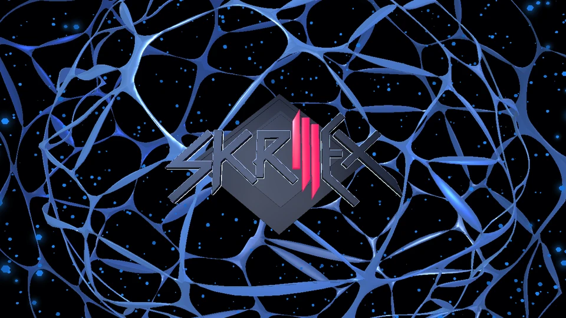

# Bass Sigil P1 — withdrawn visual experiment

**Withdrawn after user correction: the replacement environment was not authorized.** The custom asset, generation script, tests and runtime integration described below were removed. This document and its images are historical evidence only; they do not describe the current preset. See [P2 original-environment report](P2-original-environment-and-native-motion.md).

Historical status: P1 was technically validated. **Human visual acceptance remains open.** This checkpoint remains a reference preset; it is not presented as a finished reactive preset. P2 controls/native motion and P3–P8 audio, choreography, intelligence and finishing have not begun.

[Reference comparison](evidence/p1/reference-comparison.webp) · [Production browser measurements](evidence/p1/browser-report.json) · [Build/source provenance](reference/core-build.json)

## Implemented

- The existing `drmvyz.cinema2.crate-bass-sigil` entry now uses a dedicated dry manifest, with no duplicate catalog entry. Revision 1 and the reference role remain. The other seven crate preview definitions are unchanged.
- Preserved the solid source wordmark, separate outline, diamond layers and three red bars. The outline sits behind the face rather than covering it. Each solid part has a centered local pivot and a meaningful name for subsequent geometry choreography.
- Replaced the textured cellular sphere with real open membrane surfaces: rounded cell openings and physical side walls, generated from two deterministic spherical Delaunay-dual graphs (95 and 130 cells). The near layer uses the front hemisphere and the far layer the rear hemisphere, reducing overlapping clutter. Foreground cells that intersect the hero clearance are omitted.
- Added 850 deep particles, 120 near facets and 110 soft edge-glint sprites. Foreground particles respect the central hero clearance. The glint texture is a procedural radial gradient, not imagery copied from the video.
- Normalized the wordmark to 6 world units wide, retained a frontal fixed camera, and used centered minimum-aspect fitting. No baked animation is played; no audio, automatic choreography or post-processing is enabled.
- Kept the source GLB unchanged and retained its CC BY 4.0 credit. The independently generated derived asset is meshopt-compressed, 737,464 bytes, 68,364 triangles. Asset inventory totals approximately 154.04 MiB, below the existing 160 MiB limit.
- Updated the preset thumbnail from the production dry render.

## Validation performed

- Three geometry/source tests pass: connected deterministic three-way cell junctions, stable particle distributions/foreground clearance, solid part depth, centered width, separate core pivots, omitted baked animation and immutable source hash.
- Three dedicated native preset tests pass: compilation, single registration, dry/static checkpoint and retained source/derived attribution.
- Three existing crate regression tests pass: eight static references, original file hashes and legacy material decoding.
- Production browser check passes at 1280×720, 960×720, 720×720 and 540×960 high quality, plus 1280×720 low quality. Both hero/core and blue field regions are visible; core safe padding is maintained. No module/render failures or browser errors; disposal leaves zero leases and surfaces.
- TypeScript and focused ESLint pass. Khronos GLB validation reports zero errors and zero warnings; its one informational message states it cannot inspect the meshopt extension. Decoding is separately exercised by geometry tests and the production browser path.
- Diff reviewed for intended Bass Sigil integration; earlier uncommitted Open Decks changes were preserved. No commit requested or created.

Commands: `node scripts/cinema2-assets/build-bass-sigil-core.mjs`, `npm run assets:build`, `node --test scripts/cinema2-assets/bass-sigil-core.test.mjs`, focused Vitest for `Cinema2BassSigil.test.ts` and `Cinema2CratePresets.test.ts`, `npm run typecheck`, focused ESLint, and `node scripts/run-cinema2-bass-sigil-core-browser.mjs` with Vite running. `--preview` limits the browser script to one wide high-quality render during visual iteration.

## Visual review and remaining gate

Inspected the production wide render and corrected the first wire-like cell network into rounded membrane openings. The wordmark, red three-bar core, dark diamond, blue particle field and open cells are visible without bloom. The comparison deliberately shows a dry scene alongside a viewer image with glow/focus effects; pixel parity is not claimed.

Intentional differences from the video at this checkpoint: actual open cell geometry instead of a texture; sharp unblurred background and no flare/bloom effects; static rest pose rather than the source loop. Source-like focus, glints and motion need later phases and must not conceal defective base geometry.

The user still needs to judge the composition, cell character, hero weight and palette in the supplied comparison. Human acceptance is not replaced by the automated checks. If that review rejects the base appearance, revise this geometry/material/framing checkpoint before proceeding to P2.
