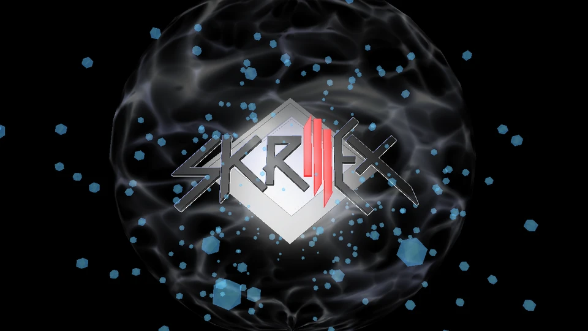

# Bass Sigil P2 — original environment, manual controls and native motion

Historical P2 checkpoint. [P3 audio reactivity](P3-audio-reactivity-report.md) now adds basic shared-audio response routes; its current status and scope supersede the no-audio/pending-P3 statements below.

**P2 complete for the manual-controls/native-motion scope; human visual review remains open.** Thirteen current focused tests, TypeScript, focused ESLint and the camera/logo production browser checks pass. Changes are uncommitted.

[Eight native programs](evidence/p2/native-programs.webp) · [Real Inspector](evidence/p2/inspector.webp) · [Browser measurements](evidence/p2/browser-report.json)

P2 restores and uses the supplied environment. It does not build or substitute a new one. The preset remains a reference entry with audio/intelligence finishing incomplete.

## Source and geometry ownership

Runtime asset: `cinema2-crate-bass-sigil`, the complete `public/cinema2/models/crate/skrillex_-_vj_-_flash_warning.glb`. SHA-256: `3b74af78b57b0dd24727a06f41a16064af3044ded52118700fbe6008cb1843cc`.

All 11 original meshes remain: wordmark/outline, three red bars, backing/shine, glow plane, textured sphere and two particle meshes. Texture images, UVs, mesh connectivity and original default material values remain supplied. Original clips remain in the GLB but are not played over the new native programs. Source bytes never change.

The custom P1 membrane/particle asset and its generator were withdrawn and removed from the shipped inventory. P1 screenshots/report remain historical, explicitly marked withdrawn. The original asset credit is retained; no new attribution record or derived asset is needed.

A common presentation transform centers the wordmark and normalizes its width to six units. The camera now supports manual full-sphere orbit plus horizontal and omnidirectional automatic travel; this replaces the earlier fixed-camera specification. The frontal first view and shared aspect fitting remain. Source part transforms are stored as rest poses, and per-frame native programs compose from those poses rather than accumulating distortion. The sphere geometry and two particle draw-range buffers are cloned per instance; shared template geometry is never changed. The private clones are disposed with the controller.

## Manual program vocabulary

| Pattern | Behavior on original geometry |
|---|---|
| Reference Vortex | Source sphere rolls on multiple axes; the second original particle population rotates around the independently moving hero. |
| Countercurrent | Sphere and particle populations counter-rotate; slight axial asymmetry distinguishes the volume. |
| Axial Pressure | Sphere and particle depth compress and recover; motion is mainly axial rather than rolling. |
| Orbital Weave | Tilted elliptical sphere and differently oriented particle rotations produce interleaved trajectories. |
| Sector Crown | Eight smooth radial lobes travel around the original sphere. Its topology and cellular texture remain intact; no added sectors or replacement geometry. |
| Tidal Twist | Bounded twist varies with sphere depth; opposing particle rotations reinforce the traveling motion. |
| Lens Collapse | Original sphere contracts into a shallow lens, with restrained cyclical compression. |
| Shock Bloom | Original sphere and particles expand in a bounded repeating release/recovery cycle. |

Each program retains the wordmark/diamond at the center and articulates the three original bars independently. No program reconstructs the environment with new ribs, ribbons, petals or particles.

## Controls and authority

Master Controls: BPM Sync and Intensity. Design: Pattern, Pattern Change, conditional Trigger, Geometry Motion, Motion Rate, Geometry Extent, Core Travel, Membrane Scale, Particle Density, Tunnel Depth and Hero Scale. Effects: Membrane Opacity and Core Glow, which control existing source material/glow-plane properties. Palette: Background, Wordmark, Edge, Core, Membrane and Particles.

All are user-owned at this stage. Module bindings consume final resolved values each frame. Palette defaults preserve the original material roles; changing a role sets a real material color, including the otherwise-black wordmark face. Background uses the shared environment color binding. Particle Density changes actual rendered source triangle count; it does not spawn substitutes. Membrane Scale replaces the rejected custom Cell Density proposal because the source's cell pattern is a texture, not individually generated cells.

BPM Sync uses `Cinema2BeatClock` and the preset's declared tempo-sync parameter; the host toggle cannot silently veto it. Off runs at the shared 120 BPM reference. Motion Rate=0 holds continuous phase. Geometry Motion OFF uses the selected program's rest pose and suppresses bar displacement; Core Travel=0 suppresses the bar stroke. Pause holds motion. Seek, track/analysis changes and context-generation changes clear transient timing/pattern state. Inactive transport holds at rest; audio-specific idle behavior is reserved for the playback integration phase.

Pattern Change defaults OFF. Trigger options are the exact 11 shared canonical entries. The native controller reuses the shared canonical event resolver and generic pattern-selection controller; it does not invent event timing. Manual edits take effect immediately, leave Pattern Change ON, and consume an already-active event. Full event-fixture/playback integration belongs to the subsequent audio/choreography phases.

No Auto Performance or Reactivity control is exposed without a functioning consumer. No reactive envelopes, build/drop overrides, Mood drives, post bloom, trails or focus pass have been introduced. Those remain later phases under the original creation contract. Source Core Glow is a manual material control, not a new finishing system.

## Evidence and validation

Production harness: `src/test/browser/cinema2-bass-sigil.html`, using the real runtime, registry, original asset and Inspector. The controlled transport enables the runtime's animation gate and supplies tempo; it does not publish analyzed audio features or implement an analyzer.

Focused tests cover source hash, original mesh count, UV/template preservation, unique native programs, canonical controls/palette, BPM Sync versus host timing, pause/zero/motion-off, manual pattern authority, discontinuity reset and private geometry cleanup. Existing crate tests keep checking all source hashes and seven unchanged static previews.

The production browser suite measures visible numeric min/default/max output, all six palette consumers, eight motion filmstrips, freeze/pause, square/portrait/landscape framing, actual Inspector control visibility and resource cleanup. A timing comparison stages BPM Sync ON/OFF at 90 and 180 BPM with opposite host-toggle states, recreating the preset with saved controls between cases.

Evidence lives under `artifacts/cinema2-bass-sigil/p2/`; the final checked captures and measurements are copied into `docs/BASS_SIGIL/evidence/p2/`. Human judgment of source-like lighting, visual weight and musicality remains distinct from automated checks. This is a manual/native-motion checkpoint, not a completed reactive preset.

### Checked results

Six focused Bass Sigil tests and three existing crate regressions pass. Numeric min/default/max checks exercised ten controls; six independent Palette edits produced visible output. All eight programs produced visible frame-to-frame motion. Geometry Motion OFF and paused playback held the image. Four aspect ratios were captured, and the real Inspector showed the four parent groups, correct Pattern controls and conditional Trigger.

The production BPM comparison measured mean per-channel pixel difference 5.085 between the 90/180 BPM Sync ON renders, versus exactly 0 between Sync OFF renders despite different tempo and host-toggle states. Each timing case recreated the preset with saved controls, exercising re-entry. Disposal left zero leases and surfaces. The browser reported no console, module or render failures.

The final authority fix also handles explicitly reselecting the same saved Pattern after the controller has advanced: its edit revision re-establishes the manual base and consumes the held event without disabling Pattern Change. Focused tests cover this case. The source hash remains unchanged, and `git diff --check` passes.

Commands: focused Vitest for `Cinema2BassSigil.test.ts` and `Cinema2CratePresets.test.ts`, `npm run typecheck`, focused ESLint, `npm run assets:build`, and `node scripts/run-cinema2-bass-sigil-browser.mjs` against Vite. The withdrawn replacement asset is absent from the generated asset manifest; all source textures and geometry are supplied by the original asset record.

Remaining work: P3 audio response, subsequent choreography/Director/Mood/Auto Performance, finishing, the full event/lifecycle/quality acceptance matrix and human reference review. Source-like viewer bloom/focus is not claimed at this stage. Geometry Extent acts on the alternate native deformation programs; Reference Vortex deliberately retains the original spherical shape, as explained by its control description.

## Camera and logo motion extension

The user explicitly requested a camera orbiting the entire sphere in all directions, and rotation/sway of the 3D logo. This replaces the fixed-camera/stationary-logo portions of the earlier plan.

- **Camera Mode:** Manual Orbit, Horizontal Orbit, or Omnidirectional Orbit (default). The omnidirectional mode follows a closed 3D spline around the sphere, moving in front, behind, above and below it. Nominal loop duration is 32 seconds at 120 BPM and Camera Speed=1. Shared tempo controls govern automatic travel.
- **Camera Heading / Elevation / Distance:** Manual Orbit exposes full 360° heading, elevation from −89.9° to +89.9° and distance 8–30. The slight pole limit prevents a singular look direction while allowing views almost directly above/below. Shared Camera Runtime owns the actual view/projection; the scene is not rotated to fake camera movement.
- **Camera Speed / Field of View:** automatic speed 0–2 (zero holds current travel), field of view 30–65°. Speed is hidden in Manual mode; manual angle/distance controls are hidden in automatic modes. Selecting Manual restores the saved manual pose.
- **Logo Motion / Spin Rate / Sway:** independent whole-assembly spin and multi-axis sway. The wordmark, outline, three bars and diamond rotate together about the centered source pivot. Spin Rate=0 holds spin while sway can continue; Sway=0 removes sway while spin continues. Logo Motion OFF removes automatic assembly movement and uses the authored orientation. Individual bar stroke still follows its existing Geometry Motion/Core Travel controls.
- **Logo Heading / Pitch / Roll:** independent manual orientation, applied beneath automatic spin/sway. The logo stays a real world-space 3D object; rear views show the source model's backing rather than a camera-facing replacement.
- Camera travel and logo assembly motion are independent of Geometry Motion. Pause holds all active clocks. Camera and logo have ambient motion without a track; no musical analysis or event detector was added. The original asset and environment remain unchanged.

Focused camera tests cover 25 manual heading/elevation combinations with finite matrices, complete automatic XYZ travel, speed-zero hold and pause. Logo tests cover independent motion with the environment stopped, manual orientation, zero spin with continued sway and hard-off. Production evidence is recorded in `evidence/orbit/` after the focused browser check.

### Orbit/logo validation results

[Reviewed camera views](evidence/orbit/views.webp) · [Moving-logo frame](evidence/orbit/logo-moving.webp) · [Inspector](evidence/orbit/inspector.webp) · [Browser measurements](evidence/orbit/browser-report.json)

The current focused suite passes 13 tests (8 source/native-controller, 2 camera-runtime, 3 crate regressions). The camera tests verify front/rear/side/pole access with finite matrices and full automatic XYZ travel. The logo tests verify independent assembly spin/sway, manual orientation, zero spin with ongoing sway, ambient idle motion and explicit idle pause. Original source hash and all 11 meshes remain preserved.

The production check passes six manual directions, 3D automatic orbit reaching positive/negative Y and Z, horizontal-only automatic orbit, independent visible logo motion with the environment stopped, hard-off, zero-speed hold, pause, square/portrait framing and the real Inspector controls. No browser/module/render errors; disposal returns zero leases/surfaces. TypeScript, focused ESLint and `git diff --check` pass. The change is uncommitted.

Run `node scripts/run-cinema2-bass-sigil-orbit-browser.mjs` against Vite for this focused extension. The older broad geometry/control acceptance script explicitly selects Manual Orbit and turns Logo Motion off, isolating its original geometry assertions from these newly independent domains. No audio/intelligence phase has been added by this camera/logo extension.
