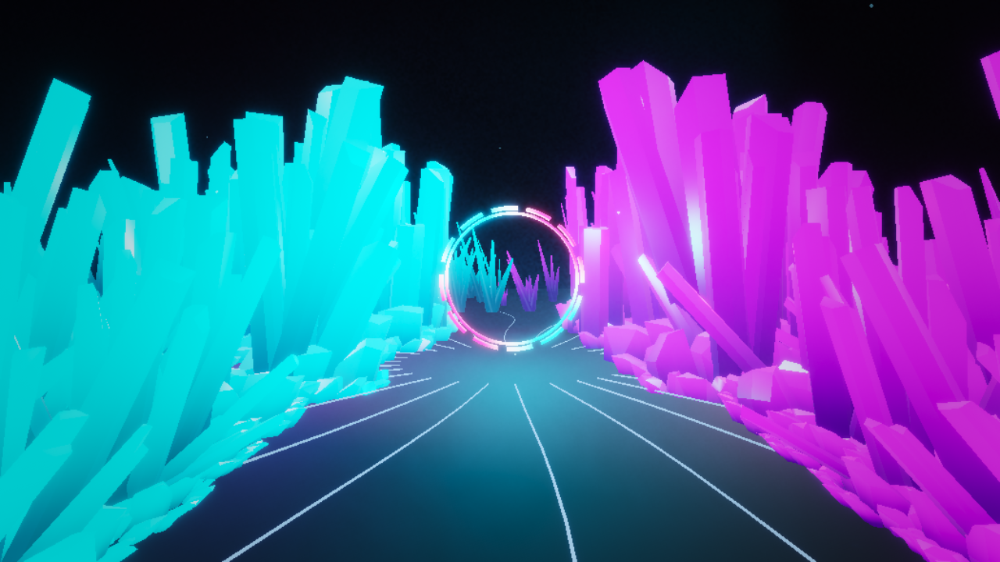

# NEON FOREST — implementation and acceptance report

November 13, 2026. Native implementation and automated acceptance are complete.
**Human visual acceptance is pending**, so the preset is registered as an
in-app `reference` review entry, not a human-accepted `keeper`. Select **NEON
FOREST** in Cinema 2.0. Stable ID: `drmvyz.cinema2.neon-forest`.

[Production-rendered motion review](NEON_FOREST-motion-review.webm) ·
[Orbit](NEON_FOREST-orbit.png) · [Portrait](NEON_FOREST-portrait.png) ·
[Maximum atmosphere](NEON_FOREST-atmosphere-max.png) ·
[Inspector and Pattern dropdown](NEON_FOREST-inspector.png)

## Delivered scope

| Phase | Result |
|---|---|
| 1 — Design, assets and static world | Preserved attributed source; repaired derivative; coherent root attributes; cleared portal aisle; surrounding prism fans, opaque terrain, root filaments and segmented portal; static readability without finishing |
| 2 — Camera, controls and motion | Aisle Travel, Grove Orbit, Elevated Passage, Fixed View; safe manual camera controls; eight spatial programs; seven independent palette colors; mandatory BPM Sync and Auto Performance toggles |
| 3 — Shared musical facts | Shared Audio Intelligence/transport, canonical 11 triggers, continuous/rhythmic/structural response, freshness and playback reset handling |
| 4 — Geometry choreography | Rooted bend/growth/twist/fan waves, pattern-specific spatial event response, bounded blended transitions and clean envelope restoration |
| 5 — Director | Qualified intensity, momentum, build, impact and section significance, consumed through shared transient targets; camera mode/framing remains manual |
| 6 — Auto Performance | Opt-in temporary build/drop presentation, underlying base progression, manual cancellation, fresh-event latch and restoration |
| 7 — Lighting and atmosphere | Shared surface/scattering lights, HDR emission, low mist, smoke volume, distance haze, spatial shafts, bloom and restrained ground reflections |
| 8 — Technical acceptance and handoff | Focused tests/typecheck/lint, production build, canvas evidence, quality/aspect/lifecycle/context recovery, documentation and diff review; human review remains required |

The [current behavior specification](NEON_FOREST-behavior-spec.md) contains the
system ownership map, user/automation authority matrix, parameter/output map,
audio/visual map, BPM Sync timing contract, eight-program library, Pattern Change
and Trigger semantics, and seven-color palette role map. The original approved
proposal and source findings remain in the [analysis/plan](NEON_FOREST-analysis-and-implementation-plan.md).

## Automated validation

- **50 focused Vitest tests** pass across preset registration/authoring,
  Audio Intelligence delivery, choreography, Director and Auto Performance. Five
  additional shared keeper-framework regression tests pass.
- The integrated production-canvas suite records **156 distinct assertions and
  63 distinct capture checkpoints**, with zero browser/shader errors. It checks
  actual controls/Inspector, all 11 triggers, manual Pattern preservation,
  temporary overrides/restoration, pause/resume, seeks, track changes, saved
  re-entry, full travel/orbit loops, aspect ratios, quality tiers and context
  recovery. Raw runner output also counts repeated health/capture checkpoints.
- Supplemental production acceptance records **63 distinct assertions and 68
  distinct capture checkpoints**, with zero browser/shader errors. It compares
  all 28 pairs of native patterns with finishing OFF, verifies motion in every
  program, exercises numeric controls at minimum/default/maximum, verifies BPM
  Sync timing at 180 BPM, checks subdued no-track idle and records a motion clip.
- Source-hash, glTF validity, four semantic batches, retained source coverage,
  new surrounding fans, reserved source corridor and low-tier asset-memory
  checks pass in `neon-forest-geometry.test.mjs`.
- Focused TypeScript validation passes for all new preset/modules/tests/harness
  files and their imported dependencies. Scoped ESLint passes.
- Asset manifest/attribution checks and all five shipped decoder checks pass.
- The full **Vite production application build passes** (2,498 modules), written
  to `/tmp/neon-forest-production-build` to preserve pre-existing `dist` edits.
  Existing large-chunk advisories remain; no unrelated bundling refactor was made.
- `git diff --check` passes. The task's tracked integration diff and new files
  were reviewed; pre-existing unrelated working-tree changes were preserved.

The repository-wide `tsc --noEmit` attempt stalled during a filesystem read of
`src/components/vyzualz/react/LaserDmxShowDirectorPerformanceResolver.test.ts`.
That process was stopped, and the focused preset/dependency check above passed.
This report does not claim a completed repository-wide typecheck or full test
suite. The new preset's production renderer and build were validated separately.

Machine-readable evidence:
[Integrated acceptance](NEON_FOREST-acceptance.json),
[supplemental controls](NEON_FOREST-controls-acceptance.json),
[prepared asset/provenance/validation](NEON_FOREST-asset-report.json).
Fresh full runs use `npm run test:e2e:cinema2-neon-forest` with the repository's
Node 22 baseline. The range-check runner can resume after a test-environment
interruption; saved distinct counts exclude repeated checkpoints.

## Brightness comparison

Matched 1280×720 high-quality production captures used the same declared
energetic deterministic publication. Regions differ by each preset's hero
composition; these are display-relative luminance statistics, not physical nits.

| Preset | Hero-region 99th-percentile luminance (0–255) | Whole-frame all-white clipping |
|---|---:|---:|
| NEON FOREST | 223.1 | 0% |
| MAINFRAME | 196.8 | 0.0043% |
| NIGHTSHIFT | 205.1 | 0% |
| Cathedral | 130.1 | 0% |

NEON FOREST is approximately 1.09× the brightest reference hero p99, within the
suite's comparable-brightness band. Its full-frame mean is higher because large
luminous crystal faces occupy more of the image than thin architectural lights.
This is intentional; the palette remains saturated, the sky stays dark, and the
default frame has no all-channel white clipping. Human review still determines
whether this brightness and visual weight match the intended taste.

## Performance and assets

Local diagnostic samples, not cross-hardware promises:

| Render state | Sampled GPU time |
|---|---:|
| 720p low | 3.38 ms |
| 720p medium | 9.88 ms |
| 720p high | 6.63 ms |
| 1080p high default | 26.51 ms |
| 1080p high dense effects | 18.11 ms |

These are individual reported GPU samples; their ordering is affected by warmup,
scene state and timing noise. They are not averages or a guarantee of 60 FPS.
CPU averages for the sampled 720p tiers were approximately 2.2–3.5 ms. Use the
existing Performance/Balanced policies when additional headroom is needed.

The 60,705-triangle prepared GLB is 1.55 MiB compressed and about 5.80 MiB decoded
asset GPU memory, shared across tiers. Effects/targets are additional allocations.
The existing Cinema installer asset budget had only 152,068 bytes free; adding
this asset required a documented increase from **129 to 131 MiB**. The resulting
shipped Cinema assets total **130.40 MiB** and pass the updated budget. Per-asset
file, texture, triangle and GPU limits are unchanged.

## Intentional differences and limits

This is a new preset, not a legacy port. It preserves the reference's faceted
crystal banks, portal and aisle while adding emission, movement, surrounding
scenery and atmosphere. The imported sky and empty Point markers are replaced
by authored background/lighting. Corridor obstructions are removed, original
surface components are addressed rather than falsely counted as complete
crystals, and outer fans/portal segments are generated. The exact source and
modification record ship through the asset attribution pipeline.

Camera mode/framing remains user-owned, including with Auto Performance ON.
Director shapes geometry/light significance rather than automatically choosing
camera shots. Ground reflection is the existing depth/screen-based treatment;
objects outside the rendered view cannot receive complete mirror reflections.
The initial rig does not request dynamic shadow maps. Maximum fog intentionally
has visible noise/softening; low/high quality adjust the shared march sampling.

Musical acceptance uses deterministic shared Audio Intelligence publications
through the real production bridge/renderer. Live desktop playback, a user-supplied
track and a long-duration full-app soak have not been independently reviewed.
Supported aspect evidence includes 16:9, 1:1 and 9:16. Full motion clips and
reference captures are provided for the required human review.

## Handoff

Implementation, focused technical checks, asset attribution, documentation and
automated canvas acceptance are delivered. No commit was requested or created;
all task changes remain uncommitted. Unrelated user edits remain intact.

The remaining release gate is human visual acceptance under Sections 20/22 of
`DRMVYZ_Cinema_2_0_Preset_Creation_Contract.md`. The review-ready preset remains
registered and selectable while awaiting that acceptance; no final keeper
approval is implied by automated metrics.
