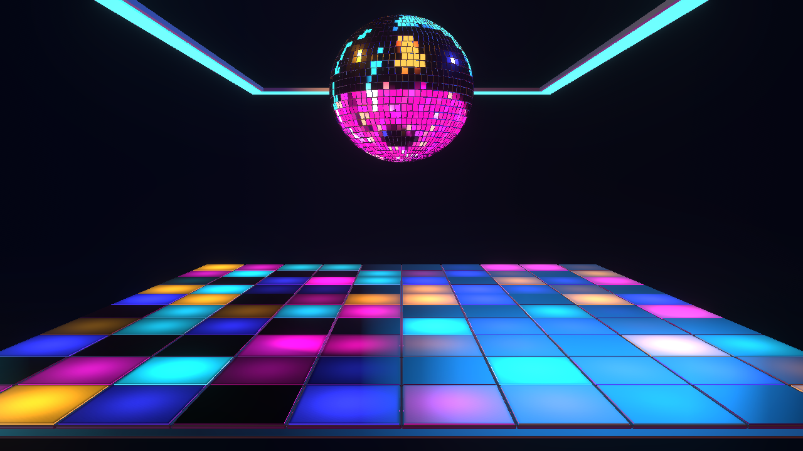

# NIGHTSHIFT — final acceptance

Follow-up: [playback, floor brightness, camera and ceiling LED corrections](NIGHTSHIFT-reactivity-fix.md)
supersede the corresponding behavior and captures below. This report records
the earlier acceptance checkpoint.

October 23, 2026. Steps 1–8 are complete. The preset is registered as **NIGHTSHIFT**
with keeper status. Its stable preset ID and revision 2 preserve existing edits.
No commit was requested or created; the implementation remains uncommitted.

The user accepted the Step 7 result and requested completion of the last phase.
The final default capture matches that accepted capture exactly. Comparison with
the original reference retains the club palette, mirror ball, ceiling frame,
addressed floor and dark separation. The smaller, higher ball and larger room
follow the user's subsequently approved framing changes. The native result is
more restrained in glow than the original illustration.

## Validation

- 284 production-path assertions across 108 captures pass, including actual hero
  visibility, all eight patterns, all eleven triggers, independent palette roles,
  minimum/default/maximum controls, effects, BPM Sync and camera safety.
- Shared audio, Director, Auto Performance expiry/restoration, manual takeover,
  pause/resume, seek, loop, track changes and missing-audio fallback pass.
- Square, portrait and 1080p output, low/medium/high/Auto quality, a 60-second
  simulated musical timeline, three switches through another native preset,
  saved-setting restoration, reset and final disposal pass.
- No transient render failures or browser/shader errors remain. Final disposal
  reports zero owned runtimes, animation frames, WebGL contexts, listeners,
  target leases or history buffers. The target pool and one history buffer stay
  bounded during the sustained timeline.
- Focused NIGHTSHIFT and shared parameter/module/shader regression tests,
  TypeScript and scoped lint pass. The working-tree diff was reviewed.

Acceptance found and fixed a shared shader-retirement bug: deleting a bound
program allowed Three's state guard to capture and later restore the retired
handle, producing a one-frame INVALID_OPERATION when effects switched OFF.
ShaderProgram.dispose now unbinds its active program before deleting it; two
regression tests cover active and inactive retirement. The full rendering run
was repeated after that fix. Remaining fixture-only corrections used checkpoints
to retain completed assertions rather than repeat expensive passed sections.
Saved numeric parameters are compared with floating-point tolerance.

## Performance and limits

Local 720p GPU samples were approximately 2.9 ms low, 7.6 ms medium and 12.8 ms
high. High quality at 1080p sampled 24.5 ms; the sustained Auto/high sample reached
27.7 ms with CPU average 3.1 ms. This does **not** establish 60 FPS at high quality.
Use the existing Balanced or Performance quality setting when headroom matters.
Auto remained high during this run; it is not a promise of GPU-based adaptation.

The browser harness uses the real Cinema 2.0 renderer/Inspector with deterministic
music publications. The 60-second timeline is simulated, not a long-duration
full-app soak. Live desktop playback and hardware-specific performance have not
been independently measured in this final phase. Ground reflections remain a
subtle perimeter treatment rather than a full reflected hero image.

[Saved assertions and telemetry](NIGHTSHIFT-final-acceptance.json),
[square capture](NIGHTSHIFT-final-square.png),
[portrait capture](NIGHTSHIFT-final-portrait.png).
Run `node scripts/cinema2-assets/accept-nightshift-final.mjs` for a fresh full run.
Historical phase scripts retain their phase-specific expectations.
