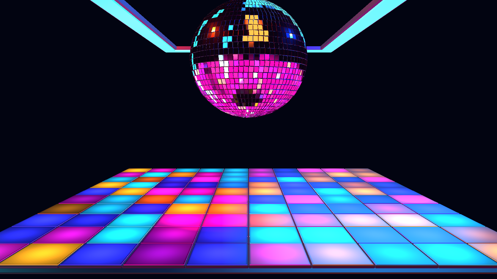

# NIGHTSHIFT — Step 1 static visual core

October 23, 2026. The user approved the authority model and Auto Performance OFF
by default. This checkpoint implements the static visual core from Section 23,
Step 1 of the supplied creation contract. It is a visible reference preview,
not a completed first-party keeper.



## Implemented

- Native preset ID `drmvyz.cinema2.nightshift`, displayed as **NIGHTSHIFT (Preview)**
  under Cinema 2.0 > Presets > SYSTEM. Registered with role `reference` and tag
  `preview`; it is available for in-app review without claiming finished status.
  The initial `internal` tag hid it from the picker and has been removed.
- Production runtime, existing native Three scene module, shared model cache,
  scene/layers, authored camera and light rig, depth-tested scene target and output.
- Owner-supplied mirror-ball geometry with separate mirror/backing materials.
  A centered pivot is preserved for later rotation. Default center y=4.84,
  scale=2. Source geometry is approximately a sphere; the initial inspector's
  transformed bounding box was a conservative rotated AABB, not a reason to
  stretch the ball into a different shape.
- Owner-supplied floor chassis, flattened/rescaled, with a regular 10 × 10 array
  of individually named/addressed luminous inserts and narrow physical frames.
  Cell metadata records row, column, palette family and initial intensity level.
- Three physical cyan ceiling strips with housings. The rear rail is occluded
  by the ball, using real scene depth.
- A static authored HDR reflection room: colored hard highlights and a tiled
  lower hemisphere. This supplies IBL for mirror facets, not the visible scene
  background or the musical floor program. Future palette edits must update the
  reflection appearance too; the static environment alone is insufficient for
  the final independent palette controls.
- Source animation buffers are omitted from the derived asset. This removes
  the invalid imported sampler layouts and leaves all future animation under
  Cinema 2.0 ownership. Original supplied GLBs are unchanged.
- Reproducible asset builder, embedded modification/provenance metadata, asset
  records, generated registry entries and shipped CC BY attribution notices.

## Framing and initial visual assessment

The default shot uses a 40-degree FOV, eye `(0, 3.1, 13.5)`, and target
`(0, 2.05, 0)`. The floor's rear edge is approximately 61% down the image, its
foreground spans the frame, and the centered ball occupies the upper portion.
The dark gap between ball and floor stays intact. The ball crown has the
reference's intentional top crop. Square resize preserves the centered hero
and crops the sides of the foreground floor without distorting the sphere.

The production capture shows the three reference elements and their perspective
relationship. The user tested the preview in the app and accepted the static
composition. A subsequently reported app slowdown is under investigation;
performance acceptance is not implied by visual approval. This is a sharp,
unenhanced geometry/material baseline: bloom, club haze/fog, enhanced floor
reflections, anti-aliasing/finish and moving glints have not yet been added.
The reference's softer lighting and atmospheric depth are therefore not yet
matched. Ball highlights use a static reflection environment at this checkpoint.

## Focused validation

| Check | Result |
|---|---|
| New native manifest tests | 2 passed: compilation, module/asset/environment registration, depth, visible preview metadata, no unimplemented controls/automation. |
| `npm run typecheck` | Passed. |
| Focused ESLint on added/edited JS/TS | Passed. |
| `npm run assets:build` | Passed; generated asset registry and attributions updated. |
| Derived model glTF Validator | Zero errors and zero warnings. |
| Derived model structural inspection | 31,894 triangles, 1,926,792 bytes on disk; approximately 1.85 MiB estimated geometry/texture GPU storage. |
| Production 1672 × 941 canvas | Passed: ball, floor and ceiling visibility measured independently; dark separation region preserved; no page errors. |
| Production square resize | Passed; capture saved and reviewed. |

The actual runtime bridge also allocates its shared reflection environment;
the model-only GPU estimate above excludes it. This checkpoint does not claim
frame-rate/performance acceptance or support across all target aspect ratios.

Reproduce:

```sh
node scripts/cinema2-assets/build-nightshift-runtime.mjs
npm run assets:build
node scripts/cinema2-assets/asset-tools/cli.mjs validate public/cinema2/models/nightshift-static.glb
npx vitest run src/components/vyzualz/cinema2/__tests__/Cinema2NightshiftPreset.test.ts
node scripts/cinema2-assets/accept-nightshift-static.mjs
```

The browser script starts a local Vite server, uses installed Chrome (or
`PLAYWRIGHT_CHROMIUM_EXECUTABLE_PATH`), captures the real runtime, then closes
its server/browser. Full reports and 16:9/square captures are generated under
`artifacts/cinema2-nightshift-static/` (ignored generated output). The main 16:9
capture is also preserved in this documentation folder for review.

## Remaining stages

Next is Section 23, Step 2: verify the optional restrained camera movement,
implement real manual palette/pattern/BPM controls and the native motion
vocabulary, then prove their canvas behavior. No placeholder controls are
exposed in this static preset.

Subsequent stages connect shared Audio Intelligence, bounded choreography,
Director meaning and the agreed optional Auto Performance. Club fog, bloom and
reflective finishing follow after the underlying visual/manual behavior works.
Full transport/reset/re-entry, trigger/override, aspect-ratio, musical and human
visual acceptance are required before promotion to keeper.

No commit was requested or created. Runtime assets and code, generated registry
and attribution changes, source documentation and captures are uncommitted.
