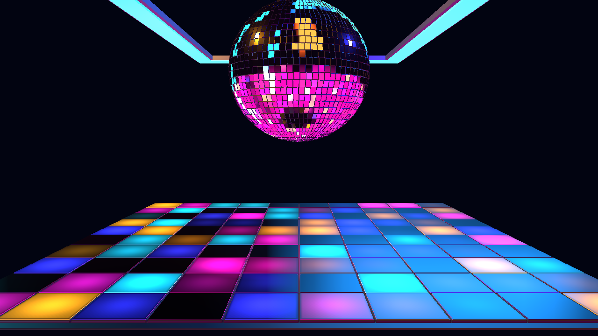

# NIGHTSHIFT — Step 2 camera, manual controls and native motion

Follow-up: the user accepted the larger-room revision and authorized Step 3.
Shared Audio Intelligence is now connected; see the
[Step 3 report](NIGHTSHIFT-step3-report.md). The remaining text records Step 2's
implementation checkpoint.

Update after user review: the controls/motion were accepted. The requested larger
room framing is now applied: slight camera pullback/wider FOV, ball higher/farther
back, ceiling wider/deeper, and expanded floor footprint. See the
[current spatial specification](NIGHTSHIFT-behavior-spec.md#spatial-revision-after-step-2-review)
and [latest production capture](NIGHTSHIFT-larger-room.png). Camera coordinates
below document the original Step 2 checkpoint; the specification records the new values.

Focused validation of the spatial revision: five NIGHTSHIFT tests, scoped lint,
derived glTF validation (zero errors/warnings), and production-canvas element
visibility/dark separation/square resize checks. Original geometry counts and
textures remain unchanged. The ceiling sample region follows the extended rear
rail's new screen position. No whole audio/control acceptance suite was repeated
for this geometry/camera-only edit.

October 23, 2026. Available as **NIGHTSHIFT (Preview)** under Cinema 2.0 > Presets >
SYSTEM. Revision 2 remains a reference preview, not a finished keeper.



## Implemented scope

This checkpoint follows Section 23, Step 2 of the supplied creation contract:
camera behavior is checked first, then manual controls and visible native motion.
The Step 1 geometry and reference camera remain the installation's foundation.

| Inspector parent | Controls | Runtime effect |
|---|---|---|
| Master Controls | Master Intensity; BPM Sync; Motion Amount; Camera Motion | Installation output gain, shared-clock tempo lock, continuous program/rotation speed, optional bounded camera drift. |
| Design / Pattern | Pattern; Pattern Change; conditional Trigger | Immediate base program selection, fresh shared-event advancement, exact eleven canonical Trigger options. |
| Design / Installation | Ball Rotation; Floor Intensity; Ball Highlight Intensity; Ceiling Intensity; Pattern Coverage | Independent physical/lighting domains. Zero motion and disabled rotation hold their current phases/angle. |
| Palette / Club Palette | Background; Ceiling Cyan; Floor Magenta; Floor Blue; Floor Amber; Ball Tint | Six independent color roles, including background, fixture/light colors and chromatic IBL contributions. |

Eight native programs: Nightshift, Crossfade Checker, Runway, Diamond Ripple,
Diagonal Relay, Quadrant Exchange, Midnight Sparse, Full House. Their spatial
lighting rules differ; they keep the same floor, ball and ceiling geometry.
Coverage changes which cell addresses participate; higher coverage opens more
of the floor. Program animations are authored motion at this stage, not proof
of musical energy/kick/drop response.

The new NIGHTSHIFT module consumes target-resolved values and uses the shared
Three scene bridge and asset cache. Floor cells and frames are two instanced
batches rather than 200 separate mesh draws. Per-instance color also drives
emission; palette edits do not trigger shader compilation or IBL regeneration.
GPU accounting traverses the scene during preparation, then stops traversing
every steady-state frame.

## Camera and timing

Camera Motion defaults to zero and restores the approved reference view at zero.
At maximum, shared seeded drift uses position amplitude 0.12 world units,
target amplitude 0.025, FOV breathing 0.25 degrees and no roll. Camera safety
constrains Y to 3.0–3.2 and FOV to 39–41 degrees, with bounded position/target
offsets. No automatic camera shots or music-driven camera changes are added.
Camera drift follows the host visual timeline; it holds when that timeline is
inactive or paused.

BPM Sync locks floor program travel and ball rotation to the existing
`Cinema2BeatClock`, using shared analyzed timing or host BPM fallback. OFF uses
the declared 100-BPM authored reference rate regardless of host BPM. This
preset-local toggle is independent of Audio Dock BPM Sync. It does not suppress
canonical event triggers. At default Motion Amount, the ball turns once per
128 shared beats, approximately 76.8 seconds when unsynced. Motion Amount zero
holds continuous motion without preventing manual program/color selection.

The no-track decorative idle feeds render-timestamp deltas into the same shared
clock, avoiding a second beat system. Loaded/paused playback freezes motion.
Track/context/discontinuity changes clear local motion/pattern state; full
seek/loop/re-entry musical acceptance remains part of the later audio stage.

## Authority and shared-system change

Pattern Change defaults OFF. Its optional event consumer reuses
`resolveCinema2AfterhoursTriggerEventIdentity`; no locally fabricated beat,
phrase or drop events. Native event-controller tests cover stale/duplicate
suppression, manual edits and reset behavior. Canonical Trigger options are
imported from `CINEMA2_AFTERHOURS_TRIGGER_OPTIONS`.

An edit revision is now available through the generic parameter state, target
resolver and module parameter facet. It records successful manual edits and
per-parameter resets, including same-value enum selections. Revisions are not
serialized and do not change persisted parameter formats. Failed writes do not
advance them. This allows manual Pattern selection to restore the authored
base even when an automatic runtime selection has advanced, while preserving
Pattern Change ON. No preset-name cases were added to the Inspector or resolver.

Auto Performance remains unimplemented and has no inert toggle. Its agreed
future default remains OFF. Build/drop overrides and their full event-driven
production tests are deferred to their required later phase.

## Validation and limits

| Check | Result |
|---|---|
| TypeScript | `npm run typecheck` passed. |
| Focused tests | 28 passed across NIGHTSHIFT, parameter/schema state, module runtime and target resolver. |
| Focused ESLint | Passed for all modified runtime/module/schema/manifest/harness/test JS/TS. |
| Production camera | OFF, midpoint and maximum create the expected visible output; maximum stays within bounds; OFF restores reference framing. |
| Real Inspector | BPM Sync editable under Master Controls; six color controls under Palette; Pattern Change click reveals Trigger under Design; exactly eleven shared options. |
| Program output | All eight produce distinct rendered floor regions, tested pairwise. |
| Palette | Each color independently changes its intended region while other authored colors remain unchanged. |
| Manual ranges | Master/floor/ball/ceiling/coverage at zero and maximum differ visibly from defaults. |
| Native motion | Default rotation changes the hero; maximum Motion Amount changes travel; zero holds output; Ball Rotation OFF freezes the hero while floor continues. |
| Shared clock | Sync ON/OFF differ at 180 BPM; Sync OFF yields matching frames at host 90/180 BPM; pause freezes output. |
| Resize/errors | Square resize passes; no page, shader or WebGL errors in the focused browser run. |
| Diff | Reviewed for unintended changes; whitespace checks pass. |

The browser report contains 95 assertions and capture hashes under
`artifacts/cinema2-nightshift-step2/`. The controlled 1280×720 high-quality run
reported approximately 1.28 ms average CPU frame time and 1.01 ms GPU frame time.
These are observations from that test session, not an FPS guarantee or a
diagnosis of the earlier live-session slowdown. The previous static check used
a different resolution, so its timing is not a direct before/after comparison.

The final small edit also treats resetting an individual parameter as a manual
edit revision; focused regression tests cover it. The browser checks already
validated manual state writes; they were not repeated for that identity-only
reset change.

Reproduce the scoped browser check with:

```sh
node scripts/cinema2-assets/accept-nightshift-step2.mjs
```

It starts local Vite/Chrome, exercises the native runtime plus the real Inspector,
saves captures/report, and closes its browser/server. Original source assets and
the Step 1 reference capture remain intact.

## Pending phases and handoff

Next is Step 3: connect shared Audio Intelligence for continuous energy,
rhythmic and structural responses and complete event-driven pattern/transport
tests on the production canvas. Later steps add bounded choreography, Director
meaning, optional Auto Performance and then club haze/fog, bloom and reflective
finishing. No effects knobs are exposed before their real consumers exist.

The user accepted the Step 1 static composition and Step 2 controls/motion. The
new larger-room spatial revision is ready for user review. The preview remains visibly labeled as
unfinished. All prior and current work is uncommitted; no commit was requested.
