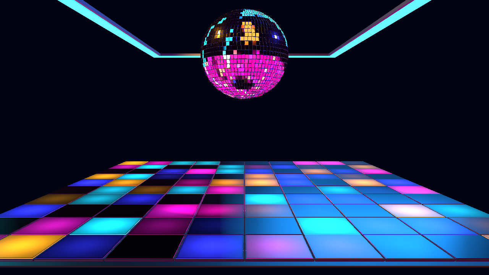

# NIGHTSHIFT — Step 3 shared Audio Intelligence

Follow-up: the user authorized Step 4, which is now implemented. The
[Step 4 report](NIGHTSHIFT-step4-report.md) records current shared smoothing,
pattern-specific spatial actions and automatic-transition timing. This document
and its captures preserve the Step 3 checkpoint; use Step 4's acceptance script
for current timing behavior.

October 23, 2026. The next authorized checkpoint, Section 23 Step 3 of the supplied
contract, is implemented. **NIGHTSHIFT (Preview)** remains available under Cinema
2.0 > Presets > SYSTEM. The approved larger-room camera and geometry are preserved.
Revision 2 is retained so adding the Music Response control does not discard saved
Step 2 edits; sessions missing that value receive its authored default.

## Connected behavior

The existing AudioFeatureBus and Cinema2AudioIntelligenceBridge supply the facts.
The native module validates source identity and timeline freshness, then resolves
bounded response channels through the existing Cinema2 target resolver. There is
no new analyzer, detector, BPM estimator, musical clock or saved-parameter writer.
The delivery gate reuses the established shared-frame validation helper currently
located in Mainframe's audio-delivery file.

**Music Response**, under Master Controls, defaults to 0.8. Zero immediately
restores authored lighting, including during pause. BPM Sync and Pattern Change
retain independent authority. Palette values and zone gains stay user-owned.

| Shared fact | Step 3 response at Music Response 1 |
|---|---|
| Overall energy | Floor coverage multiplier 0.55–1; level multiplier 0.75–1. |
| Supported vocals | Up to another 0.15 reduction in coverage multiplier. |
| Bass | Up to 1.25 times authored ball angular rate, subject to Motion Amount and Ball Rotation. |
| High-frequency energy | Small accumulated reflection traversal, subject to Motion Amount. |
| Fresh kick | Traveling row accent, up to +0.18 normalized, with a 360 ms release. |
| Fresh snare | Sparse mirror highlight accent, up to +0.12 normalized, with a 160 ms release. |
| Supported build confidence/progress | Concentrates the current floor program by restraining outer cells, up to 32%. |
| Analyzed semantic drop | Outward floor accent, up to +0.25 normalized, with a 650 ms release. |

Floor gain is clamped to 0–1 before user zone/master gains. User coverage masks
both the base program and accents; coverage zero cannot be reopened by music.
Missing signals use authored defaults. Source changes, discontinuities, seeks,
loops and re-entry clear transient history and latch current event identities.
Pause holds output; events received while held are consumed without replay on
resume. Duplicate shared event identities do not restart impulses or cycle twice.

Pattern Change still defaults OFF. When enabled, all eleven canonical Trigger
choices use shared identities. A qualified event advances the runtime base without
writing saved Pattern. Reselecting the authored Pattern reclaims it while leaving
Pattern Change enabled. Manual edits, trigger changes and resets latch the current
event so the user's choice is visible immediately.

## Validation

- Eleven focused tests pass: six new Audio Intelligence/target-delivery tests and
  five existing NIGHTSHIFT preset/control tests. Optional-capability warnings are
  expected when compiling with only WebGL2 available; no capability is required
  for the authored no-audio view except WebGL2.
- TypeScript and scoped ESLint pass. The working diff was reviewed and
  `git diff --check` passes. No commit was requested or created.
- The real native production canvas passes 68 assertions at 1280 × 720 using
  deterministic publications through AudioFeatureBus, the runtime bridge,
  canonical targets, Inspector parameter state and the native renderer.
- Quiet/energetic/vocal/build/kick/snare/drop captures differ visibly in the
  intended regions. Kick, snare and drop envelopes restore the base. Every
  enabled capture also checks actual ball and ceiling pixel visibility.
- All eleven triggers advance to a different rendered native program exactly
  once per event identity. Saved Pattern and toggle ownership are preserved.
- Music Response zero, Pattern Change OFF, BPM Sync OFF with continued response,
  palette preservation, zero master/coverage, pause/resume, seek, loop, track
  changes, no audio and fresh native runtime re-entry pass.
- No browser, WebGL or shader errors. The final measured high-quality run reports
  approximately 1.50 ms average CPU frame time and 1.02 ms GPU frame time, with no
  quality degradation. These are local harness observations, not whole-app or
  long-duration performance acceptance.

Reproduce with `node scripts/cinema2-assets/accept-nightshift-step3.mjs`. The
harness URL adds `?step3=1`; ordinary app playback receives real shared music
publications. The test-only fixture is outside the production preset modules.

The [saved acceptance report](NIGHTSHIFT-step3-acceptance.json) records all checks.
Additional captures are in ignored `artifacts/cinema2-nightshift-step3/`.

## Next checkpoint

Step 4 adds the shared choreography manifest, deliberate continuous-signal
smoothing, pattern-specific action tuning and restoration checks. The simple
native delivery responses above establish audible-input-to-visible-output proof
for Step 3; they do not claim the final choreography vocabulary is finished.
Visual Director meaning, scoped Auto Performance (OFF by default), shared bloom,
club haze/fog and full acceptance remain in their respective later phases.
The full preset remains a reference preview until those stages and human review.
