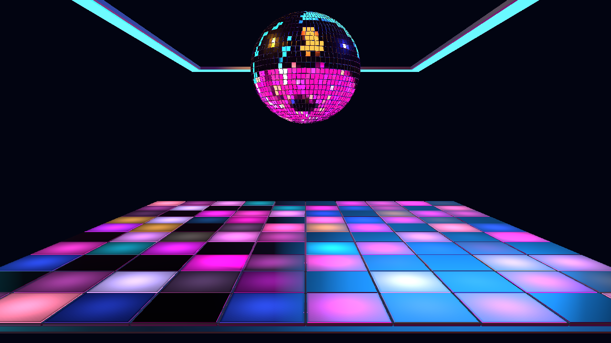

# NIGHTSHIFT — Step 4 bounded choreography

Follow-up: the user authorized Step 5, which now connects shared Visual Director
meaning. See the [Step 5 report](NIGHTSHIFT-step5-report.md) for current lighting,
rate and route-count expectations and its acceptance script. This report records
the Step 4 checkpoint.

October 23, 2026. Section 23, Step 4 is implemented. **NIGHTSHIFT (Preview)**
remains a reference preset. The accepted larger room, camera, geometry, palette
controls and user authority are retained. Revision 2 is retained to preserve
existing saved edits; this phase adds only internal transient delivery targets.

## Shared choreography

Five declared continuous routes now use Cinema2ChoreographyRuntime's existing
exponential smoothing and canonical target publication. The native module reads
those resolved values; it no longer reads raw continuous amplitudes to drive its
response. Audio Intelligence still owns availability and provenance. No shared
engine change, detector, clock or additional Inspector control was needed.

| Shared source | Internal target | Smoothing time constant |
|---|---|---|
| Overall energy | audioEnergy | 180 ms |
| Bass | bassPressure | 160 ms |
| High frequencies | highGlint | 120 ms |
| Supported vocal presence | vocalRestraint | 300 ms |
| Build progress | buildPressure | 300 ms |

These are symmetric exponential time constants, not the earlier proposal's
separate attack/release timings. Held visual time holds smoothing. Missing facts
fall back to the authored view. Build pressure still requires supported build
confidence; losing that qualification clears its restraint immediately. Source
discontinuities clear the shared smoothing history and reconstruct current facts.

The existing native kick/snare/drop identity delivery, deduplication and release
envelopes remain their single owner. They were not duplicated in the shared
manifest. Every final music response continues composing through the canonical
target resolver before the renderer applies user master, zone and coverage caps.
Music Response scales the final response once; zero restores authored lighting
immediately. BPM Sync OFF continues to allow musical response.

## Spatial action vocabulary

All eight floor programs keep the installation in place. Their accents now have
distinct spatial rules, rather than applying the same row/ring to every pattern.

| Pattern | Kick | Drop |
|---|---|---|
| Nightshift | Traveling row | Expanding diamond front |
| Crossfade Checker | Parity-weighted row | Square front with alternating cell weight |
| Runway | Row accent concentrated on central lanes | Front spreading outward across columns |
| Diamond Ripple | Narrow diamond front | Narrow expanding diamond |
| Diagonal Relay | Diagonal sweep | Opposing diagonal sweep |
| Quadrant Exchange | Row concentrated in the active quadrant | Square front with quadrant weighting |
| Midnight Sparse | Sparse addressed sparks along a row | Sparse sparks along an expanding diamond |
| Full House | Broad radial accent | Broad radial expansion |

Build restraint follows each pattern's drop-distance field. Midnight Sparse
chooses accent addresses inside the low coverage ranks, preventing its entire
accent from being hidden by default coverage. The final user coverage mask still
applies, including a hard zero. No intensity cap or OFF switch is reopened.

Automatic Pattern Change transitions blend outgoing/incoming cell colors in
linear space over 300 ms with smoothstep easing. This uses the shared visual
timeline, so pause holds the blend. It adds no draw batches or shader compilation.
Manual Pattern selection, including reselecting the saved value, cancels the
blend immediately without disabling Pattern Change. Turning Pattern Change OFF
immediately restores the authored base. Source resets clear transition history.

## Validation and evidence

- Fourteen focused tests pass: nine shared audio/choreography/spatial/transition
  tests and five preset/control tests. Shared smoothing, zero-delta holds,
  convergence, resets, eight distinct kick/drop fields and coverage caps pass.
- TypeScript, scoped ESLint and `git diff --check` pass. Relevant implementation
  and working-tree changes were reviewed. No commit was requested or created.
- The native production-canvas check passes 63 assertions at 1280 × 720 through
  AudioFeatureBus, the production bridge, shared choreography and final targets.
  Five actual shared contributions are active, with no choreography diagnostics.
- Rendered attack/release, build/vocal restoration, pause during smoothing and
  during crossfade, crossfade start/midpoint/end, manual takeover, Pattern Change
  OFF, all eight kick/drop responses and restoration, zero Music Response,
  coverage/master zero, seek/loop reset, no audio and fresh re-entry pass.
- Ball/ceiling visibility passes in all 68 enabled captures. No browser, WebGL,
  shader or choreography errors were observed.
- The final high-quality harness sample reports about 3.95 ms average CPU frame
  time and 1.08 ms GPU frame time, with no quality degradation. This is a local
  sample and does not replace full-app, long-duration performance acceptance.

Run `node scripts/cinema2-assets/accept-nightshift-step4.mjs` for the current
choreography checks. The [saved report](NIGHTSHIFT-step4-acceptance.json) lists
every assertion and measured pattern response. Other captures are in ignored
`artifacts/cinema2-nightshift-step4/`. Earlier phase reports/captures record their
historical checkpoints; Step 4 supersedes their instantaneous continuous-response
and automatic-transition timing expectations.

## Next checkpoint

Step 5 connects Visual Director significance to bounded macro behavior. Auto
Performance remains a separate later phase and will default OFF. Club haze/fog,
bloom, reflection finishing and full acceptance also remain pending. This phase
does not promote NIGHTSHIFT from reference preview to finished keeper.
