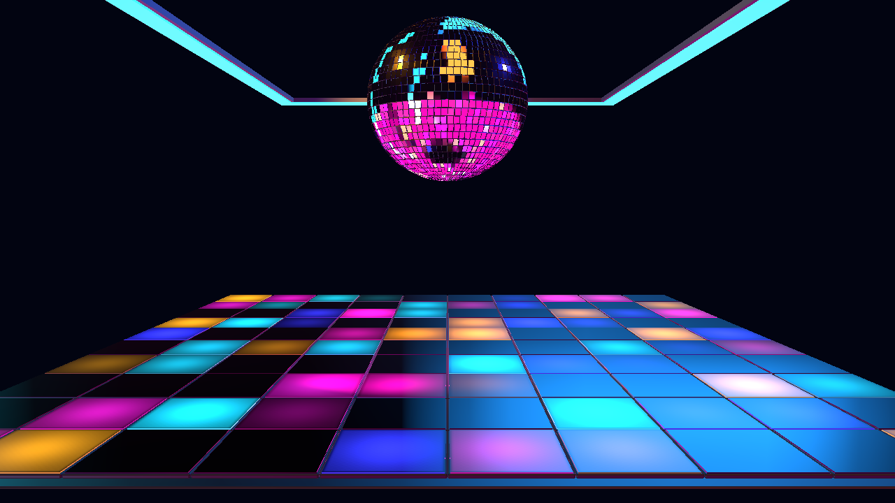

# NIGHTSHIFT — Step 5 Visual Director meaning

Follow-up: the user authorized Step 6, which now adds the agreed Auto Performance
domain, OFF by default. See the [Step 6 report](NIGHTSHIFT-step6-report.md) for
current override ownership, restoration behavior and acceptance evidence. This
report preserves the Step 5 checkpoint.

October 23, 2026. Section 23, Step 5 is implemented. **NIGHTSHIFT (Preview)**
remains a reference preset. The approved larger room, static default camera,
geometry, palette controls and user authority remain intact. Revision 2 is
retained to preserve existing edits; the new channels are internal transient
targets. No additional Inspector control or shared-engine change was needed.

## Connected meaning and bounds

Cinema2VisualDirector still owns all interpretation of musical facts. Four new
routes pass its output through the existing shared choreography and target
resolver. The native consumer checks matching audio/Director visual-frame and
discontinuity identities and a minimum confidence of 0.45. Missing, mismatched
or unsupported Director meaning falls back to the existing audio-only behavior.

| Director source | Shared smoothing | Bounded native meaning |
|---|---|---|
| Intensity | 240 ms | Floor-level and ceiling gain in the 0.88–1 range at full Music Response; lower significance restrains lighting. |
| Momentum | 320 ms | Floor program rate up to 1.15 times the user-authored rate. Ball rate receives a smaller gain, with bass and Director combined capped at 1.25 times the user-authored rate. |
| Build context | 300 ms | Floor concentration uses the greater of existing supported audio build or 0.8 times Director build. This does not change the chosen pattern. |
| Impact authority | Identity captured without smoothing | Authority at least 0.85 with a fresh shared identity starts one 700 ms release envelope. Ordinary kicks/snares do not independently qualify for this macro accent. |

Impact authority is sampled immediately because it may exist for a single visual
frame. The preset then owns its bounded delivery envelope, not a new detector or
significance model. The accent supplies a broad floor pool (up to +0.12 normalized
cell gain), up to +0.06 floor-level gain and +0.08 ceiling gain. Final normalized
cell/lighting gains are clamped to 1 before user master/zone gains. Coverage masks
both the program and impact pool. This is distinct from the existing traveling
drop front; a shared `major_impact` can qualify without fabricating a drop event.

All response is scaled once by Music Response. Zero restores authored lighting
immediately, including while paused. Motion Amount zero stops continuous travel;
Ball Rotation OFF cannot be re-enabled by momentum. BPM Sync OFF preserves
response while using the existing authored timing rate. Palette, physical layout,
camera, saved Pattern, Pattern Change and Trigger are never written by Director.
The existing manual pattern/crossfade behavior remains in place.

Pause holds the macro state. Current identities are consumed during pause,
deactivation and response OFF. Duplicate semantic identities cannot restart a
completed envelope. Source resets, seeks, loops and track changes clear the
envelope and latch the current event; fresh native re-entry starts cleanly.

## Validation and evidence

- Nineteen focused tests pass: the previous fourteen preset/audio/choreography
  tests plus five new Director tests. They exercise the actual shared bridge,
  Director, choreography and target resolver, including independent structural
  intensity, momentum caps, section build context, major-impact identity,
  restoration, pause/OFF/seek and unavailable or mismatched Director fallback.
- TypeScript, scoped ESLint and `git diff --check` pass. Implementation and
  working-tree changes were reviewed. No commit was requested or created.
- Thirty-eight production-canvas assertions pass at 1280 × 720 through real
  AudioFeatureBus publications and the native runtime. Nine actual shared
  contributions are present: five audio routes and four Director routes.
- Structural intensity changes floor/ceiling pixels while raw energy stays
  constant. Section build context visibly changes the floor while raw build
  progress stays zero. Momentum changes visible floor travel with BPM Sync OFF.
- Major-impact response, 700 ms restoration, duplicate suppression, pause,
  immediate response OFF during pause, zero motion, rotation OFF, zero floor,
  coverage, ceiling and master, seek/track resets, no audio and re-entry pass.
- Palette, saved Pattern/Pattern Change/Trigger and the approved camera snapshot
  remain unchanged by Director. Ball visibility passes in all 30 enabled captures.
  No browser, shader or choreography errors were observed.
- The final high-quality local sample reports about 3.46 ms average CPU frame
  time and 0.98 ms GPU frame time without quality degradation. This is a local
  harness observation, not full-app or long-duration performance acceptance.

Run `node scripts/cinema2-assets/accept-nightshift-step5.mjs` for this checkpoint.
The [saved report](NIGHTSHIFT-step5-acceptance.json) lists assertions and regional
pixel measurements. Other captures are in ignored
`artifacts/cinema2-nightshift-step5/`. Earlier reports preserve their checkpoints;
this phase supersedes their audio-only lighting and five-route expectations.

## Next checkpoint

Step 6 adds the agreed scoped Auto Performance behavior, OFF by default: temporary
build/drop program substitutions, manual takeover and restoration to the current
underlying base. That behavior is not implemented here. Club haze/fog, bloom,
reflection finishing and full acceptance remain later phases. NIGHTSHIFT has
not been promoted to a finished keeper.
