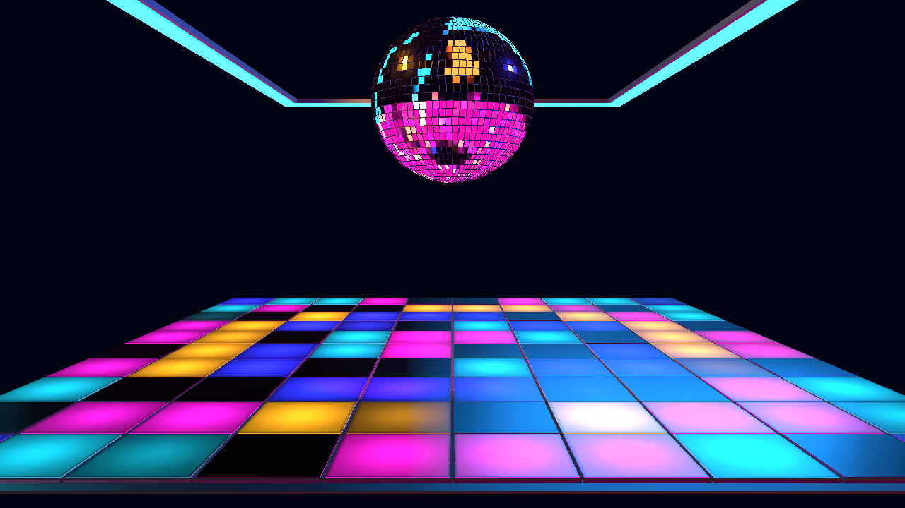

# NIGHTSHIFT — Step 6 scoped Auto Performance

Follow-up: [Step 7 finishing is implemented](NIGHTSHIFT-step7-report.md). This report records the earlier Step 6 checkpoint.

October 23, 2026. Section 23, Step 6 is implemented. **Auto Performance** now
appears under Master Controls and defaults **OFF**, as agreed. NIGHTSHIFT remains
a reference preview. Revision 2 is retained so the new parameter receives its
authored default without discarding earlier edits. Camera, geometry and assets
were not changed; fog and finishing remain for Step 7.

## Ownership and behavior

Auto Performance owns only temporary floor-program substitution. It cannot
change palette, physical layout, camera, saved Pattern/Pattern Change/Trigger,
intensity ceilings, motion settings or hard permissions. It never writes a
parameter. Shared Audio Intelligence, Director meaning and the module's existing
Cinema2BeatClock remain the musical authorities; no new analyzer or clock exists.

| Moment | Temporary program | Bound / restoration |
|---|---|---|
| Newly supported build | Diagonal Relay | Until build meaning ends or eight shared-clock beats elapse. |
| Fresh canonical drop | Full House | Four shared-clock beats from the event. Takes priority over a build. |
| Manual Pattern edit/reselect | Current authored base | Immediate takeover; the active moment is consumed. |
| Auto Performance OFF | Current underlying base | Immediate restoration, including while paused or mid-transition. |

Build authorization uses matched shared Director build context with confidence
at least 0.45, entering at 0.56 and releasing below 0.42. A stable source/section
identity latches that build interval. Crossing the duration cap does not rearm the
same ongoing build. A later separate build interval can qualify again. Drops use
the existing canonical semantic/structural resolver and identity deduplication.
An ended drop restores the base rather than reviving its previously consumed build.

The base Pattern Change controller always runs first. Selected fresh Trigger
events may advance it behind an override. Expiry restores that current base,
not the base that existed when the override began. Saved Pattern is untouched.
Normal entry/expiry uses the established 300 ms automatic crossfade; the beat
limits end override ownership, followed by that bounded restoration blend.
Manual Pattern selection and Auto Performance OFF cancel the blend immediately.

Reselecting the same saved Pattern uses the existing edit revision to take over.
Pattern Change and Auto Performance stay enabled; only a later separately
qualifying event can substitute again. Turning Pattern Change OFF stops base
cycling but grants no extra authority over an independently enabled performance.

Enabling Auto Performance during an already active build latches that moment.
Pause holds an override and its remaining beat budget. Current events are
consumed while paused, disabled, manually edited, reset or deactivated, preventing
replay. Seek, loop, source/track changes and missing audio clear the override.
Fresh activation with a persisted ON permission still latches current moments;
it does not reconstruct a stale override.

The clock advances independently of Motion Amount and Music Response. Motion
Amount zero still holds continuous motion; Music Response zero still removes
lighting/motion modulation. Authorized discrete program substitutions remain
independent, just like Pattern Change. With BPM Sync OFF the existing authored
100-BPM clock governs the beat budgets. All programs obey final intensity and
coverage caps; no OFF control is reopened.

## Validation and evidence

- Twenty-seven focused tests pass: the previous nineteen tests plus eight new
  Auto Performance cases. These cover default/activation latching, eight/four
  beat bounds, build release, drop priority, stale/duplicate identity rejection,
  same-value manual takeover, hidden base progression, OFF, pause and resets.
- TypeScript, scoped ESLint and `git diff --check` pass. Relevant implementation
  and working-tree changes were reviewed. No commit was requested or created.
- The native production canvas passes 78 assertions across 59 captures at
  1280 × 720. The real Inspector toggle is verified under Master Controls.
- All eleven canonical Trigger choices advance the hidden base exactly once
  under repeated publication, then restore the expected rendered program when
  Auto Performance is disabled. Saved Pattern, Pattern Change and Trigger remain
  unchanged by both the override and the runtime progression.
- Default OFF, enable-during-build latching, build cap/end, drop cap/priority,
  duplicate suppression, authored unsynced timing, manual takeover during build
  and drop, future events after takeover, pause/OFF/resume, seek/track changes,
  missing audio, zero coverage/master and fresh default re-entry pass.
- Palette and approved camera remain unchanged. The zero-motion ball remains
  unchanged during program substitution. No browser, shader or choreography
  errors were observed.
- The final high-quality local sample reports approximately 2.44 ms average CPU
  frame time and 1.01 ms GPU frame time without quality degradation. This is a
  local observation, not full-app or long-duration performance acceptance.

Run `node scripts/cinema2-assets/accept-nightshift-step6.mjs` for this checkpoint.
The [saved report](NIGHTSHIFT-step6-acceptance.json) lists every assertion and
rendered-program comparison. Other captures are in ignored
`artifacts/cinema2-nightshift-step6/`. The test-only fixture can publish an
advancing beat grid to verify durations through the actual shared clock.

## Next checkpoint

Step 7 adds shared bloom, subtle club haze/fog and reflection finishing, with
OFF/default/maximum checks and preserved tile seams/dark separation. Full
acceptance and human review follow in Step 8. No finishing effects or keeper
promotion are claimed at this checkpoint.
