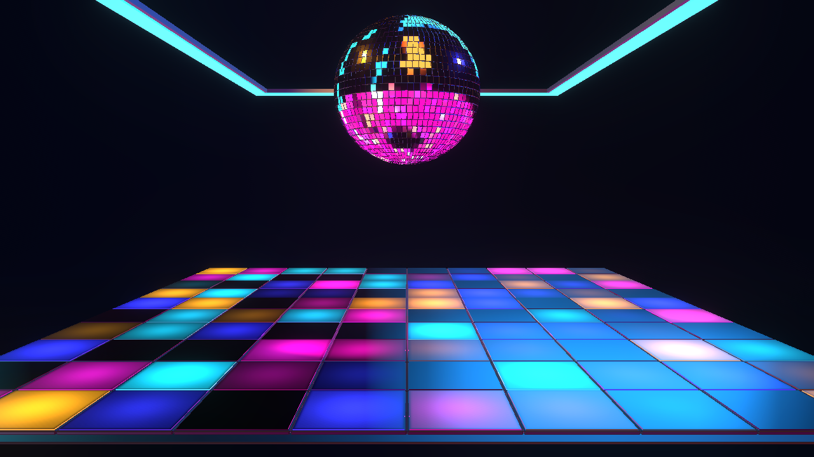

# NIGHTSHIFT — Step 7 club finishing

Follow-up: [final acceptance and keeper promotion are complete](NIGHTSHIFT-final-report.md). This report records the earlier Step 7 checkpoint.

October 23, 2026. Shared bloom, depth-aware club haze/fog and restrained ground
reflections are implemented. All three controls appear under **Effects → Club
Finish** in the Design Inspector. NIGHTSHIFT remains **NIGHTSHIFT (Preview)**,
revision 2, with final acceptance and human review reserved for Step 8.

## Controls and rendering

| Control | Default / range | Visible result |
|---|---|---|
| Bloom | 0.35 / 0–1 | Shared linear-light bloom around bright tiles, ball highlights and cyan ceiling strips. |
| Club Haze / Fog | 0.35 / 0–1 | Shared depth-aware atmosphere, colored spill and subtle low mist. |
| Reflections | 0.25 / 0–1 | Subtle glossy ground around the existing tile deck, with screen-space reflection sampling. |

Each control scales the mix of a bounded treatment. Zero bypasses the effect and
retires its runtime instance. Maximum increases that treatment without removing
the tile boundaries or filling the dark gap. The original proposed physical fog
density control is now a normalized mix; the physical density is bounded at 0.01.
Reflection mix was tuned down from the initial proposed 0.45 to 0.25.

The graph runs **scene → reflective-floor → volumetric-atmosphere → hdr-bloom →
output**. Reflections and haze read the original scene depth. The virtual ground
plane sits at Y −0.16, below the tile deck, so it preserves the actual tile faces
and geometry. This is deliberately a subtle perimeter/foreground treatment,
not a second copy of the ball across the dance floor. Shared reflection quality
profiles use reflectivity 0.08/0.14/0.22 for low/medium/high.

Haze uses density 0.01, bounded light scattering, low mist and a slow shared
transport-driven drift. Ceiling Cyan supplies its tint; the shared spot lights
already follow the editable palette. Reflection sky color follows Background.
Bloom retains the colors of its source. Effects receive no additional audio or
Director modulation in this phase; musical light changes arrive through the
existing native scene. No extra analyzer, clock or preset-specific effect exists.

Five shared parameter-source choreography gates preserve user authority without
writing saved values: Master Intensity scales each effect below its 0.85 authored
level; Floor Intensity and Pattern Coverage also scale ground reflections below
their authored levels. At Master zero all three effects bypass completely, even
with their controls at maximum. Floor or coverage zero suppresses reflections.
These gates work without audio and with zero frame delta.

The approved camera, larger room geometry, materials, asset files, palette
defaults and rgba8 scene/output pipeline remain unchanged. Shared HDR bloom
supports this display-referred input; this phase adds no new tone curve or HDR
conversion.

## Validation and evidence

- Twenty-nine focused NIGHTSHIFT tests pass, including two finishing tests for
  registered effects, depth wiring, canonical controls, independent OFF/default/
  maximum values, no-audio gates and preservation of saved values.
- TypeScript, scoped ESLint and whitespace checks pass. Implementation and the
  working tree were reviewed for unintended edits. No commit was requested or
  created; all NIGHTSHIFT work remains uncommitted.
- The real native runtime and Inspector pass **32 assertions across 19 captures**
  at 1280 × 720. Each effect produces measured output differences at default and
  maximum, and each OFF state restores the original native output.
- Combined finishing retains approximately **98% of baseline tile-edge contrast
  at default and 96% at maximum**. Mean RGB brightness in the dark separation
  region is 14.91/255 at default and 25.86/255 at maximum, under the 30/255 limit.
  The initial maximum exceeded that limit slightly; haze density/light scattering
  were reduced before the passing capture run.
- Master zero, floor/coverage reflection gates, pause stability, OFF edits while
  paused, editable cyan role, unchanged camera and fresh re-entry pass. There are
  no browser, shader, effect or choreography errors.
- The local high-quality sample reports 3.65 ms average CPU frame time and
  12.34 ms GPU frame time without quality degradation. Full-app performance,
  other aspect ratios/quality levels and long-duration behavior remain part of
  Step 8 acceptance; this sample is not a performance guarantee.

Run `node scripts/cinema2-assets/accept-nightshift-step7.mjs` to reproduce this
checkpoint. The [saved acceptance report](NIGHTSHIFT-step7-acceptance.json) records
the assertions and measurements. Compare [all effects OFF](NIGHTSHIFT-step7-off.png),
[default finishing](NIGHTSHIFT-step7-default.png), and
[combined maximum](NIGHTSHIFT-step7-max.png). Other captures are in ignored
`artifacts/cinema2-nightshift-step7/`.

## Remaining checkpoint

Step 8 is full acceptance of the assembled preset: musical/transport behavior,
all controls together, resizing/aspect ratios, resource lifecycle, performance
and human review against the saved reference. Keeper promotion remains pending.
