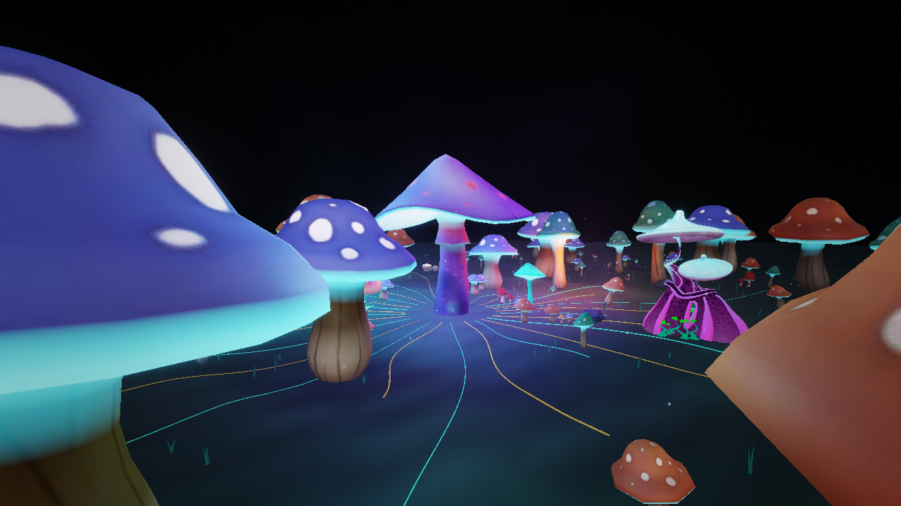
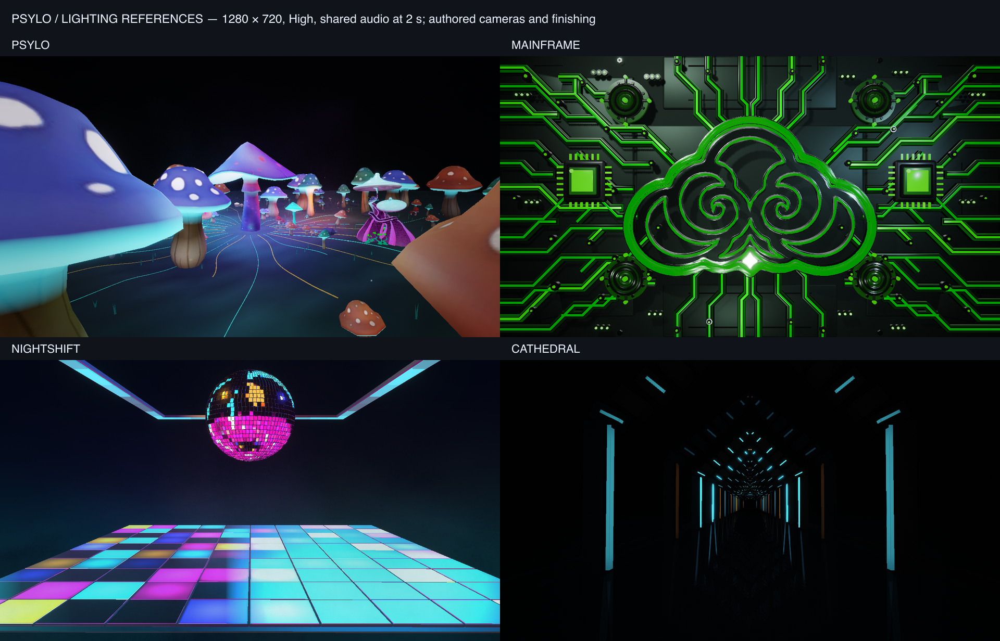

# PSYLO — remaining phases and final implementation handoff

November 2, 2026. The user authorized the remainder of all phases. **Phases 6–7
are implemented; Phase 8 acceptance is complete.** The user approved the final
handoff on November 2, 2026. PSYLO is promoted to catalog role **keeper**, retaining
stable ID `drmvyz.cinema2.psylo` and revision 2. No commit was
requested or created. Existing Phase 4/5 work was preserved.



## Phase 6 — scoped Auto Performance

Auto Performance defaults OFF and owns only finite build/drop Pattern presentation.
A fresh supported build selects Canopy Breath for at most eight shared-clock beats;
a fresh canonical semantic drop takes priority with Psylo Release for four beats.
An alternative native program is used when the base already equals the proposed
substitution. The ordinary controller continues fresh Trigger progression behind
the override, so expiry restores the **current** base instead of an old snapshot.

Manual Pattern edits/reselection take effect immediately and leave Pattern Change
ON. The active moment is consumed, preventing immediate re-override. OFF,
seek/source/context/analysis replacement and playing analysis loss cancel stale
presentation. Pause holds the override/budget through the host's hidden-audio gate;
resume latches current identities before accepting future events. Re-entry retains
saved permissions without replaying old performances. Auto Performance never writes
Pattern/Pattern Change/Trigger, changes palette/layout, acquires camera ownership
or bypasses feature zero/OFF limits.

Camera automation was conditional in the reviewed plan and was not added as an
implicit extra domain. Full travel/orbit/canopy/fixed controls remain manual and
are proven to remain under user authority while Auto Performance is ON. There is
no hidden automatic camera permission to revoke.

## Phase 7 — visible light and full atmosphere

The final graph carries **RGBA16F scene color + Depth24 → volumetric atmosphere →
HDR bloom → cinematic finish → output**. The native forest now has cap-spot/gill/
mycelium radiance with retained source textures, six independently gated point/spot
accent lights, low baseline ambient/moon illumination, world-space distance fog,
layered ground mist, drifting 3D smoke billows, depth-terminated light cones and
restrained bloom/grade. Surface emission, cast light spill and volume scattering
are independent, visible layers.

New live controls: Auto Performance; Scene Lights / Light Strength; Atmosphere /
Fog Density / Ground Mist / Mist Height / Light Shafts; Bloom / Bloom Amount; and
an eighth independent Palette role, Atmosphere. There are 39 total controls.
Fog Density multiplies physical distance and ground densities together; zero
clears the entire medium. Mist amount and world height remain independently
editable. Atmosphere and Bloom OFF hard-bypass their passes. Master and light
permissions multiply authored ceilings even without audio, rather than relying
on replacement priority. Music/Director/performance cannot re-enable them.

The atmosphere consumes the final shared camera/depth and shared lights; no flat
fog card or screen-space shaft blur was added. Existing shared 3D smoke assets are
reused, with no new installer payload. A generic opt-in authored-motion flag keeps
mist drift/fade-in alive without analysis/no-source idle and holds explicit pause/
stop; presets without that flag retain their timing. Volumetric steps/resolution
and bloom cost follow existing tier policies. All geometry and the hero survive
Low quality. These are unshadowed light cones terminated by scene depth; shadow-map
carving was not introduced.

## Lighting comparison and limits of equivalence



The four real production renders use 1280 × 720, High quality, the same shared
fixture (energy .7, bass .6, highs .7, no build), at two seconds. Each preset keeps
its authored camera, scene geometry, source radiance and finishing; global scene
exposure is 1, while authored final tone curves differ. These are representative
composition comparisons, **not a claim of photometric equality** between unlike
scenes. Region coordinates and measurements are retained in
[the evidence summary](PSYLO-final-evidence.json).

Display-RGB luminance percentiles, range 0–255:

| Preset | Emitter/core-region P99 | Spill-region P95 | Whole-frame fully white clipping |
|---|---:|---:|---:|
| PSYLO | 226.6 | 180.7 | 0.000% |
| MAINFRAME | 196.8 | 158.4 | 0.004% |
| NIGHTSHIFT | 205.1 | 219.0 | 0.000% |
| Cathedral | 130.1 | 6.4 | 0.000% |

PSYLO's cap/gill sources and nearby surfaces are clearly readable at the reference
output conditions, with bright local regions and dark separation. The comparison
supports the implemented visibility/brightness goal; subjective visual matching
was accepted by the user with the final handoff. Cathedral's darker default architecture and
NIGHTSHIFT's broad lit floor are explicit composition differences. Background
brightness alone is not used as a pass criterion.

Other retained views: [orbit](PSYLO-final-orbit.png),
[canopy passage](PSYLO-final-canopy.png), [dense mist](PSYLO-final-dense.png),
[portrait](PSYLO-final-portrait.png), [shared Inspector](PSYLO-final-inspector.png).

## Phase 8 — integrated acceptance

**67 focused tests pass** across PSYLO and the affected atmosphere implementation:
26 audio/trigger/authority, 8 choreography/transition, 7 Director, 5 Auto Performance,
3 finishing-gate/authored-motion, 3 preset/authoring/asset registration, 4 full-route
camera/decoded-geometry clearance, and 11 shared atmosphere regressions. Finishing
failures found during implementation were corrected and the affected tests rerun;
passed unrelated checks were retained.

**142 unique production assertions / 60 captures pass** in the final evidence:

- Real visible consumers for geometry/design, lights, all eight palette roles,
  fog density, independent mist amount/height, shafts, bloom and hard effect toggles.
  All eight native programs remain visually distinct. Music Response has a matched
  phase consumer; all eleven canonical Triggers render the expected destination.
- Temporary drop/build presentation, correctly advanced hidden-base restoration,
  immediate manual takeover without disabling Pattern Change, camera non-ownership
  and hard-disable authority under strong musical/Director input.
- Complete rendered 52-second travel and 72-second orbit joins; authored camera
  modes and orbit/FOV controls; square and portrait resize; playback, pause/resume,
  analysis loss, seek/track reset, saved-setting re-entry and WebGL context recovery.
- Genuine fresh Low/Medium/High sessions verify their **resolved tier**, render
  complete geometry/effects and profile the appropriate policies. The canonical
  Quality control changes real runtime policy. Early harness samples that pinned
  High were superseded; they are not reported as Low/Medium measurements.
- No browser/shader errors, failed/degraded modules or failed effects/passes remain.
  Final disposal leaves zero module/resource leases and no active event envelopes.
  Shared Inspector typography was retained; no workspace font overrides were added.

The integrated run resumed completed checkpoints after a harness timing correction
and a development-server reload during context recovery. Recovery now uses a
bounded, event-loop-safe wait. Final evidence deduplicates repeated capture/assertion
names and retains the successful results; old failure/preview files in ignored
artifacts are diagnostic history, not final acceptance evidence.

### Measured performance

Local Chrome/WebGL2 on this workstation, 30-frame samples, fixed review view with
music and the complete native/effect graph. CPU is the runtime rolling average;
GPU is the **last available timer-query sample**, not a GPU percentile/FPS promise.
Tracked render-target bytes and module estimates exclude other browser/driver
allocations and some effect internals.

| Output / quality | CPU average | Last GPU sample | Tracked render targets | Module estimate |
|---|---:|---:|---:|---:|
| 1280 × 720 / Low | 3.78 ms | 4.16 ms | 14.70 MiB | 19.30 MiB |
| 1280 × 720 / Medium | 3.46 ms | 8.49 ms | 22.45 MiB | 30.14 MiB |
| 1280 × 720 / High | 3.61 ms | 14.66 ms | 33.40 MiB | 30.14 MiB |
| 1280 × 720 / High, dense atmosphere | 3.36 ms | 14.32 ms | 33.40 MiB | 30.14 MiB |
| 1920 × 1080 / High, default atmosphere | 3.63 ms | 19.84 ms | 75.15 MiB | 30.14 MiB |
| 1920 × 1080 / High, dense atmosphere | 3.38 ms | 27.96 ms | 75.15 MiB | 30.14 MiB |

These samples establish a real cost boundary: dense 1080p High exceeds a 16.7 ms
GPU budget. Balanced/Performance offer headroom; 60 FPS across hardware or the full
Electron workspace is **not** signed off. The user’s acceptance does not turn these samples into a full desktop/hardware
benchmark; extended profiling and a universal 60 FPS guarantee are not claimed.

### Reproduction

```sh
npx vitest run src/components/vyzualz/cinema2/__tests__/Cinema2PsyloAudio.test.ts src/components/vyzualz/cinema2/__tests__/Cinema2PsyloChoreography.test.ts src/components/vyzualz/cinema2/__tests__/Cinema2PsyloDirector.test.ts src/components/vyzualz/cinema2/__tests__/Cinema2PsyloAutoPerformance.test.ts src/components/vyzualz/cinema2/__tests__/Cinema2PsyloFinishing.test.ts src/components/vyzualz/cinema2/__tests__/Cinema2PsyloPreset.test.ts src/components/vyzualz/cinema2/__tests__/Cinema2PsyloCamera.test.ts src/components/vyzualz/cinema2/__tests__/Cinema2VolumetricAtmosphere.test.ts
node scripts/cinema2-assets/accept-psylo-final.mjs
npm run typecheck
```

Full machine-readable production evidence: `artifacts/cinema2-psylo-final/report.json`.
A smaller retained [evidence summary](PSYLO-final-evidence.json) includes region
statistics, actual tier profiles, control image differences and cleanup counts.
The acceptance script supports `--preview` for a single tuning view and `--from=`
checkpoints for diagnostics; a fresh default command runs the complete gate.

TypeScript, focused ESLint, whitespace, documentation links and the final working
tree/diff were checked. The original GLBs, generated runtime assets, attribution
and installer budget are unchanged. No commit was requested or created.

## Final acceptance recorded

The user approved the completed handoff on **November 2, 2026**. This closes the
final acceptance gate under [Section 20 of the preset creation contract](../../DRMVYZ_Cinema_2_0_Preset_Creation_Contract.md#20-human-visual-acceptance-is-mandatory).
PSYLO is now registered as a **keeper**. All eight implementation/acceptance phases
are complete; no further approval or implementation work is queued.

Promotion changes catalog classification and removes the review metadata tag.
Stable preset ID, revision, parameters, saved-setting compatibility, rendering and
known performance limits remain unchanged. The focused keeper/compiler/authoring
checks passed after promotion. No commit was requested or created.
