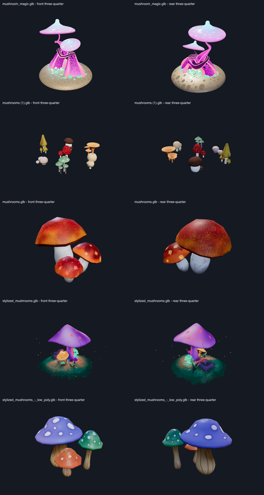

# PSYLO — asset analysis and proposed implementation phases

Status: the user authorized all remaining phases on November 2, 2026.
All eight phases are complete. The user approved the final handoff on November 2,
2026, and PSYLO is registered as a keeper. See the current
behavior specification and [final report](PSYLO-final-report.md).
Prepared November 1, 2026.

## Scope and inspected sources

The requested `/Downloads/PSYLO` resolves locally to
`/Users/kodyrobinson/Downloads/PSYLO`. The requested contract resolves to
[`DRMVYZ_Cinema_2_0_Preset_Creation_Contract.md`](../../DRMVYZ_Cinema_2_0_Preset_Creation_Contract.md).
All five GLBs were inspected structurally, validated, loaded with Three's GLTFLoader,
and rendered from opposing three-quarter angles under neutral review lights.

These renders document supplied geometry and materials, not the proposed finished
PSYLO scene. No bloom, authored atmosphere, musical response, or production lighting
was added to this asset viewer.

Also inspected: MAINFRAME's operating specification and lighting architecture;
NIGHTSHIFT's behavior, acceptance, subsequent brightness/fog/playback corrections,
native module and scene controller; Cathedral's preset and continuous-flight loop
fix; shared manifest, authoring/catalog, asset, parameter/target, audio, Director,
choreography, camera, render-graph and effects integration points and production
browser harness conventions.

## Asset findings

Triangle counts describe source geometry once, before environment instancing.
GPU estimates include uncompressed geometry/textures and mipmaps; they exclude
PSYLO render targets, shadows, atmosphere, and runtime overhead.

| Source | File size | Triangles | Meshes / materials | Estimated GPU memory | Recommended role |
|---|---:|---:|---:|---:|---|
| `mushroom_magic.glb` | 23.85 MiB | 778,922 | 34 / 9 | 38.2 MiB | Optimized hero landmark and visual inspiration |
| `mushrooms (1).glb` | 0.66 MiB | 9,370 | 7 / 7 | 5.6 MiB | Varied mushroom clusters for forest dressing |
| `mushrooms.glb` | 1.89 MiB | 1,056 | 2 / 2 | 26.7 MiB | Red/orange cluster as an occasional accent |
| `stylized_mushrooms.glb` | 2.20 MiB | 12,057 | 25 / 2 | 21.8 MiB | Primary composition, palette and grove reference |
| `stylized_mushrooms_-_low_poly.glb` | 0.69 MiB | 1,328 | 3 / 3 | 12.1 MiB | Repeated large/small/thin mushroom silhouettes |

### Visual and material character

- **Mushroom Magic:** twisting pink/magenta supports, pale cyan/lilac caps, luminous
  spots, small green growth and a circular base. Strong sculptural landmark from
  both sides. Multiple HDR emissive materials have authored strengths of roughly
  2–10; these can lose surface detail under bloom. Simplify this source before
  runtime use, retaining the silhouette, cap detail and material regions. Do not
  scatter many copies of its original 779k-triangle model.
- **Mushrooms (1):** several distinguishable cluster styles, including spotted
  red/green caps, brown caps, pale rounded mushrooms and tall yellow forms. Seven
  mesh/material groups share a 1024px atlas. Useful variety at modest geometry cost;
  individual mushrooms may still require connected-component extraction within a
  group before independent animation. Its source materials are not a complete
  bioluminescent lighting design.
- **Mushrooms:** three chunky red/orange mushrooms with pale stems, represented by
  two material/mesh groups. Very cheap geometry, but five 1024px textures dominate
  memory. One material contains an emissive map. Separate individual mushrooms
  and cap/stem masks if this cluster needs more than whole-group motion.
- **Stylized mushrooms:** purple hero cap, smaller yellow/teal mushrooms, grass,
  rocks, ground and decorative floating flecks form the closest complete scene
  reference. Both materials use `KHR_materials_unlit`; the ground material is
  alpha blended. Imported unchanged, they do not respond to scene lights like
  physically shaded surfaces. Preserve useful texture artwork while deriving
  lit surface materials and independent emission masks. Existing ground/fleck
  geometry must be classified before it is reused as terrain or live spores.
- **Low Poly:** three readable blue/violet, green and orange mushrooms with
  spotted caps and woody stems. Three mesh/material groups, nine 512px PBR maps,
  normal/AO support and no authored emission. Best repeated silhouette source;
  add controlled emissive regions without flattening its material shading.

### Structural constraints

All five files have **zero animation clips, skins and cameras**. PSYLO's movement
must be authored; an animation mixer cannot supply the requested choreography.
There is no ready-made navigable forest or camera corridor in this collection.

World-space heights after imported transforms range from approximately 0.245 to
11.084 units, about a 45-fold difference. Normalize transforms, ground contact,
forward/up axes and pivots into one scene convention. Do not scale raw accessor
bounds without applying the imported hierarchy first.

The project asset limits are **250,000 triangles and 16 MiB per shipped asset**, with
low/medium/high asset-memory budgets of 32/48/80 MiB and an aggregate installer
asset budget of 128 MiB. Mushroom Magic exceeds the triangle and file-size limits;
its estimated memory also exceeds the low-tier asset allowance. The other four
sources pass the inspector against current project budgets. Their combined cost
still matters; passing individually does not authorize loading every source at
every quality level. Compression alone does not reduce rendered triangles.

All five GLBs have zero glTF validation errors. `stylized_mushrooms.glb` has two
material-extension compatibility warnings involving its unlit materials; the
other four have zero validator warnings. These source warnings should be resolved
or explicitly accounted for in the derived runtime asset validation.

Embedded metadata identifies all five as CC-BY-4.0: Tycho Magnetic Anomaly,
leha_pu, Gwappa, QumoDone and Camille Barral, respectively. Preserve source URLs,
author credits, license and modification notices in registered asset provenance
and generated attribution. This finding is from the supplied files; the original
listing pages were not independently reverified.

## Proposed visual specification

Build a **fully modeled bioluminescent mushroom forest**, with a central hero grove,
root/mycelium paths, layered mushroom populations, continuous terrain, overhead
canopies and animated spores. Ground-level travel, an elevated passage and a
360-degree grove orbit must reveal convincing depth and finished reverse sides.

Use `stylized_mushrooms.glb` as the main composition/palette reference and the low
poly set as the repeated forest vocabulary. Use the other clusters selectively.
The optimized Mushroom Magic landmark can anchor the grove if its derived visual
quality and budget are acceptable. The environment should remain coherent rather
than displaying five unrelated source dioramas together.

Proposed starting composition: one hero grove with three major mushroom forms,
three surrounding forest zones, roughly 36–60 medium mushrooms and 80–160 small
instances. These are tunable composition targets, not promised final counts.
Instance compatible geometry/materials, keep population stable through camera
motion, and reduce peripheral detail before removing the hero on lower tiers.

Geometry convention: world space, Y up, ground around Y=0, default view looking
into -Z. Normalize individual species to authored dimensions. Stem bases remain
rooted. Give clusters deterministic IDs and transforms, cap/stem masks and local
height/phase attributes. Deform stems with zero displacement at their roots;
animate caps, spores and mycelium as separate meaningful domains. Camera clearance
must account for maximum deformation, cap overhangs, terrain and near-plane bounds.

Mandatory reference traits: mushroom silhouettes, layered scale, luminous cap
details and violet/teal/amber biological character. Exact source arrangement,
pedestal bases, fixed baked decorative flecks and original material brightness
are inspirational; they may change to create a continuous environment.

Idle: subtle authored breathing, very slow spore drift and optional slow camera
travel. Explicit pause/stop holds motion. During music, geometry range, spatial
accents and structural behavior must differ visibly from idle. Missing analysis
must not stop otherwise valid playback animation or invent musical events.

### Proposed native Pattern library

All patterns operate on actual geometry as well as their supporting light program.

| Pattern | Distinct motion vocabulary |
|---|---|
| Mycelium Tide | Ground-originating waves propagate out through rooted stem bends and cap lift. |
| Gill Spiral | Cap/gill accents and bounded mushroom torsion progress around the grove in a spiral. |
| Spore Choir | Cluster groups answer one another with staggered cap tilts and rising spore plumes. |
| Canopy Breath | Giant forms expand/relax subtly while smaller growth bends beneath them. |
| Fairy Ring | Circular banks lean/lift sequentially around the hero, independently of camera orbit. |
| Root Relay | Directional ground paths hand impulses from one cluster to the next. |
| Bloom Ascent | Growth and cap-opening gestures rise by height, accompanied by upward spore motion. |
| Psylo Release | A controlled inward preparation releases an outward geometry wave through the forest. |

Patterns are proposed for review, not implemented claims. Avoid renaming one sine
wave eight times. Blend transitions without dislodging roots or creating camera
collisions. Large terrain and structural supports remain stable.

### Controls and timing

Use only the contract's four Inspector parent groups, with shared typography:

| Parent | Proposed controls and visible consumers |
|---|---|
| Master Controls | Master Intensity; Geometry Motion Amount/Speed; Music Response; BPM Sync; Auto Performance |
| Design | Pattern / Pattern Change / conditional Trigger; mushroom population/scale within authored bounds; Camera Travel and Orbit enables/speeds, radius, elevation and FOV; automatic camera permission |
| Effects | Cap/Gill Emission; scene-light strength; shaft strength; fog density; mist height/amount; spore density; bloom; individual hard enables |
| Palette | Background; Cap Primary; Cap Secondary; Gill Glow; Mycelium; Spores; Atmosphere |

The final parameter list must remain proportional to genuine independent visual
domains. Parameter-to-visible-output documentation records each consumer, range,
default, zero behavior and authority before controls are added.

BPM Sync ON uses the shared Cinema2BeatClock/transport to lock geometry periods,
relay progress and the camera timing domains declared synchronized. OFF uses
authored rates without removing audio-response envelopes. Compose any host timing
gate explicitly through the shared effective-timing policy; do not add a competing
clock. Shared Trigger events remain musical events even with free-running motion.
Unavailable structural signals do not authorize synthetic drops or phrases.

Pattern Change defaults OFF. Reuse `CINEMA2_AFTERHOURS_TRIGGER_OPTIONS`: `beat`,
`kick`, `snare`, `downbeat`, `beat2`, `beat4`, `bar`, `bar4`, `bar8`, `phrase`, `drop`,
with their unchanged labels and meanings. Preserve the selected Trigger while
hidden. Deduplicate events, avoid immediate pattern repeats, and reset/reconstruct
predictably across transport changes.

### Proposed authority matrix — review before coding

| Property | Manual control | Audio modulation | Visual Director | Auto Performance | Manual edit behavior |
|---|---|---|---|---|---|
| Pattern | Authored base selection | Selected Trigger advances runtime base only when enabled | Significance only | Temporary fresh build/drop substitution | Immediate visible base; Pattern Change stays ON; suppress already-active override/event |
| Pattern Change / Trigger | User owns both | Canonical fresh events only | Cannot edit | Cannot edit | Immediate re-arm; preserve saved values; no stale switch |
| Geometry amount/speed | User base and bounds | Bounded movement/phase accents | Bounded energy/momentum | Cannot exceed user limits | Immediately changes range/rate; zero prevents movement |
| Population, scale, placement | User owns authored layout limits | No implicit respawn or layout replacement | None | None | Immediate bounded result; no automation overwrite |
| Brightness and emission | User base and ceiling | Pulses within final ceiling | Bounded intensity | Cannot exceed ceiling | Zero remains off |
| Palette | Seven independent base colors | No hue replacement | None | None | Immediate and persistent |
| Camera travel/orbit | User controls and hard enables | Bounded authorized timing response | Energy within safe bounds | Shot progression only with separate permission | Editing camera domain revokes auto-camera ownership |
| FOV/radius/elevation | User base within clearance envelope | Small authorized offsets only | No direct replacement | Within declared camera permission | Immediate takeover of auto-camera domain |
| Scene lights / shafts | User base and enable | Spatial accents within ceiling | Bounded impact | No hard-enable override | Zero/OFF remains authoritative |
| Fog/mist | User base, height and ceiling | Small bounded structural lift | Build significance | No hard-enable override | Density zero and disabled state remain off |
| Spores | User density/motion limits | Bursts below population cap | Bounded structural significance | No permission override | Disabled/zero stays off |
| Bloom | User enable and base amount | Small declared accents | Bounded effect significance | No permission override | OFF always bypasses |

Pattern precedence: manual choice establishes base -> fresh selected Trigger may
advance the runtime base -> authorized fresh build/drop can temporarily substitute
a performance -> current underlying base resumes. Authored Pattern, Trigger and
Pattern Change are not rewritten by the performance controller. Underlying valid
Trigger progression continues during a temporary override.

## Architecture and benchmark interpretation

Add a PSYLO manifest/native module with focused layout, asset preparation, scene,
pattern and authority components. Proposed seams are
`presets/Cinema2PsyloPreset.ts`, `modules/Cinema2PsyloNativeModule.ts`, and
`modules/psylo/`, registered through the existing module and first-party catalogs.
Use the shared Three asset cache/scene bridge, final-value resolver, shared music
bridge, choreography/Director, camera, render graph and effects. Keep one production
WebGL context and render loop; no preset-local music detector or Inspector system.

The camera runtime supports path/fly spline rigs, constant speed, orbit controls,
additive orbit, safety clamps and tempo bindings. It selects an authored camera;
the inspected control schema has no direct rig-selector binding. Phase 2 must
prove travel/orbit composition through existing controls or introduce the smallest
generic camera binding needed for safe mode selection. Do not move a second hidden
camera inside the PSYLO renderer or add preset-name conditions to shared systems.

MAINFRAME demonstrates bright HDR emitter cores against readable dark surfaces.
NIGHTSHIFT's current corrections establish that source radiance, not simply global
exposure, makes lighting readable, and that fog needs physical density/height as
well as visible output strength. Cathedral demonstrates luminous architecture,
spatial shafts and continuous travel without missing geometry at loop boundaries.
These are behavior references, not interchangeable brightness constants.

PSYLO requires three independent lighting layers: emissive caps/gills/mycelium,
actual local light cast onto neighboring terrain and stems, and depth-aware shafts
scattered through mist. An emissive texture alone supplies none of that light
spill. Establish a fixed exposure/tone-map reference for matching and compare hero,
light-spill and shaft regions separately; background brightness cannot pass.

## Implementation phases and review gates

### Phase 1 — agreed specification, prepared assets and static 3D core

Finalize this design, authority matrix, parameter/output map and geometry contract
before coding. Preserve source hashes/provenance; derive budget-compliant assets
outside the immutable source collection. Classify/detach reusable species, ground,
decorative cards and cap/stem regions; normalize transforms and grounded pivots.
Resolve unlit material handling and source warnings. Add the manifest/native module
as a review/reference entry and construct continuous terrain, hero grove, forest
zones and path clearances. Include readable baseline physical light and material
shading; keep automation, geometry animation and finishing effects disabled.

Deliver: approved spec/maps, derived-asset report and attribution, static native
core, source/derivative validation, default and reverse-view production captures.
Review landscape/square/portrait framing and enough side/rear viewpoints to prove
the intended environment extends beyond one front-facing diorama. Stop here until
the static composition is accepted. Later music/effects work is outside Phase 1.

### Phase 2 — camera, manual controls and native geometry motion

Prove camera travel first: a continuous ground route through the environment,
elevated reveal, genuine 360-degree grove orbit and fixed view. Expose speed,
radius/elevation/FOV and hard movement gates. Prove clearances throughout geometry
motion bounds and near the path join. Prefer a closed bounded route; if a repeated
world is selected, draw adjoining sections before camera crossings, as Cathedral
does. Camera smoothing alone cannot hide missing terrain.

Then wire manual controls, seven palette roles, all eight native patterns and BPM
Sync ON/OFF against shared timing fixtures. Establish distinct motion algorithms,
stable roots, cap deformation, cluster sequencing and spore movement, initially
without live musical modulation. Wire Pattern Change/Trigger schema now; their
complete musical switching proof follows in Phase 3. For finishing-only controls,
add them when their real consumer arrives rather than expose inert sliders.

Deliver: production camera-path/orbit samples, control min/default/max and enum
checks, independently visible palette edits, motion sequences, shared-control
placement/conditional visibility checks and focused camera/pattern tests.

### Phase 3 — shared Audio Intelligence and musical pattern switching

Connect existing shared facts and timing, including missing-signal availability.
Map continuous energy to movement range, bass to rooted bend amplitude, highs to
spore activity, kick/snare/downbeat to distinct spatial regions, vocals to restraint
and shared build/drop facts to structural preparation/release. Confirm several
dimensions change beyond brightness. Implement all eleven canonical Trigger
semantics through shared event-resolution conventions, fresh-event latching and
duplicate suppression. Preserve valid animation through transient analysis gaps.

Deliver: deterministic quiet/groove/kick/snare/vocal/build/drop/phrase checkpoints,
fresh/duplicate Trigger tests, manual selection while Pattern Change remains ON,
and play/pause/resume/seek/loop/track-change/analysis-refresh checks. Runtime
pattern switching must not mutate the persisted authored Pattern.

### Phase 4 — bounded geometry and lighting choreography

Route temporary actions through the shared target/value system. Document each
rule's source, target, operation, maximum, attack, release, conditions and authority.
Starting ranges for review: continuous movement 0.6–1.0 of the user's maximum;
kick cap-lift accent up to 0.12 normalized (20/220 ms attack/release); snare/spore
accent up to 0.15 (10/180 ms); vocal restraint down to 0.65 of authored motion
(200/500 ms); build convergence up to 0.15 (250/600 ms); drop outward-wave accent
up to 0.25 (20/800 ms). All bounds are composition-tuned and final-clamped; none
authorizes root detachment, camera collision or re-enabling a disabled domain.

Deliver: pattern-specific event choreography, smooth transitions, return-to-base
checks, zero-motion/zero-intensity tests and discontinuity-safe envelope cleanup.

### Phase 5 — Visual Director meaning

Use shared intensity, momentum, build pressure, impact and transition significance
to shape already-working choreography: broader grove gestures in energetic
sections, restraint under vocals, deliberate build tension and a clear release.
Keep mushroom identities and spatial vocabulary in PSYLO, not the Director. No
Director replacement of colors, pattern selection, user layout or camera limits.

Deliver: matched-input comparisons with Director contributions on/off, bounded
macro behavior and authored-base restoration under missing/changed context.

### Phase 6 — scoped Auto Performance and takeover

Add opt-in temporary build/drop performances, plus separately authorized camera
shot progression if approved. Keep manual travel/orbit and all feature permissions
authoritative. Implement the Pattern exception exactly: manual edits show
immediately without turning Pattern Change OFF; a still-active event cannot
instantly override them; a new qualified event may start a later temporary
performance. Maintain underlying Trigger progression during overrides and restore
the current base, not a stale selection captured at override start.

Deliver: active-event edit/reselection tests, override expiry, hidden-base
progression/restoration, camera-domain manual takeover and hard-disable checks.

### Phase 7 — full lighting, atmosphere and finishing

Calibrate the three lighting layers against current MAINFRAME, NIGHTSHIFT and
Cathedral at documented matching output conditions. Retain cap spots, gill detail,
stem form and dark separation while making light spill and shafts obvious.
Implement full depth-aware distance fog, layered ground mist, drifting billows,
spore scattering and restrained HDR bloom/grade. Validate actual scene depth,
world-height alignment and camera-motion consistency; avoid a flat fog overlay.

Gate expensive lights/shadows/volume samples by quality without making the hero
or lighting disappear at low quality. Test every effect OFF/default/max, local
brightness regions, independent fog height/density and intensity/enable gates.
Publish a lighting comparison sheet for user acceptance; brightness equivalence
is not established by the present source analysis.

### Phase 8 — integrated acceptance and handoff

Run one proportional integrated production-path pass after preceding gates pass.
Cover every primary control, all patterns/triggers, music checkpoints, camera
travel/orbit joins and clearances, user authority, transport discontinuities,
save/reload, re-entry, resize/aspect ratios, quality tiers and resource cleanup.
Profile representative default and dense atmosphere scenes on the target device;
state measured frame times and limits instead of promising 60 FPS in advance.

Deliver: final behavior and authority documentation, reproducible visual evidence,
focused automated checks, production rendering results and human review of both
composition and musicality. Register as a finished keeper only after acceptance.
Review the diff for unrelated changes and report commit status; create a commit
only when requested.

## Current handoff

All implementation phases and acceptance are complete; final user approval is recorded. See
[the final report](PSYLO-final-report.md) for controls/authority, reference-lighting
comparisons, 1080p performance limits, reproducible validation and the recorded
user acceptance. Camera automation was conditional and is not implemented;
manual travel/orbit/canopy/fixed controls remain authoritative. No commit was
requested or created. Earlier phase reports are historical checkpoints.
