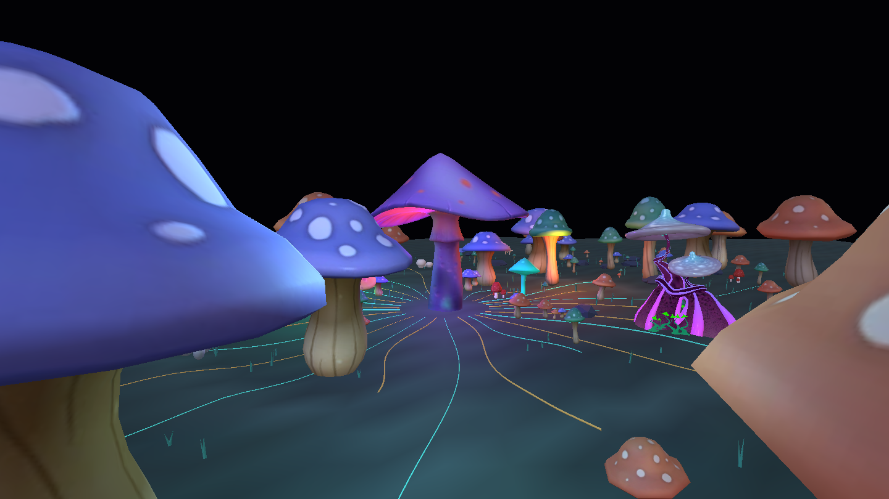

# PSYLO — Phase 1 static environment

Historical checkpoint: the user subsequently authorized Phase 2. Use
[the Phase 2 report](PSYLO-phase2-report.md) and its acceptance script for the
current preset; the Phase 1 script describes the earlier static-only harness.

November 1, 2026. The Phase 1 implementation and automated checks are complete.
**Human acceptance of the static composition is pending.** Phase 2 has not begun.
PSYLO is registered as a visible reference entry, with its unfinished status in
its description. No commit was requested or created.



## Implemented

- A continuous, depth-tested 150 × 150 world-unit terrain with 167 mushroom
  placements, including a purple hero, companion groves and the reduced twisting
  Mushroom Magic landmark. Includes grass, rocks and 28 mycelium paths.
- Source display bases/cards removed. Imported transforms and grounded pivots
  normalized. Source unlit materials adapted to PBR, with source texture artwork,
  real scene-light response, emissive regions and normal-map tangents retained.
- Six semantic attributes preserve rooted height, stable identity, zone, species
  and upper-cap region for the later geometry choreography phase.
- Material batching into 19 meshes, 205,371 triangles. Both quality variants retain
  the complete geometry. No shader deformation, spores simulation, fog, bloom,
  automatic camera movement, music response, Director or Auto Performance is active.
- Shared Cinema 2.0 camera, lighting, depth, Three bridge, asset cache, render graph,
  context and scoped resource ownership. No preset-local renderer or audio system.
- Three static review controls: distance, heading and elevation. These inspect the
  finished reverse sides and surrounding environment; they are not the Phase 2
  camera performance controls.
- All five original sources archived with immutable SHA-256 checks and attribution.
  Regeneration reads repository sources rather than Downloads. Derived asset
  registration and generated attributions include the five authors and source URLs.

## Asset delivery

| Tier | File | Estimated asset GPU memory | Texture maximum |
|---|---:|---:|---:|
| High / medium fallback | 3,730,336 bytes | 25.1 MiB | 384px |
| Low | 3,237,900 bytes | 15.3 MiB | 256px |

Files use Meshopt compression, WebP color maps, PNG data maps and 16-bit position
quantization. The full registered Cinema 2.0 asset collection remains within the
128 MiB installer budget (127.95 MiB). GPU estimates above exclude render targets,
shared environment textures and other runtime costs; they are not FPS claims.
The low variant preserves the hero and population while reducing texture cost.

## Validation

- Three focused Vitest checks pass: reference registration/native compilation,
  static/depth/system boundary, and quality-asset resolution.
- Four focused Node tests pass: five source hashes/attribution, high and low glTF
  validation/budgets/semantic attributes, and surrounding population/layout
  reservations. Both derived GLBs have **zero errors and zero warnings**.
- TypeScript passes. Scoped ESLint passes. The generated asset build passes.
- The production browser gate passes with **eight captures**: default, left,
  rear, right, overview, square, portrait and low quality. Hero/ground region
  visibility, runtime health, zero failed/degraded modules and zero failed render
  passes are checked. No browser or shader console errors were recorded.
- Identical held-frame pixels and unchanged final camera matrices prove this
  phase is static. Runtime disposal reports zero active module resource leases.
- Default, rear, overview, square and portrait output were visually inspected.
  The central mushroom remains identifiable, local light spill is visible on
  terrain/stems, and alternate views reveal surrounding 3D geometry. Later
  atmosphere/lighting comparison against MAINFRAME, NIGHTSHIFT and Cathedral
  remains Phase 7 work.

The browser harness waits for completed texture upload/shader warmup before
visibility checks. The normal-mapped derivatives include tangents so they no
longer rely on runtime tangent generation. These fixes are included in the final
passing checks and saved captures.

The integrated production result is reproducible with:

```sh
node scripts/cinema2-assets/accept-psylo-phase1.mjs
```

All eight captures and numerical/runtime results are in
`artifacts/cinema2-psylo-phase1/report.json`. Review images retained here:
[rear](PSYLO-phase1-rear.png), [overview](PSYLO-phase1-overview.png),
[square](PSYLO-phase1-square.png), [portrait](PSYLO-phase1-portrait.png).

## Handoff and remaining scope

The code/asset implementation is ready for static composition review in the app
under **PSYLO**. The world currently uses baseline light and a dark clear background;
full atmosphere and final brightness matching are intentionally not represented
as complete. Foreground caps frame/crop at the edges, while the center hero remains
readable. The overview exposes terrain extent for inspection.

The path/orbit clearance bands are population layout reservations. They do not
prove camera clearance against all cap overhangs or future deformation; that
verification belongs to Phase 2. Automatic travel/orbit, all eight motion patterns,
shared timing/audio controls, final palette controls and musical automation remain
unimplemented, as required by the phase boundary.

The final working-tree/diff review found only intended PSYLO registration,
asset/generated-attribution, runtime, harness, test and documentation additions.
The five pre-existing user-edited files were left intact. All PSYLO work remains
uncommitted. Static visual acceptance is the next gate before Phase 2.

See [the behavior specification](PSYLO-behavior-spec.md) and
[the reviewed implementation plan](PSYLO-implementation-plan.md).
