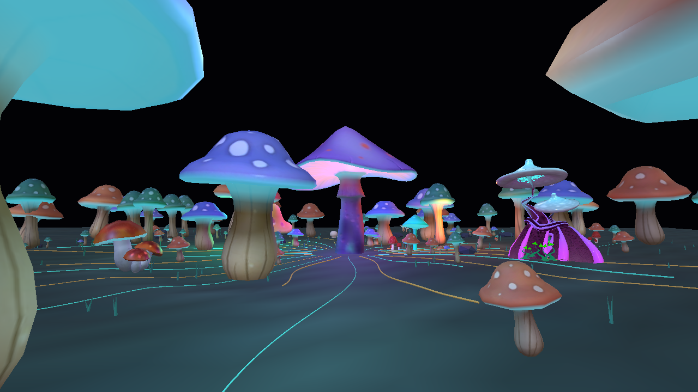

# PSYLO — Phase 2 camera, manual controls and native motion

Historical checkpoint: the user subsequently authorized Phase 3. See
[the Phase 3 report](PSYLO-phase3-report.md) for the current audio and switching
implementation; this report retains the Phase 2 acceptance evidence.

November 1, 2026. Phase 2 implementation and focused automated validation are
complete. **Human review of the moving camera and geometry remains the next gate.**
Phase 3 has not begun. PSYLO remains a reference preset, revision 2; no commit was
requested or created.



## Implemented

- Shared-camera Forest Travel, Grove Orbit, Canopy Passage and Fixed View. Travel
  and canopy paths are closed constant-speed splines. Orbit makes a true 360-degree
  revolution around the grove. Camera Motion OFF, speed zero and pause hold.
- Mode, speed, FOV and conditionally visible orbit radius/heading/elevation controls.
  A small generic camera extension selects authored rig variants through an enum;
  it adds no preset-name conditions and preserves legacy rigs without that binding.
- Eight distinct native geometry programs: radial tide, torsion spiral, zone choir,
  canopy breathing, circular relay, directional root relay, growth ascent and
  preparation/release. All use fixed roots, per-species addressing, bounded world
  deformation and updated surface normals. Source geometry remains immutable.
- Master intensity, geometry enable/amount/speed, BPM Sync, forest density, rooted
  scale, cap/gill emission and a bounded 128-point spore field. Geometry Motion OFF
  restores undeformed plants; speed zero holds the existing phase.
- Seven independent live palette roles: Background, Cap Primary, Cap Secondary,
  Stems, Gill Glow, Mycelium and Spores. Source texture detail remains. Atmosphere
  color will arrive with its real consumer in the later finishing phase.
- Pattern / Pattern Change / conditional Trigger in the correct Design hierarchy,
  using the canonical eleven Trigger options. Manual Pattern selection is active.
  Automatic musical pattern progression deliberately remains Phase 3.
- Shared beat-clock consumers for geometry and camera. Sync ON uses available
  shared tempo/grid facts; OFF uses the authored 100 BPM reference without a phase
  jump. Idle and playing-through-analysis-gap motion use timestamp deltas when the
  host freezes its analysis-gated animation delta. Explicit pause/stop still holds.
- Real production Inspector using the app's shared styles/appearance, including the
  body-portaled Pattern dropdown. No shared typography overrides were added.

## Camera safety and continuity

The first clearance sweep detected a left-canopy intrusion at the ground route's
turnaround. The final route is offset approximately 0.65–1.3 units to the right,
with eye heights 2.5–2.7. It preserves travel through the forest and clears the
source geometry without changing the accepted forest asset.

The source-geometry gate checks height-sliced plant bounds swept through the full
0.8–1.1 scale range, expanded for 0.75 units of maximum motion and a 0.3-unit camera
margin. It also checks clearance above the maximum stationary terrain/stone/
groundcover height. Full travel/canopy loops, fixed framing and orbit radius/
elevation extremes pass. These checks use the decoded shipped geometry, not just
population root positions.

Production captures verify all four orbit quadrants and the return after one
complete revolution. Captures before/after the 52-second ground lap and 72-second
canopy lap retain visible geometry and continuous camera positions. The scene is
one continuous environment; it does not depend on repeated world chunks appearing
at the boundary. Higher camera speeds follow the same clear paths.

[Full-orbit view](PSYLO-phase2-orbit.png),
[elevated passage](PSYLO-phase2-canopy.png),
[Inspector and Pattern menu](PSYLO-phase2-inspector.png).

## Focused validation

- **25 Vitest checks pass:** 3 PSYLO manifest/registration/asset tests, 4 PSYLO
  camera/clearance/timing tests, 8 shared camera regressions and 10 compiler tests.
- **189 main production assertions across 56 captures pass:** four camera modes,
  hard camera gates, camera extremes, all eight distinct patterns and their actual
  frame-to-frame motion, native minimum/default/maximum controls, all seven visible
  palette consumers, phase holds, pause/resume, BPM Sync ON/OFF, Inspector ownership,
  Trigger visibility/options, saved Pattern re-entry, square/portrait resize and
  resource disposal.
- **29 camera coverage assertions across 11 additional captures pass:** full orbit,
  both loop joins, maximum camera rate and native speed variation.
- **3 styled Inspector assertions plus its saved capture pass:** seven palette
  controls, shared 11px label typography, and clean disposal/error state. The final
  Inspector/menu capture was visually inspected with the shared app styles loaded.
- TypeScript, scoped ESLint and whitespace checks pass. No browser/shader errors,
  degraded modules or failed render passes remain. Disposal reports zero active
  module resource leases.
- The original runtime assets, provenance and quality variants are unchanged by
  Phase 2. Phase 1's clean glTF/budget/source-hash results still apply; no expensive
  asset rebuild was needed.

Ground, orbit, elevated, native-pattern and styled Inspector captures were visually
reviewed. Pixel changes establish output differences; user review remains necessary
for the desired motion character, framing and overall visual weight.

Commands:

```sh
npx vitest run src/components/vyzualz/cinema2/__tests__/Cinema2PsyloPreset.test.ts src/components/vyzualz/cinema2/__tests__/Cinema2PsyloCamera.test.ts src/components/vyzualz/cinema2/__tests__/Cinema2CameraRuntime.test.ts src/components/vyzualz/cinema2/__tests__/Cinema2PresetCompiler.test.ts
node scripts/cinema2-assets/accept-psylo-phase2.mjs
node scripts/cinema2-assets/accept-psylo-phase2.mjs --camera-coverage
node scripts/cinema2-assets/accept-psylo-phase2.mjs --inspector-only
```

Numerical evidence and all captures are under `artifacts/cinema2-psylo-phase2/` in
`report.json`, `camera-coverage-report.json` and `inspector-report.json`. The browser
harness uses the real Cinema 2.0 renderer/Inspector and deterministic host timing;
it does not publish musical events or exercise live desktop music playback.

## Handoff

Phase 2 is ready for review in **PSYLO**. Test the four Camera Modes and eight Pattern
options, then change Motion Amount/Speed, BPM Sync and the palette. Pattern Change
currently exposes the canonical Trigger controls while retaining manual selection;
its musical switching is not represented as implemented.

Audio energy/rhythmic/structural response, musical Trigger progression, choreography,
Director meaning, Auto Performance and full fog/shafts/bloom remain in later phases.
The present gill emission and particles are native surface/geometry controls, not
final atmospheric lighting calibration against MAINFRAME/NIGHTSHIFT/Cathedral.
Hardware performance and live music acceptance remain later gates.

The final diff review covers the intended PSYLO module/controller/manifest,
generic optional camera schema/runtime/compiler additions, focused tests, harness
and documentation. The five unrelated pre-existing user edits remain untouched.
All Phase 1 and Phase 2 work remains uncommitted. The revision changes from 1 to
2; an old Phase 1 review session falls back to Phase 2 authored defaults through
the existing Stage recovery path. Current Phase 2 saved controls/re-entry are
validated; no migration of the obsolete static-review controls was added.

See [the current behavior specification](PSYLO-behavior-spec.md) and
[the implementation plan](PSYLO-implementation-plan.md).
