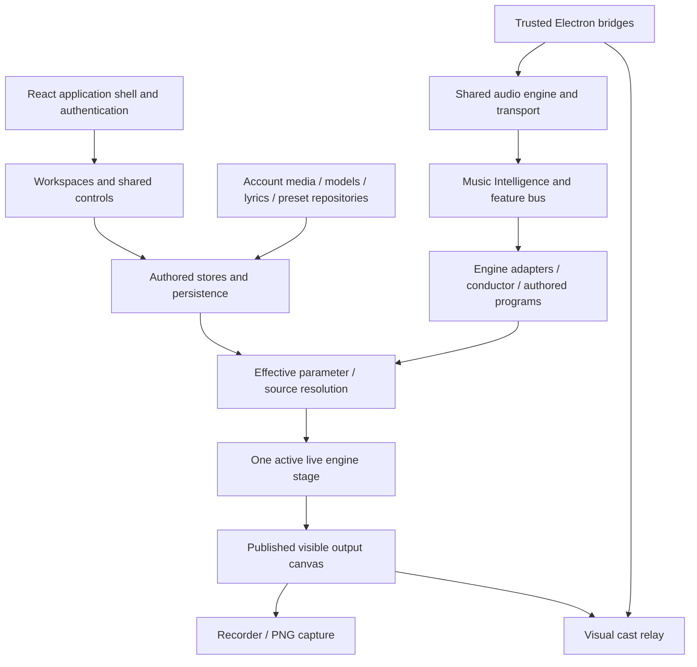

# DRMVYZ User Guide

> Application and architecture reference · reviewed 20 November 2026 · package version 1.0.0
>
> This manual describes the current repository implementation. It follows Downbeat's layered documentation approach: purpose, screen orientation, practical workflows, expandable references, limitations, troubleshooting, and source traceability. It is a Markdown document, not a newly implemented in-app help window. Search uses your Markdown reader's Find function; collapsible sections and diagrams depend on the reader.

## Contents

1. [Welcome and scope](#welcome-and-scope)
2. [First session](#first-session)
3. [Application navigation and visual language](#application-navigation-and-visual-language)
4. [React: the live visual workspace](#react-the-live-visual-workspace)
5. [Audio sources, transport, and Track Map](#audio-sources-transport-and-track-map)
6. [Music Intelligence and performance authority](#music-intelligence-and-performance-authority)
7. [Engine selection reference](#engine-selection-reference)
8. [Cinema 2.0](#cinema-20)
9. [Sound Drawing](#sound-drawing)
10. [Sound Drawing XY](#sound-drawing-xy)
11. [CANVAS](#canvas)
12. [LaserDMX](#laserdmx)
13. [PixGrid](#pixgrid)
14. [HEADLINER](#headliner)
15. [Performance Manager](#performance-manager)
16. [Preset Manager](#preset-manager)
17. [Media Manager](#media-manager)
18. [Lyric Manager](#lyric-manager)
19. [Show Manager](#show-manager)
20. [Settings, Brand Kit, notifications, and administration](#settings-brand-kit-notifications-and-administration)
21. [Recording, stills, casting, and production output](#recording-stills-casting-and-production-output)
22. [Mobile and design previews](#mobile-and-design-previews)
23. [Saving, identity, and recovery](#saving-identity-and-recovery)
24. [Architecture for advanced users and maintainers](#architecture-for-advanced-users-and-maintainers)
25. [Performance and resource limits](#performance-and-resource-limits)
26. [Recipes for common tasks](#recipes-for-common-tasks)
27. [Troubleshooting](#troubleshooting)
28. [Control reference](#control-reference)
29. [Glossary](#glossary)
30. [Source map and maintaining this guide](#source-map-and-maintaining-this-guide)

## Welcome and scope

DRMVYZ is a desktop and browser visual-performance application. It combines a shared audio transport and analysis system with seven selectable visual engines, preset and media libraries, performance pads, timed lyrics, show authoring, recording, and output routing.

The central activity is a performance: choose a visual engine and its content, provide audio, shape how the visuals react, and send the resulting stage to an audience or recording. Managers prepare reusable assets and assignments around that live workspace.

### Who should use this document

- **Performers:** start with First Session, React, your chosen engine, Performance Manager, and output.
- **Content authors:** read Media Manager, Preset Manager, Lyric Manager, Show Manager, and persistence.
- **Advanced operators:** use the authority, architecture, quality, and troubleshooting chapters to understand why a control or output behaves a particular way.
- **Maintainers:** use the source map and linked implementation references before changing shared behavior.

### How capability is described

| Term | Meaning in this guide |
| --- | --- |
| Implemented | A current code path exists; this does not certify every device, account, deployment, or musical input. |
| Reference / preview | A selectable review implementation; the label does not promise the same completeness as every accepted production preset. |
| Design mockup | A visual exploration, separate from a working production workflow. |
| Host dependent | Requires Electron, an operating-system capability, permissions, or a trusted native integration. |
| Deployment dependent | Requires configured authentication, storage, database policies, or a server-side provider. |
| Reserved / unavailable | A control may be shown but disabled; visibility alone is not proof of functionality. |

The presence of a preset card, hardware protocol name, mobile screen, or test fixture does not establish physical-device support. This distinction is especially relevant to LaserDMX output, mobile Remote, reference Cinema scenes, and cloud extraction.

## First session

### Prerequisites

Use a supported browser with Web Audio and WebGL2, or the Electron desktop application. Desktop integrations such as local display discovery and native DJ-software workflows require the desktop host. Camera and microphone sources require permission. Account-owned libraries require a valid configured session and the corresponding backend services.

For source development, the package specifies Node `>=22.12 <23`. `launch.command` starts the desktop development launcher; `npm run dev` starts Vite. Development commands are not necessary for someone using an installed build.

### Guided workflow: first audio-reactive visual

1. Sign in, then open **React** from the left navigation.
2. Select an engine using its engine card/dropdown. Start with a preset that does not require an unavailable private asset or camera.
3. Load a saved audio track or local track through the shared audio controls. Alternatively, choose Live Input and grant microphone permission.
4. Start playback or supply live sound. Confirm that the waveform, transport state, or analysis indicators correspond to that source.
5. Select a preset and inspect its **Design** controls before changing automation.
6. Adjust intensity, scale, and palette where supported. Start with modest changes so you can identify their effect.
7. Open **React** controls in the inspector to review routing or analysis. Enable Auto Performance only after observing the preset's manual baseline.
8. Test pause, seek, and a contrasting part of the song. A single loud moment is not a representative review of a whole performance.
9. Save the configuration using the relevant preset or workspace workflow. Check the save status and notifications.
10. Test recording or casting separately before relying on it for a performance.

### Source selection is not engine selection

The engine determines the visual system. A visual source can be text, SVG, media, geometry, camera imagery, or a selected model. An audio source supplies the music. A preset configures an engine. A performance pad can recall a preset. These are different selections and may have different persistence rules.

## Application navigation and visual language

### Main destinations

| Destination | Main job | Typical user decision |
| --- | --- | --- |
| React | Run and shape the active visual engine | What is performing now? |
| Performance Manager | Prepare shared pad assignments and colors | What should each pad recall? |
| Preset Manager | Browse, inspect, and manage preset records | Which configuration should I use or keep? |
| Show Manager | Author and organize show content and linked audio | How should content develop over a timeline? |
| Lyric Manager | Author, extract, review, and activate timed lyrics | Which lyric version should this saved track display? |
| Media Manager | Manage reusable media, fonts, and models | Which asset or version should a visual use? |
| Admin Console | Authorized administrative operations | Which server-approved administration tools may this account access? |

The production left navigation is permanently collapsed, with an active-icon notch and tooltips. Layout Lab opens the design workspace. Mobile App Preview runs the mobile app in a phone-sized window. Administrative visibility is permission dependent; hiding a navigation item is not the security boundary.

### Header, windows, tabs, and groups

A page header identifies the current workspace and contains relevant icon actions and shared status. Window headers identify regions such as a library, stage, or inspector. Tabs change content within a region; nested tabs refine the current task. Collapsible groups organize related controls without changing the selected engine.

The shared interface uses dark surfaces, cyan emphasis by default, subdued inactive states, and consistent iconography. Brand personalization can change applicable accent presentation. Space Grotesk serves structural headings; Manrope serves many field, tab, and value roles. Media artwork and lyric fonts are content choices, not replacements for interface typography.

Active tabs use accent text and an underline. Nested active tabs may use an accent dot. A dimmed or disabled control can mean missing prerequisites, a reserved surface, or a parameter owned by an active program. Read its label, tooltip, and ownership reason before assuming it is broken.

### Selection versus activation

Selecting a record for inspection does not always apply it to the live stage. Performance Manager deliberately separates browsing and assignment from performing a pad. Lyric Manager separates opening a version from activating it. Show and preset screens have their own explicit actions; verify the active engine/preset or version after a change.

## React: the live visual workspace

### Screen map

| Region | Purpose |
| --- | --- |
| Header | Workspace identity, contextual actions, save/load status, and performance information |
| Left workspace | Engine selection and source/setup tools, with engine-dependent tabs |
| Center stage | The active engine's visible live output |
| Right Inspector | Presets, Design, React, Output, and relevant nested surfaces according to the engine |
| Lower workspace | Track Map, optional Sound Drawing timeline, and Performance Pads |
| Bottom audio dock | Shared source selection, playback, waveform, timing, and related transport controls |

The shell stays consistent while tools change with the engine. An engine should not introduce a second independent audio transport or replace the application's shared output workflow.

### Left workspace by engine

| Engine | Current composition |
| --- | --- |
| Cinema 2.0 | SOURCE plus LAYERS, or POOL for supported text presets |
| Sound Drawing | SOURCE, MEDIA, FONTS |
| Sound Drawing XY | SOURCE; a separate MEDIA tab is reserved/disabled in the composition resolver. SVG selection is available through the supported source controls. |
| CANVAS | SOURCE and LAYERS |
| LaserDMX | RIG and LAYERS; beam-editor presentation is conditional |
| PixGrid | SOURCE, LAYERS, MEDIA |
| HEADLINER | SETUP and MEDIA for supported backdrop content |

The lower surface order is **Track Map → Sound Drawing → Performance Pads**, with Sound Drawing's timeline included only for the original Sound Drawing engine. Track Map and the cross-engine pads are shared.

### Inspector jobs

- **Presets:** discover and load supported configurations.
- **Design:** change the visual's authored construction and appearance.
- **React:** configure musical response and inspect analysis/routing where available.
- **Output:** configure recording or other engine-supported output controls.

Not every engine exposes every nested tab. The control set comes from the selected engine or preset rather than a universal list of identical sliders.

### Stage Focus

Stage Focus expands the live stage by hiding surrounding workspace presentation. It is session-only. It does not create another renderer, change pad assignments, rewrite a preset, or select a casting destination. Exit Stage Focus to resume detailed editing.

## Audio sources, transport, and Track Map

### Shared transport

The audio engine owns playback identity, time, playing/paused state, decoded waveform information, analysis inputs, and program-audio access. Managers and visual engines consume that shared state. A track's file name is not its complete identity.

Loaded tracks support seeking and whole-track analysis. Live Input supplies real-time sound and available live features, but does not inherently provide a known future arrangement. DJ-software integrations depend on the configured native workflow and authoritative metadata; they are not interchangeable with ordinary microphone capture.

### Practical transport workflow

1. Confirm the source shown in the dock.
2. Load the intended track and wait for loading/analysis status to settle.
3. Start playback through a user gesture when the browser requires it.
4. Seek using the shared waveform or timeline controls.
5. If timing is wrong, inspect detected BPM/grid and analysis provenance before compensating inside each visual engine.
6. After changing tracks, verify that the displayed title, waveform, lyrics, and sections belong to the replacement.

Pausing, stopping, seeking, and losing a source are different events. Engines may hold a pose, settle into a readable state, clear transient attacks, or release a temporary automatic override. The exact visual policy belongs to the engine.

### Track Map

Track Map exposes musical context such as beats, bars, phrases, sections, energy, and cue lanes supported by the current workspace. Analysis can include automatically detected material and explicitly edited/manual sections. A temporary BPM-derived grid must not be mistaken for fully analyzed structure.

Use Track Map to evaluate whether the visual is responding to meaningful song changes rather than simply pulsing at the same rate throughout. Section labels and confidence describe an interpretation of audio, not a guarantee that every musical event was detected correctly.

### Saved versus temporary audio

A saved audio record can own persistent relationships, including lyrics. An unpersisted local file does not automatically become the same record because its name matches a library item. Mobile local-file playback is also separate from uploading that file into the account.

Further reference: [loaded-audio-analysis.md](loaded-audio-analysis.md) and [music-intelligence.md](music-intelligence.md).

## Music Intelligence and performance authority

### The analysis layers

| Layer | Information supplied | Examples of visual use |
| --- | --- | --- |
| Audio bands | Sub, bass, low-mid, mid, high, air and normalized values | Geometry pressure, brightness, fine detail |
| Rhythm | Kick, snare, hat, transients and beat events | Short impact envelopes and accents |
| Musical grid | Beat phase, position in bar, bar and phrase boundaries | Quantized changes and long-form phrasing |
| Energy | Smoothed energy, flux, tension and complexity | Sustained intensity and movement development |
| Sections | Section type, progress and confidence | Build, drop, verse, breakdown behavior |
| Harmonic | Key, tonal and pitch estimates where available | Supported harmonic reactions and diagnostics |
| Stems and lyrics | Available stem curves and active lyric line/word | Vocal-sensitive effects and timed text |
| Semantic | Higher-level build/drop/fakeout/hook and mood evidence | Section-aware performance decisions |

Unavailable evidence should stay unavailable. A fallback tempo is not proof of a detected beat; a synthetic instructional trace is not proof of stereo capture.

### From audio to movement

The shared Music Intelligence engine assembles a frame and publishes it to an audio feature bus. The active visual path owns the appropriate analyzer pump. Engine adapters read this shared evidence and interpret it using engine-specific choreography. They do not each analyze the song independently.

The distinction explains an important failure mode: a renderer can be drawing successfully while receiving no fresh analysis frame. In that case, increasing a response slider cannot repair the missing publication path.

### Pattern, Pattern Change, Trigger, BPM Sync, and Auto Performance

| Control | Responsibility |
| --- | --- |
| Pattern | Select a visual arrangement or performance routine |
| Pattern Change | Permit movement between routines according to supported events |
| Trigger | Choose the event/boundary that advances a routine when that policy is active |
| BPM Sync | Relate the engine's supported motion clock to musical timing |
| Audio Reactivity | Scale the engine's musical contribution; zero behavior is engine specific |
| Auto Performance | Let the engine's supported conductor/program coordinate several responses over time |

**Pattern Change off does not mean animation off.** A routine may contain an entire evolving performance. Sound Drawing XY, for example, can leave lettering, perform a figure, and return while the same Pattern remains selected.

Auto Performance is not a second transport and does not imply every setting is automatically controlled. In Cinema's shared pattern policy, temporary build/drop routines can take precedence over a base routine, and mood can choose effective changes at boundaries. Other engines use their own authored programs and parameter ownership. Read the selected engine's behavior rather than assuming universal automation.

### Authored and resolved values

A saved setting is an authored value. The runtime may combine it with musical modulation, a temporary override, a lock, or an authored show. A live result changing does not necessarily mean the saved value was rewritten.

Sound Drawing explicitly distinguishes **Manual, Program, Locked, Mixed, and Unavailable** ownership. A program-owned control may be disabled; a mixed control can remain editable because the manual value still contributes. This is more precise than treating Auto Performance as a global interface lock.

## Engine-selection reference

| Selectable engine | Best suited to | Key input |
| --- | --- | --- |
| Cinema 2.0 | Native 3D scenes, typography, materials, lights and authored environments | Preset, optional model/text/media, shared audio |
| Sound Drawing | Waveform, shapes, text, SVG, lyric and authored drawing performances | Engine Mode and prepared source geometry |
| Sound Drawing XY | Phosphor-style beam drawings and evolving text/SVG performances | Word, SVG, or supported scope source |
| CANVAS | Uploaded media with compositing and reactive visual treatments | Video, image, SVG or authored media layers |
| LaserDMX | Virtual lighting rigs, beam matrices and show programming | Rig, fixtures, cues and musical context |
| PixGrid | LED-cell artwork, animation, media conversion and pixel shows | Artwork/layers, prepared media and performance program |
| HEADLINER | Camera-based performer effects | Camera, optional tracking/isolation and backdrop |

Shader Pads, Cinematic Worlds, and legacy Cinema remain known compatibility identities in code, but are not selectable engines in the current live catalog. Do not use an old screenshot as the current engine list.

## Cinema 2.0

### What it does

Cinema 2.0 is a native composition runtime. Presets describe scene nodes, cameras, lights, modules, parameters, effects, capabilities, choreography, and a render graph. The compiler validates that description; the stage executes it; the Inspector builds controls from the same manifests.

This architecture allows very different scenes to share the shell without copying a full workspace for each preset. A preset can use procedural geometry, imported GLBs, text, materials, lighting, and post-processing while preserving a single published output canvas.

### Guided workflow

1. Choose Cinema 2.0 and load a preset from its current catalog.
2. Check SOURCE for prerequisites: text, a private model, a media selection, or no additional input.
3. Open Design. Review Master Controls, Design, Effects where offered, and Palette.
4. Begin with the saved/default pattern and moderate movement.
5. Start audio and compare a quiet section, build, and drop.
6. Enable Auto Performance if the selected preset supports it, then observe which parameters or patterns are automatically resolved.
7. Recheck the source and Notifications after replacing an imported model or loading a different preset.

BPM Sync and Auto Performance, where offered in the standard Master Controls group, occupy its final positions. Pattern and automatic performance capabilities still vary by preset.

### Catalog interpretation

The first-party catalog separates keeper, reference, and foundation declarations. Some reference scenes are extensively implemented but await visual/musical approval; others are primarily static visual reviews. Catalog membership alone does not promise identical choreography.

Examples of specialized preset families include text/environment work such as SAY IT and Depth; architectural/circuit performances such as Mainframe; imported environment work such as Chamber; and scene-specific performances such as Glassfall, Inertia, Trippy Bro, and Neon Forest. Use the current card and inspector as the immediate source for the available controls.

**Glitch Array and Nested Pulse have been removed.** Their original supplied assets may remain in the asset inventory for preservation; an asset record is not an active preset registration.

### User-supplied 3D models

Select uploaded models from the left SOURCE library. Model bindings identify a model and a specific saved version. A later edit is not permission to silently replace a pinned version in an existing performance. Missing, deleted, inaccessible, or incompatible versions produce a loading/availability state rather than a substitute private asset.

The six model previews are:

| Preview | Representation and behavior to evaluate |
| --- | --- |
| 3D Form | Original model materials and bounded whole-model presentation |
| 3D Dust | Model-derived point representation with scattering and reconstruction behavior |
| 3D Hologram | Wireframe/scan and projection treatment based on the selected geometry |
| 3D Shatter | Prepared model fragments and separation/reassembly; not a physical destruction simulator |
| 3D Slices | Model-derived cuts/layers, with cap behavior constrained by valid contours |
| 3D Voxel | Capped voxel representation; fidelity depends on resolution, geometry and preparation limits |

These are reference previews. Later buildout sections supersede the early proxy-only descriptions in the phase document. They should not be described as either universal exact geometry conversion or simply generic built-in shapes.

The old torus-knot placeholder is removed: the model slot is empty while loading, after clearing, or on failure. Model selection belongs in SOURCE, not a duplicate Model search/thumbnail/create group in Design. Preparation warnings belong in the standard Notifications drawer, not duplicated cards in both rails.

Open or non-manifold contours can prevent valid cut-face caps. This is different from failure to load the whole model. Imported material appearance also depends on environment lighting, exposure, texture tiers, camera, and post-processing; matching GLB materials does not guarantee matching an external viewer's lighting.

### Rendering quality

Cinema quality tiers budget textures, geometry, effects and render targets. Current texture policy can reduce a model's largest maps to fit its allowance while retaining the saved source. An imported compressed file's size is not the decoded GPU cost. Inspect the actual resource warning and quality status before diagnosing a slow scene by file size alone.

Further reference: [cinema2-crate-previews.md](cinema2-crate-previews.md), [model-preview-phase06.md](model-preview-phase06.md), and [cinema2-rendering-architecture-upgrade.md](cinema2-rendering-architecture-upgrade.md).

## Sound Drawing

Sound Drawing is the `oscilloscope` engine, distinct from Sound Drawing XY. It supports classic scopes, built-in shapes, text, prepared SVG artwork, lyric sources, and authored drawing performances. Source preparation is cached outside the continuous drawing loop.

### Workflow

1. Choose the intended **Engine Mode** and provide its source.
2. For text, choose the text/font; for SVG, select the uploaded artwork; for classic scope, select its scope behavior.
3. Use Design to set rendering and appearance.
4. Review React routing/analysis, then choose a performance show or enable its supported automatic behavior.
5. If source ownership changes, inspect whether the show is using **Generated Show Visuals** or **Use Current Engine Source**.
6. Use the Sound Drawing timeline for supported drawing clips; this timeline is a sibling of Track Map, not a second audio clock.

Choosing a Performance Show starts it immediately. Missing text/SVG content can produce a disclosed generated fallback. A section change should not silently replace a stable user-selected source identity.

### Geometry and scope controls

Classic modes include waveform, Lissajous, radial and spiral scope behavior. Rendering modes include Outline, Multi Trace, Dots and Ribbon where supported. Shapes, font outlines and SVG geometry follow different preparation paths; a selected rendering style is not a new audio source.

Pro Scope adds signal-calibration controls. Review axis linking and trigger stability together with visual size; signal calibration is not the same operation as making the finished graphic larger. Trail decay and the authored trail recipe can also have separate ownership.

Further reference: [sound-drawing.md](sound-drawing.md) and [sound-drawing-control-ownership-and-provenance.md](sound-drawing-control-ownership-and-provenance.md).

## Sound Drawing XY

### Visual concept

Sound Drawing XY uses a phosphor-like beam to move between recognizable source artwork and full-field oscillator figures. Text is a recurring destination, not a permanent overlay. A complete routine can hold the word, unfold its outlines into traces, perform a large figure, and reconstruct the word.

Its dedicated runtime is separate from the original Sound Drawing renderer. It uses the application's shared audio and transport evidence rather than a separate beat detector.

### Sources and controls

The current workspace supports text/font sources and uploaded SVG selection with SVG processing options, as well as its supported oscillator/instrument presets. The separate generic MEDIA tab remains reserved in the shell; source controls are the path to SVG selection.

Start with a short, readable word or clean SVG. Select the source and processing mode, then adjust its supported beam, geometry, reaction and palette controls. SVG selection filters uploaded vector artwork; a raster image is not automatically an SVG contour.

### Complete routines

The original text routine catalog includes Word, Waveform, Stereo Scope, Ring, Rosette, Weave and Pinwheel. These are performance styles: perimeter traces, traversing signals, rings, petals, Lissajous figures and rotating strokes can develop between returns to lettering. Specialized XY instrument presets can expose additional dedicated design surfaces; their settings are not necessarily interchangeable with the original text routine.

- **Pattern Change off:** the chosen routine still performs its sequence and develops across visits.
- **Pattern Change on:** supported musical triggers queue another style; the text choreography can wait for its return point rather than interrupt every departure.
- **Manual Pattern selection:** restarts the selected routine from its authored starting state.
- **BPM Sync:** uses shared timing or the documented active-playback fallback.
- **Motion / Reactivity zero:** the original text performance settles to readable lettering; do not apply this behavior as a universal rule to every other engine.
- **Pause:** freezes the performance clock and can ease back to readable lettering.

If stereo capture is unavailable, inspect the disclosed fallback. A moving synthetic sine is not evidence that the engine received real left/right input.

Further reference: [sound-drawing-xy.md](sound-drawing-xy.md).

## CANVAS

CANVAS turns uploaded videos, images and SVGs into reactive visual performances. Its SOURCE tools select content; LAYERS author compositions. The engine can process a direct source or render an authored/show-owned composition. These ownership modes matter when comparing a preview with a recording.

### Workflow

1. Upload or select media in Media Manager.
2. Select CANVAS, a preset, and the compatible source.
3. Review fit, transforms, playback behavior and source reconstruction/dry contribution where offered.
4. Start audio, then tune effect amount before increasing glow or output intensity.
5. For compositions, select and manage actual layers rather than expecting a direct-source effect to rewrite the entire show.
6. Test seeking a video and switching sources before recording.

### Effect families

| Treatment | Main visual idea |
| --- | --- |
| SHIFTGRID | Spatial subdivision and mosaic/grid rearrangement |
| Data Bleed | Temporal bleeding and source reconstruction |
| Phase Drag | Temporal dragging and motion persistence |
| Cellular | Reaction–diffusion treatment |
| Terminal | Glyph-rendered imagery |
| Fluidity | Refraction/glass distortion |
| Divinity | Light shafts with optional source-alpha expansion |
| VHS | Tape/CRT presentation and phosphor afterglow |
| MUTAGEN | Dedicated procedural transformation patterns applied to the direct source |

Use each preset's source requirements and parameter descriptions. These names do not imply identical geometry, history, source mix, or transparency behavior.

### Output and source lifecycle

Direct-source treatments publish their processed snapshot through the shell capture compositor so the visible processed image can reach recording/casting. Authored layers and active Shows retain their own output ownership. A temporary video seek can hold the last drawable snapshot until a replacement frame is ready. An unavailable source must not leave stale output represented as a successful new load.

Further reference: [canvas.md](canvas.md).

## LaserDMX

LaserDMX combines virtual lighting presentation with rig, fixture, cue, routing and performance authoring. Beam Matrix and Show Director are different authoring contexts; a preset must be valid for the current context.

### Virtual workflow

1. Choose LaserDMX and the intended workspace mode.
2. Select or prepare the rig and fixtures.
3. Choose a supported look/preset and review layers and beam-editor tools where available.
4. Set fixture design, spatial behavior, optical presentation and atmosphere.
5. Configure musical routes and events, then rehearse builds, drops and transitions.
6. Inspect the normalized rig/output state before enabling any production-output session.

A virtual shaft, glow or fog image is a rendered effect. It does not demonstrate that a real fixture is connected, patched correctly, calibrated or safe.

### Production-output boundaries

The executable default is the in-process **virtual adapter**, which opens no network socket. Art-Net and sACN identifiers in renderer code describe protocols; physical UDP transmission requires an available trusted host adapter and the full output safety workflow.

Connected, Armed, Blackout, Rehearsal, and Error are separate states. Selecting a protocol does not arm fixtures. Emergency blackout and fail-dark behavior take precedence over authored output. Validation includes channel footprints, overlaps, stale frames, heartbeat timeout, exclusion zones, intensity/strobe limits and atmospheric cooldown rules.

For real laser equipment, follow the equipment's operator requirements and venue procedures. The software visualizer and a successful virtual test do not certify a physical installation.

Further reference: [laser-dmx-production-rig-architecture.md](laser-dmx-production-rig-architecture.md) and [laser-dmx-production-output.md](laser-dmx-production-output.md).

## PixGrid

### Rendering model

PixGrid is a programmable logical LED framebuffer. Artwork, layers, prepared media, cell edits, masks, group reactions and musical choreography combine before a WebGL2 pass displays distinct LED cells. Canvas2D is a bounded fallback.

The logical matrix is separate from the final window or video resolution. A 160 × 90 logical scene can be presented on a much larger output without becoming 160 × 90 conventional smooth video.

### Quality reference

| Tier | Logical matrix |
| --- | ---: |
| Draft | 64 × 36 |
| Low | 96 × 54 |
| High | 160 × 90 |
| Ultra | 256 × 144 |

Adaptive mode is the default. Requested and effective quality are separate. Adaptive safety can promote Draft to the effective Low floor or reduce work under pressure without rewriting the saved request. Fixed/adaptive policy has its own control; changing the tier alone does not toggle that policy.

### Editor workflow

1. Choose PixGrid and a preset such as Bass Beacon, Geometric Reactor or Pixel Parade.
2. Open **Edit PixGrid** to enter the stage editor; ordinary performance keeps the stage render-only.
3. Select scenes/layers and edit position, scale, rotation, masks, visibility, order and animation.
4. Use cell tools such as pencil, eraser, line, rectangle, fill, marquee, move, pan, zoom and eyedropper.
5. Add compatible static media through the Media Library, then adjust conversion, fit, palette, dithering and alpha.
6. Create smart groups and assign musical reactions.
7. Close the overlay and rehearse the complete song, including seek/loop behavior.

Supported media conversion includes PNG, JPEG, static WebP and SVG. Animated GIF/WebP, arbitrary video, sprite-sheet slicing and image sequences are not part of this documented media MVP.

### Groups, performance and brightness

Groups can target regions derived from selections, layer alpha, colors/luminance, connected components, borders, rows, columns, quadrants and radial/other masks. Group routes can control supported brightness, color, reveal, motion and effect operations using shared musical signals.

The output brightness factors are resolved once:

`Output Intensity × Authored Performance Trim × Cell Calibration`

Glow strength, halo radius and diffusion have different meanings. Raising all three to repair a dim artwork can obscure the actual source of the problem.

**Load Program Preset** replaces a broader matching preset. **Change Performance Program Only** preserves unrelated artwork and edits while changing the program and its program-specific overrides. Do not treat those actions as synonyms.

### Decks and compiled shows

PixGrid Deck authoring/compilation adds prepared scene and media scheduling to the existing engine. Decks and their generated presets are managed through their actual authoring/library integration, including Show Manager and Preset Manager. Check compilation and media availability before performing a generated preset; an editor preview is not proof that all compiled assets are ready. No separate future Visual Manager is required to use the current editor.

Further reference: [pixgrid.md](pixgrid.md).

## HEADLINER

HEADLINER processes a live camera source into performer-centered effects. The current effect catalog includes motion echo, ghost trails, smearing/melting, freeze/strobe clones, RGB ghost, face treatments, aura/outline, particles, silhouette, portal, X-ray, posterize and Virtual Backdrop treatments.

### Camera workflow

1. Select HEADLINER and an effect.
2. Choose/enable the camera through SETUP and grant operating-system/browser permission.
3. Verify a real camera image before tuning the effect.
4. For tracking/isolation effects, inspect the corresponding readiness or tracking notice.
5. For Virtual Backdrop, select the supported background through MEDIA.
6. Adjust Design and palette controls, then review response to both body motion and music.
7. Test the published stage in the intended recording/output path.

A camera can be permitted but unavailable because another application owns it or the device disconnected. Tracking/model readiness is a different state from camera permission. Background separation and face/body effects depend on the relevant available processing path; a valid microphone source does not supply a missing camera frame.

HEADLINER shares React's Track Map, transport context and performance pads. Its camera session and effect resources must be cleaned up when ownership ends rather than starting another audio engine.

## Performance Manager

### Layout and purpose

Performance Manager prepares the shared pad set without running another visualizer. Its left window selects an engine, the center holds expanded pads and Configuration, and the right window offers preset browsing and pad editing. The bottom dock is the shared audio dock.

Expanded manager pads and compact React pads are two presentations of the reusable production pad. Assigned pads have stable/default or explicitly selected accents. Empty pads are transparent. Press feedback is fast and releases promptly; it is not a persistent selected-state indicator.

### Drag a preset onto a pad

1. Choose the engine and find the preset in the right PRESETS window.
2. Drag the preset card onto the destination pad.
3. Review the confirmation naming the preset and pad shortcut.
4. Choose **Cancel** to keep the assignment, or **Link** to update it.
5. Check Notifications for the workflow result.
6. Return to live React pads and test the assignment.

Browsing a preset and clicking a manager pad do not perform that preset. Confirmed assignments update the shared pad state throughout the application. Explicit preset assignments take precedence over the pad's contextual engine action.

### Header and context actions

| Action | Result |
| --- | --- |
| Add | Link the selected preset to the selected/available pad through the supported workflow; can restore missing default slots when no preset is selected |
| Clear | Unlink the selected pad while retaining the slot |
| Clear all | Confirm before clearing assignments while preserving slots |
| Delete | Confirm before removing the selected slot |
| Reset | Confirm before restoring the default layout and assignments |
| Right-click → Edit | Inspect the pad and edit its explicit color |
| Right-click → Link | Enter the direct linking workflow for that pad |
| Right-click → Random | Choose another valid preset from the combined canonical catalogs |
| Right-click → Clear | Clear only the targeted assignment |

Direct linking has its own cancellation guard. Clicking a visible preset while linking assigns it without performing it; attempting an unrelated action offers cancellation. The drag-and-confirm workflow remains a separate path.

The lower Configuration area remains an unpopulated surface in the documented implementation. Assignment/color editing is implemented through actual pad workflows and the inspector; do not infer a configuration editor from an empty window heading.

Further reference: [performance-manager-phase01.md](performance-manager-phase01.md), including its later assignment and context-action sections.

## Preset Manager

### Screen map

- **Left Preset Library:** Presets, Favorites and Custom, search and category filtering.
- **Center:** Visualizer, Store and My Downloads surfaces.
- **Right Inspector:** Info, Design, React and Output.

Library cards show a primary preset title, engine label, preset-specific artwork, favorite action and supported capability indicators. A thumbnail is a catalog representation, not an independent running renderer or proof of available private media.

### Workflow

1. Search by name or narrow the category/library tab.
2. Select a record and inspect Info and its engine identity.
3. Apply/load through the supported action when you want it on stage.
4. Adjust supported Design/React controls and save a custom configuration using the provided workflow.
5. Use Favorites for quick discovery; it is not a separate visual engine.
6. Review Store/My Downloads status before assuming a remote item has been downloaded and installed.

The catalog aggregates engine-specific sources, including native Cinema and generated PixGrid Deck presets. A record can be discoverable while its required asset, account entitlement, download or compilation is unavailable. Library selection, application, editing and publishing remain different operations.

## Media Manager

Media Manager owns reusable uploaded content and its editing/version relationships. It is the appropriate place to prepare images, videos, audio, SVGs, fonts and supported 3D model assets before selecting them in an engine.

### Library and stage

The Media Library separates images and videos into their own groups with corresponding search inputs. Grid/list presentation uses the shared view control where offered. Other asset families have their corresponding browsing/editing paths. Selecting a card drives the media preview/stage and inspector; it does not automatically replace every live engine source.

### Import and edit workflow

1. Open the upload/import action and choose the intended files.
2. Review the file-type-specific validation and progress.
3. Select the resulting record, preview it, and inspect available metadata.
4. Edit supported image/video properties or create a derived asset through the supplied editor.
5. Save or Save As according to whether the workflow updates a record/version or creates another asset.
6. Return to the target engine and explicitly select the intended record/version.

The uploader advertises a general media maximum of **5 GB**, with separate font/model limits. This is an upload boundary, not a promise that a browser can decode or perform a 5 GB asset smoothly. Codec support, duration, decoded dimensions, model geometry and texture memory impose additional limits.

### 3D assets

The model pipeline supports uploaded/private assets and generated model workflows. Geometry/texture validation, preparation and engine use are separate stages. A successfully uploaded GLB may still fail a specific effect's preparation limits. A generated extrusion from an image/SVG is not an automatic reconstruction of an arbitrary photographic scene.

Preserve the distinction between the source asset, saved version, preview thumbnail, prepared effect geometry and live instance. Deletion guards exist because an asset may be referenced by a show or preset; read the confirmation rather than assuming deleting a card is harmless to all dependent content.

Further reference: [model-generator-phase02.md](model-generator-phase02.md) and [model-preview-phase06.md](model-preview-phase06.md).

## Lyric Manager

### Track-first ownership

A saved User Media audio row is the canonical owner of its lyrics. Loading a saved track preserves its persisted identity. Loading an unpersisted local file clears the previous runtime lyrics instead of borrowing lyrics by matching a title.

The left Track Workspace provides **Tracks, Import and AI Extract**. The main timeline and cue list edit timing and text. The right inspector provides document/version/presentation/review tools and Workflow Status.

### Guided workflow: extract and activate

1. Select a saved audio track and confirm it is the intended full-mix owner.
2. Load/analyze it as required for Track Map context.
3. Open AI Extract and choose its supported source and Cue Style.
4. If using a saved vocal stem, verify its relationship and timing offset to the full mix.
5. Start extraction and follow queued/processing/success/failure status.
6. Review the generated cues and word timing.
7. Save the edited version.
8. Explicitly activate the intended runtime version when replacement is required.
9. Enable global lyric display and play the full mix to confirm the result.

The configured extraction path uses the Groq transcription provider through the application's backend workflow. Provider deployment/credentials are not a user-side text field. Cue Styles include Hip-Hop / Rap, Balanced, Melodic and Vocal Chops.

The first successful extraction activates automatically only when the track has no active version. Later versions do not silently replace an active document. Opening or saving a document is not the same as activating it.

### Editing and review

- Click the waveform to seek.
- Drag a cue body to move it; drag an edge to change its duration.
- Expand cue records to edit words and precise timing.
- Use supported snapping modes such as milliseconds, frames, words or the authoritative detected grid.
- Use undo/redo for cue and word timing operations.
- Search literal text, case-insensitively, within the current cue filter.
- Open Review issues to focus the affected cue/word and timeline location.

Unreviewed, low-confidence, warning and error counts are different metrics. Cue count means lyric lines; word count means optional nested timed words. Reformat Cues creates a new version from available word timing without rewriting the source version or authoritative word timestamps.

Document presentation defaults include supported text color, font size/weight, alignment, anchor/position, opacity, animation and effect. Cue overrides inherit defaults until changed. A global display switch determines whether the actual active document renders during playback.

Further reference: [lyric-manager.md](lyric-manager.md) and [lyric-transcription-deployment.md](lyric-transcription-deployment.md).

## Show Manager

Show Manager organizes authored show records, groups/collections, linked audio, engine content and timeline-driven behavior. It has engine-aware authoring and right Inspector, Design and React surfaces. Track Map supplies the shared musical context.

### Workflow

1. Create or select the show or supported Deck authoring record.
2. Confirm the engine/context and linked audio record.
3. Build its supported content/layers/scenes and arrange timing.
4. Configure relevant design and musical routes.
5. Preview against the linked track and inspect missing media or compilation state.
6. Save, then use the supported activation/compiled-preset path.
7. Rehearse after reopening the record rather than relying only on unsaved editor state.

An authored show can own values that otherwise belong to manual controls. Treat show activation as a change of runtime authority, not merely another thumbnail selection. Deleting a show does not inherently delete its linked audio/media library records. Deck deletion can also remove its generated preset; read the specific confirmation.

Show Manager is unavailable from the navigation while the shared source is microphone/Live Input. Switch to an appropriate loaded-track source for timeline-based show work.

## Settings, Brand Kit, notifications, and administration

### Settings

Current settings destinations include **Account, Appearance, Brand Kit, System Settings, DJ Software and Developer**. Their exact options depend on the current host and deployment.

- **Account:** identity/session-related settings and account workflows.
- **Appearance:** shared UI presentation preferences.
- **Brand Kit:** reusable branding assets and palette authority.
- **System Settings:** application/device behavior exposed by the current build.
- **DJ Software:** supported DJ integration setup and status.
- **Developer:** diagnostics and logging tools for investigation.

Do not change provider secrets or invent backend configuration from a generic settings label. Report missing integration prerequisites using the actual status.

### Brand Kit

Brand Kit centralizes reusable palette and asset choices. It is separate from directly editing every preset's color controls. Its authority and supported engine integration determine when brand colors replace or combine with a preset's palette. Changing a kit is not permission to rewrite all saved presets.

Further reference: [brand-kit.md](brand-kit.md).

### Notifications

The bell opens the standard right-side Notifications drawer. It collects page/workflow activity, success/cancellation/failure results, and current runtime notices. Read the notice title and body for the affected workflow.

Examples include pad linking, missing private model versions, geometry preparation warnings and GPU-memory budget warnings. A warning about open cut contours is not the same as a fatal model-load failure. Persistent stage notices should resolve or disappear when the corresponding condition/runtime ends, rather than remaining as duplicate cards in both rails.

### Admin Console

Admin access is server verified. The navigation item appears only for an authorized account, and the administrative view checks access again. This manual does not grant privileges or document bypasses. Use the current authorized interface for administrative operations; ordinary visual-authoring tasks do not require administrative access.

## Recording, stills, casting, and production output

These are three different paths: capturing pixels/audio, transmitting a clean stage, and compiling hardware fixture intent. Success in one does not certify another.

### Video recording

React owns one recorder targeting the active engine's published live canvas. Thumbnail, helper/editor, hidden and stale canvases must not become its recording source.

1. Choose the active engine and confirm its stage is drawing.
2. Open the recording controls.
3. Select supported 30 or 60 FPS capture.
4. Start recording and verify whether the mode includes audio.
5. Stop and save/download the result; play the actual file to review it.

The browser path uses `captureStream()` and `MediaRecorder`. Codec selection prefers supported WebM VP9/VP8 variants, then generic WebM. It does not promise MP4 on every platform. If no program-audio track is available, recording continues as **video-only** and must say so. Ending capture must not stop the application's shared audio stream.

### Stills and audio export

PNG captures the current live canvas. WAV export uses the available shared ring buffer for a requested duration; it is not unlimited retrospective recording or an automatic export of every audio file in the account.

### Cast the visual stage

1. Use Cast beside Stage Focus in the lower visualizer toolbar.
2. Select the required presentation mode and aspect ratio.
3. Choose an available local display or supported DRMVYZ desktop receiver.
4. Confirm connected state and inspect the receiving output.
5. Use the session's eye button for a floating cast preview if needed.
6. Stop/disconnect explicitly when finished.

Window modes are Window, Borderless and Full Screen. Supported chooser aspects include 16:9, 16:10, 4:3, 3:2, 1:1 and 9:16. The receiver uses contained scaling and black surround rather than rewriting the engine's authored scene.

Local targets come from Electron's display inventory. LAN DRMVYZ receivers use discovery, scoped receiver/session tokens and WebRTC. A stable relay carries the clean stage across engine canvas replacement. The small movable cast preview samples that existing relay; it does not create a second engine, capture session or audio path.

AirPlay/Miracast displays are operating-system connections when exposed as displays. Do not infer arbitrary proprietary-device control from a casting icon or transport-related code. Browser-only builds explain the missing native bridge rather than fabricating devices. Other transport availability remains dependent on its actual adapter/session status.

### Fixture output

LaserDMX Production Output compiles normalized fixture frames and enforces its safety contract. Its virtual adapter is distinct from both recording and visual casting. Physical protocols require an implemented trusted-host path, explicit enablement, valid patching, arming and ongoing heartbeat/validation.

Further reference: [react-recording-and-output.md](react-recording-and-output.md).

## Mobile and design previews

### Real mobile application

Touch-first phones can receive a dedicated mobile shell after sign-in. Tablets retain the desktop shell under the documented detector. `?view=mobile` and `?view=desktop` provide remembered overrides.

| Screen | Current role |
| --- | --- |
| Perform | Engine selection and Cinema 2.0 Presets/Controls |
| Pads | Shared pads in banks of twelve; supported Cinema destinations perform, other-engine destinations are disabled |
| Visualizer | Live Cinema stage and Mic/Track audio selection |
| Remote | Static example/mockup desktop list with disabled controls |

Only Cinema 2.0 is selectable in the documented mobile engine implementation. No default preset is selected on the user's behalf. The phone can choose one local audio file up to **100 MB**; this playback path does not upload it into the account. Saved account tracks are a separate source.

The stage keeps its runtime/context while navigating between pages, but visual rendering is suspended when the Visualizer is not displayed or the browser tab is hidden. Mobile Controls can therefore address the same runtime without each screen creating a new engine.

Mobile casting, real desktop remote control, other engines and phone-side fullscreen stage are not part of the documented implemented mobile scope. Desktop casting capability does not imply those phone features exist.

### Pad synchronization

Account pad sets carry revisions. Unsynced edits are debounced; a fresh device with stock pads does not overwrite a customized cloud set. If the cloud revision wins a conflict, local unsynced pads are backed up before replacement. Device focus/visibility/network changes and periodic visible refresh keep state current. This is assignment synchronization, not live remote control of another device's renderer.

### Layout Lab and Mobile App Preview

Layout Lab is a design sandbox with named/stable tab identities. Its performance-pad and record-listing studies explore interface presentation. A renamed visible tab should retain its stable identity so future work can refer to the same study.

**Mobile App Preview** opens the running mobile application in a separate iPhone 16-sized window. Its phone icon is directly above Layout Lab in the desktop sidebar.

Further reference: [mobile-app.md](mobile-app.md), [mobile-preview-window.md](mobile-preview-window.md), and [layout-lab-design-workbench.md](layout-lab-design-workbench.md).

## Saving, identity, and recovery

### What is being saved?

| State | Typical owner | Important distinction |
| --- | --- | --- |
| Live engine settings | React engine/workspace stores and their persistence adapters | Authored values differ from transient resolved modulation |
| Custom preset | Engine-aware preset/catalog workflow | Not identical to saving the whole application session |
| Pad assignments/colors | Shared React pad state and account synchronization | Shared across manager/live/mobile surfaces within supported scope |
| Uploaded asset | Media repository/storage and saved versions | A thumbnail is not the original file |
| Lyric document/version | Saved audio identity and lyric persistence | Saved/open version differs from active runtime version |
| Show/Deck | Its authoring/persistence/compile workflow | Editable source differs from a prepared generated preset |
| Stage Focus and output safety session | Session state | Not an instruction to restore an armed hardware session |
| Decoded images, textures, streams, analysis buffers | Runtime/cache ownership | Disposable resources, not serialized preset content |

### Recovery habits

Check save/load status and relevant Notifications before closing a task. Reopen important presets, shows or lyric versions to verify the saved result. Keep source media accessible under its saved account/version identity. Avoid clearing browser storage as a first troubleshooting step: it can remove local unsynced settings or recovery backups.

Navigation guards protect dirty editors where implemented. A guard is a workflow-specific protection, not a promise that every slider movement creates an account-wide backup. Cloud/account synchronization and offline cached state have different failure conditions.

## Architecture for advanced users and maintainers

### System layers

This is a conceptual flow, not a statement that every engine shares one implementation class. Engine-specific runtimes preserve their own visual language while consuming common transport and evidence.

### Front end and native host

The front end uses React, TypeScript and Vite, with Zustand stores for important authored/application state. `App.tsx` owns authentication/mobile shell selection and shared application services. `VyzualzView` composes desktop destinations. React View and the workspace-composition resolver decide which tools an engine can actually consume.

Electron owns native windows and privileged operations. Its main process exposes restricted functionality through preload bridges rather than enabling arbitrary Node access inside the renderer. Output receiver windows are isolated/sandboxed. Browser builds retain supported web features while reporting unavailable native capabilities.

### Cinema runtime

The native preset registry and first-party declarations provide the registration seam. A manifest compiler checks identifiers, targets, capabilities and graph structure. Parameter state holds authored values; target resolution and choreography create effective runtime inputs. Modules own domain rendering, while the render graph schedules scene/effect passes.

The Three scene bridge leases assets and creates per-instance material behavior. Private model bindings resolve saved versions through authorized loading/cache paths. Controller-owned generated geometry/materials must be disposed separately from leased source assets. Releasing a private effect must not mutate or destroy the original cached GLB.

A post-processing effect has its own activation/parameter validation. A valid preset schema does not by itself guarantee its effect parameters or shaders will initialize on a real GPU.

### Audio authority and discontinuities

Analysis includes source/track identity and timing/provenance. Adapters should reject stale evidence from a previous track. Seek, loop, track replacement, stop and context recreation can reset temporary envelopes or authority. A musical event has an identity so repeated delivery does not mean a new kick/drop.

The active analyzer frame pump and bus ownership prevent independent engine loops from publishing contradictory analysis. Low-allocation frame reads keep high-frequency rendering outside ordinary React state churn where appropriate.

### Assets and backend

Supabase supplies configured authentication and account-backed data/storage workflows. Native file access, downloaded assets, decoded media caches and GPU buffers are different layers. A database record can exist while its file is unavailable; a file can load while its engine preparation fails; a prepared asset can exist while its shader fails. Diagnostics should identify the failing layer.

Sensitive provider credentials remain in their trusted/server environment. A client-side field, screenshot, console dump or guide should not expose signed private URLs or credentials.

### Output authority

The live renderer publishes its output rather than allowing recording or casting to discover an arbitrary canvas by proximity. A stable relay decouples receiver transport from engine canvas replacement. PixGrid thumbnails have their own renderer; CANVAS processed snapshots participate through their documented capture compositor; Cinema publishes its native stage.

LaserDMX fixture intent follows a separate normalized rig/frame contract. It should agree with virtual presentation semantically without treating video pixels as physical channel instructions.

## Performance and resource limits

### Diagnose the right bottleneck

| Symptom | Likely domain to inspect |
| --- | --- |
| Slow initial load, then smooth performance | Download, decoding, asset preparation or shader compilation |
| Consistently high frame time | Geometry, per-frame work, effect passes, output resolution or GPU load |
| GPU memory warning | Decoded textures, geometry, render targets and resident assets |
| Visual animates but does not react | Audio publication, source freshness, routing or parameter ownership |
| Preview works but capture is stale | Published canvas/compositor/relay ownership |
| Pad links but cannot perform | Destination validity, engine availability, mobile restriction or missing asset |

### Cinema GPU budgets

The current quality architecture uses approximate budgets of **96 MiB low, 160 MiB medium and 256 MiB high**. These are application estimates, not measurements of all memory on the graphics card or a guarantee that the browser will reserve that amount.

Texture tier policies cap dimensions and model allowances; render targets also consume memory proportional to width × height × format × pass count. A 4096-square uncompressed RGBA texture already requires about 64 MiB before mipmaps or additional maps. Several material maps can therefore dominate a small compressed GLB's runtime cost.

### Model preparation limits

The shared preview preparation checks limits before large allocations, including **250,000 source triangles, 1,024 meshes and 32 MiB of typed preparation buffers per attachment** in its documented preparation contract. These CPU preparation limits are separate from upload limits and GPU budgets. Later effect-specific geometry operations impose further bounded work and approximation rules.

### General operating practices

- Lower the relevant quality/effect cost before stripping out source assets blindly.
- Distinguish requested from effective/adaptive quality.
- Test output resolution, record FPS and receiver behavior on the actual performance machine.
- Reduce unnecessary simultaneous camera, recording and output work during diagnosis.
- A synthetic three-minute test or software-WebGL capture is useful evidence, but not a hardware benchmark or whole-song visual acceptance.

Do not repeatedly increase every intensity/brightness control to compensate for missing content. Check source readiness, palette/material settings, program ownership and output composition first.

## Recipes for common tasks

### Build a cross-engine performance set

1. Prepare the required media/models and choose working presets in their respective engines.
2. Open Performance Manager and assign each target pad using drag-and-confirm or the explicit linking workflow.
3. Set pad colors if useful; empty pads remain visibly distinct.
4. Test the pads in React rather than assuming manager selection performs them.
5. Confirm a Cinema-to-CANVAS-to-PixGrid handoff with the intended audio source.
6. Repeat while recording/casting to check output handoff, not just local selection.
7. On mobile, expect only supported Cinema destinations to be usable.

### Perform a custom logo as a 3D effect

1. Import the GLB through Media Manager and resolve any validation failures.
2. Save the intended model version.
3. Open a Cinema model preview and select it in SOURCE.
4. Wait for loading/preparation; the absence of a placeholder is intentional.
5. Begin with Form to assess baseline material and geometry appearance.
6. Try Dust, Hologram, Shatter, Slices or Voxel according to the intended treatment.
7. Read preparation warnings; inspect holes, caps and reconstruction at different amounts.
8. Save the preset binding, then reopen it to verify the pinned model/version.

### Prepare track-linked lyrics for a set

1. Use a saved full-mix audio track as owner.
2. Extract/import/edit a lyric version and verify timing.
3. Reformat into another version when useful, preserving original word timestamps.
4. Review errors and low-confidence cues.
5. Save and activate the intended version.
6. Enable lyric display and verify seek behavior against the full mix.

### Build LED artwork without losing the composition

1. Start in PixGrid with an authored preset or your prepared image.
2. Enter Edit PixGrid and edit layers/cells.
3. Define smart groups and reactions.
4. To try another choreography while preserving art, use Change Performance Program Only.
5. Use Load Program Preset only when you intend to replace the broader matching configuration.
6. Check effective quality and record a representative sequence.

### Rehearse a camera performance

1. Start HEADLINER and verify the camera source.
2. Choose a motion/outline effect before enabling more expensive tracking or backdrop work.
3. Check exposure, silhouette readiness and movement response.
4. Add audio and inspect the distinction between motion history and musical reactions.
5. Record a short file and check framing, audio mode and actual output.

## Troubleshooting

| Problem | Check first | Next action |
| --- | --- | --- |
| No visual appears | Active engine/preset, required source, runtime notice, output opacity | Select a known compatible preset; inspect Notifications and source readiness |
| Audio plays but nothing reacts | Analysis active/fresh, source identity, Reactivity, routing, program ownership | Inspect Analysis/Track Map; compare another section or engine without changing the source |
| Pattern looks static | Playback state, Movement/Speed, source readiness and preset capabilities | Keep Pattern Change off and test the chosen routine's own development; do not assume every reference scene is animated |
| XY word never leaves lettering | Original text routine's motion/reactivity and fresh shared audio frames | Restore meaningful response settings and inspect source/transport publication |
| SVG is not selectable | Actual uploaded SVG type and current source controls | Use the SVG source selector; the reserved generic MEDIA tab is not the required path |
| Model absent while loading | Private version loading and preparation status | Wait for completion or inspect the actual failure; the placeholder was removed intentionally |
| Model cuts have holes | Open/non-manifold contours and effect preparation warning | Repair source geometry or use a treatment that does not require closed cut caps |
| GPU-budget warning | Effective quality, decoded texture size, resident assets and output targets | Reduce quality/effect cost; inspect estimated resource use rather than compressed file size |
| Wrong lyrics show | Loaded saved-track ID and active lyric version | Activate the intended version for the actual saved track; do not link by title alone |
| AI extraction fails | Job status, saved source relationship, deployment/provider availability | Follow retry/error status; preserve editor work and report the bounded diagnostic |
| Manager click does not perform a pad | Manager browsing/selection is intentionally non-performing | Use React's live pad; finish confirmation if linking |
| Pad is disabled on phone | Destination engine is not supported on mobile | Use a Cinema destination or perform on desktop |
| Show Manager unavailable | Shared source is microphone | Switch to an appropriate loaded-track source |
| Recording lacks audio | Recorder reports video-only and program stream has no audio track | Verify the program-audio path and browser capability before another capture |
| Cast has no destinations | Browser build/native bridge, OS display connection or LAN receiver | Use desktop, expose the display in the OS, or verify the receiver/network |
| Cast preview closed | Preview visibility is separate from session state | Use the eye button; closing the small preview does not stop casting |
| Physical fixture output unavailable | Virtual adapter versus implemented trusted host | Do not infer a connected physical adapter from a protocol label |
| Camera effect is blank | Permission, selected camera, device ownership and tracking readiness | Release conflicting camera apps and recheck HEADLINER status |
| Changes appear lost | Wrong record/version, unsaved state, account, sync conflict | Check status/notifications and recovery path before clearing storage |
| Old preset missing | Retired engine/preset/catalog changes | Glitch Array and Nested Pulse were intentionally removed |

When reporting a problem, include the workspace, engine/preset, source type, action sequence, relevant error, and whether it occurs after pause/seek/track changes. Use bounded diagnostic IDs. Do not include credentials, private signed media URLs or raw account payloads.

## Control reference

Numeric defaults and ranges are engine/preset specific. Use the current control definition/Inspector rather than copying a value from another preset. The following reference explains roles without inventing a universal default.

<strong>Master Intensity / Output Intensity</strong>

Overall output strength within the selected engine's actual contract. It can affect light emission, model/proxy brightness, or a resolved framebuffer multiplier. It is not necessarily the same as opacity or audio gain. A zero setting does not universally hide every physical surface.

<strong>Pattern / Pattern Change / Trigger</strong>

Pattern selects a routine. Pattern Change allows supported event-driven selection changes. Trigger selects the corresponding musical boundary/event when that policy owns changes. Trigger choices can include beat/downbeat/bar/phrase/section/drop families depending on the engine. Manual edits and event deduplication protect against stale events immediately undoing a choice.

<strong>BPM Sync</strong>

Relates supported animation/performance timing to shared musical timing. Some implementations use a fixed 120 BPM reference when off; that fallback does not represent analyzed music. Inspect the selected engine's definition before expecting identical unsynced behavior everywhere.

<strong>Auto Performance</strong>

Enables the selected engine's automatic program/conductor behavior. It may coordinate section development, temporary build/drop patterns, effects, lighting and camera contributions. Saved settings, runtime overrides, locks and program ownership are separate. It is not synonymous with Pattern Change.

<strong>Audio Reactivity / response amounts</strong>

Scale supported musical modulation. Bass, mid/high, percussion and structural responses can have independent routes. Zero may preserve baseline animation or settle a specific performance to its rest state; the engine chapter defines which. Increasing reactivity cannot supply missing analysis or media.

<strong>Movement Amount / Speed / Transition Length</strong>

Amount changes displacement/intensity of motion; speed changes rate; transition length changes phrasing or duration. They are distinct controls. A held pose can still receive lighting accents where designed. A scene's movement-speed zero should not be assumed to stop audio transport.

<strong>Palette / model tint / Brand Kit</strong>

Palette roles name visual consumers such as body, signal, secondary or background. Model tint can be opt-in to preserve imported materials. Brand Kit supplies a separate supported branding authority. Background color is not automatically an environment-lighting or material-exposure control.

<strong>Glow / Bloom / Trails</strong>

Glow usually controls luminous source or halo strength; bloom spreads bright pixels through post-processing; trails retain earlier image/beam history. They have different cost and appearance. Trail locks and authored recipes can have independent ownership in Sound Drawing.

<strong>Source Reconstruction / dry contribution</strong>

CANVAS treatments can blend or reconstruct the original source while applying their own effects. The exact clean endpoint and alpha behavior are preset specific. Direct-source values should not be assumed to override authored/show-owned composition output.

<strong>Quality / Adaptive Quality</strong>

Requested quality is a user preference; effective quality describes what the renderer currently runs. Adaptive policy can change effective work under pressure. PixGrid additionally separates logical matrix resolution from final output dimensions. Quality is not a substitute for validating a missing or incompatible source.

### Keyboard and accessibility notes

Use visible labels/tooltips and focus indicators for icon-only actions. Text inputs, searchable dropdowns and confirmation dialogs retain their shared keyboard behavior; Escape closes/cancels the relevant supported overlay rather than universally stopping playback. Pad shortcuts follow each pad's displayed shortcut and the live focus/ownership rules. Do not assume a global shortcut is armed while typing in an editor or interacting with a modal.

This guide intentionally does not invent a universal Space/record/blackout keyboard mapping. Use the actual action tooltip and current engine controls.

## Glossary

| Term | Meaning |
| --- | --- |
| Active preset | Configuration currently loaded into the relevant engine/runtime |
| Authored value | A user's or preset's saved base setting |
| Resolved value | Effective runtime input after applicable modulation and authority |
| Band | A frequency-range energy signal |
| Beat / bar / phrase | Increasing musical timing units used by supported choreography |
| BPM | Beats per minute; an estimate/grid value is not automatically a perfect analysis |
| Canonical event | An event with shared identity/provenance, consumed without inventing duplicate hits |
| Cue | A timed action or lyric record, depending on the workspace |
| Deck | Engine-specific authored/compiled show content; not synonymous with every preset |
| Feature bus | Shared publication point for Music Intelligence frames |
| Framebuffer | Pixel storage holding a composed visual frame |
| GLB | Binary glTF asset containing model data and possibly textures/animations |
| GPU budget | Estimated graphics resource allowance under the current quality policy |
| Keeper / reference | Catalog declaration roles, not identical guarantees of human acceptance |
| Layer | An authored composition element, with engine-specific semantics |
| Live canvas | The visible stage surface published for capture/output |
| Model binding | Reference to a model identity and saved version |
| Non-manifold / open contour | Geometry condition that can prevent valid closed cut faces |
| Pad assignment | Shared mapping from a pad slot to an explicit action or preset destination |
| Palette role | A named color consumer within a preset/engine |
| Program | Authored performance policy with engine-specific choreography |
| Relay | Stable output surface used to carry the live stage across renderer changes |
| Source identity | Authoritative track/asset identifier, not just a display name |
| Stem | An isolated or separated component of a mix, such as vocals |
| Track Map | Shared timeline view of available musical structure and cues |
| Virtual adapter | In-process production-output target without physical network transmission |
| WebRTC | Real-time transport used by supported visual receiver sessions |
| WebGL2 | GPU rendering API used by supported engine paths |
| WebM | Container selected by the browser recording path where supported |

## Source map and maintaining this guide

### Reader-facing references

| Subject | Detailed reference |
| --- | --- |
| Shared shell and visual language | [React View architecture](react-view-architecture.md) |
| Audio identity, cache and fallbacks | [Loaded audio analysis](loaded-audio-analysis.md) |
| Analysis layers | [Music Intelligence](music-intelligence.md) |
| Cinema imported scenes and removals | [Cinema crate previews](cinema2-crate-previews.md) |
| User-model effects and later corrections | [Model preview implementation](model-preview-phase06.md) |
| Native Cinema rendering | [Rendering architecture](cinema2-rendering-architecture-upgrade.md) |
| Original drawing engine | [Sound Drawing](sound-drawing.md) |
| Parameter ownership | [Sound Drawing ownership](sound-drawing-control-ownership-and-provenance.md) |
| XY performance | [Sound Drawing XY](sound-drawing-xy.md) |
| Media performances | [CANVAS](canvas.md) |
| Pixel authoring and Decks | [PixGrid](pixgrid.md) |
| Rig architecture | [LaserDMX rig](laser-dmx-production-rig-architecture.md) |
| Fixture-output boundaries | [LaserDMX output](laser-dmx-production-output.md) |
| Pad workflows and later additions | [Performance Manager](performance-manager-phase01.md) |
| Lyric authoring | [Lyric Manager](lyric-manager.md) |
| Extraction deployment | [Lyric transcription](lyric-transcription-deployment.md) |
| Branding | [Brand Kit](brand-kit.md) |
| Capture and casting | [Recording and output](react-recording-and-output.md) |
| Real mobile shell | [Mobile app](mobile-app.md) |
| Desktop phone preview | [Mobile App Preview](mobile-preview-window.md) |
| Design sandbox | [Layout Lab](layout-lab-design-workbench.md) |
| Desktop launch and icon | [Desktop launcher](desktop-launcher.md) |

### Canonical code entry points

Paths below are relative to the repository root. They are implementation references, not user-editable configuration files.

| Area | Entry points |
| --- | --- |
| Application/auth/mobile selection | `src/App.tsx` |
| Desktop destinations and navigation | `src/components/vyzualz/VyzualzView.tsx`, `VyzualzSidebar.tsx` |
| Engine list | `src/components/vyzualz/react/reactEngineCatalog.ts` |
| Live workspace composition | `src/components/vyzualz/react/ReactView.tsx`, `reactWorkspaceComposition.ts` |
| Shared audio | `src/context/AudioEngineContext.tsx`, `src/features/musicIntelligence/` |
| Native Cinema | `src/components/vyzualz/cinema2/runtime/`, `contracts/`, `parameters/`, `presets/`, `modules/` |
| XY scope | `src/components/vyzualz/react/xyScope/` |
| HEADLINER | `src/components/vyzualz/react/headliner/` |
| PixGrid | `src/components/vyzualz/react/pixGrid/` |
| Preset and pad managers | `src/components/vyzualz/presetManager/`, `performanceManager/` |
| Shared authored state | `src/stores/reactStore.ts` and domain stores |
| Lyrics | `src/features/lyrics/`, `src/stores/lyricsStore.ts` |
| Media and model preparation | `src/components/vyzualz/media/`, `src/features/media/`, `src/components/vyzualz/cinema2/model/` |
| Recording | `src/hooks/useRecorder.ts` |
| Output controls | `src/components/vyzualz/react/output/` |
| Desktop host and native bridges | `electron/main.cjs`, `native/output/`, `native/rekordbox/` |
| UI typography and tabs | `src/styles/typography.css`, `src/styles/tabRows.css` |

### Documentation rules for future updates

1. Update the affected workflow and limitation when behavior changes; a version/date bump alone is insufficient.
2. Verify current registries and implementation before carrying forward an older phase document's claims. Later corrections can supersede earlier tables within the same file.
3. Keep production, reference, prototype and host/deployment-dependent functionality distinguishable.
4. Preserve stable heading anchors when renaming visible titles, or update every incoming link.
5. For screenshots, capture actual current screens, label the date/state, and annotate without redrawing controls. Do not present generated concept imagery as a production screenshot.
6. If this manual becomes an interactive guide, retain stable article IDs and use one canonical content source for web/PDF. Add contextual screenshot callouts, filterable status/type metadata, control deep links and guided-step UI without pretending screenshots are live controls.
7. Validate links, anchors, file paths and factual ranges after edits. Test actual UI workflows when behavior changes; documentation-only edits do not need an expensive application build.

This document is a source-reviewed manual, not a new certification of every engine, server deployment, physical receiver, camera, phone or lighting installation. No automated guide-update enforcement or interactive help application is created by adding this Markdown file.
